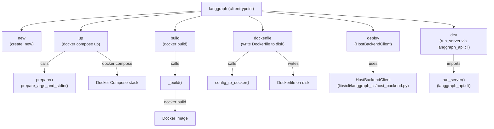
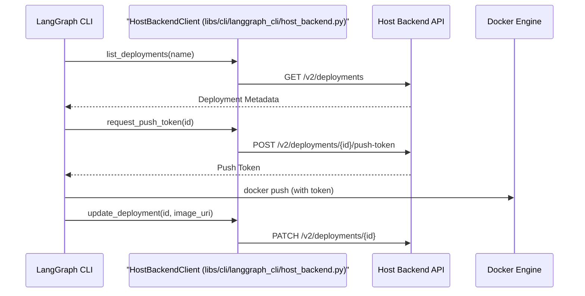

<!-- source: DeepWiki mcp.deepwiki.com · repo langchain-ai/langgraph · page 6.1 CLI Commands · fetched 2026-10-26 -->

# CLI Commands

<details>
<summary>Relevant source files</summary>

The following files were used as context for generating this wiki page:

- [libs/cli/langgraph_cli/__init__.py](libs/cli/langgraph_cli/__init__.py)
- [libs/cli/langgraph_cli/cli.py](libs/cli/langgraph_cli/cli.py)
- [libs/cli/langgraph_cli/config.py](libs/cli/langgraph_cli/config.py)
- [libs/cli/langgraph_cli/deploy.py](libs/cli/langgraph_cli/deploy.py)
- [libs/cli/langgraph_cli/host_backend.py](libs/cli/langgraph_cli/host_backend.py)
- [libs/cli/langgraph_cli/progress.py](libs/cli/langgraph_cli/progress.py)
- [libs/cli/langgraph_cli/util.py](libs/cli/langgraph_cli/util.py)
- [libs/cli/pyproject.toml](libs/cli/pyproject.toml)
- [libs/cli/tests/unit_tests/cli/test_cli.py](libs/cli/tests/unit_tests/cli/test_cli.py)
- [libs/cli/tests/unit_tests/test_config.py](libs/cli/tests/unit_tests/test_config.py)
- [libs/cli/tests/unit_tests/test_deploy_helpers.py](libs/cli/tests/unit_tests/test_deploy_helpers.py)
- [libs/cli/tests/unit_tests/test_host_backend.py](libs/cli/tests/unit_tests/test_host_backend.py)
- [libs/cli/tests/unit_tests/test_logs_helpers.py](libs/cli/tests/unit_tests/test_logs_helpers.py)
- [libs/cli/tests/unit_tests/test_util.py](libs/cli/tests/unit_tests/test_util.py)
- [libs/cli/uv.lock](libs/cli/uv.lock)

</details>


This page documents all commands provided by the `langgraph-cli` package, covering their options, arguments, and typical usage. The CLI is the primary interface for running, building, and scaffolding LangGraph deployments.

For the `langgraph.json` configuration format consumed by these commands, see page [6.2](). For how the Dockerfile is generated from configuration, see page [6.3](). For the Docker Compose multi-service orchestration behavior, see page [6.4](). For the in-memory development server internals, see page [6.5]().

---

## Overview

The `langgraph` CLI is installed as a script entry point from the `langgraph-cli` package [libs/cli/pyproject.toml:36-37](). It is implemented as a Click group defined in `langgraph_cli.cli:cli` [libs/cli/langgraph_cli/cli.py:214-215](). The CLI utilizes `click.Group` with a custom `NestedHelpGroup` class to format nested subcommands in the top-level help output [libs/cli/langgraph_cli/cli.py:185-210]().

The CLI supports the following primary commands:

| Command | Purpose |
|---|---|
| `langgraph new` | Scaffold a new project from a template |
| `langgraph dev` | Run API server locally with hot reloading (no Docker) |
| `langgraph up` | Launch full Docker Compose stack |
| `langgraph build` | Build a Docker image for deployment |
| `langgraph dockerfile` | Write a Dockerfile (and optionally docker-compose.yml) to disk |
| `langgraph deploy` | Deploy a project to LangGraph Cloud/Host Backend |

**Installation:**

```bash
pip install langgraph-cli          # up/build/dockerfile/new only
pip install "langgraph-cli[inmem]" # also enables: langgraph dev
```

The `inmem` extras group adds `langgraph-api` and `langgraph-runtime-inmem` as dependencies [libs/cli/pyproject.toml:24-28]().

---

## Command Flow Diagram

**CLI Command Dispatch and Data Flow**



Sources: [libs/cli/langgraph_cli/cli.py:214-220](), [libs/cli/langgraph_cli/host_backend.py:19-43](), [libs/cli/langgraph_cli/cli.py:17-21]()

---

## `langgraph new`

Creates a new project directory from a template.

```bash
langgraph new [PATH] [--template TEMPLATE]
```

**Arguments and Options:**

| Parameter | Type | Description |
|---|---|---|
| `PATH` | argument (optional) | Target directory for the new project |
| `--template` | string option | Template name (see `TEMPLATE_HELP_STRING`) |

Implemented by the `new` function, which delegates to `create_new` from `langgraph_cli.templates` [libs/cli/langgraph_cli/cli.py:21]().

Sources: [libs/cli/langgraph_cli/cli.py:21]()

---

## `langgraph dev`

Runs the LangGraph API server in-process (no Docker) with hot reloading. Requires the `inmem` extras [libs/cli/pyproject.toml:24-28]().

**Behavior:**
1. Validates the config file via `validate_config_file` [libs/cli/langgraph_cli/cli.py:1003-1004]().
2. Raises an error if the config specifies a `node_version` as JS graphs are not supported in the in-memory server [libs/cli/langgraph_cli/cli.py:1008-1011]().
3. Adds the current working directory and local dependency paths to `sys.path` to ensure graph code is importable [libs/cli/langgraph_cli/cli.py:1016-1020]().
4. Calls `run_server` imported from `langgraph_api.cli` [libs/cli/langgraph_cli/cli.py:1024-1025]().

Sources: [libs/cli/pyproject.toml:24-28](), [libs/cli/langgraph_cli/cli.py:1003-1025]()

---

## `langgraph deploy`

Deploys the project to a remote LangGraph host backend (e.g., LangGraph Cloud).

```bash
langgraph deploy [DEPLOYMENT_NAME] [OPTIONS]
```

**Key Features:**
- **Deployment Resolution:** Resolves existing deployments by name or ID using `list_deployments` [libs/cli/langgraph_cli/host_backend.py:94-99]().
- **Environment Management:** Resolves secrets from `.env` or `langgraph.json`, filtering out reserved variables defined in `RESERVED_ENV_VARS` [libs/cli/langgraph_cli/deploy.py:34-79]().
- **Push Token Auth:** Requests a temporary push token to authenticate with the registry via `request_push_token` [libs/cli/langgraph_cli/host_backend.py:107-111]().
- **Log Streaming:** Monitors build and deployment logs in real-time using `get_build_logs` and `get_deploy_logs` [libs/cli/langgraph_cli/host_backend.py:186-205]().
- **Internal Source Support:** Can trigger remote builds using uploaded tarballs via `update_deployment_internal_source` [libs/cli/langgraph_cli/host_backend.py:141-172]().

**Host Backend Interaction**



Sources: [libs/cli/langgraph_cli/host_backend.py:73-136](), [libs/cli/langgraph_cli/host_backend.py:19-43](), [libs/cli/langgraph_cli/deploy.py:17]()

---

## `langgraph up`

Launches the full production-like Docker Compose stack: the LangGraph API service, a PostgreSQL database (with `pgvector`), and Redis.

**Behavior:**
1. Calls `prepare()`, which validates the config and generates Docker Compose YAML via `prepare_args_and_stdin()` [libs/cli/langgraph_cli/cli.py:461-490]().
2. Generates an inline Dockerfile if no image is provided, including automatic installation of local dependencies [libs/cli/tests/unit_tests/cli/test_cli.py:141-158]().
3. Configures healthchecks for services like `langgraph-postgres` and `langgraph-redis` to ensure dependencies are ready before the API starts [libs/cli/tests/unit_tests/cli/test_cli.py:87-112]().
4. Monitors the startup sequence and prints the ready URL once the API reports "Application startup complete".

Sources: [libs/cli/langgraph_cli/cli.py:29-170](), [libs/cli/tests/unit_tests/cli/test_cli.py:52-172]()

---

## Config File Validation

All commands that accept `--config` call `validate_config()` from `langgraph_cli.config` [libs/cli/langgraph_cli/config.py:170](). This function enforces strict schema rules:

- **Python Version:** Must be `>=3.11`. Defaults to `3.11` [libs/cli/langgraph_cli/config.py:81-82]().
- **Node Version:** Must be major version only (e.g., "20"). Defaults to `20` [libs/cli/langgraph_cli/config.py:17-18, 145-155]().
- **Distro:** Supports `debian` (default) and `wolfi` [libs/cli/langgraph_cli/config.py:84]().
- **Security Warning:** If `image_distro` is not `wolfi`, the CLI issues a security recommendation via `warn_non_wolfi_distro` [libs/cli/langgraph_cli/util.py:12-50]().
- **Build Commands:** Validates `build_command` to block disallowed characters like backticks or single ampersands via `has_disallowed_build_command_content` [libs/cli/langgraph_cli/config.py:72-78]().

Sources: [libs/cli/langgraph_cli/config.py:170-212](), [libs/cli/langgraph_cli/util.py:12-50]()

---

## Internal Helper Functions

### `prepare_args_and_stdin()`
This function is the core of the `up` command. It constructs the Docker Compose arguments and the dynamic YAML configuration passed via stdin.

- **Service Mapping:** Configures `langgraph-api`, `langgraph-postgres`, and `langgraph-redis` [libs/cli/tests/unit_tests/cli/test_cli.py:84-133]().
- **Volume Management:** Sets up `langgraph-data` for persistent PostgreSQL storage [libs/cli/tests/unit_tests/cli/test_cli.py:81-83]().
- **Debugger Integration:** Optionally injects the `langgraph-debugger` service if a port is provided [libs/cli/tests/unit_tests/cli/test_cli.py:113-122]().

Sources: [libs/cli/tests/unit_tests/cli/test_cli.py:52-172]()

### `HostBackendClient`
A minimal JSON HTTP client used for remote deployment operations.

- **Authentication:** Uses `X-Api-Key` and optional `X-Tenant-ID` headers [libs/cli/langgraph_cli/host_backend.py:31-36]().
- **Retries:** Implements automatic retries via `httpx.HTTPTransport(retries=3)` [libs/cli/langgraph_cli/host_backend.py:30]().
- **Logging:** Provides methods to fetch build logs (`get_build_logs`) and deployment logs (`get_deploy_logs`) [libs/cli/langgraph_cli/host_backend.py:186-205]().

Sources: [libs/cli/langgraph_cli/host_backend.py:19-43](), [libs/cli/langgraph_cli/host_backend.py:186-205]()

---

