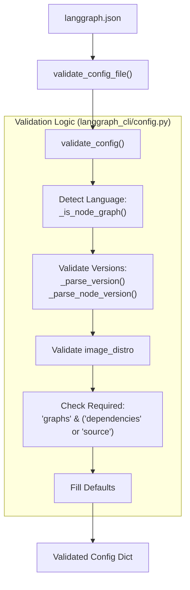
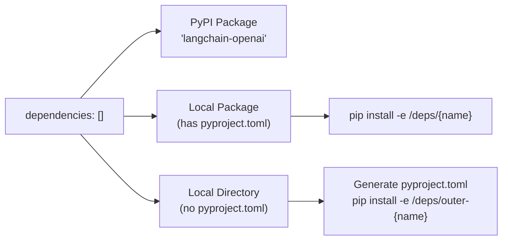
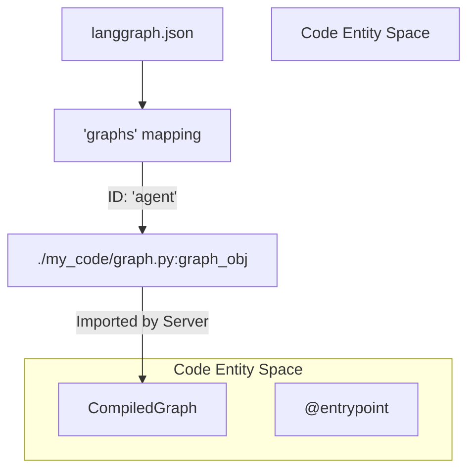
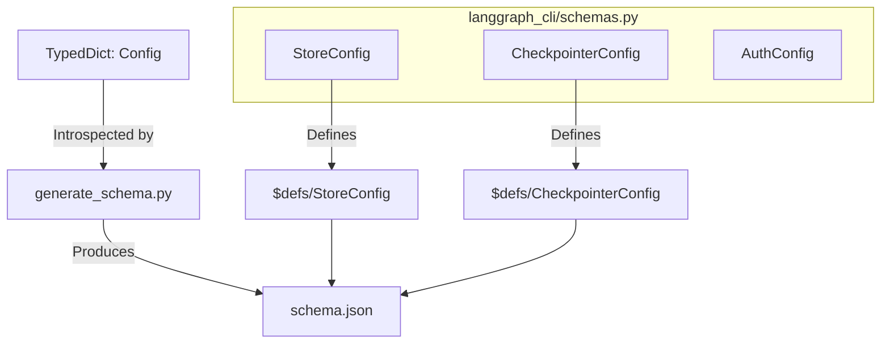

<!-- source: DeepWiki mcp.deepwiki.com · repo langchain-ai/langgraph · page 6.2 Configuration System (langgraph.json) · fetched 2026-10-26 -->

# Configuration System (langgraph.json)

<details>
<summary>Relevant source files</summary>

The following files were used as context for generating this wiki page:

- [libs/cli/generate_schema.py](libs/cli/generate_schema.py)
- [libs/cli/langgraph_cli/__init__.py](libs/cli/langgraph_cli/__init__.py)
- [libs/cli/langgraph_cli/cli.py](libs/cli/langgraph_cli/cli.py)
- [libs/cli/langgraph_cli/config.py](libs/cli/langgraph_cli/config.py)
- [libs/cli/langgraph_cli/schemas.py](libs/cli/langgraph_cli/schemas.py)
- [libs/cli/pyproject.toml](libs/cli/pyproject.toml)
- [libs/cli/schemas/schema.json](libs/cli/schemas/schema.json)
- [libs/cli/schemas/schema.v0.json](libs/cli/schemas/schema.v0.json)
- [libs/cli/tests/unit_tests/cli/test_cli.py](libs/cli/tests/unit_tests/cli/test_cli.py)
- [libs/cli/tests/unit_tests/test_config.py](libs/cli/tests/unit_tests/test_config.py)
- [libs/cli/uv.lock](libs/cli/uv.lock)

</details>


The `langgraph.json` configuration file is the central control mechanism for LangGraph CLI commands. It declares dependencies, graph definitions, runtime settings, and deployment parameters used by `langgraph build`, `langgraph up`, `langgraph dev`, and `langgraph deploy` to construct Docker images and configure the LangGraph API server.

For information about CLI commands that consume this configuration, see [6.1](). For information about the Dockerfile generation process, see [6.3]().

---

## Configuration File Structure

The `langgraph.json` file uses a JSON structure with required and optional fields. The configuration is loaded and validated by the `validate_config_file()` and `validate_config()` functions in `langgraph_cli/config.py` [libs/cli/langgraph_cli/config.py:20-22]().

### Required Fields

| Field | Type | Description |
|-------|------|-------------|
| `dependencies` | `array[string]` | Package dependencies. Can be PyPI names (e.g., `"langchain_openai"`) or local paths starting with `"."` (e.g., `"./my_package"`). Required unless `source` is provided [libs/cli/langgraph_cli/cli.py:48-51](). |
| `graphs` | `object` | Mapping from graph ID to graph location. Values are strings in format `"./path/to/file.py:attribute"` or objects with a `path` key [libs/cli/langgraph_cli/cli.py:52-53](). |

### Optional Fields

| Field | Type | Default | Description |
|-------|------|---------|-------------|
| `python_version` | `string` | `"3.11"` | Python version: `"3.11"`, `"3.12"`, or `"3.13"`. Must be `major.minor` [libs/cli/langgraph_cli/config.py:81-82](). |
| `node_version` | `string` | `"20"` | Node.js major version (e.g., `"20"`). Detected if `.ts`/`.js` files are used [libs/cli/langgraph_cli/config.py:17-18](). |
| `pip_installer` | `string` | `"auto"` | Package installer: `"auto"`, `"pip"`, or `"uv"` [libs/cli/tests/unit_tests/test_config.py:150](). |
| `pip_config_file` | `string` | `null` | Path to pip configuration file [libs/cli/langgraph_cli/cli.py:56](). |
| `base_image` | `string` | `null` | Custom base Docker image [libs/cli/schemas/schema.json:66-76](). |
| `image_distro` | `string` | `"debian"` | Base image distribution: `"debian"`, `"wolfi"`, or `"bookworm"` [libs/cli/langgraph_cli/config.py:84](). |
| `dockerfile_lines` | `array[string]` | `[]` | Additional Dockerfile instructions [libs/cli/langgraph_cli/cli.py:57](). |
| `env` | `string \| object` | `{}` | Path to `.env` file or object mapping env vars [libs/cli/langgraph_cli/cli.py:54](). |
| `auth` | `object` | `null` | Authentication configuration [libs/cli/schemas/schema.json:55-65](). |
| `encryption` | `object` | `null` | Encryption configuration [libs/cli/schemas/schema.json:102-112](). |
| `checkpointer` | `object` | `null` | Checkpointer configuration [libs/cli/schemas/schema.json:77-87](). |
| `store` | `object` | `null` | Store configuration (TTL, indexing) [libs/cli/langgraph_cli/schemas.py:83-108](). |
| `http` | `object` | `null` | HTTP app configuration (custom routes, CORS) [libs/cli/langgraph_cli/schemas.py:228-232](). |
| `keep_pkg_tools` | `bool \| array` | `null` | Retain packaging tools (`pip`, `setuptools`, `wheel`) in final image [libs/cli/schemas/schema.json:167-183](). |

**Sources:** [libs/cli/langgraph_cli/config.py:16-155](), [libs/cli/langgraph_cli/cli.py:41-101](), [libs/cli/schemas/schema.json:12-195](), [libs/cli/langgraph_cli/schemas.py:83-200]()

---

## Configuration Loading and Validation Flow

The CLI validates the configuration to ensure compatibility with the LangGraph API server. This process is handled primarily by `validate_config` which normalizes the input dictionary into a standard `Config` TypedDict [libs/cli/langgraph_cli/config.py:20-22]().

### Validation Sequence

Title: Configuration Validation Data Flow


**Validation Rules:**
1. **Python Version:** Must be `major.minor` format and ≥ 3.11 [libs/cli/langgraph_cli/config.py:136-143]().
2. **Node Version:** Must be major version only (e.g., `"20"`) [libs/cli/langgraph_cli/config.py:145-155]().
3. **Bullseye Deprecation:** The CLI explicitly blocks `bullseye` images as they are deprecated [libs/cli/tests/unit_tests/test_config.py:230-238]().
4. **Language Detection:** If any graph path ends in `.ts`, `.js`, etc., via `_is_node_graph`, the `node_version` logic is triggered [libs/cli/langgraph_cli/config.py:144-160]().

**Sources:** [libs/cli/langgraph_cli/config.py:110-235](), [libs/cli/tests/unit_tests/test_config.py:136-238]()

---

## Dependency Management

The `dependencies` field determines how local code and external packages are bundled into the container.

### Dependency Types

Title: Dependency Resolution to Code Entities


### Build Tool Management
The CLI provides specific logic to handle the lifecycle of build tools like `pip`, `setuptools`, and `wheel`. The function `_get_pip_cleanup_lines` generates the shell commands required to ensure the final production image is lean by removing these tools unless `keep_pkg_tools` is specified [libs/cli/langgraph_cli/config.py:90-133]().

**Sources:** [libs/cli/langgraph_cli/config.py:87-133](), [libs/cli/langgraph_cli/schemas.py:167-183]()

---

## Graph Specification

Graphs are the primary entry points for the application. The configuration maps a user-defined ID to a code entity.

### Code Entity Association

Title: Graph ID to CompiledGraph Mapping


**String Format:**
```json
{
  "graphs": {
    "agent": "./src/my_agent.py:graph"
  }
}
```

**Object Format:**
```json
{
  "graphs": {
    "agent": {
      "path": "./src/my_agent.py:graph",
      "description": "Multi-agent supervisor"
    }
  }
}
```

The format `<file_path>:<attribute>` allows the server to import the compiled `StateGraph` or `@entrypoint` object [libs/cli/langgraph_cli/cli.py:52-53]().

**Sources:** [libs/cli/langgraph_cli/config.py:144-160](), [libs/cli/langgraph_cli/cli.py:41-92]()

---

## JSON Schema and IDE Support

The CLI includes a schema generator `generate_schema.py` that produces `schema.json`. This script uses `msgspec` to introspect the `Config` TypedDict and its nested components [libs/cli/generate_schema.py:135-145]().

### Configuration Entity Mapping

Title: Schema Generation from TypedDicts


**Key Schema Definitions:**
- **`StoreConfig`**: Configures long-term memory, including `IndexConfig` for semantic search [libs/cli/langgraph_cli/schemas.py:83-108]().
- **`CheckpointerConfig`**: Configures state persistence and `SerdeConfig` for serialization [libs/cli/langgraph_cli/schemas.py:193-200]().
- **`HttpConfig`**: Configures custom routes and `CorsConfig` [libs/cli/langgraph_cli/schemas.py:228-232]().

**Sources:** [libs/cli/schemas/schema.json:1-195](), [libs/cli/generate_schema.py:135-199](), [libs/cli/langgraph_cli/schemas.py:9-232]()

---

## Build Customization

The configuration allows fine-grained control over the Docker build process.

### Build Tool Cleanup
By default, the CLI removes build dependencies (`pip`, `setuptools`, `wheel`) from the final image to minimize size and attack surface [libs/cli/langgraph_cli/config.py:87-88]().
- **`keep_pkg_tools: true`**: Retains all tools.
- **`keep_pkg_tools: ["pip"]`**: Retains only `pip`.

### Custom Docker Instructions
The `dockerfile_lines` array allows injecting raw Dockerfile commands (e.g., `RUN apt-get update && apt-get install -y ffmpeg`) immediately after the base image import [libs/cli/langgraph_cli/cli.py:57]().

**Sources:** [libs/cli/langgraph_cli/config.py:90-133](), [libs/cli/langgraph_cli/cli.py:41-92]()

---

