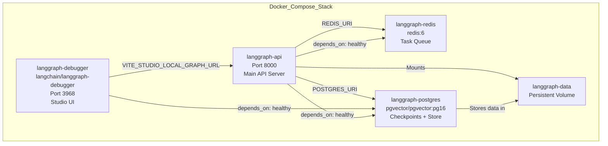
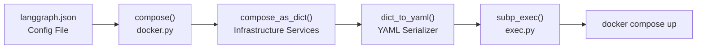
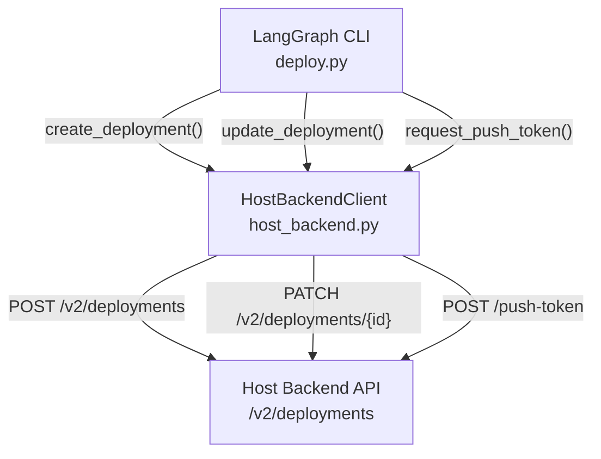

<!-- source: DeepWiki mcp.deepwiki.com · repo langchain-ai/langgraph · page 6.4 Multi-Service Orchestration · fetched 2026-10-26 -->

# Multi-Service Orchestration

Relevant source files

The following files were used as context for generating this wiki page:

- [libs/cli/examples/my_app.py](libs/cli/examples/my_app.py)
- [libs/cli/langgraph_cli/deploy.py](libs/cli/langgraph_cli/deploy.py)
- [libs/cli/langgraph_cli/docker.py](libs/cli/langgraph_cli/docker.py)
- [libs/cli/langgraph_cli/exec.py](libs/cli/langgraph_cli/exec.py)
- [libs/cli/langgraph_cli/host_backend.py](libs/cli/langgraph_cli/host_backend.py)
- [libs/cli/langgraph_cli/progress.py](libs/cli/langgraph_cli/progress.py)
- [libs/cli/langgraph_cli/util.py](libs/cli/langgraph_cli/util.py)
- [libs/cli/tests/unit_tests/graphs/agent.py](libs/cli/tests/unit_tests/graphs/agent.py)
- [libs/cli/tests/unit_tests/test_config.json](libs/cli/tests/unit_tests/test_config.json)
- [libs/cli/tests/unit_tests/test_deploy_helpers.py](libs/cli/tests/unit_tests/test_deploy_helpers.py)
- [libs/cli/tests/unit_tests/test_docker.py](libs/cli/tests/unit_tests/test_docker.py)
- [libs/cli/tests/unit_tests/test_host_backend.py](libs/cli/tests/unit_tests/test_host_backend.py)
- [libs/cli/tests/unit_tests/test_logs_helpers.py](libs/cli/tests/unit_tests/test_logs_helpers.py)
- [libs/cli/tests/unit_tests/test_util.py](libs/cli/tests/unit_tests/test_util.py)

## Purpose and Scope

This document describes how the LangGraph CLI generates and orchestrates multi-service Docker Compose configurations for local development and deployment. The system automatically provisions dependent services (Redis, PostgreSQL, debugger UI) alongside the LangGraph API server, handling service dependencies, health checks, networking, and volume persistence.

For building single Docker images (without orchestration), see [6.3 Docker Image Generation](). For the development server that runs without Docker, see [6.5 Local Development Server]().

## Service Architecture

The CLI generates a multi-service stack with four primary components, each running in its own container with defined health checks and dependencies.

Title: LangGraph Multi-Service Stack Architecture

Sources: [libs/cli/langgraph_cli/docker.py:219-270](), [libs/cli/langgraph_cli/docker.py:150-165]()

## Docker Compose Generation Flow

The CLI generates Docker Compose configurations by combining infrastructure definitions with application-specific settings.

Title: CLI Docker Compose Generation Pipeline

The `compose` function in `docker.py` serves as the entry point, calling `compose_as_dict` to build a Python dictionary representing the YAML structure [libs/cli/langgraph_cli/docker.py:206-215](). This dictionary is then converted to a YAML string using `dict_to_yaml` [libs/cli/langgraph_cli/docker.py:169-187]().

Sources: [libs/cli/langgraph_cli/docker.py:206-270](), [libs/cli/langgraph_cli/docker.py:169-187](), [libs/cli/langgraph_cli/exec.py:31-39]()

## Infrastructure Services

### Redis Service

The Redis service provides task queue and caching functionality with automatic health checking.

| Property | Value |
|----------|-------|
| Image | `redis:6` |
| Healthcheck | `redis-cli ping` |
| Interval | 5s |
| Timeout | 1s |
| Retries | 5 |

The API server connects via `REDIS_URI=redis://langgraph-redis:6379` [libs/cli/langgraph_cli/docker.py:265-265]().

Sources: [libs/cli/langgraph_cli/docker.py:220-229](), [libs/cli/tests/unit_tests/test_docker.py:26-32]()

### PostgreSQL Service

PostgreSQL with the `pgvector` extension stores checkpoints and provides the `BaseStore` backend.

| Property | Value |
|----------|-------|
| Image | `pgvector/pgvector:pg16` |
| Port | 5433:5432 (host:container) |
| Environment | `POSTGRES_DB=postgres` `POSTGRES_USER=postgres` `POSTGRES_PASSWORD=postgres` |
| Command | `postgres -c shared_preload_libraries=vector` |
| Volume | `langgraph-data:/var/lib/postgresql/data` |
| Healthcheck | `pg_isready -U postgres` |

The default connection string is defined as `DEFAULT_POSTGRES_URI` [libs/cli/langgraph_cli/docker.py:15-17](), and is configurable via the `postgres_uri` parameter in `compose_as_dict` [libs/cli/langgraph_cli/docker.py:197-197]().

Sources: [libs/cli/langgraph_cli/docker.py:230-252](), [libs/cli/tests/unit_tests/test_docker.py:120-139]()

### Debugger Service (Optional)

When a `debugger_port` is specified, the CLI includes the LangGraph Studio debugger UI via `debugger_compose` [libs/cli/langgraph_cli/docker.py:145-165]().

| Property | Value |
|----------|-------|
| Image | `langchain/langgraph-debugger` |
| Port | User-specified (mapped to 3968) |
| Restart Policy | `on-failure` |
| Environment | `VITE_STUDIO_LOCAL_GRAPH_URL` set to `base_url` |
| Dependencies | Waits for `langgraph-postgres` to be healthy |

Sources: [libs/cli/langgraph_cli/docker.py:150-163]()

## Deployment Orchestration

The CLI handles remote deployment through the `HostBackendClient`, which communicates with a deployment service to manage images and revisions.

Title: Remote Deployment Flow

### Build and Update Logic
During `langgraph deploy`, the CLI:
1. Validates local Docker capabilities using `can_build_locally` [libs/cli/langgraph_cli/docker.py:52-98]().
2. Builds the image using `build_docker_image` [libs/cli/langgraph_cli/deploy.py:24-24]().
3. Updates the remote deployment with the new `image_uri` and any `tracked_packages` via `HostBackendClient.update_deployment` [libs/cli/langgraph_cli/host_backend.py:120-139]().

Sources: [libs/cli/langgraph_cli/deploy.py:104-117](), [libs/cli/langgraph_cli/host_backend.py:73-92](), [libs/cli/langgraph_cli/host_backend.py:120-139]()

## Configuration and Environment

### Environment Variable Resolution
The CLI resolves environment variables from multiple sources during orchestration:
- **langgraph.json**: The `env` key can point to a `.env` file or a dictionary of variables [libs/cli/tests/unit_tests/test_config.json:15-15]().
- **Default Fallback**: If no environment is specified, it defaults to looking for a `.env` file in the current directory [libs/cli/tests/unit_tests/test_deploy_helpers.py:176-183]().
- **Reserved Variables**: The CLI maintains a list of `RESERVED_ENV_VARS` that are protected during deployment to ensure system stability [libs/cli/langgraph_cli/deploy.py:34-79]().

### Docker Capabilities Detection
Before running `docker compose`, the CLI executes `check_capabilities` to determine the environment's support for modern features [libs/cli/langgraph_cli/docker.py:100-142]().
- **Compose Type**: Detects if `docker compose` (plugin) or `docker-compose` (standalone) should be used [libs/cli/langgraph_cli/docker.py:116-130]().
- **Healthcheck Support**: Enables `start_interval` only if the Docker version is `>= 25.0.0` [libs/cli/langgraph_cli/docker.py:140-140]().

Sources: [libs/cli/langgraph_cli/docker.py:100-142](), [libs/cli/langgraph_cli/deploy.py:34-79](), [libs/cli/tests/unit_tests/test_deploy_helpers.py:161-183]()

## Execution Utilities

The `subp_exec` function in `exec.py` provides a robust wrapper for running Docker and Docker Compose commands asynchronously [libs/cli/langgraph_cli/exec.py:31-108]().
- **Signal Handling**: Correctly propagates `SIGINT` and `SIGTERM` to the underlying subprocess to ensure clean shutdown of the service stack [libs/cli/langgraph_cli/exec.py:58-75]().
- **Stream Monitoring**: Uses `monitor_stream` to capture and optionally display `stdout` and `stderr` in real-time [libs/cli/langgraph_cli/exec.py:126-174]().
- **Progress Tracking**: The `Progress` class provides a spinning cursor and elapsed time tracking for long-running build or deployment tasks [libs/cli/langgraph_cli/progress.py:7-45]().

Sources: [libs/cli/langgraph_cli/exec.py:31-108](), [libs/cli/langgraph_cli/progress.py:7-86]()

---

