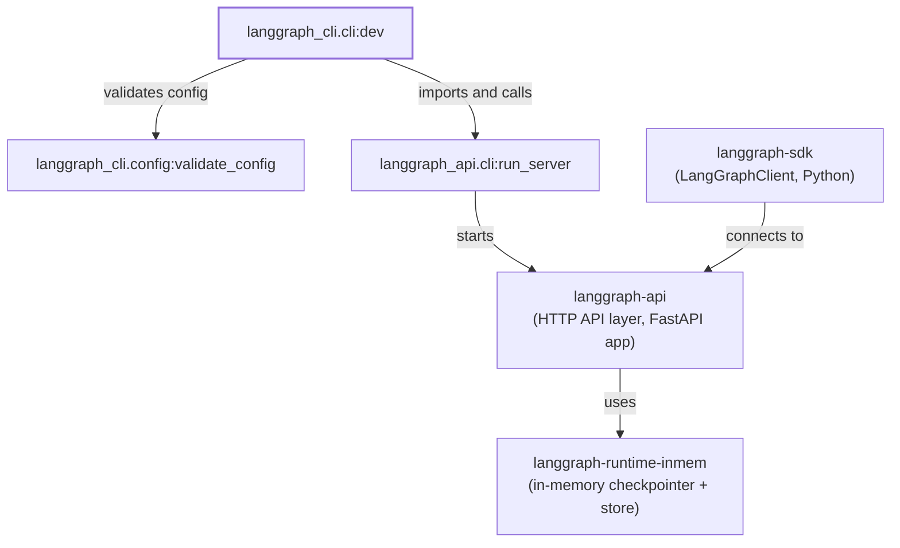
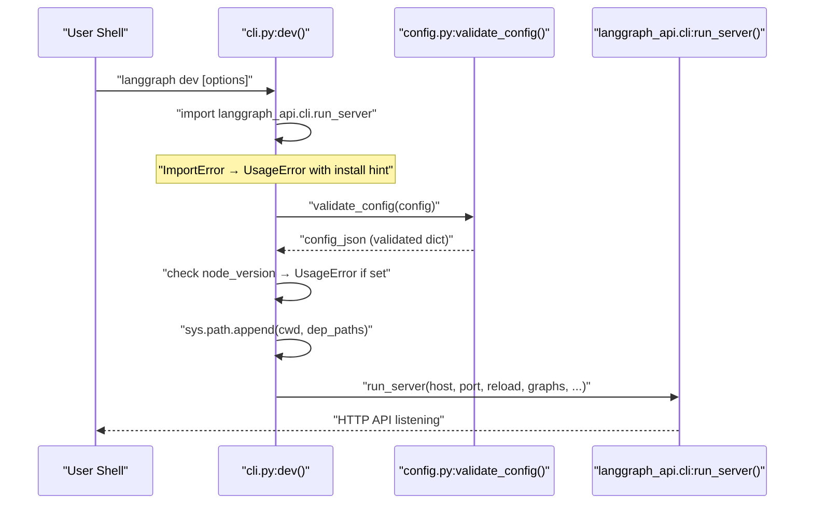

<!-- source: DeepWiki mcp.deepwiki.com · repo langchain-ai/langgraph · page 6.5 Local Development Server · fetched 2026-10-26 -->

# Local Development Server

<details>
<summary>Relevant source files</summary>

The following files were used as context for generating this wiki page:

- [libs/cli/langgraph_cli/__init__.py](libs/cli/langgraph_cli/__init__.py)
- [libs/cli/langgraph_cli/_ignore.py](libs/cli/langgraph_cli/_ignore.py)
- [libs/cli/langgraph_cli/archive.py](libs/cli/langgraph_cli/archive.py)
- [libs/cli/langgraph_cli/cli.py](libs/cli/langgraph_cli/cli.py)
- [libs/cli/langgraph_cli/config.py](libs/cli/langgraph_cli/config.py)
- [libs/cli/langgraph_cli/uv_lock.py](libs/cli/langgraph_cli/uv_lock.py)
- [libs/cli/pyproject.toml](libs/cli/pyproject.toml)
- [libs/cli/tests/unit_tests/cli/test_cli.py](libs/cli/tests/unit_tests/cli/test_cli.py)
- [libs/cli/tests/unit_tests/test_archive.py](libs/cli/tests/unit_tests/test_archive.py)
- [libs/cli/tests/unit_tests/test_config.py](libs/cli/tests/unit_tests/test_config.py)
- [libs/cli/uv-examples/monorepo/apps/agent/pyproject.toml](libs/cli/uv-examples/monorepo/apps/agent/pyproject.toml)
- [libs/cli/uv-examples/monorepo/pyproject.toml](libs/cli/uv-examples/monorepo/pyproject.toml)
- [libs/cli/uv-examples/monorepo/uv.lock](libs/cli/uv-examples/monorepo/uv.lock)
- [libs/cli/uv-examples/simple/pyproject.toml](libs/cli/uv-examples/simple/pyproject.toml)
- [libs/cli/uv-examples/simple/uv.lock](libs/cli/uv-examples/simple/uv.lock)
- [libs/cli/uv.lock](libs/cli/uv.lock)

</details>


This page covers `langgraph dev`, the in-memory development server mode provided by `langgraph-cli`. It is intended for rapid local iteration without Docker. For the Docker-based production-oriented server (using Postgres and Redis), see [Multi-Service Orchestration](6.4). For all CLI commands at a summary level, see [CLI Commands](6.1). For the `langgraph.json` configuration file, see [Configuration System (langgraph.json)](6.2).

---

## Overview

`langgraph dev` starts the LangGraph API server as a native Python process in the current shell, loading graphs directly from source. It does not require Docker. The server uses an in-memory checkpointer and store rather than Postgres, which makes it unsuitable for production but fast to start.

The command is implemented in `langgraph_cli/cli.py` as the `dev` Click command [libs/cli/langgraph_cli/cli.py:609-768]().

---

## Installation Requirements

`langgraph dev` depends on two optional packages that are not installed by default. They are available via the `inmem` extras group declared in `pyproject.toml` [libs/cli/pyproject.toml:24-28]():

| Package | Minimum Version | Python Constraint | Role |
|---|---|---|---|
| `langgraph-api` | `>=0.5.35,<1.0.0` | `>= 3.11` | Provides `run_server` function and HTTP API layer |
| `langgraph-runtime-inmem` | `>=0.7` | `>= 3.11` | Provides in-memory checkpointer and store |
| `python-dotenv` | `>=0.8.0` | `>= 3.10` | `.env` file loading support |

Install with:

```bash
pip install -U "langgraph-cli[inmem]"
```

**Python version requirement:** The `inmem` extras are only installed for Python 3.11 or higher [libs/cli/pyproject.toml:26-27](). The `dev` command will emit a descriptive error if Python < 3.11 is detected [libs/cli/langgraph_cli/cli.py:703-710]().

**JS graphs are not supported.** If the validated config includes `node_version`, the command immediately raises a `UsageError` [libs/cli/langgraph_cli/cli.py:733-736]().

Sources: [libs/cli/pyproject.toml:24-28](), [libs/cli/langgraph_cli/cli.py:703-736]()

---

## Architecture

The following diagram shows how `langgraph dev` relates to the packages it depends on.

**Dependency and call flow for `langgraph dev`**



Sources: [libs/cli/langgraph_cli/cli.py:700-768](), [libs/cli/pyproject.toml:24-28]()

---

## Command Options

The `dev` command is registered as `langgraph dev` via the Click group [libs/cli/langgraph_cli/cli.py:609-679]().

| Option | Type | Default | Description |
|---|---|---|---|
| `--host` | `str` | `127.0.0.1` | Network interface to bind |
| `--port` | `int` | `2024` | Port to listen on |
| `--no-reload` | flag | off | Disables hot reloading |
| `--config` | path | `langgraph.json` | Config file path |
| `--n-jobs-per-worker` | `int` | `None` | Max concurrent jobs per worker |
| `--no-browser` | flag | off | Skips auto-opening LangGraph Studio |
| `--debug-port` | `int` | `None` | Enables `debugpy` remote debugging on this port |
| `--wait-for-client` | flag | off | Blocks startup until a debugger connects |
| `--studio-url` | `str` | `None` | Override Studio URL (default: `https://smith.langchain.com`) |
| `--allow-blocking` | flag | off | Suppresses errors for synchronous blocking I/O |
| `--tunnel` | flag | off | Expose server via Cloudflare tunnel |

Sources: [libs/cli/langgraph_cli/cli.py:609-679]()

---

## Execution Flow

The following diagram maps the `dev` function's internal execution sequence to the actual code constructs involved.

**`dev` function execution sequence**



Sources: [libs/cli/langgraph_cli/cli.py:698-768](), [libs/cli/langgraph_cli/config.py:136-238]()

---

## Config Propagation

After validation via `validate_config` [libs/cli/langgraph_cli/config.py:136-238](), config fields are extracted and forwarded directly to `run_server`. The mapping includes:

| `langgraph.json` field | Forwarded as `run_server` argument |
|---|---|
| `graphs` | `graphs` |
| `env` | `env` |
| `store` | `store` |
| `auth` | `auth` |
| `http` | `http` |
| `ui` | `ui` |
| `ui_config` | `ui_config` |
| `webhooks` | `webhooks` |

The `dependencies` list is used locally to extend `sys.path` before calling `run_server` [libs/cli/langgraph_cli/cli.py:740-744](). This ensures that relative local packages declared as `"."` or `"./some_dir"` are importable when the graph modules are loaded.

Sources: [libs/cli/langgraph_cli/cli.py:738-768](), [libs/cli/langgraph_cli/config.py:136-238]()

---

## Hot Reloading

Hot reloading is enabled by default (the `--no-reload` flag disables it). When enabled, `run_server` is called with `reload=True` [libs/cli/langgraph_cli/cli.py:748-752]():

```python
run_server(
    host,
    port,
    not no_reload,   # reload=True unless --no-reload
    graphs,
    ...
)
```

The actual file-watching and process restarting is implemented inside `langgraph-api` (not in `langgraph-cli`). The `langgraph-cli` side only passes the boolean flag.

Sources: [libs/cli/langgraph_cli/cli.py:748-768]()

---

## Remote Debugging

When `--debug-port` is specified, the `run_server` function is expected to call `debugpy.listen()` on the given port. The `--wait-for-client` flag causes the server to block until a debugger IDE (e.g., VS Code) attaches before beginning graph execution.

Both `debug_port` and `wait_for_client` are passed directly to `run_server` [libs/cli/langgraph_cli/cli.py:754-755]().

Sources: [libs/cli/langgraph_cli/cli.py:643-655](), [libs/cli/langgraph_cli/cli.py:754-755]()

---

## LangGraph Studio Integration

When the server starts (and `--no-browser` is not set), `run_server` opens a browser to connect LangGraph Studio to the local server. The Studio URL defaults to `https://smith.langchain.com` but can be overridden with `--studio-url` [libs/cli/langgraph_cli/cli.py:656-664]().

When using `--tunnel`, the server is additionally exposed via a Cloudflare tunnel so that remote Studio instances or browsers that block `localhost` can reach the local API [libs/cli/langgraph_cli/cli.py:665-673]().

Sources: [libs/cli/langgraph_cli/cli.py:656-673](), [libs/cli/langgraph_cli/cli.py:762-763]()

---

## Error Handling for Missing Dependencies

If `langgraph-api` is not installed (i.e., `langgraph-cli` was installed without the `inmem` extra), the `dev` command produces a structured error message rather than a raw `ImportError`. The check also detects whether Python is below 3.11 and appends a version-specific note to the error [libs/cli/langgraph_cli/cli.py:703-730]().

Sources: [libs/cli/langgraph_cli/cli.py:700-730]()

---

## Comparison: `langgraph dev` vs `langgraph up`

| Aspect | `langgraph dev` | `langgraph up` |
|---|---|---|
| Requires Docker | No | Yes |
| Persistence backend | In-memory (SQLite) | Postgres |
| Hot reload mechanism | In-process Python reload | Docker Compose `watch` |
| JS graph support | No [libs/cli/langgraph_cli/cli.py:733]() | Yes |
| Config validated by | `validate_config` | `validate_config` |
| Runtime packages | `langgraph-api` [libs/cli/pyproject.toml:26]() | `langchain/langgraph-api` image |
| Default port | `2024` | `8123` [libs/cli/langgraph_cli/constants.py:4]() |

Sources: [libs/cli/langgraph_cli/cli.py:609-768](), [libs/cli/pyproject.toml:24-28](), [libs/cli/langgraph_cli/constants.py:1-6]()

---

