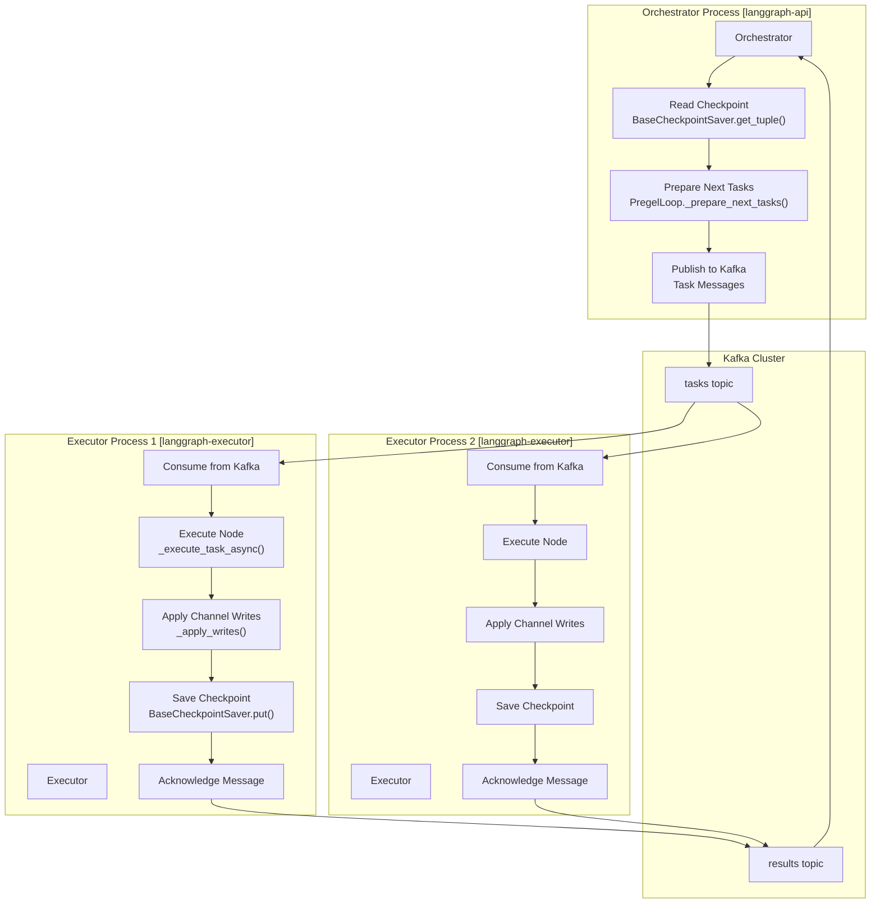
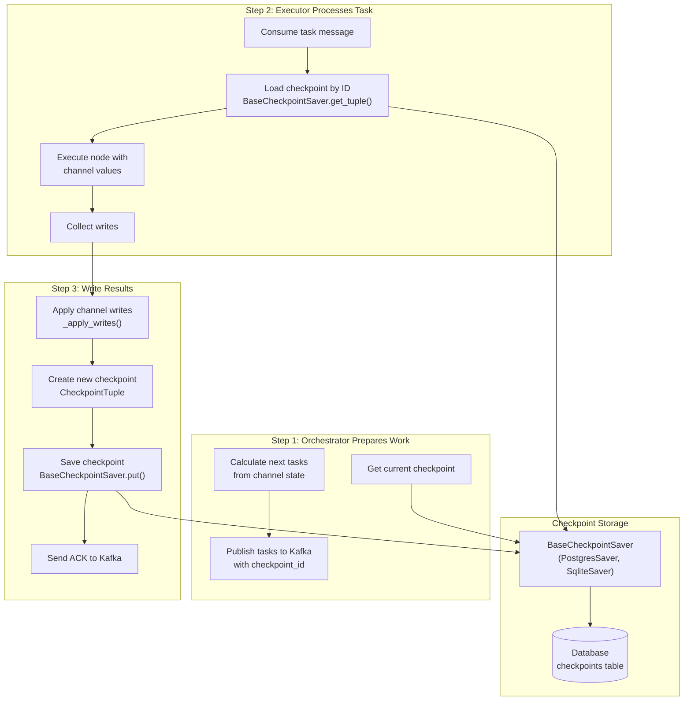
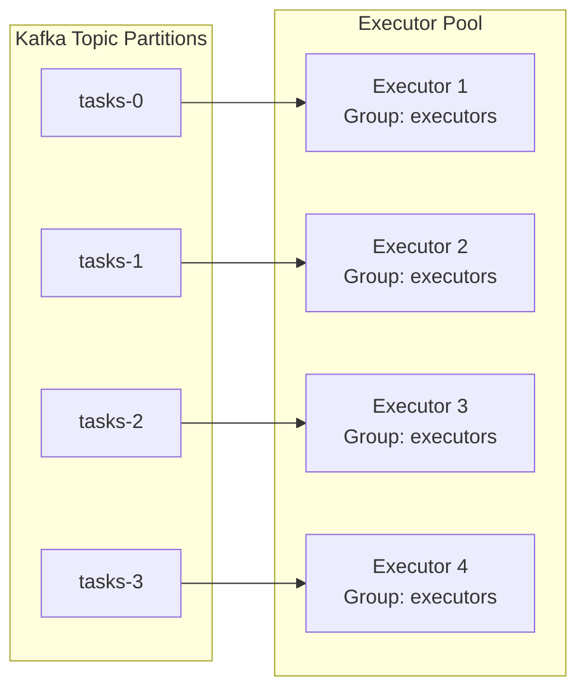
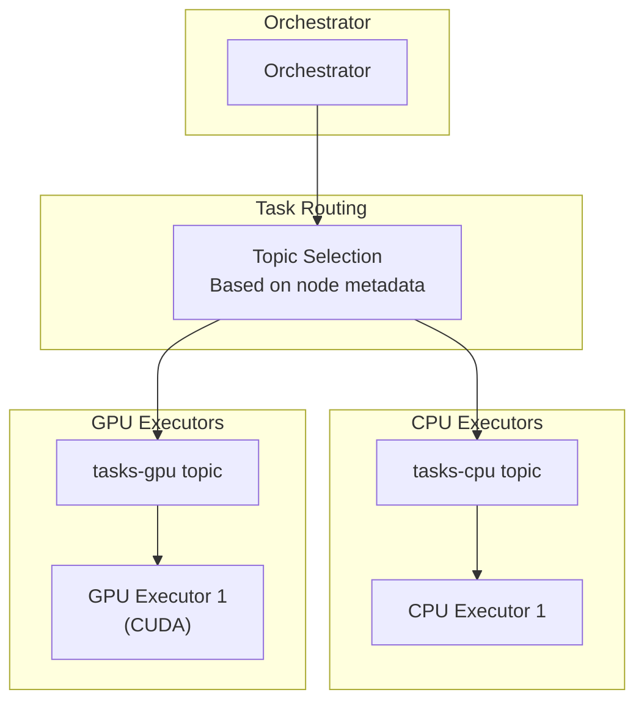

<!-- source: DeepWiki mcp.deepwiki.com · repo langchain-ai/langgraph · page 6.6 Distributed Execution with Kafka · fetched 2026-10-26 -->

# Distributed Execution with Kafka

<details>
<summary>Relevant source files</summary>

The following files were used as context for generating this wiki page:

- [libs/cli/langgraph_cli/__init__.py](libs/cli/langgraph_cli/__init__.py)
- [libs/cli/langgraph_cli/cli.py](libs/cli/langgraph_cli/cli.py)
- [libs/cli/langgraph_cli/config.py](libs/cli/langgraph_cli/config.py)
- [libs/cli/langgraph_cli/deploy.py](libs/cli/langgraph_cli/deploy.py)
- [libs/cli/langgraph_cli/host_backend.py](libs/cli/langgraph_cli/host_backend.py)
- [libs/cli/langgraph_cli/progress.py](libs/cli/langgraph_cli/progress.py)
- [libs/cli/langgraph_cli/util.py](libs/cli/langgraph_cli/util.py)
- [libs/cli/pyproject.toml](libs/cli/pyproject.toml)
- [libs/cli/tests/unit_tests/cli/test_cli.py](libs/cli/tests/unit_tests/cli/test_cli.py)
- [libs/cli/tests/unit_tests/test_config.py](libs/cli/tests/unit_tests/test_config.py)
- [libs/cli/tests/unit_tests/test_deploy_helpers.py](libs/cli/tests/unit_tests/test_deploy_helpers.py)
- [libs/cli/tests/unit_tests/test_host_backend.py](libs/cli/tests/unit_tests/test_host_backend.py)
- [libs/cli/tests/unit_tests/test_logs_helpers.py](libs/cli/tests/unit_tests/test_logs_helpers.py)
- [libs/cli/tests/unit_tests/test_util.py](libs/cli/tests/unit_tests/test_util.py)
- [libs/cli/uv.lock](libs/cli/uv.lock)

</details>


## Purpose and Scope

This document describes the Kafka-based distributed execution system for LangGraph graphs. This system enables horizontal scaling of graph execution across multiple worker processes or machines, allowing workloads to be distributed beyond a single process.

The distributed execution system builds on top of the checkpoint persistence layer to orchestrate work across multiple executors. While the core logic of graph traversal resides in the Pregel engine, the Kafka scheduler provides the transport and coordination layer required for multi-node deployments.

The LangGraph CLI supports this mode via the `--engine-runtime-mode distributed` option [libs/cli/langgraph_cli/cli.py:172-177](), which configures the environment to use separate executor and orchestrator containers rather than the default `combined_queue_worker` mode.

## Architecture Overview

The Kafka scheduler implements an orchestrator-executor pattern. In this architecture, the **Orchestrator** manages the state machine and graph topology, while **Executors** handle the actual execution of node functions.

The CLI's `langgraph up` command orchestrates these components using Docker Compose [libs/cli/langgraph_cli/cli.py:29-40](), often pulling specific base images defined by the `api-version` [libs/cli/langgraph_cli/cli.py:159-170]().

### Distributed Component Interaction
Title: Orchestrator-Executor Pattern for Distributed Graph Execution


The separation of concerns allows:
- **Orchestrators** to remain lightweight and handle coordination for many graphs.
- **Executors** to scale independently based on compute workload.
- **Work distribution** across heterogeneous machines (e.g., GPU executors for ML nodes).

Sources: [libs/cli/langgraph_cli/cli.py:172-177](), [libs/cli/langgraph_cli/config.py:136-166]().

## Integration with Checkpointing

The distributed execution system relies heavily on the checkpoint persistence layer to maintain consistency across distributed workers. Each step in the execution lifecycle involves checkpoint operations to ensure that state is never lost if a worker fails.

### Distributed State Lifecycle
Title: Checkpoint Lifecycle in Distributed Execution


Key aspects of checkpoint integration:
1. **Checkpoint ID in Messages**: Each task message includes the `checkpoint_id` of the state from which it was derived, ensuring executors load the correct state.
2. **Atomic Checkpoint Writes**: Executors must write both channel updates and the new checkpoint.
3. **Version Conflict Resolution**: If multiple executors attempt to process the same task (due to retries or consumer rebalancing), the checkpoint system's version tracking detects conflicts. Only the first checkpoint write succeeds.

The CLI manages the configuration for these checkpointers via the `checkpointer` key in `langgraph.json` [libs/cli/langgraph_cli/config.py:159-166]().

Sources: [libs/cli/langgraph_cli/config.py:136-166](), [libs/cli/langgraph_cli/cli.py:154-157]().

## Scaling and Deployment Patterns

### Horizontal Scaling

Executors can be scaled horizontally by increasing consumer instances within a Kafka consumer group. Kafka's partition assignment ensures that work is distributed evenly while maintaining ordering guarantees for specific threads.

Title: Kafka Partition Assignment for Parallel Execution


### Resource-Specific Executors

Nodes can be annotated with resource requirements, allowing orchestrators to route tasks to appropriate executor pools via specialized Kafka topics. The CLI supports building these specialized images by injecting custom `dockerfile_lines` [libs/cli/langgraph_cli/config.py:153-166]().

Title: Resource-Aware Task Routing


## Comparison with Local Execution

The distributed execution system differs from local execution in its handling of the Pregel loop.

| Aspect | Local Execution | Distributed Execution |
| :--- | :--- | :--- |
| **Orchestration** | Single `PregelLoop` in-process | Orchestrator process + Kafka |
| **Task Execution** | Direct function calls | Executors consume from Kafka |
| **State Persistence** | Optional (can use `InMemorySaver`) | Required (PostgreSQL) |
| **CLI Mode** | Default (`combined_queue_worker`) | `distributed` [libs/cli/langgraph_cli/cli.py:172-177]() |
| **Fault Tolerance** | Process crash loses in-flight work | Kafka retries + checkpoint recovery |

### Execution Flow Comparison

**Local Execution:**
The loop is managed entirely within the Pregel class.
`Pregel.stream()` → `PregelLoop` → `_execute_task_async()` → `_apply_writes()` → `BaseCheckpointSaver.put()`

**Distributed Execution:**
The loop is broken across the network.
`Orchestrator` → `_prepare_next_tasks()` → Kafka Publish → `Executor` → `_execute_task_async()` → `_apply_writes()` → `BaseCheckpointSaver.put()` → Kafka ACK → `Orchestrator`

Sources: [libs/cli/langgraph_cli/cli.py:172-177](), [libs/cli/langgraph_cli/config.py:136-166]().

## Error Handling and Recovery

The distributed system must handle failures at multiple levels:

1. **Executor Failures**: If an executor crashes mid-execution, the Kafka consumer group rebalances. Unacknowledged messages are redelivered to another executor.
2. **Orchestrator Failures**: If an orchestrator crashes, new instances pick up from the last committed offset in the results topic.
3. **Configuration Validation**: The CLI performs strict validation of the `langgraph.json` config to prevent runtime failures in distributed environments [libs/cli/langgraph_cli/config.py:136-238](). The `validate_config` function ensures mandatory keys like `dependencies` and `graphs` are present and that `python_version` meets the minimum requirement of 3.11 [libs/cli/langgraph_cli/config.py:81-82](), [libs/cli/langgraph_cli/config.py:136-166]().

Sources: [libs/cli/langgraph_cli/config.py:81-82](), [libs/cli/langgraph_cli/config.py:136-238]().

## Infrastructure Requirements

To run the distributed system, a persistent backend is required. The CLI allows specifying an external Postgres URI via `--postgres-uri` [libs/cli/langgraph_cli/cli.py:154-157]().

```yaml
# Example service configuration for distributed testing
services:
  postgres-test:
    image: pgvector/pgvector:pg16
    ports:
      - "5433:5432"
    environment:
      POSTGRES_DB: postgres
      POSTGRES_USER: postgres
      POSTGRES_PASSWORD: postgres
```

The CLI also manages dependency installation for these environments, supporting both `pip` and `uv` installers. It generates Dockerfile commands to install local packages and cleanup build tools to minimize image size [libs/cli/langgraph_cli/config.py:90-133](), [libs/cli/langgraph_cli/config.py:150-166]().

Sources: [libs/cli/langgraph_cli/cli.py:154-157](), [libs/cli/langgraph_cli/config.py:90-133](), [libs/cli/langgraph_cli/config.py:150-166]().

---

