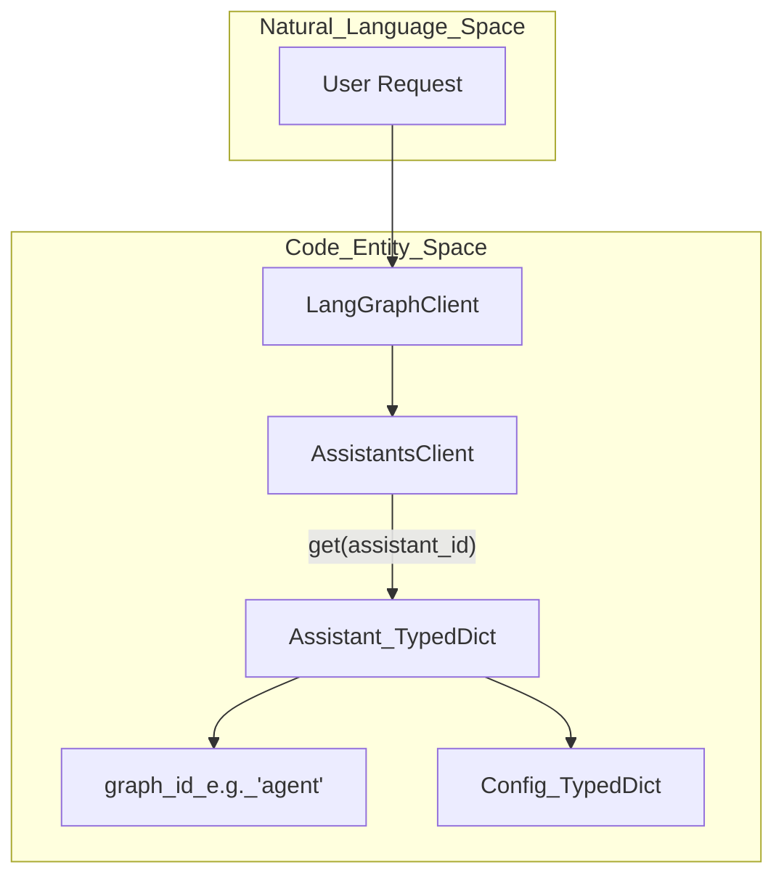
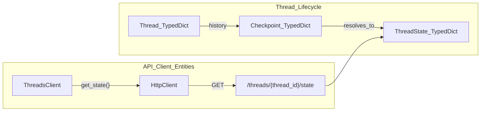
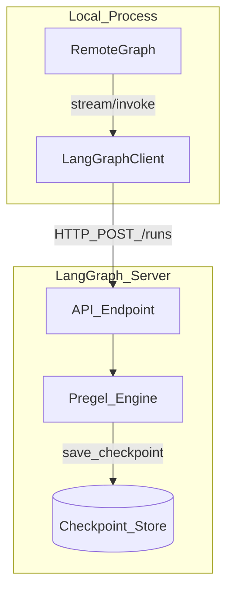

<!-- source: DeepWiki mcp.deepwiki.com · repo langchain-ai/langgraph · page 7.1 Assistants and Threads · fetched 2026-10-26 -->

# Assistants and Threads

Relevant source files

The following files were used as context for generating this wiki page:

- [libs/sdk-py/langgraph_sdk/__init__.py](libs/sdk-py/langgraph_sdk/__init__.py)
- [libs/sdk-py/langgraph_sdk/_async/assistants.py](libs/sdk-py/langgraph_sdk/_async/assistants.py)
- [libs/sdk-py/langgraph_sdk/_async/runs.py](libs/sdk-py/langgraph_sdk/_async/runs.py)
- [libs/sdk-py/langgraph_sdk/_shared/utilities.py](libs/sdk-py/langgraph_sdk/_shared/utilities.py)
- [libs/sdk-py/langgraph_sdk/_sync/assistants.py](libs/sdk-py/langgraph_sdk/_sync/assistants.py)
- [libs/sdk-py/langgraph_sdk/_sync/runs.py](libs/sdk-py/langgraph_sdk/_sync/runs.py)
- [libs/sdk-py/langgraph_sdk/auth/__init__.py](libs/sdk-py/langgraph_sdk/auth/__init__.py)
- [libs/sdk-py/langgraph_sdk/auth/exceptions.py](libs/sdk-py/langgraph_sdk/auth/exceptions.py)
- [libs/sdk-py/langgraph_sdk/auth/types.py](libs/sdk-py/langgraph_sdk/auth/types.py)
- [libs/sdk-py/langgraph_sdk/client.py](libs/sdk-py/langgraph_sdk/client.py)
- [libs/sdk-py/langgraph_sdk/schema.py](libs/sdk-py/langgraph_sdk/schema.py)
- [libs/sdk-py/pyproject.toml](libs/sdk-py/pyproject.toml)
- [libs/sdk-py/tests/test_langsmith_tracing.py](libs/sdk-py/tests/test_langsmith_tracing.py)
- [libs/sdk-py/tests/test_path_encoding.py](libs/sdk-py/tests/test_path_encoding.py)

The LangGraph API organizes stateful agentic workflows around two primary resources: **Assistants** and **Threads**. Assistants represent reusable, versioned configurations of a graph (including its logic and parameters), while Threads represent specific stateful sessions or conversations that persist over time.

## Assistants

An **Assistant** is a resource that binds a specific graph (identified by `graph_id`) with a set of configurations, metadata, and optional specialized instructions. In the LangGraph ecosystem, the "Assistant" is the entity that a user interacts with.

### Assistant Resource Structure
The `Assistant` object contains the following key fields:
- `assistant_id`: The unique identifier for the assistant [libs/sdk-py/langgraph_sdk/schema.py:252-253]().
- `graph_id`: The identifier of the underlying compiled graph [libs/sdk-py/langgraph_sdk/schema.py:254-255]().
- `config`: A `Config` object containing `configurable` values used during graph execution [libs/sdk-py/langgraph_sdk/schema.py:185-206]().
- `metadata`: Key-value pairs for categorization or filtering [libs/sdk-py/langgraph_sdk/schema.py:261-262]().
- `version`: The version number of the assistant configuration [libs/sdk-py/langgraph_sdk/schema.py:263-264]().

### Managing Assistants
The `AssistantsClient` [libs/sdk-py/langgraph_sdk/_async/assistants.py:29-41]() (and its synchronous counterpart `SyncAssistantsClient` [libs/sdk-py/langgraph_sdk/_sync/assistants.py:29-40]()) provides methods to manage these resources:
- **Get/Search**: Retrieve assistant details or search based on metadata and graph IDs [libs/sdk-py/langgraph_sdk/_async/assistants.py:46-91]().
- **Graph Inspection**: Retrieve the visual representation of the graph using `get_graph`, with support for `xray` mode to inspect subgraphs [libs/sdk-py/langgraph_sdk/_async/assistants.py:93-151]().
- **Schema Access**: Retrieve the input, output, and state schemas defined for the graph via `get_schemas` [libs/sdk-py/langgraph_sdk/_async/assistants.py:153-178]().

### Assistant Logic Flow
The following diagram illustrates how an Assistant acts as a configured instance of a Graph.

**Assistant to Code Entity Mapping**

Sources: [libs/sdk-py/langgraph_sdk/_async/assistants.py:29-41](), [libs/sdk-py/langgraph_sdk/schema.py:251-264](), [libs/sdk-py/langgraph_sdk/client.py:12-16]()

---

## Threads

A **Thread** represents a stateful session. It is the primary mechanism for persistence, allowing a graph to maintain its state (via checkpoints) across multiple separate requests.

### Thread State and Status
Threads transition through various statuses during their lifecycle [libs/sdk-py/langgraph_sdk/schema.py:34-41]():
- `"idle"`: The thread is not currently processing any task [libs/sdk-py/langgraph_sdk/schema.py:37]().
- `"busy"`: The thread is actively processing a task [libs/sdk-py/langgraph_sdk/schema.py:38]().
- `"interrupted"`: The thread's execution was interrupted [libs/sdk-py/langgraph_sdk/schema.py:39]().
- `"error"`: An exception occurred during task processing [libs/sdk-py/langgraph_sdk/schema.py:40]().

### Thread Management Operations
The `ThreadsClient` [libs/sdk-py/langgraph_sdk/_async/threads.py:30-43]() handles the lifecycle of these sessions:
- **Creation**: Threads can be created with specific `thread_id` or metadata. They can also be initialized with `if_not_exists` behavior [libs/sdk-py/langgraph_sdk/schema.py:123-128]().
- **TTL (Time-to-Live)**: Threads can be configured with a TTL to automatically delete or prune old state using `PruneStrategy` [libs/sdk-py/langgraph_sdk/schema.py:130-135]().
- **State Updates**: Users can manually update the state of a thread using `update_state`, which creates a new checkpoint [libs/sdk-py/langgraph_sdk/_async/threads.py:240-285]().

### Checkpoint History
Every transition in a thread's state is captured as a checkpoint.
- `get_history`: Returns an async iterator of `ThreadState` objects representing the timeline of the thread [libs/sdk-py/langgraph_sdk/_async/threads.py:314-350]().
- `get_state`: Retrieves the current state or state at a specific `checkpoint_id` [libs/sdk-py/langgraph_sdk/_async/threads.py:195-236]().

**Thread Persistence and Checkpointing**

Sources: [libs/sdk-py/langgraph_sdk/_async/threads.py:30-43](), [libs/sdk-py/langgraph_sdk/schema.py:208-220](), [libs/sdk-py/langgraph_sdk/schema.py:285-305]()

---

## Data Models and Schemas

The interaction between Assistants and Threads is governed by several key `TypedDict` models defined in `langgraph_sdk.schema`.

| Class | Description | Key Fields |
| :--- | :--- | :--- |
| `Assistant` | Configured graph instance [libs/sdk-py/langgraph_sdk/schema.py:251]() | `assistant_id`, `graph_id`, `config`, `metadata` |
| `Thread` | Stateful session [libs/sdk-py/langgraph_sdk/schema.py:270]() | `thread_id`, `status`, `metadata`, `created_at` |
| `ThreadState` | Snapshot of thread state [libs/sdk-py/langgraph_sdk/schema.py:285]() | `values`, `next`, `checkpoint_id`, `metadata` |
| `Checkpoint` | Internal persistence marker [libs/sdk-py/langgraph_sdk/schema.py:208]() | `thread_id`, `checkpoint_ns`, `checkpoint_id` |

Sources: [libs/sdk-py/langgraph_sdk/schema.py:185-305]()

## Interaction Flow: Runs on Threads

While Assistants and Threads define the configuration and the session, a **Run** defines the execution. To execute logic, a client creates a run by providing an `assistant_id` and a `thread_id`.

1.  **Selection**: The system fetches the graph and configuration from the **Assistant** resource.
2.  **Context**: The system loads the latest `Checkpoint` from the **Thread**.
3.  **Execution**: The graph processes the input and updates the state. Execution status is tracked via `RunStatus` [libs/sdk-py/langgraph_sdk/schema.py:23-32]().
4.  **Persistence**: A new checkpoint is saved back to the thread upon completion or interruption.

Sources: [libs/sdk-py/langgraph_sdk/_async/runs.py:56-68](), [libs/sdk-py/langgraph_sdk/schema.py:208-220](), [libs/sdk-py/langgraph_sdk/schema.py:23-32]()

## Remote Execution and Protocol

The `RemoteGraph` class acts as a bridge, allowing a remote LangGraph API deployment to be treated as a local graph instance. It utilizes the `LangGraphClient` to communicate with the server-side Pregel engine.

### Configuration and Sanitization
When calling a remote graph, the configuration is merged and sanitized to ensure only primitives are sent over the wire. Certain internal keys like `checkpoint_map` and `checkpoint_id` are managed by the server to prevent state conflicts during remote execution.

### Distributed Tracing
Remote execution supports LangSmith distributed tracing, allowing traces to be linked across the client and the remote server using `LangSmithTracing` configurations [libs/sdk-py/langgraph_sdk/schema.py:111-118]().

**Remote Execution Flow**

Sources: [libs/sdk-py/langgraph_sdk/client.py:1-8](), [libs/sdk-py/langgraph_sdk/_async/runs.py:56-68](), [libs/sdk-py/langgraph_sdk/schema.py:111-118]()

---

