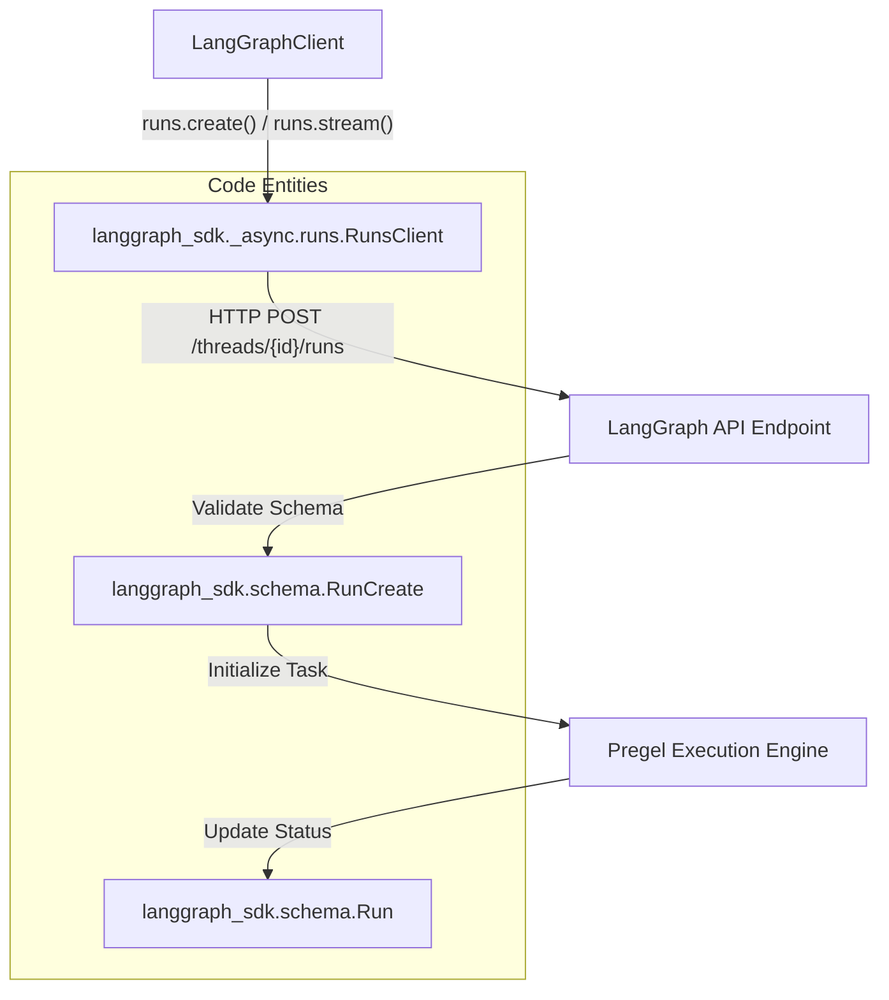
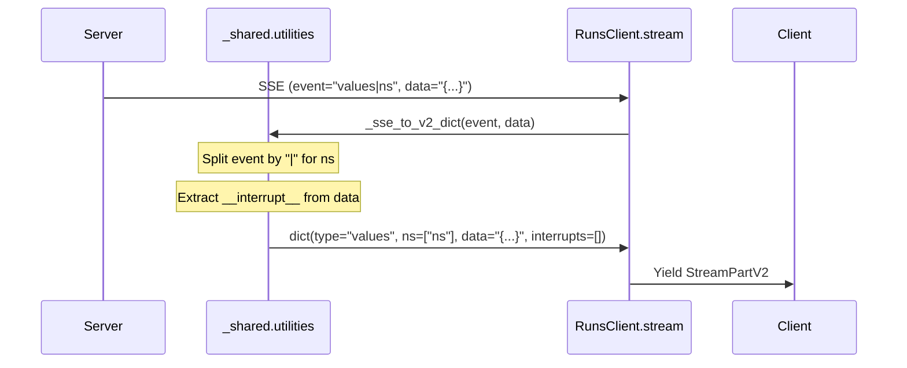
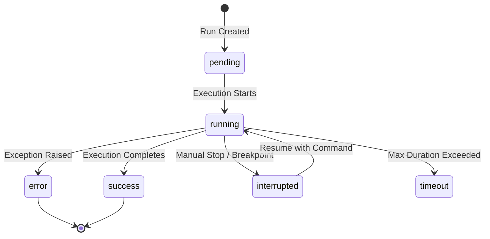

<!-- source: DeepWiki mcp.deepwiki.com · repo langchain-ai/langgraph · page 7.2 Runs · fetched 2026-10-26 -->

# Runs

Relevant source files

The following files were used as context for generating this wiki page:

- [libs/sdk-py/langgraph_sdk/_async/assistants.py](libs/sdk-py/langgraph_sdk/_async/assistants.py)
- [libs/sdk-py/langgraph_sdk/_async/runs.py](libs/sdk-py/langgraph_sdk/_async/runs.py)
- [libs/sdk-py/langgraph_sdk/_shared/utilities.py](libs/sdk-py/langgraph_sdk/_shared/utilities.py)
- [libs/sdk-py/langgraph_sdk/_sync/assistants.py](libs/sdk-py/langgraph_sdk/_sync/assistants.py)
- [libs/sdk-py/langgraph_sdk/_sync/runs.py](libs/sdk-py/langgraph_sdk/_sync/runs.py)
- [libs/sdk-py/tests/integration/test_assistants.py](libs/sdk-py/tests/integration/test_assistants.py)
- [libs/sdk-py/tests/integration/test_cancel.py](libs/sdk-py/tests/integration/test_cancel.py)
- [libs/sdk-py/tests/integration/test_crons.py](libs/sdk-py/tests/integration/test_crons.py)
- [libs/sdk-py/tests/integration/test_runs.py](libs/sdk-py/tests/integration/test_runs.py)
- [libs/sdk-py/tests/integration/test_store.py](libs/sdk-py/tests/integration/test_store.py)
- [libs/sdk-py/tests/integration/test_websocket.py](libs/sdk-py/tests/integration/test_websocket.py)
- [libs/sdk-py/tests/streaming/test_extensions_projection.py](libs/sdk-py/tests/streaming/test_extensions_projection.py)
- [libs/sdk-py/tests/streaming/test_sync_extensions_projection.py](libs/sdk-py/tests/streaming/test_sync_extensions_projection.py)
- [libs/sdk-py/tests/test_langsmith_tracing.py](libs/sdk-py/tests/test_langsmith_tracing.py)
- [libs/sdk-py/tests/test_path_encoding.py](libs/sdk-py/tests/test_path_encoding.py)

A **Run** represents a single invocation of a LangGraph assistant. It is the primary resource for executing graph logic, whether statefully (associated with a `Thread`) or statelessly. Runs provide the interface for streaming execution data, managing lifecycle states, and handling concurrent execution strategies.

## Overview of Run Execution

Runs are managed via the `RunsClient` (async) or `SyncRunsClient` (sync) [libs/sdk-py/langgraph_sdk/_async/runs.py:56-57](), [libs/sdk-py/langgraph_sdk/_sync/runs.py:56-57](). A run can be triggered as a background task, a blocking wait, or a streaming response. When a run is created, it executes the graph associated with an `Assistant` using the provided input, configuration, and optional control commands.

### Data Flow: Triggering a Run

The following diagram illustrates the flow from a client request to the initialization of a run.

**Run Initialization Flow**

Sources: [libs/sdk-py/langgraph_sdk/_async/runs.py:56-71](), [libs/sdk-py/langgraph_sdk/schema.py:34-38]()

## Streaming Modes

LangGraph supports multiple streaming modes that determine what data is pushed to the client during execution. These are defined by the `StreamMode` type [libs/sdk-py/langgraph_sdk/schema.py:39]().

| Mode | Description |
| :--- | :--- |
| `values` | Streams the full state of the graph after each step. |
| `updates` | Streams only the incremental updates applied to the state in the current step. |
| `messages` | Streams message objects, often used for chat interfaces. |
| `events` | Streams fine-grained events occurring during execution (v2 events). |
| `debug` | Streams detailed internal execution information for troubleshooting. |
| `custom` | Streams user-defined custom events. |

### SSE Protocol and Decoding
Streaming is implemented using Server-Sent Events (SSE). The SDK provides a `version="v2"` option in the `stream` method which wraps the raw SSE stream to provide a standardized dictionary format via `_sse_to_v2_dict` [libs/sdk-py/langgraph_sdk/_shared/utilities.py:115-130](). This conversion handles namespaces (`ns`) and extracts interrupts from the data payload [libs/sdk-py/langgraph_sdk/_shared/utilities.py:122-129]().

**Streaming Data Logic**

Sources: [libs/sdk-py/langgraph_sdk/_async/runs.py:46-54](), [libs/sdk-py/langgraph_sdk/_shared/utilities.py:115-130]()

## Run Status Lifecycle

A run transitions through several statuses defined by the `RunStatus` literal [libs/sdk-py/langgraph_sdk/schema.py:38]().

**Run State Transitions**

### Lifecycle Details
- **pending**: The run is queued and waiting for an executor.
- **running**: The graph is currently processing steps.
- **interrupted**: The run encountered an `interrupt` (human-in-the-loop) or a breakpoint.
- **CancelAction**: Runs can be cancelled using `interrupt` (stops at next step) or `rollback` (reverts to state before run started) [libs/sdk-py/langgraph_sdk/schema.py:21]().

Sources: [libs/sdk-py/langgraph_sdk/schema.py:21-38](), [libs/sdk-py/langgraph_sdk/_async/runs.py:447-456]()

## Multitask Strategies

When multiple runs are triggered on the same `Thread`, the server applies a `MultitaskStrategy` to handle the concurrency [libs/sdk-py/langgraph_sdk/schema.py:31]().

| Strategy | Behavior |
| :--- | :--- |
| `reject` | Reject new tasks when the thread is busy. |
| `interrupt` | Interrupt current task to start the new one. |
| `rollback` | Roll back current task and start the new one. |
| `enqueue` | Queue the new task to run after the current one finishes. |

Sources: [libs/sdk-py/langgraph_sdk/schema.py:31](), [libs/sdk-py/langgraph_sdk/_async/runs.py:95]()

## Key Functions and Classes

### `RunsClient` / `SyncRunsClient`
The primary interface for run operations. Key methods include:
- `create`: Triggers a run and returns the `Run` object metadata immediately [libs/sdk-py/langgraph_sdk/_async/runs.py:313]().
- `stream`: Returns an `AsyncIterator` or `Iterator` of `StreamPart` objects. Supports `v1` (raw SSE) and `v2` (wrapped dicts) [libs/sdk-py/langgraph_sdk/_async/runs.py:74-135]().
- `wait`: Blocks until the run reaches a terminal state and returns the final state/messages [libs/sdk-py/langgraph_sdk/_async/runs.py:387]().
- `cancel`: Sends a cancellation request with a specific `CancelAction` [libs/sdk-py/langgraph_sdk/_async/runs.py:447]().

### Path Encoding and Security
The SDK uses `_quote_path_param` to ensure that user-supplied identifiers (like `thread_id` or `run_id`) do not contain special characters that could allow path traversal or API pivot attacks [libs/sdk-py/langgraph_sdk/_shared/utilities.py:201-218](). This is critical when identifiers are interpolated into URL paths [libs/sdk-py/tests/test_path_encoding.py:31-61]().

### LangSmith Tracing
Runs can be automatically traced to LangSmith by providing a `langsmith_tracing` configuration, which is mapped to the `langsmith_tracer` field in the request payload [libs/sdk-py/tests/test_langsmith_tracing.py:27-50]().

Sources: [libs/sdk-py/langgraph_sdk/_async/runs.py:56-71](), [libs/sdk-py/langgraph_sdk/_shared/utilities.py:201-218](), [libs/sdk-py/tests/test_langsmith_tracing.py:27-50]()

---

