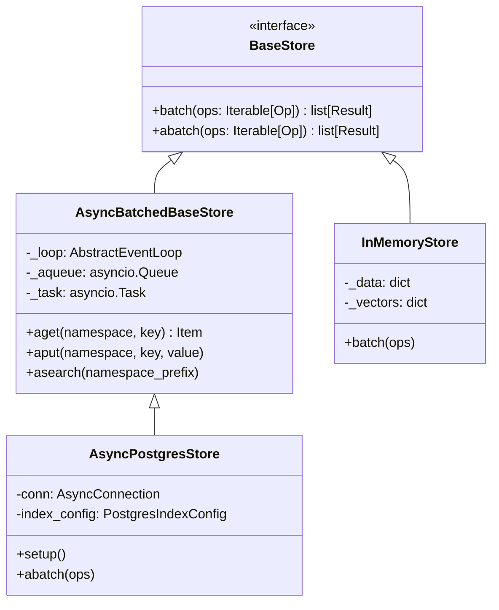
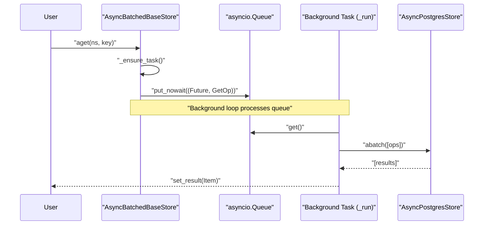

<!-- source: DeepWiki mcp.deepwiki.com · repo langchain-ai/langgraph · page 7.4 Store API · fetched 2026-10-26 -->

# Store API

Relevant source files

The following files were used as context for generating this wiki page:

- [libs/checkpoint-postgres/langgraph/store/postgres/aio.py](libs/checkpoint-postgres/langgraph/store/postgres/aio.py)
- [libs/checkpoint-postgres/langgraph/store/postgres/base.py](libs/checkpoint-postgres/langgraph/store/postgres/base.py)
- [libs/checkpoint-postgres/tests/conftest.py](libs/checkpoint-postgres/tests/conftest.py)
- [libs/checkpoint-postgres/tests/test_async_store.py](libs/checkpoint-postgres/tests/test_async_store.py)
- [libs/checkpoint-postgres/tests/test_store.py](libs/checkpoint-postgres/tests/test_store.py)
- [libs/checkpoint/langgraph/store/base/__init__.py](libs/checkpoint/langgraph/store/base/__init__.py)
- [libs/checkpoint/langgraph/store/base/batch.py](libs/checkpoint/langgraph/store/base/batch.py)
- [libs/checkpoint/langgraph/store/base/embed.py](libs/checkpoint/langgraph/store/base/embed.py)
- [libs/checkpoint/langgraph/store/memory/__init__.py](libs/checkpoint/langgraph/store/memory/__init__.py)
- [libs/checkpoint/tests/test_store.py](libs/checkpoint/tests/test_store.py)

This page documents the Store API for cross-thread persistent storage. It covers the namespace model, core operations (`put`, `get`, `search`, `delete`, `list_namespaces`), data types, and implementation details for both synchronous and asynchronous backends, including authorization patterns and PostgreSQL-specific features.

---

## Architecture Overview

The Store system provides a unified interface for long-term memory that persists across different threads and conversations [libs/checkpoint/langgraph/store/base/__init__.py:1-10](). It supports hierarchical namespaces, key-value storage, and optional vector search [libs/checkpoint/langgraph/store/base/__init__.py:1-10]().

**Store Entity Relationship Diagram**

Sources: [libs/checkpoint/langgraph/store/base/__init__.py:7-10](), [libs/checkpoint/langgraph/store/base/batch.py:58-68](), [libs/checkpoint-postgres/langgraph/store/postgres/aio.py:42-45](), [libs/checkpoint/langgraph/store/memory/__init__.py:136-181]()

---

## Namespace Model

Items are organized into **namespaces**: ordered tuples of strings forming a hierarchical path [libs/checkpoint/langgraph/store/base/__init__.py:57-59]().

| Concept | Representation | Example |
|---|---|---|
| **Namespace** | `tuple[str, ...]` | `("documents", "user123")` [libs/checkpoint/langgraph/store/base/__init__.py:59]() |
| **Key** | `str` | `"profile_prefs"` [libs/checkpoint/langgraph/store/base/__init__.py:56]() |
| **Item** | `Item` object | Contains `value` (dict), `key`, and `namespace` [libs/checkpoint/langgraph/store/base/__init__.py:64]() |

Namespaces allow for nested categorization. For example, `("users", "123", "settings")` is distinct from `("users", "456", "settings")` [libs/checkpoint/langgraph/store/base/__init__.py:57-60](). The `list_namespaces` operation allows discovery via prefix/suffix matching [libs/checkpoint/langgraph/store/base/batch.py:174-187]().

Sources: [libs/checkpoint/langgraph/store/base/__init__.py:51-115](), [libs/checkpoint/langgraph/store/base/batch.py:141-151, 163-187]()

---

## Data Models

### Item and SearchItem
The `Item` class represents a stored document with its metadata [libs/checkpoint/langgraph/store/base/__init__.py:51-52]().

| Field | Type | Description |
|---|---|---|
| `value` | `dict[str, Any]` | The actual stored data. Keys are filterable [libs/checkpoint/langgraph/store/base/__init__.py:69](). |
| `key` | `str` | Unique identifier within the namespace [libs/checkpoint/langgraph/store/base/__init__.py:70](). |
| `namespace` | `tuple[str, ...]` | Hierarchical path as a tuple of strings [libs/checkpoint/langgraph/store/base/__init__.py:71, 79](). |
| `created_at` | `datetime` | Timestamp of creation [libs/checkpoint/langgraph/store/base/__init__.py:72](). |
| `updated_at` | `datetime` | Timestamp of last update [libs/checkpoint/langgraph/store/base/__init__.py:73](). |

`SearchItem` extends `Item` by adding a `score` field for relevance/similarity in ranked operations (like vector search) [libs/checkpoint/langgraph/store/base/__init__.py:118-121, 149]().

Sources: [libs/checkpoint/langgraph/store/base/__init__.py:51-155]()

---

## Core Operations

The API utilizes a batching pattern where operations are encapsulated as `Op` objects and processed together via `batch` or `abatch` [libs/checkpoint/langgraph/store/base/__init__.py:9, 157-236]().

### Operation Types

| Operation | Code Entity | Description |
|---|---|---|
| **Get** | `GetOp` | Retrieve an item by namespace and key [libs/checkpoint/langgraph/store/base/__init__.py:157-161](). |
| **Put** | `PutOp` | Create or update an item [libs/checkpoint/langgraph/store/base/batch.py:146](). |
| **Delete** | `PutOp` | A `PutOp` with `value=None` performs a delete [libs/checkpoint/langgraph/store/base/batch.py:160](). |
| **Search** | `SearchOp` | Query items using filters or natural language (vector search) [libs/checkpoint/langgraph/store/base/__init__.py:203-208](). |
| **List** | `ListNamespacesOp` | List available namespaces with `MatchCondition` [libs/checkpoint/langgraph/store/base/batch.py:180](). |

**Data Flow: Async Batched Operations**

Sources: [libs/checkpoint/langgraph/store/base/batch.py:58-101](), [libs/checkpoint/langgraph/store/base/batch.py:113-129](), [libs/checkpoint/langgraph/store/base/batch.py:189-230](), [libs/checkpoint/langgraph/store/base/batch.py:65-81]()

---

## Vector Search and Indexing

Store implementations can optionally support semantic search using embeddings [libs/checkpoint/langgraph/store/base/embed.py:1-7]().

### Configuration
The `IndexConfig` defines how fields are embedded [libs/checkpoint/langgraph/store/base/__init__.py:27](). PostgreSQL-specific options are handled via `PostgresIndexConfig` [libs/checkpoint-postgres/langgraph/store/postgres/base.py:220]().

- **`dims`**: Dimensionality of the vector [libs/checkpoint-postgres/langgraph/store/postgres/base.py:117]().
- **`embed`**: Embedding function (sync `EmbeddingsFunc` or async `AEmbeddingsFunc`) [libs/checkpoint/langgraph/store/base/embed.py:19-31]().
- **`fields`**: List of JSON paths in the `value` dict to index. Defaults to `["$"]` (the entire document) [libs/checkpoint/langgraph/store/memory/__init__.py:197-199]().

### PostgreSQL Vector Support
The `AsyncPostgresStore` leverages `pgvector` for efficient similarity search [libs/checkpoint-postgres/langgraph/store/postgres/base.py:92-102]().

- **`ANNIndexConfig`**: Supports `hnsw`, `ivfflat`, and `flat` index types [libs/checkpoint-postgres/langgraph/store/postgres/base.py:181-182]().
- **`vector_type`**: Can be `vector` (default) or `halfvec` for reduced memory usage [libs/checkpoint-postgres/langgraph/store/postgres/base.py:183-188]().

Sources: [libs/checkpoint/langgraph/store/base/embed.py:19-106](), [libs/checkpoint-postgres/langgraph/store/postgres/base.py:178-220](), [libs/checkpoint-postgres/langgraph/store/postgres/aio.py:60-84]()

---

## Implementation Details

### PostgreSQL Store (`AsyncPostgresStore` / `PostgresStore`)
A Postgres-backed store using `psycopg` and `pgvector` [libs/checkpoint-postgres/langgraph/store/postgres/aio.py:42-43]().

- **Schema**: Data is stored in a `store` table with `prefix` (namespace), `key`, and `value` (jsonb) [libs/checkpoint-postgres/langgraph/store/postgres/base.py:65-74]().
- **Vector Storage**: Embeddings are stored in a separate `store_vectors` table linked via foreign key on `(prefix, key)` with `ON DELETE CASCADE` [libs/checkpoint-postgres/langgraph/store/postgres/base.py:105-114]().
- **Connection Pooling**: Supports `AsyncConnectionPool` or `ConnectionPool` for high-concurrency workloads via `PoolConfig` [libs/checkpoint-postgres/langgraph/store/postgres/base.py:151-176]().

### In-Memory Store (`InMemoryStore`)
A dictionary-backed store suitable for testing or transient data [libs/checkpoint/langgraph/store/memory/__init__.py:1-10]().

- **Storage**: Uses a `defaultdict(dict)` mapping `tuple[str, ...]` to keys and `Item` objects [libs/checkpoint/langgraph/store/memory/__init__.py:186]().
- **Vectors**: Managed in a separate nested dictionary structure `_vectors` [libs/checkpoint/langgraph/store/memory/__init__.py:188-190]().
- **Search**: Implements cosine similarity search (often using `numpy` if available for performance) [libs/checkpoint/langgraph/store/memory/__init__.py:170-173]().

Sources: [libs/checkpoint-postgres/langgraph/store/postgres/aio.py:42-118](), [libs/checkpoint-postgres/langgraph/store/postgres/base.py:63-145](), [libs/checkpoint/langgraph/store/memory/__init__.py:136-224]()

---

## TTL (Time-to-Live) Management

The Store API supports expiring items after a specific duration.

1. **Setting TTL**: When calling `put` or `aput`, a `ttl` value (in minutes) can be provided. This is stored in `PutOp` [libs/checkpoint/langgraph/store/base/batch.py:148]().
2. **Refresh on Read**: `GetOp` and `SearchOp` include a `refresh_ttl` flag [libs/checkpoint/langgraph/store/base/__init__.py:194, 215](). If `True`, accessing the item resets its expiration timer [libs/checkpoint/langgraph/store/base/batch.py:97, 125]().
3. **Postgres Implementation**: `AsyncPostgresStore` uses an `expires_at` column and `ttl_minutes` column [libs/checkpoint-postgres/langgraph/store/postgres/base.py:80-84](). It provides a `start_ttl_sweeper()` background task to periodically vacuum expired rows [libs/checkpoint-postgres/langgraph/store/postgres/aio.py:115-117]().

Sources: [libs/checkpoint/langgraph/store/base/__init__.py:194-215](), [libs/checkpoint/langgraph/store/base/batch.py:97, 148](), [libs/checkpoint-postgres/langgraph/store/postgres/base.py:80-90](), [libs/checkpoint-postgres/langgraph/store/postgres/aio.py:159-162]()

---

