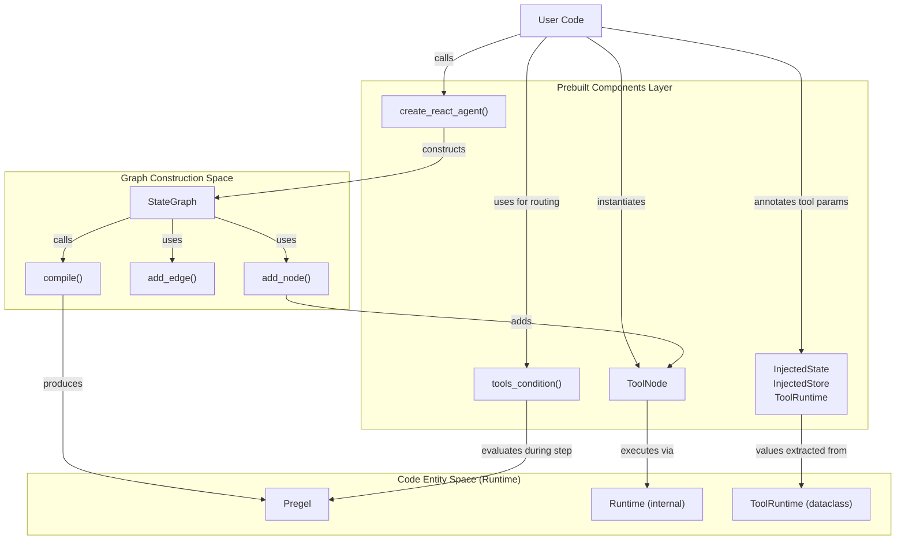
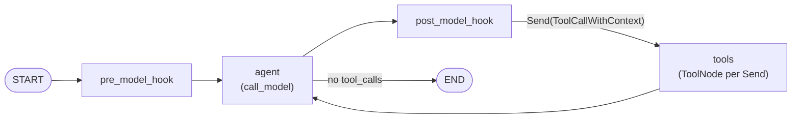
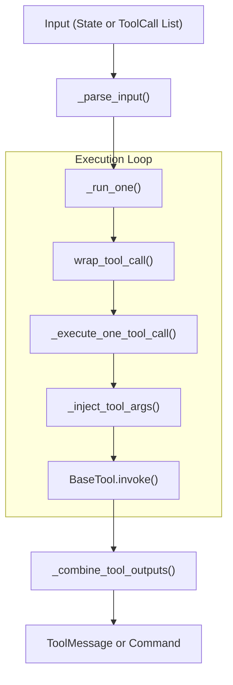

<!-- source: DeepWiki mcp.deepwiki.com · repo langchain-ai/langgraph · page 8 Prebuilt Components · fetched 2026-10-26 -->

# Prebuilt Components

<details>
<summary>Relevant source files</summary>

The following files were used as context for generating this wiki page:

- [libs/langgraph/langgraph/graph/__init__.py](libs/langgraph/langgraph/graph/__init__.py)
- [libs/prebuilt/langgraph/prebuilt/chat_agent_executor.py](libs/prebuilt/langgraph/prebuilt/chat_agent_executor.py)
- [libs/prebuilt/langgraph/prebuilt/tool_node.py](libs/prebuilt/langgraph/prebuilt/tool_node.py)
- [libs/prebuilt/langgraph/prebuilt/tool_validator.py](libs/prebuilt/langgraph/prebuilt/tool_validator.py)
- [libs/prebuilt/tests/test_deprecation.py](libs/prebuilt/tests/test_deprecation.py)
- [libs/prebuilt/tests/test_injected_state_not_required.py](libs/prebuilt/tests/test_injected_state_not_required.py)
- [libs/prebuilt/tests/test_on_tool_call.py](libs/prebuilt/tests/test_on_tool_call.py)
- [libs/prebuilt/tests/test_react_agent.py](libs/prebuilt/tests/test_react_agent.py)
- [libs/prebuilt/tests/test_tool_node.py](libs/prebuilt/tests/test_tool_node.py)

</details>


Prebuilt components provide high-level abstractions for common LangGraph patterns, primarily focusing on tool-using agents and tool execution infrastructure. These components abstract away graph construction details while remaining fully customizable through parameters and hooks.

For low-level graph construction APIs, see [StateGraph API](#3.1) and [Functional API (@task and @entrypoint)](#3.2). For deployment of prebuilt agents, see [CLI and Deployment](#6).

**Sources:** [libs/prebuilt/langgraph/prebuilt/__init__.py:1-23]()

## Overview

The prebuilt components module exports the following components from [libs/prebuilt/langgraph/prebuilt/__init__.py:1-23]():

| Component | Status | Purpose |
|-----------|--------|---------|
| `ToolNode` | Active | Execute tool calls with parallel execution, error handling, and injection |
| `tools_condition` | Active | Utility function for conditional routing based on tool calls |
| `InjectedState` | Active | Annotation for injecting graph state into tools |
| `InjectedStore` | Active | Annotation for injecting persistent store into tools |
| `ToolRuntime` | Active | Bundle of runtime context for tools |
| `create_react_agent` | **Deprecated** | Build ReAct agents — use `langchain.agents.create_agent` instead |
| `ValidationNode` | **Deprecated** | Validate tool calls against schemas — use `create_agent` with custom error handling |

> **Migration note:** `create_react_agent` and several related types (`AgentState`, `AgentStatePydantic`, `AgentStateWithStructuredResponse`) were moved to the `langchain` package as of `LangGraphDeprecatedSinceV10`. See the [Deprecated Components](#deprecated-components) section for details. [libs/prebuilt/langgraph/prebuilt/chat_agent_executor.py:53-116](), [libs/prebuilt/langgraph/prebuilt/tool_validator.py:43-47]()

**Sources:** [libs/prebuilt/langgraph/prebuilt/__init__.py:1-23](), [libs/prebuilt/langgraph/prebuilt/chat_agent_executor.py:53-116](), [libs/prebuilt/langgraph/prebuilt/tool_validator.py:43-47]()

## Architecture: Prebuilt Components in Execution Pipeline

The following diagram bridges the gap between high-level prebuilt abstractions and the underlying graph execution engine by mapping prebuilt classes to their runtime execution entities.

**Prebuilt to Code Entity Mapping**


**Sources:** [libs/prebuilt/langgraph/prebuilt/chat_agent_executor.py:1-116](), [libs/prebuilt/langgraph/prebuilt/tool_node.py:1-38](), [libs/prebuilt/langgraph/prebuilt/tool_node.py:1691-1710]()

## create_react_agent Function

> **Deprecated since `LangGraphDeprecatedSinceV10`.** Use `create_agent` from `langchain.agents` instead. The function remains available for backwards compatibility but will be removed in a future version. [libs/prebuilt/langgraph/prebuilt/chat_agent_executor.py:274-278]()

The `create_react_agent` function constructs a `CompiledStateGraph` that implements the ReAct (Reasoning and Acting) pattern. It creates a graph with an agent node that calls an LLM and a tools node that executes tool calls. It supports both standard message-based state and structured response generation. [libs/prebuilt/langgraph/prebuilt/chat_agent_executor.py:274-320]()

For details, see [ReAct Agent (create_react_agent)](#8.1).

### Graph Structure

The compiled graph differs based on the `version` parameter. In `v1`, a single `ToolNode` receives all tool calls. In `v2` (default), each individual tool call is dispatched to a separate node instance using the `Send` API (`ToolCallWithContext`), enabling parallel execution and correct pause/resume semantics. [libs/prebuilt/langgraph/prebuilt/chat_agent_executor.py:843-853]()

**`create_react_agent` v2 graph topology**



**Sources:** [libs/prebuilt/langgraph/prebuilt/chat_agent_executor.py:843-853](), [libs/prebuilt/langgraph/prebuilt/tool_node.py:282-303]()

## ToolNode Class

`ToolNode` is a `RunnableCallable` that executes tool calls from language model outputs. It handles parallel execution, robust error handling with customizable templates, and argument injection. [libs/prebuilt/langgraph/prebuilt/tool_node.py:18-38]()

For details, see [ToolNode and Tool Execution](#8.2).

### Tool Execution Pipeline

`ToolNode` processes inputs (either as graph state or direct tool call lists) through an execution loop that supports interceptors via `wrap_tool_call`. [libs/prebuilt/langgraph/prebuilt/tool_node.py:786-847]()

**Tool Execution Logic**


**Sources:** [libs/prebuilt/langgraph/prebuilt/tool_node.py:786-847](), [libs/prebuilt/langgraph/prebuilt/tool_node.py:1029-1163]()

## Dependency Injection System

`ToolNode` provides injection annotations that allow tools to receive system-provided values without the LLM needing to supply them. These are identified at initialization time. [libs/prebuilt/langgraph/prebuilt/tool_node.py:12-14]()

| Annotation | Code Entity | Purpose |
|------------|-------------|---------|
| `InjectedState` | `langgraph.prebuilt.InjectedState` | Inject specific fields or the entire graph state into a tool parameter [libs/prebuilt/langgraph/prebuilt/tool_node.py:1495-1601]() |
| `InjectedStore` | `langgraph.prebuilt.InjectedStore` | Inject the `BaseStore` instance for cross-thread persistent storage [libs/prebuilt/langgraph/prebuilt/tool_node.py:1604-1688]() |
| `ToolRuntime` | `langgraph.prebuilt.ToolRuntime` | Inject a bundle containing `state`, `config`, `store`, and `stream_writer` [libs/prebuilt/langgraph/prebuilt/tool_node.py:1691-1834]() |

**Sources:** [libs/prebuilt/langgraph/prebuilt/tool_node.py:1495-1834](), [libs/prebuilt/tests/test_injected_state_not_required.py:26-45]()

## UI Integration

LangGraph supports UI-specific messaging patterns via `UIMessage` and `RemoveUIMessage`. These are integrated into the prebuilt components to allow tools to push transient updates to the front-end without polluting the model's chat history. [libs/prebuilt/langgraph/prebuilt/tool_node.py:63-70]()

For details, see [UI Integration](#8.3).

**Sources:** [libs/prebuilt/langgraph/prebuilt/tool_node.py:63-70]()

## Deprecated Components

Several components in this module are deprecated as of `LangGraphDeprecatedSinceV10` and will be removed in a future major version.

### create_react_agent

Deprecated in favor of `create_agent` from `langchain.agents`. The underlying graph construction logic and `ToolNode` integration remain in this package for compatibility. [libs/prebuilt/langgraph/prebuilt/chat_agent_executor.py:274-278]()

**Sources:** [libs/prebuilt/langgraph/prebuilt/chat_agent_executor.py:274-278]()

### AgentState / AgentStatePydantic

The default state schemas used by `create_react_agent` define `messages` (with `add_messages` reducer) and `remaining_steps` fields. Both moved to `langchain.agents`. [libs/prebuilt/langgraph/prebuilt/chat_agent_executor.py:53-116]()

**Sources:** [libs/prebuilt/langgraph/prebuilt/chat_agent_executor.py:53-116]()

### ValidationNode

`ValidationNode` validates tool calls against Pydantic schemas without executing them. Deprecated in favor of using `create_agent` with custom tool error handling. [libs/prebuilt/langgraph/prebuilt/tool_validator.py:43-47]()

**Sources:** [libs/prebuilt/langgraph/prebuilt/tool_validator.py:43-114]()

## Testing Utilities

Test files demonstrate common patterns for using prebuilt components outside graph context, specifically requiring a mock `Runtime` or `ToolRuntime` to be provided in the `RunnableConfig`'s `configurable` dictionary under `__pregel_runtime`. [libs/prebuilt/tests/test_tool_node.py:55-81]()

```python
def _create_mock_runtime(store: BaseStore | None = None) -> Mock:
    mock_runtime = Mock()
    mock_runtime.store = store
    mock_runtime.context = None
    mock_runtime.stream_writer = lambda *args, **kwargs: None
    return mock_runtime

def _create_config_with_runtime(store: BaseStore | None = None) -> RunnableConfig:
    return {"configurable": {"__pregel_runtime": _create_mock_runtime(store)}}
```

**Sources:** [libs/prebuilt/tests/test_react_agent.py:67-87](), [libs/prebuilt/tests/test_tool_node.py:55-81](), [libs/prebuilt/tests/test_injected_state_not_required.py:48-80]()

---

