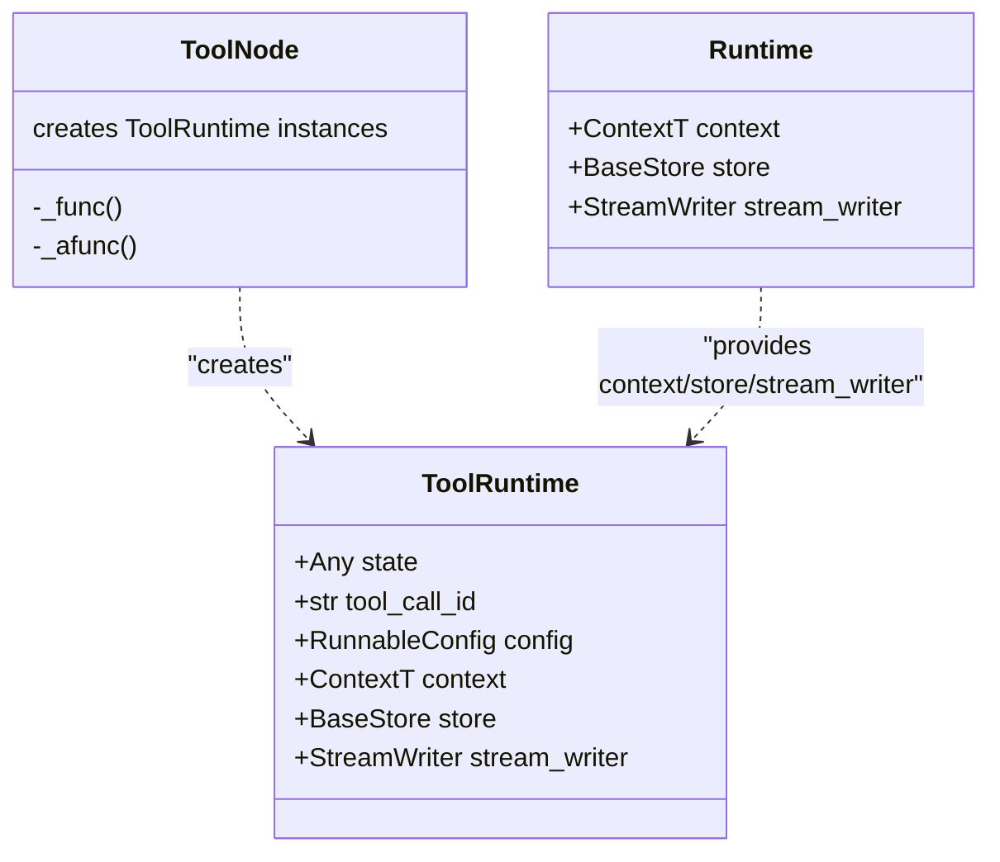
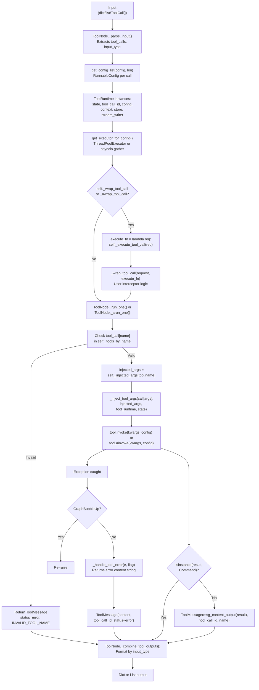
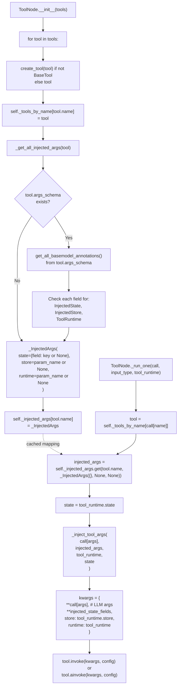
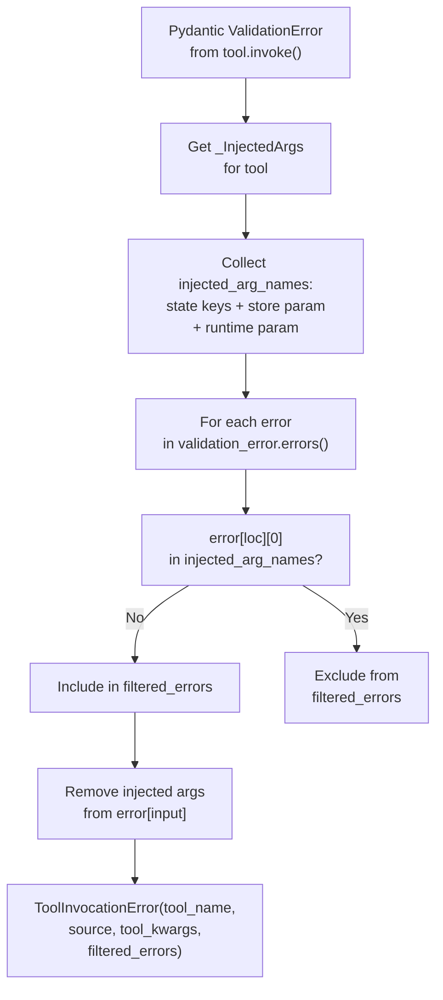
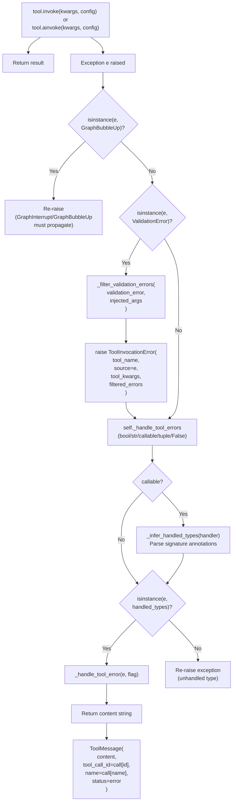
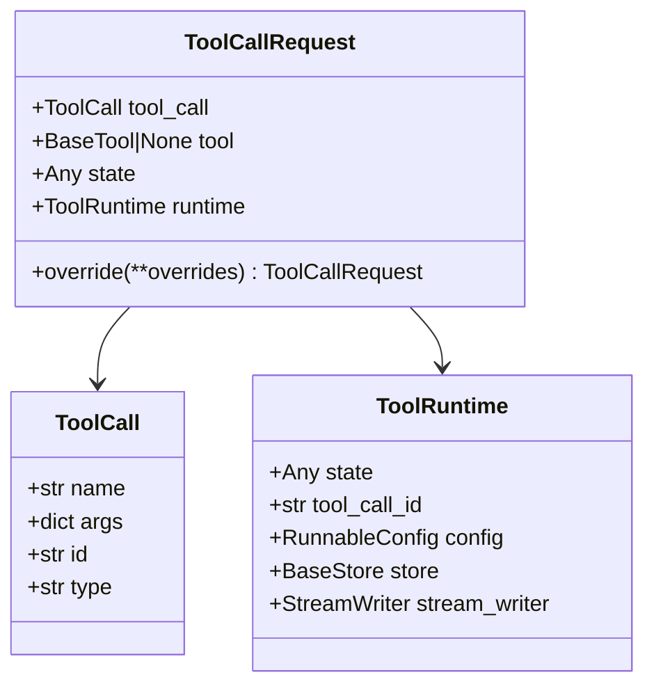
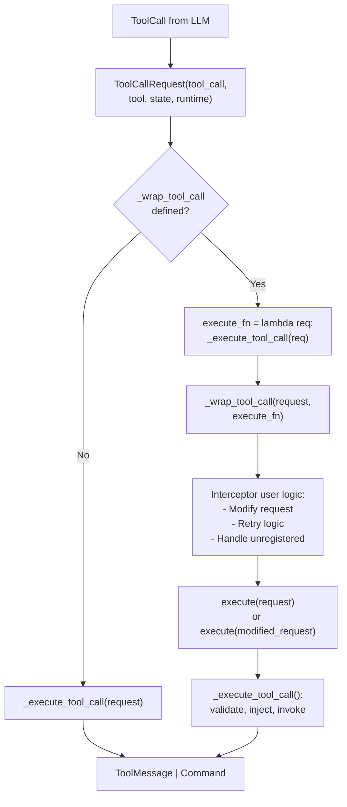
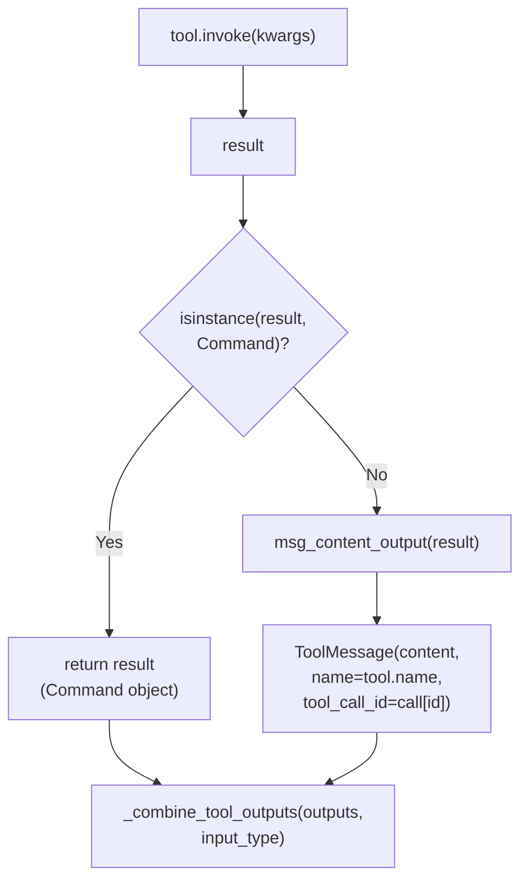
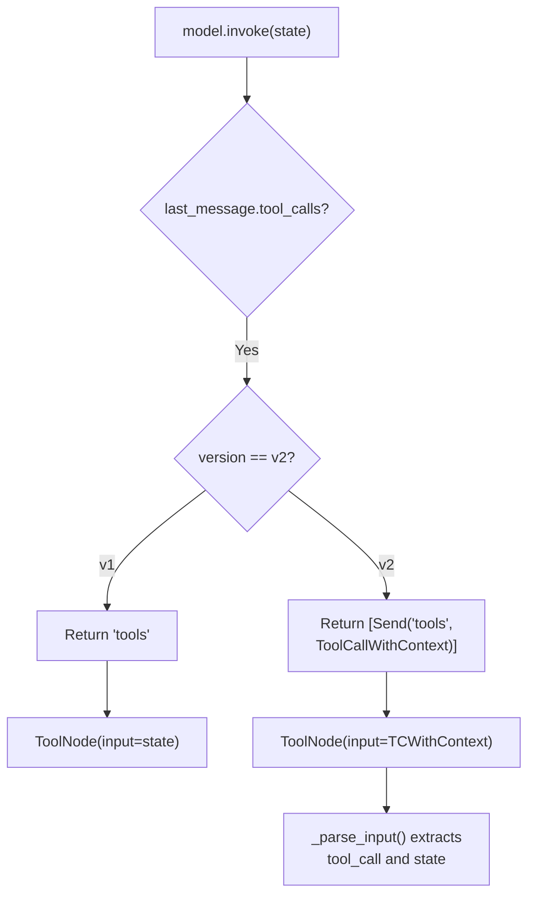

<!-- source: DeepWiki mcp.deepwiki.com · repo langchain-ai/langgraph · page 8.2 ToolNode and Tool Execution · fetched 2026-10-26 -->

# ToolNode and Tool Execution

<details>
<summary>Relevant source files</summary>

The following files were used as context for generating this wiki page:

- [libs/langgraph/langgraph/graph/__init__.py](libs/langgraph/langgraph/graph/__init__.py)
- [libs/prebuilt/langgraph/prebuilt/__init__.py](libs/prebuilt/langgraph/prebuilt/__init__.py)
- [libs/prebuilt/langgraph/prebuilt/chat_agent_executor.py](libs/prebuilt/langgraph/prebuilt/chat_agent_executor.py)
- [libs/prebuilt/langgraph/prebuilt/tool_node.py](libs/prebuilt/langgraph/prebuilt/tool_node.py)
- [libs/prebuilt/langgraph/prebuilt/tool_validator.py](libs/prebuilt/langgraph/prebuilt/tool_validator.py)
- [libs/prebuilt/tests/test_deprecation.py](libs/prebuilt/tests/test_deprecation.py)
- [libs/prebuilt/tests/test_injected_state_not_required.py](libs/prebuilt/tests/test_injected_state_not_required.py)
- [libs/prebuilt/tests/test_on_tool_call.py](libs/prebuilt/tests/test_on_tool_call.py)
- [libs/prebuilt/tests/test_react_agent.py](libs/prebuilt/tests/test_react_agent.py)
- [libs/prebuilt/tests/test_tool_node.py](libs/prebuilt/tests/test_tool_node.py)
- [libs/prebuilt/tests/test_tool_node_interceptor_unregistered.py](libs/prebuilt/tests/test_tool_node_interceptor_unregistered.py)
- [libs/prebuilt/tests/test_tool_node_validation_error_filtering.py](libs/prebuilt/tests/test_tool_node_validation_error_filtering.py)

</details>


## Purpose and Scope

This page documents the `ToolNode` class and the tool execution system in LangGraph's prebuilt components. `ToolNode` is a sophisticated execution engine that handles tool invocation, dependency injection, error handling, and control flow for agent workflows.

`ToolNode` provides the low-level tool execution machinery used by higher-level components. For information about building complete ReAct-style agents that use `ToolNode` internally, see [ReAct Agent (create_react_agent)](8.1). For UI-related tool patterns, see [UI Integration](8.3).

**Sources:** [libs/prebuilt/langgraph/prebuilt/tool_node.py:1-38]()

---

## Core Components

### ToolNode Class

`ToolNode` extends `RunnableCallable` to execute tools in LangGraph workflows with parallel execution, dependency injection, and configurable error handling.

**Constructor signature:**
```python
ToolNode(
    tools: Sequence[BaseTool | Callable],
    name: str = "tools",
    tags: list[str] | None = None,
    handle_tool_errors: bool | str | Callable | type[Exception] | tuple = _default_handle_tool_errors,
    messages_key: str = "messages",
    wrap_tool_call: ToolCallWrapper | None = None,
    awrap_tool_call: AsyncToolCallWrapper | None = None,
)
```

**Key attributes:**
- `_tools_by_name: dict[str, BaseTool]` - Maps tool names to tool instances [[libs/prebuilt/langgraph/prebuilt/tool_node.py:773-781]()]
- `_injected_args: dict[str, _InjectedArgs]` - Cached injection metadata per tool [[libs/prebuilt/langgraph/prebuilt/tool_node.py:773-781]()]
- `_handle_tool_errors` - Error handling configuration [[libs/prebuilt/langgraph/prebuilt/tool_node.py:769-769]()]
- `_messages_key` - State key for message list (default: `"messages"`) [[libs/prebuilt/langgraph/prebuilt/tool_node.py:770-770]()]
- `_wrap_tool_call` / `_awrap_tool_call` - Optional interceptor functions [[libs/prebuilt/langgraph/prebuilt/tool_node.py:771-772]()]

**Key methods:**
- `_func(input, config, runtime)` - Synchronous execution entry point [[libs/prebuilt/langgraph/prebuilt/tool_node.py:787-817]()]
- `_afunc(input, config, runtime)` - Asynchronous execution entry point [[libs/prebuilt/langgraph/prebuilt/tool_node.py:819-848]()]
- `_parse_input(input)` - Extracts tool calls from input (dict/list/ToolCall[]) [[libs/prebuilt/langgraph/prebuilt/tool_node.py:916-976]()]
- `_run_one(call, input_type, tool_runtime)` - Executes single tool call [[libs/prebuilt/langgraph/prebuilt/tool_node.py:978-1001]()]
- `_execute_tool_call(request)` - Core execution logic with validation and injection [[libs/prebuilt/langgraph/prebuilt/tool_node.py:1059-1130]()]
- `_combine_tool_outputs(outputs, input_type)` - Formats results by input type [[libs/prebuilt/langgraph/prebuilt/tool_node.py:850-914]()]

**Sources:** [libs/prebuilt/langgraph/prebuilt/tool_node.py:616-1130]()

### ToolRuntime

`ToolRuntime` is a dataclass that bundles runtime context for injection into tools. It provides access to state, tool call metadata, and graph utilities.

**ToolRuntime Structure:**



**Sources:** [libs/prebuilt/langgraph/prebuilt/tool_node.py:21-22](), [libs/prebuilt/langgraph/prebuilt/tool_node.py:796-808](), [libs/prebuilt/langgraph/prebuilt/tool_node.py:829-840]()

### Dependency Injection Annotations

Three primary annotations enable dependency injection into tool arguments:

| Annotation | Purpose | Example |
|------------|---------|---------|
| `InjectedState` | Inject entire state or specific field | `state: Annotated[dict, InjectedState]` |
| `InjectedStore` | Inject persistent store | `store: Annotated[BaseStore, InjectedStore()]` |
| `ToolRuntime` | Inject complete runtime bundle | `runtime: ToolRuntime` |

`InjectedState` also supports `NotRequired` fields in state schemas, injecting `None` instead of raising a `KeyError` if the field is missing [[libs/prebuilt/tests/test_injected_state_not_required.py:86-115]()].

**Sources:** [libs/prebuilt/langgraph/prebuilt/__init__.py:1-22](), [libs/prebuilt/langgraph/prebuilt/tool_node.py:562-614](), [libs/prebuilt/tests/test_injected_state_not_required.py:1-20]()

### tools_condition

`tools_condition` is a utility function for conditional routing based on whether the last message contains tool calls. It returns `"tools"` if tool calls are present, otherwise `END`.

**Sources:** [libs/prebuilt/langgraph/prebuilt/tool_node.py:1230-1254]()

---

## Tool Execution Architecture

The following diagram illustrates how tool calls flow through the `ToolNode` execution pipeline:

**Tool Execution Flow**



**Sources:** [libs/prebuilt/langgraph/prebuilt/tool_node.py:787-848](), [libs/prebuilt/langgraph/prebuilt/tool_node.py:916-1057]()

---

## Input and Output Formats

### Input Formats

`ToolNode` handles three primary input formats via `_parse_input()`:

**1. Graph State Dictionary**
```python
{
    "messages": [
        AIMessage("", tool_calls=[
            {"name": "tool1", "args": {"x": 1}, "id": "call_1"}
        ])
    ]
}
```

**2. Message List**
```python
[
    AIMessage("", tool_calls=[
        {"name": "tool1", "args": {"x": 1}, "id": "call_1"}
    ])
]
```

**3. Direct Tool Calls**
```python
[
    {"name": "tool1", "args": {"x": 1}, "id": "call_1", "type": "tool_call"}
]
```

**Sources:** [libs/prebuilt/langgraph/prebuilt/tool_node.py:631-656](), [libs/prebuilt/langgraph/prebuilt/tool_node.py:916-976]()

### Output Formats

Output is formatted by `_combine_tool_outputs()` based on the detected `input_type`:

- **Dict input:** Returns `{"messages": [ToolMessage(...)]}` [[libs/prebuilt/langgraph/prebuilt/tool_node.py:850-865]()]
- **List input:** Returns `[ToolMessage(...)]` [[libs/prebuilt/langgraph/prebuilt/tool_node.py:866-871]()]
- **Command output:** If tools return `Command` objects, they are returned directly in the list [[libs/prebuilt/langgraph/prebuilt/tool_node.py:850-914]()]

**Sources:** [libs/prebuilt/langgraph/prebuilt/tool_node.py:850-914]()

---

## Dependency Injection System

### Architecture

The injection system analyzes tool signatures during initialization and stores metadata in `_injected_args`.

**Dependency Injection Flow**



**Sources:** [libs/prebuilt/langgraph/prebuilt/tool_node.py:737-781](), [libs/prebuilt/langgraph/prebuilt/tool_node.py:1132-1228](), [libs/prebuilt/langgraph/prebuilt/tool_node.py:562-614](), [libs/prebuilt/langgraph/prebuilt/tool_node.py:1059-1130]()

### Validation Error Filtering

`ToolNode` implements `_filter_validation_errors()` to remove injected arguments from Pydantic `ValidationError` messages. This ensures the LLM only receives feedback about parameters it controls [[libs/prebuilt/langgraph/prebuilt/tool_node.py:506-560]()].

**Validation Error Processing:**



**Sources:** [libs/prebuilt/langgraph/prebuilt/tool_node.py:506-560](), [libs/prebuilt/tests/test_tool_node_validation_error_filtering.py:1-470]()

---

## Error Handling

### Configuration Strategies

The `handle_tool_errors` parameter supports several modes [[libs/prebuilt/langgraph/prebuilt/tool_node.py:668-690]()]:

- **`True`**: Catches all exceptions and returns a default error template [[libs/prebuilt/langgraph/prebuilt/tool_node.py:423-426]()].
- **`str`**: Catches all exceptions and returns the provided string [[libs/prebuilt/langgraph/prebuilt/tool_node.py:421-422]()].
- **`Callable`**: Invokes the function with the exception and returns the result [[libs/prebuilt/langgraph/prebuilt/tool_node.py:419-420]()].
- **`type[Exception]`**: Only catches specific exception types [[libs/prebuilt/langgraph/prebuilt/tool_node.py:423-426]()].

### Error Handler Implementation

**Error Handling Architecture:**



**Sources:** [libs/prebuilt/langgraph/prebuilt/tool_node.py:379-438](), [libs/prebuilt/langgraph/prebuilt/tool_node.py:978-1057](), [libs/prebuilt/langgraph/prebuilt/tool_node.py:440-504]()

---

## Tool Call Interceptors

### ToolCallRequest and Interceptors

Interceptors (`wrap_tool_call`) allow wrapping tool execution with custom logic [[libs/prebuilt/langgraph/prebuilt/tool_node.py:198-273]()]. They receive a `ToolCallRequest` which can be modified using `override()` [[libs/prebuilt/langgraph/prebuilt/tool_node.py:166-196]()].

**ToolCallRequest Class Diagram:**



**Sources:** [libs/prebuilt/langgraph/prebuilt/tool_node.py:128-196](), [libs/prebuilt/langgraph/prebuilt/tool_node.py:198-280]()

### Interceptor Execution Flow



**Sources:** [libs/prebuilt/langgraph/prebuilt/tool_node.py:749-751](), [libs/prebuilt/langgraph/prebuilt/tool_node.py:978-1001](), [libs/prebuilt/tests/test_on_tool_call.py:1-556]()

---

## Command-Based Control Flow

Tools can return `Command` objects to update state or route the graph [[libs/prebuilt/langgraph/prebuilt/tool_node.py:1003-1057]()].

**Command Handling Flow:**



**Sources:** [libs/prebuilt/langgraph/prebuilt/tool_node.py:850-914](), [libs/prebuilt/langgraph/prebuilt/tool_node.py:1003-1057]()

---

## Integration with ReAct Agent

`create_react_agent` uses `ToolNode` to execute tool calls. In `version="v2"`, it uses `Send` to distribute tool calls to the `ToolNode` individually [[libs/prebuilt/langgraph/prebuilt/chat_agent_executor.py:844-860]()].

**ReAct Agent Tool Flow:**



**Sources:** [libs/prebuilt/langgraph/prebuilt/chat_agent_executor.py:787-953](), [libs/prebuilt/langgraph/prebuilt/tool_node.py:282-303](), [libs/prebuilt/langgraph/prebuilt/tool_node.py:916-976]()

---

