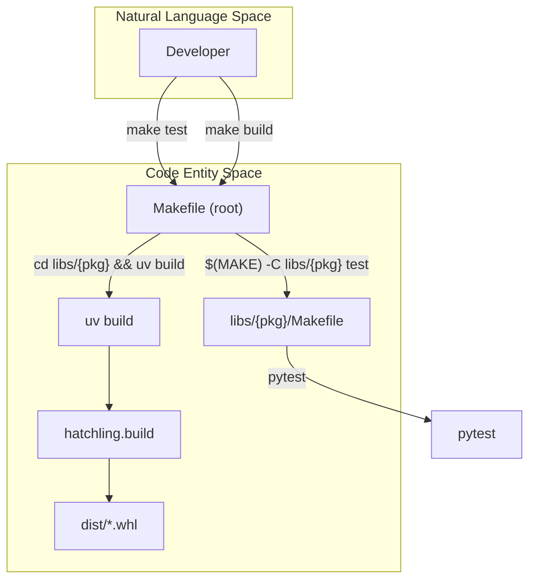
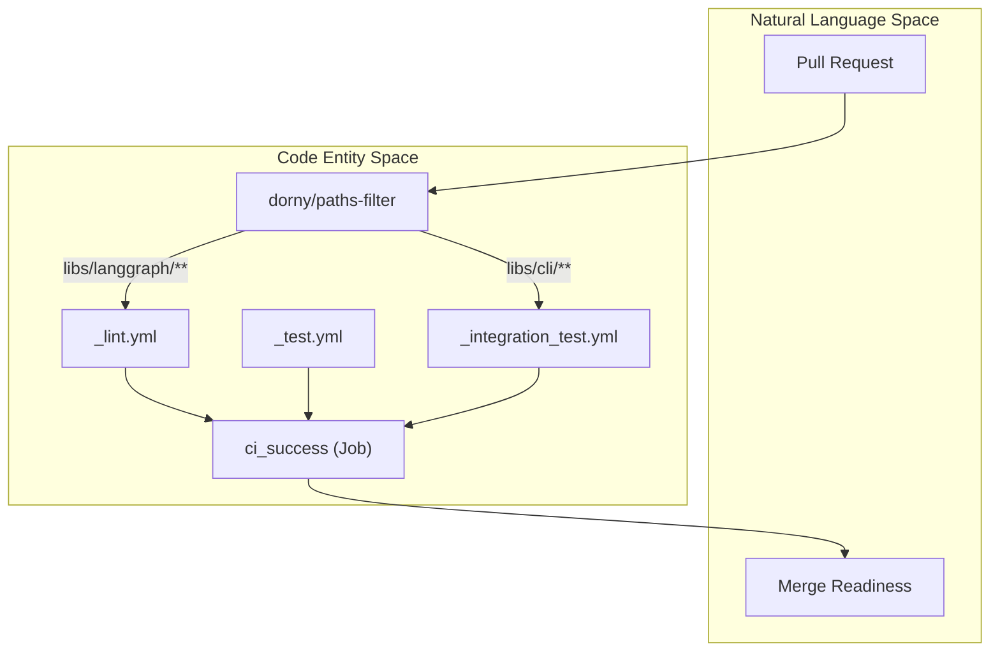

<!-- source: DeepWiki mcp.deepwiki.com · repo langchain-ai/langgraph · page 9 Development Infrastructure · fetched 2026-10-26 -->

# Development Infrastructure

<details>
<summary>Relevant source files</summary>

The following files were used as context for generating this wiki page:

- [.github/workflows/_integration_test.yml](.github/workflows/_integration_test.yml)
- [.github/workflows/_lint.yml](.github/workflows/_lint.yml)
- [.github/workflows/_sdk_integration_test.yml](.github/workflows/_sdk_integration_test.yml)
- [.github/workflows/_test.yml](.github/workflows/_test.yml)
- [.github/workflows/_test_langgraph.yml](.github/workflows/_test_langgraph.yml)
- [.github/workflows/_test_release.yml](.github/workflows/_test_release.yml)
- [.github/workflows/baseline.yml](.github/workflows/baseline.yml)
- [.github/workflows/bench.yml](.github/workflows/bench.yml)
- [.github/workflows/ci.yml](.github/workflows/ci.yml)
- [.github/workflows/deploy-redirects.yml](.github/workflows/deploy-redirects.yml)
- [.github/workflows/release.yml](.github/workflows/release.yml)
- [.github/workflows/uv_lock_ugprade.yml](.github/workflows/uv_lock_ugprade.yml)
- [libs/checkpoint-conformance/uv.lock](libs/checkpoint-conformance/uv.lock)
- [libs/checkpoint-postgres/pyproject.toml](libs/checkpoint-postgres/pyproject.toml)
- [libs/checkpoint-postgres/uv.lock](libs/checkpoint-postgres/uv.lock)
- [libs/checkpoint-sqlite/pyproject.toml](libs/checkpoint-sqlite/pyproject.toml)
- [libs/checkpoint-sqlite/uv.lock](libs/checkpoint-sqlite/uv.lock)
- [libs/checkpoint/pyproject.toml](libs/checkpoint/pyproject.toml)
- [libs/checkpoint/uv.lock](libs/checkpoint/uv.lock)
- [libs/langgraph/pyproject.toml](libs/langgraph/pyproject.toml)
- [libs/langgraph/uv.lock](libs/langgraph/uv.lock)
- [libs/prebuilt/pyproject.toml](libs/prebuilt/pyproject.toml)
- [libs/prebuilt/uv.lock](libs/prebuilt/uv.lock)
- [libs/sdk-py/uv.lock](libs/sdk-py/uv.lock)

</details>


This page provides an overview of the tooling and automation that supports development across the LangGraph monorepo. It covers the monorepo organization, dependency management with `uv`, testing infrastructure, and the automated CI/CD pipelines.

For detailed information on individual topics, see:
- [Monorepo Structure and Build System](#9.1)
- [Testing Infrastructure](#9.2)
- [CI/CD Workflows](#9.3)
- [Release Process](#9.4)

---

## Repository Layout

All publishable packages live under the `libs/` directory. The root of the repository contains a top-level `Makefile` that orchestrates operations across every package.

```
langgraph/               ← repository root
├── Makefile             ← root orchestrator
└── libs/
    ├── langgraph/       ← core library [libs/langgraph/pyproject.toml:6]()
    ├── checkpoint/      ← base checkpoint interfaces [libs/checkpoint/pyproject.toml:6]()
    ├── checkpoint-postgres/ ← Postgres implementation [libs/checkpoint-postgres/pyproject.toml:6]()
    ├── checkpoint-sqlite/   ← SQLite implementation [libs/checkpoint-sqlite/pyproject.toml:6]()
    ├── checkpoint-conformance/ ← interface compliance tests [/.github/workflows/ci.yml:71]()
    ├── prebuilt/        ← prebuilt nodes and agents [libs/prebuilt/pyproject.toml:6]()
    ├── sdk-py/          ← Python SDK client [libs/sdk-py/pyproject.toml:6]()
    └── cli/             ← Command line interface [libs/cli/pyproject.toml:6]()
```

Each package under `libs/` owns its own `Makefile`, `pyproject.toml`, and `uv.lock`. The root `Makefile` iterates over `libs/*` and delegates to each package's `Makefile`.

Sources: [libs/langgraph/pyproject.toml:1-33](), [libs/prebuilt/pyproject.toml:1-29](), [libs/langgraph/uv.lock:1](), [libs/prebuilt/uv.lock:1](), [libs/checkpoint/pyproject.toml:5-17](), [libs/checkpoint-postgres/pyproject.toml:5-19]()

---

## Build System Overview

LangGraph uses [hatchling](https://hatch.pypa.io/latest/) as the build backend for its Python packages [libs/langgraph/pyproject.toml:1-3]().

**Build System Orchestration**



Sources: [libs/langgraph/pyproject.toml:1-3](), [libs/prebuilt/pyproject.toml:1-3](), [/.github/workflows/_test.yml:50]()

### Dependency Management

The monorepo leverages [`uv`](https://github.com/astral-sh/uv) for fast, reproducible dependency resolution.

- **Lock Files**: Each package maintains a standalone `uv.lock` file to ensure consistent environments [libs/langgraph/uv.lock:1](), [libs/prebuilt/uv.lock:1](), [libs/sdk-py/uv.lock:1](), [libs/checkpoint/uv.lock:1]().
- **Local Sources**: Packages reference each other using relative paths in the `[tool.uv.sources]` section, enabling seamless local development. For example, `langgraph` uses local paths for `langgraph-checkpoint` and `langgraph-sdk` [libs/langgraph/pyproject.toml:83-89]().
- **Dependency Groups**: Development tools are organized into `test`, `lint`, and `dev` groups to minimize production environment size [libs/langgraph/pyproject.toml:45-80](), [libs/prebuilt/pyproject.toml:37-59](), [libs/checkpoint/pyproject.toml:25-46]().

---

## Testing Infrastructure

LangGraph employs a comprehensive testing strategy using `pytest` and specialized fixtures to handle multiple persistence backends.

### Test Matrix and Fixtures

The testing infrastructure runs logic against various state managers and environment configurations. The `langgraph` package specifically tests against multiple Python versions from 3.10 to 3.14 [/.github/workflows/_test_langgraph.yml:14-19]().

| Component | Implementations Tested |
|---|---|
| **Checkpointers** | Memory, SQLite, Postgres [libs/langgraph/pyproject.toml:58-60]() |
| **SDK/CLI** | Python SDK, CLI integration [libs/langgraph/pyproject.toml:61-68]() |
| **Special Modes** | Strict Msgpack Pregel tests [/.github/workflows/_test_langgraph.yml:48-53]() |

### Benchmarking

Performance is tracked via `pyperf` to prevent regressions in core graph execution logic.

- **Baseline**: A baseline is maintained and restored from the GHA cache [/.github/workflows/bench.yml:32-40]().
- **Comparison**: PRs trigger `make benchmark-fast`, which compares current performance against `benchmark-baseline.json` using `pyperf compare_to` [/.github/workflows/bench.yml:41-58]().

Sources: [libs/langgraph/pyproject.toml:46-70](), [/.github/workflows/bench.yml:12-58](), [libs/checkpoint/pyproject.toml:51-54]()

---

## CI/CD Workflows

Automation is handled via GitHub Actions, focusing on change detection and cross-package validation.

**CI Entity Mapping**



Sources: [/.github/workflows/ci.yml:26-50](), [/.github/workflows/ci.yml:173-198]()

### Key Workflow Features
- **Path Filtering**: The `changes` job uses `dorny/paths-filter` to ensure only modified packages are re-tested [/.github/workflows/ci.yml:31-50]().
- **Integration Testing**: The `_integration_test.yml` workflow builds Docker images and verifies them against a live LangSmith environment [/.github/workflows/_integration_test.yml:57-74]().
- **Schema Validation**: CI verifies that `langgraph.json` configuration schemas haven't drifted by running `generate_schema.py` in the `libs/cli` directory [/.github/workflows/ci.yml:144-157]().
- **SDK Consistency**: The `check-sdk-methods` job ensures that the SDK implementation matches the expected API surface [/.github/workflows/ci.yml:109-122]().

---

## Release Process

Releases are triggered manually via `workflow_dispatch` and follow a strict security-first "Trusted Publishing" model [/.github/workflows/release.yml:4-9]().

1. **Build**: Distribution files are built in an isolated job using `uv build` [/.github/workflows/release.yml:48-50]().
2. **TestPyPI**: Packages are published to TestPyPI first for validation [/.github/workflows/release.yml:142-152]().
3. **Validation**: The `pre-release-checks` job installs the package from TestPyPI to ensure no missing dependencies exist in the published artifact [/.github/workflows/release.yml:183-193]().
4. **Trusted Publishing**: Final release to PyPI uses OIDC tokens (`id-token: write`), removing the need for long-lived repository secrets [/.github/workflows/release.yml:148]().

Sources: [/.github/workflows/release.yml:1-11](), [/.github/workflows/release.yml:142-152](), [/.github/workflows/release.yml:183-193]()

---

