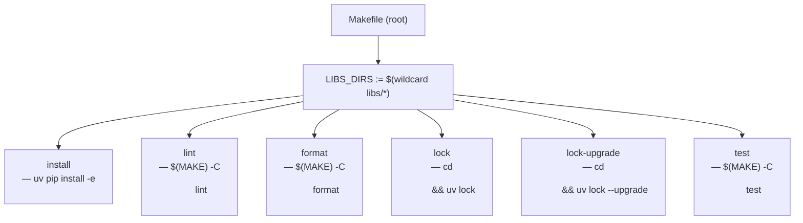
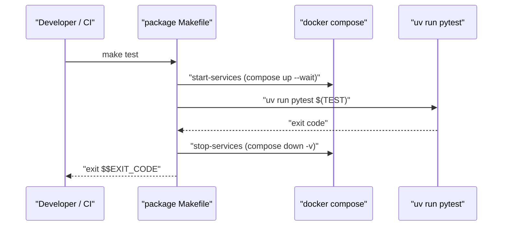
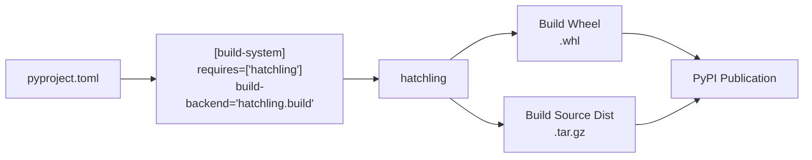

<!-- source: DeepWiki mcp.deepwiki.com · repo langchain-ai/langgraph · page 9.1 Monorepo Structure and Build System · fetched 2026-10-26 -->

# Monorepo Structure and Build System

<details>
<summary>Relevant source files</summary>

The following files were used as context for generating this wiki page:

- [libs/checkpoint-conformance/uv.lock](libs/checkpoint-conformance/uv.lock)
- [libs/checkpoint-postgres/pyproject.toml](libs/checkpoint-postgres/pyproject.toml)
- [libs/checkpoint-postgres/uv.lock](libs/checkpoint-postgres/uv.lock)
- [libs/checkpoint-sqlite/Makefile](libs/checkpoint-sqlite/Makefile)
- [libs/checkpoint-sqlite/pyproject.toml](libs/checkpoint-sqlite/pyproject.toml)
- [libs/checkpoint-sqlite/uv.lock](libs/checkpoint-sqlite/uv.lock)
- [libs/checkpoint/Makefile](libs/checkpoint/Makefile)
- [libs/checkpoint/pyproject.toml](libs/checkpoint/pyproject.toml)
- [libs/checkpoint/uv.lock](libs/checkpoint/uv.lock)
- [libs/cli/Makefile](libs/cli/Makefile)
- [libs/langgraph/Makefile](libs/langgraph/Makefile)
- [libs/langgraph/pyproject.toml](libs/langgraph/pyproject.toml)
- [libs/langgraph/tests/conftest.py](libs/langgraph/tests/conftest.py)
- [libs/langgraph/uv.lock](libs/langgraph/uv.lock)
- [libs/prebuilt/pyproject.toml](libs/prebuilt/pyproject.toml)
- [libs/prebuilt/uv.lock](libs/prebuilt/uv.lock)
- [libs/sdk-py/Makefile](libs/sdk-py/Makefile)
- [libs/sdk-py/uv.lock](libs/sdk-py/uv.lock)

</details>


This document describes the organization of the LangGraph repository as a Python monorepo, including the package structure, build system configuration, workspace dependency management, and the role of the `uv` package manager.

---

## Overview

The LangGraph repository is structured as a **monorepo** with multiple independent but related Python packages located in the `libs/` directory. Each package is independently versioned and published to PyPI, but they share a common development environment and build infrastructure. The monorepo uses `uv` as the package manager and supports editable workspace dependencies for efficient local development.

---

## Directory Structure

The repository organizes packages in a flat hierarchy under `libs/`:

**Monorepo Hierarchy and Code Entities**
```mermaid
graph TB
    [Root] --> [libs/]
    
    [libs/] --> [langgraph]
    [libs/] --> [checkpoint]
    [libs/] --> [checkpoint-postgres]
    [libs/] --> [checkpoint-sqlite]
    [libs/] --> [checkpoint-conformance]
    [libs/] --> [prebuilt]
    [libs/] --> [sdk-py]
    [libs/] --> [cli]
    
    subgraph "Core Execution"
    [langgraph]
    end

    subgraph "Persistence Layers"
    [checkpoint]
    [checkpoint-postgres]
    [checkpoint-sqlite]
    [checkpoint-conformance]
    end

    subgraph "Clients & Tooling"
    [sdk-py]
    [cli]
    [prebuilt]
    end
```

**Sources:** [libs/langgraph/pyproject.toml:5-7](), [libs/checkpoint/pyproject.toml:5-7](), [libs/checkpoint-postgres/pyproject.toml:5-7](), [libs/checkpoint-sqlite/pyproject.toml:5-7](), [libs/prebuilt/pyproject.toml:5-7]()

Each package directory contains:
- `pyproject.toml` — Package metadata, dependencies, and build configuration.
- `uv.lock` — Locked dependency versions (in packages with dev dependencies).
- Package source code in a subdirectory matching the package name (e.g., `libs/langgraph/langgraph`).
- `README.md` — Package-specific documentation.
- `Makefile` — Local task runner for linting, testing, and formatting.

---

## Makefile Build System

Each package ships a `Makefile` with a consistent set of targets. The repository root also has a `Makefile` that orchestrates targets across all packages.

### Root Makefile Orchestration

The root `Makefile` discovers all packages by globbing `libs/*` and delegates to each package's own `Makefile`.

**Root Makefile target dispatch**


- `install` — creates a virtual environment via `uv venv` and iterates every `libs/*/pyproject.toml` to run `uv pip install -e <dir>`, creating editable installs in the root virtual environment [libs/langgraph/Makefile:9-18]().
- `lock` — runs `uv lock` in each package directory to regenerate `uv.lock` against current constraints [libs/langgraph/Makefile:42-48]().
- `lock-upgrade` — same as `lock` but passes `--upgrade` to pull latest compatible versions [libs/langgraph/Makefile:52-58]().
- `lint`, `format`, `test` — delegates to each package's own `Makefile` via `$(MAKE) -C <dir> <target>` [libs/langgraph/Makefile:21-38, 61-67]().

### Per-Package Makefiles

Standard targets are maintained across per-package Makefiles to ensure a uniform developer experience.

| Target | What it runs | Notes |
|---|---|---|
| `lint` | `uv run ruff check .`, `uv run ruff format --diff`, `uv run ty` | Fails on any issue. [libs/langgraph/Makefile:121-127]() |
| `format` | `uv run ruff format`, `uv run ruff check --fix` | Modifies files in-place. [libs/langgraph/Makefile:131-133]() |
| `type` | `uv run ty langgraph` | Standalone type check using `ty`. [libs/langgraph/Makefile:128-129]() |
| `test` | `uv run pytest` | Orchestrates Docker services if available. [libs/langgraph/Makefile:61-74]() |
| `test_watch` | `uv run ptw` | Re-runs tests on file save using `pytest-watcher`. [libs/langgraph/Makefile:95-102]() |
| `integration_tests` | `uv run pytest integration_tests` | Long-running / external deps. [libs/langgraph/Makefile:85-86]() |
| `coverage` | `uv run pytest --cov` | Generates XML + terminal report. [libs/langgraph/Makefile:34-38]() |
| `spell_check` / `spell_fix` | `uv run codespell --toml pyproject.toml` | Typo detection. [libs/langgraph/Makefile:135-139]() |

**Sources:** [libs/langgraph/Makefile:1-157](), [libs/prebuilt/Makefile:1-83](), [libs/cli/Makefile:1-41](), [libs/sdk-py/Makefile:1-26]()

### Service Management for Tests

Packages whose tests require PostgreSQL or Redis include `start-services` and `stop-services` targets backed by Docker Compose files.

**Service lifecycle in `test` targets**


**Sources:** [libs/langgraph/Makefile:40-44](), [libs/langgraph/Makefile:61-74]()

The `langgraph` package's `test` target also manages a local `langgraph dev` server during execution [libs/langgraph/Makefile:46-56](). The `NO_DOCKER` environment variable allows skipping external services when Docker is unavailable [libs/langgraph/Makefile:59-74]().

---

## Package Dependency Graph

The packages have a clear dependency hierarchy designed to minimize coupling:

**Dependency Flow and System Names**
```mermaid
graph TB
    subgraph "Published Packages"
        [langgraph]
        [langgraph-checkpoint]
        [langgraph-checkpoint-postgres]
        [langgraph-checkpoint-sqlite]
        [langgraph-prebuilt]
        [langgraph-sdk]
    end
    
    subgraph "External Dependencies"
        [langchain-core]
        [pydantic]
        [xxhash]
    end
    
    [langgraph] --> [langgraph-checkpoint]
    [langgraph] --> [langgraph-sdk]
    [langgraph] --> [langgraph-prebuilt]
    [langgraph] --> [langchain-core]
    [langgraph] --> [pydantic]
    [langgraph] --> [xxhash]
    
    [langgraph-prebuilt] --> [langgraph-checkpoint]
    [langgraph-prebuilt] --> [langchain-core]
    
    [langgraph-checkpoint-postgres] --> [langgraph-checkpoint]
    [langgraph-checkpoint-sqlite] --> [langgraph-checkpoint]
```

**Sources:** [libs/langgraph/pyproject.toml:26-33](), [libs/prebuilt/pyproject.toml:26-29](), [libs/checkpoint-postgres/pyproject.toml:15-19](), [libs/checkpoint-sqlite/pyproject.toml:15-18]()

### Dependency Constraints

Internal package dependencies use version ranges to allow flexibility:

| Package | Checkpoint Version | SDK Version | Prebuilt Version |
|---------|-------------------|-------------|------------------|
| `langgraph` | `>=4.1.0,<5.0.0` | `>=0.4.2,<0.5.0` | `>=1.1.0,<1.2.0` |
| `langgraph-prebuilt` | `>=2.1.0,<5.0.0` | - | - |
| `langgraph-checkpoint-postgres` | `>=4.1.0,<5.0.0` | - | - |
| `langgraph-checkpoint-sqlite` | `>=4.1.0,<5.0.0` | - | - |

**Sources:** [libs/langgraph/pyproject.toml:28-30](), [libs/prebuilt/pyproject.toml:27](), [libs/checkpoint-postgres/pyproject.toml:15](), [libs/checkpoint-sqlite/pyproject.toml:15]()

---

## Build System Architecture

### Build Backend: Hatchling

All packages use `hatchling` as their build backend, configured via `pyproject.toml`:



**Sources:** [libs/langgraph/pyproject.toml:1-3](), [libs/prebuilt/pyproject.toml:1-3](), [libs/checkpoint/pyproject.toml:1-3]()

### Wheel Configuration

Each package specifies which directories to include in the built wheel. For example, `langgraph` includes the `langgraph` package [libs/langgraph/pyproject.toml:134](), while `langgraph-prebuilt` also targets the `langgraph` namespace for inclusion [libs/prebuilt/pyproject.toml:71](). Checkpoint implementations similarly include the `langgraph` namespace [libs/checkpoint-postgres/pyproject.toml:56]().

---

## Package Manager: uv

The repository uses `uv` for fast dependency resolution and cross-platform lock files.

### UV Lock Files

Each package maintains a `uv.lock` file that pins exact versions of all transitive dependencies. These lock files include SHA256 hashes and platform-specific wheels to ensure reproducible environments. The `uv.lock` files include resolution markers for different Python versions [libs/langgraph/uv.lock:4-9]().

**Sources:** [libs/langgraph/uv.lock:1-9](), [libs/prebuilt/uv.lock:1-7](), [libs/sdk-py/uv.lock:1-7](), [libs/checkpoint-postgres/uv.lock:1-7]()

---

## Workspace Dependencies and Editable Installs

### Workspace Sources Configuration

For local development, packages reference each other as editable workspace dependencies using `[tool.uv.sources]`. This allows changes in a dependency (like `langgraph-checkpoint`) to be immediately reflected in a dependent package (like `langgraph`) without a re-install.

```toml
[tool.uv.sources]
langgraph-prebuilt = { path = "../prebuilt", editable = true }
langgraph-checkpoint = { path = "../checkpoint", editable = true }
langgraph-checkpoint-sqlite = { path = "../checkpoint-sqlite", editable = true }
langgraph-checkpoint-postgres = { path = "../checkpoint-postgres", editable = true }
langgraph-sdk = { path = "../sdk-py", editable = true }
langgraph-cli = { path = "../cli", editable = true }
```

**Sources:** [libs/langgraph/pyproject.toml:83-89](), [libs/prebuilt/pyproject.toml:64-68](), [libs/checkpoint-postgres/pyproject.toml:51-53]()

---

## Dependency Groups

Packages define sets of dependencies for various purposes using `[dependency-groups]`.

| Group | Purpose | Key Dependencies |
|-------|---------|------------------|
| `test` | Testing infrastructure | `pytest`, `pytest-cov`, `syrupy`, `httpx`, `pytest-xdist`, `langgraph-checkpoint-sqlite`, `langgraph-checkpoint-postgres` |
| `lint` | Code quality | `ruff`, `ty`, `types-requests` |
| `dev` | Complete environment | Includes `test` and `lint` groups, plus `jupyter` |

**Sources:** [libs/langgraph/pyproject.toml:45-80](), [libs/prebuilt/pyproject.toml:37-59](), [libs/checkpoint/pyproject.toml:25-46]()

---

## Development Tools Configuration

### Ruff (Linting and Formatting)

Linting rules are standardized across packages, selecting for errors (`E`), pyflakes (`F`), isort (`I`), tidy-imports (`TID251`), and pyupgrade (`UP`). Specific file ignores are applied for `import-outside-top-level` (`PLC0415`) in library code [libs/langgraph/pyproject.toml:97]().

**Sources:** [libs/langgraph/pyproject.toml:91-97](), [libs/prebuilt/pyproject.toml:78-84](), [libs/checkpoint/pyproject.toml:55-70]()

### Ty (Type Checking)

Type checking rules are managed via the `ty` tool, with extensive "ignore" rules for various invalid type forms to maintain build stability while migrating [libs/langgraph/pyproject.toml:106-124]().

**Sources:** [libs/langgraph/pyproject.toml:106-124](), [libs/prebuilt/pyproject.toml:86-97](), [libs/checkpoint/pyproject.toml:73-85]()

### Pytest Configuration

Test execution settings emphasize strict configuration and timing. `langgraph` uses `--full-trace` and `--durations=5` [libs/langgraph/pyproject.toml:137](). Checkpoint packages use `asyncio_mode = "auto"` [libs/checkpoint/pyproject.toml:53]().

**Sources:** [libs/langgraph/pyproject.toml:136-137](), [libs/prebuilt/pyproject.toml:73-75](), [libs/checkpoint/pyproject.toml:51-53]()

---

## Python Version Support

All packages require Python 3.10 or higher [libs/langgraph/pyproject.toml:10](), [libs/checkpoint/pyproject.toml:10]() and explicitly support Python 3.10 through 3.13 via classifiers [libs/langgraph/pyproject.toml:21-24](). `langgraph-cli` has specific markers to exclude it from Python 3.14+ environments in the current lock configuration [libs/langgraph/pyproject.toml:67-68]().

**Sources:** [libs/langgraph/pyproject.toml:10-24](), [libs/langgraph/pyproject.toml:67-68](), [libs/checkpoint/pyproject.toml:10]()

---

