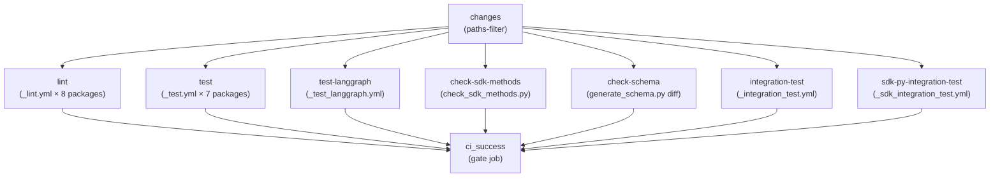
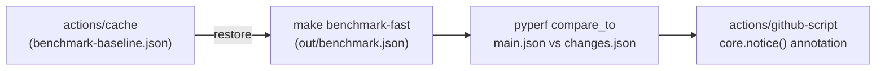

<!-- source: DeepWiki mcp.deepwiki.com · repo langchain-ai/langgraph · page 9.3 CI/CD Workflows · fetched 2026-10-26 -->

# CI/CD Workflows

Relevant source files

The following files were used as context for generating this wiki page:

- [.github/dependabot.yml](.github/dependabot.yml)
- [.github/workflows/_integration_test.yml](.github/workflows/_integration_test.yml)
- [.github/workflows/_lint.yml](.github/workflows/_lint.yml)
- [.github/workflows/_sdk_integration_test.yml](.github/workflows/_sdk_integration_test.yml)
- [.github/workflows/_test.yml](.github/workflows/_test.yml)
- [.github/workflows/_test_langgraph.yml](.github/workflows/_test_langgraph.yml)
- [.github/workflows/_test_release.yml](.github/workflows/_test_release.yml)
- [.github/workflows/baseline.yml](.github/workflows/baseline.yml)
- [.github/workflows/bench.yml](.github/workflows/bench.yml)
- [.github/workflows/ci.yml](.github/workflows/ci.yml)
- [.github/workflows/deploy-redirects.yml](.github/workflows/deploy-redirects.yml)
- [.github/workflows/release.yml](.github/workflows/release.yml)
- [.github/workflows/reopen_on_assignment.yml](.github/workflows/reopen_on_assignment.yml)
- [.github/workflows/require_issue_link.yml](.github/workflows/require_issue_link.yml)
- [.github/workflows/tag-external-issues.yml](.github/workflows/tag-external-issues.yml)
- [.github/workflows/tag-external-prs.yml](.github/workflows/tag-external-prs.yml)
- [.github/workflows/uv_lock_ugprade.yml](.github/workflows/uv_lock_ugprade.yml)
- [libs/checkpoint-conformance/Makefile](libs/checkpoint-conformance/Makefile)
- [libs/checkpoint-conformance/langgraph/checkpoint/conformance/__init__.py](libs/checkpoint-conformance/langgraph/checkpoint/conformance/__init__.py)
- [libs/checkpoint-conformance/langgraph/checkpoint/conformance/initializer.py](libs/checkpoint-conformance/langgraph/checkpoint/conformance/initializer.py)
- [libs/checkpoint-conformance/langgraph/checkpoint/conformance/report.py](libs/checkpoint-conformance/langgraph/checkpoint/conformance/report.py)
- [libs/checkpoint-conformance/langgraph/checkpoint/conformance/spec/test_copy_thread.py](libs/checkpoint-conformance/langgraph/checkpoint/conformance/spec/test_copy_thread.py)
- [libs/checkpoint-conformance/langgraph/checkpoint/conformance/spec/test_delete_for_runs.py](libs/checkpoint-conformance/langgraph/checkpoint/conformance/spec/test_delete_for_runs.py)

This page documents all GitHub Actions workflows in the LangGraph monorepo: the main CI pipeline, reusable job workflows, benchmarking pipelines, the weekly dependency lock upgrade, and the release workflow. For the release process itself (PyPI publishing, tagging, and release notes), see [9.4](). For test infrastructure details (fixtures, Docker services, conftest setup), see [9.2](). For the monorepo build system and `make` targets that these workflows invoke, see [9.1]().

---

## Workflow Inventory

All workflow files live under `.github/workflows/`. Filenames prefixed with `_` are reusable workflows, invoked via `workflow_call` from other workflows.

| File | Name | Trigger | Purpose |
|---|---|---|---|
| `ci.yml` | CI | `push` to `main`, `pull_request` | Orchestrates lint, test, schema and integration checks |
| `_lint.yml` | lint | `workflow_call` | Runs ruff and mypy per package |
| `_test.yml` | test | `workflow_call` | Runs `make test` per package across Python versions |
| `_test_langgraph.yml` | test | `workflow_call` | Runs `make test_parallel` for `libs/langgraph` specifically |
| `_integration_test.yml` | CLI integration test | `workflow_call` | Builds and smoke-tests Docker images via `langgraph build` |
| `_sdk_integration_test.yml` | sdk-py integration test | `workflow_call` | Exercises the Python SDK against the server |
| `bench.yml` | bench | `pull_request` on `libs/**` | Runs benchmarks and compares to baseline |
| `baseline.yml` | baseline | `push` to `main`, `workflow_dispatch` | Saves benchmark baseline to cache |
| `uv_lock_ugprade.yml` | UV Lock Upgrade | Weekly cron, `workflow_dispatch` | Runs `make lock-upgrade` and opens a PR |
| `release.yml` | release | `workflow_dispatch` | Full release pipeline (build → test PyPI → pre-check → publish → tag) |
| `_test_release.yml` | test-release | `workflow_call` | Builds and publishes to test PyPI |
| `deploy-redirects.yml` | Deploy Redirects | `push` to `main` on `docs/**` | Generates and deploys documentation redirects to GitHub Pages |
| `require_issue_link.yml` | Require Issue Link | `pull_request_target` (labeled, edited, etc.) | Enforces issue references for external PRs |

Sources: [.github/workflows/ci.yml:2-10](), [.github/workflows/_lint.yml:1-10](), [.github/workflows/_test.yml:1-10](), [.github/workflows/_test_langgraph.yml:1-5](), [.github/workflows/_integration_test.yml:1-8](), [.github/workflows/bench.yml:1-6](), [.github/workflows/baseline.yml:1-9](), [.github/workflows/uv_lock_ugprade.yml:4-8](), [.github/workflows/release.yml:1-9](), [.github/workflows/deploy-redirects.yml:1-10](), [.github/workflows/require_issue_link.yml:12-19]()

---

## Main CI Pipeline (`ci.yml`)

The CI workflow is the primary gate on all pull requests and pushes to `main`.

### Concurrency

A concurrency group keyed on `${{ github.workflow }}-${{ github.ref }}` ensures that if a new push arrives while CI is still running for the same branch, the older run is cancelled [.github/workflows/ci.yml:21-23]().

### Path Filtering (`changes` job)

The first job uses the `dorny/paths-filter` action to determine which areas of the repository changed [.github/workflows/ci.yml:26-57](). Three output flags control downstream jobs:

| Flag | Paths Watched |
|---|---|
| `python` | `libs/langgraph/**`, `libs/sdk-py/**`, `libs/cli/**`, `libs/checkpoint/**`, `libs/checkpoint-sqlite/**`, `libs/checkpoint-postgres/**`, `libs/checkpoint-conformance/**`, `libs/prebuilt/**` |
| `deps` | `**/pyproject.toml`, `**/uv.lock` |
| `sdk_py` | `libs/sdk-py/**`, `libs/langgraph/**` |

Downstream jobs only run if the relevant flags are `true`, which prevents unnecessary work on documentation-only changes [.github/workflows/ci.yml:74]().

### Job Graph

**CI pipeline job dependency diagram:**

Sources: [.github/workflows/ci.yml:26-172]()

### `ci_success` Gate Job

The final `ci_success` job [.github/workflows/ci.yml:173-198]() always runs (via `if: always()`) and exits non-zero if any upstream job resulted in `failure` or `cancelled` [.github/workflows/ci.yml:191](). This provides a single required status check that branch protection rules can target, regardless of which jobs were skipped due to path filtering.

---

## Reusable Workflows

### `_lint.yml` — Per-Package Linting

Triggered via `workflow_call` with a `working-directory` input. Runs on Python 3.12 only [.github/workflows/_lint.yml:19-32]().

Steps:

1. **Changed-file detection** — uses `Ana06/get-changed-files` filtered to `${{ inputs.working-directory }}/**` [.github/workflows/_lint.yml:35-40](). Remaining steps are skipped if no files changed.
2. **Install lint deps** — `uv sync --frozen --group lint` [.github/workflows/_lint.yml:52]().
3. **`lint_package`** — runs `make lint_package` (falls back to `make lint` if target absent) [.github/workflows/_lint.yml:58-63]().
4. **Install test lint deps** — `uv sync --group lint` [.github/workflows/_lint.yml:68]().
5. **`lint_tests`** — runs `make lint_tests` (skipped if target absent) [.github/workflows/_lint.yml:74-78]().

The `RUFF_OUTPUT_FORMAT: github` environment variable causes ruff to emit inline PR annotations [.github/workflows/_lint.yml:16]().

Sources: [.github/workflows/_lint.yml:1-78]()

### `_test.yml` — Per-Package Tests

Triggered via `workflow_call` with a `working-directory` input. Runs a matrix across **Python 3.10, 3.11, 3.12, 3.13, 3.14** [.github/workflows/_test.yml:17-24]().

Steps:

1. **Docker Hub login** — authenticates to avoid pull rate limits (skipped on fork PRs) [.github/workflows/_test.yml:35-40]().
2. **Install deps** — `uv sync --frozen --group test --no-dev` [.github/workflows/_test.yml:45]().
3. **Run tests** — `make test` [.github/workflows/_test.yml:50]().
4. **Clean working tree check** — fails if tests created untracked files [.github/workflows/_test.yml:52-63]().

Sources: [.github/workflows/_test.yml:1-63]()

### `_test_langgraph.yml` — LangGraph-Specific Tests

Hardcoded to `libs/langgraph` and invokes `make test_parallel` instead of `make test` [.github/workflows/_test_langgraph.yml:46](). It also includes a specific run for strict `msgpack` pregel tests on Python 3.13 when `LANGGRAPH_STRICT_MSGPACK` is enabled [.github/workflows/_test_langgraph.yml:48-53]().

Sources: [.github/workflows/_test_langgraph.yml:1-65]()

---

## Schema and SDK Consistency Checks

### `check-sdk-methods`

Runs the script `.github/scripts/check_sdk_methods.py` [.github/workflows/ci.yml:121](). This verifies that methods defined in the SDK match those expected by the server API.

### `check-schema`

Generates the `langgraph.json` configuration schema via `uv run python generate_schema.py` inside `libs/cli`, then diffs the result against the committed `schemas/schema.json` [.github/workflows/ci.yml:148-155]().

Sources: [.github/workflows/ci.yml:109-158]()

---

## CLI Integration Tests (`_integration_test.yml`)

This reusable workflow builds real Docker images using `langgraph build` and, when a `LANGSMITH_API_KEY` is available, runs the built containers using `run_langgraph_cli_test.py`.

### Matrix

The matrix is two-dimensional: Python versions (3.10, 3.14) × example directories [.github/workflows/_integration_test.yml:16-32]():

| Example | Working Dir | Tag |
|---|---|---|
| A | `libs/cli/examples` | `langgraph-test-a` |
| B | `libs/cli/examples/graphs` | `langgraph-test-b` |
| C | `libs/cli/examples/graphs_reqs_a` | `langgraph-test-c` |
| D | `libs/cli/examples/graphs_reqs_b` | `langgraph-test-d` |

The test runner script is `.github/scripts/run_langgraph_cli_test.py`, wrapped in a 60-second timeout [.github/workflows/_integration_test.yml:74]().

Sources: [.github/workflows/_integration_test.yml:1-146]()

---

## Benchmarking Workflows

### `baseline.yml` — Save Baseline

**Trigger:** Push to `main` or `workflow_dispatch`, when `libs/**` changes [.github/workflows/baseline.yml:3-9]().

Runs `make benchmark` in `libs/langgraph` and saves the output as `out/benchmark-baseline.json` to the Actions cache under a key of the form `${{ runner.os }}-benchmark-baseline-${{ env.SHA }}` [.github/workflows/baseline.yml:31-37]().

### `bench.yml` — PR Comparison

**Trigger:** Pull requests touching `libs/**` [.github/workflows/bench.yml:4-6]().

**Benchmark comparison diagram:**

Steps [.github/workflows/bench.yml:17-71]():

1. Restore baseline from cache [.github/workflows/bench.yml:33-40]().
2. Run `make benchmark-fast` → writes `out/benchmark.json` [.github/workflows/bench.yml:46]().
3. Rename files and run `uv run pyperf compare_to out/main.json out/changes.json --table --group-by-speed` [.github/workflows/bench.yml:54-56]().
4. Post both raw results and the comparison table as PR annotations via `core.notice()` [.github/workflows/bench.yml:62-71]().

Sources: [.github/workflows/bench.yml:1-71](), [.github/workflows/baseline.yml:1-37]()

---

## External Contributor Controls (`require_issue_link.yml`)

For PRs from external contributors (labeled `external`), the repository enforces that the PR references an approved issue (e.g., "Fixes #NNN").

**Process Flow:**
1. **Gate:** Checks if PR is labeled `external` and lacks `trusted-contributor` or `bypass-issue-check` [.github/workflows/require_issue_link.yml:37-44]().
2. **Action:** If no valid issue reference is found in the PR body, the workflow:
    - Labels the PR `missing-issue-link` [.github/workflows/require_issue_link.yml:61-77]().
    - Comments on the PR requiring an issue reference.
    - Closes the PR (if `ENFORCE_ISSUE_LINK` is "true") [.github/workflows/require_issue_link.yml:25-26]().
3. **Override:** A maintainer can override this by manually adding the `bypass-issue-check` label or removing `missing-issue-link` [.github/workflows/require_issue_link.yml:114-145]().

Sources: [.github/workflows/require_issue_link.yml:1-154]()

---

## Weekly Dependency Lock Upgrade (`uv_lock_ugprade.yml`)

**Trigger:** Cron at `0 0 * * 0` [.github/workflows/uv_lock_ugprade.yml:4-8]().

Runs `make lock-upgrade` at the repo root [.github/workflows/uv_lock_ugprade.yml:28](), which calls `uv lock --upgrade` across all packages. Then uses `peter-evans/create-pull-request` to open a PR on branch `deps/uv-lock-upgrade` [.github/workflows/uv_lock_ugprade.yml:30-43]().

Sources: [.github/workflows/uv_lock_ugprade.yml:1-43]()

---

## Release Pipeline

### Permission Isolation

The `build` job runs with only `contents: read` [.github/workflows/release.yml:11-12](). The `test-pypi-publish` job requires `id-token: write` (for PyPI trusted publishing) [.github/workflows/release.yml:146-148](). These permissions are intentionally kept in separate jobs so that a compromised build step cannot access publishing credentials [.github/workflows/release.yml:38-48]().

### `_test_release.yml` Reusable Workflow

Called by the `test-pypi-publish` job in `release.yml` [.github/workflows/release.yml:149-152](). It builds the package with `uv build` [.github/workflows/_test_release.yml:47](), and uploads to test PyPI using `pypa/gh-action-pypi-publish` [.github/workflows/_test_release.yml:85-90]().

### Version Extraction Logic

The `Check Version` step in `release.yml` handles both standard and dynamic versioning by checking for `dynamic` fields in `pyproject.toml` and falling back to `__init__.py` if necessary [.github/workflows/release.yml:59-81]().

Sources: [.github/workflows/release.yml:1-158](), [.github/workflows/_test_release.yml:1-97]()

---

## Python Version Coverage Summary

| Workflow | Python Versions |
|---|---|
| `_lint.yml` | 3.12 only |
| `_test.yml` | 3.10, 3.11, 3.12, 3.13, 3.14 |
| `_test_langgraph.yml` | 3.10, 3.11, 3.12, 3.13, 3.14 |
| `_integration_test.yml` | 3.10, 3.14 |
| `bench.yml` | 3.11 |
| `baseline.yml` | 3.11 |
| `release.yml` | 3.11 |
| `_test_release.yml` | 3.10 |
| `uv_lock_ugprade.yml` | 3.10 |

Sources: [.github/workflows/_lint.yml:31](), [.github/workflows/_test.yml:20-24](), [.github/workflows/_test_langgraph.yml:15-19](), [.github/workflows/_integration_test.yml:18-19](), [.github/workflows/bench.yml:24](), [.github/workflows/baseline.yml:22](), [.github/workflows/release.yml:15](), [.github/workflows/_test_release.yml:12](), [.github/workflows/uv_lock_ugprade.yml:24]()

---

