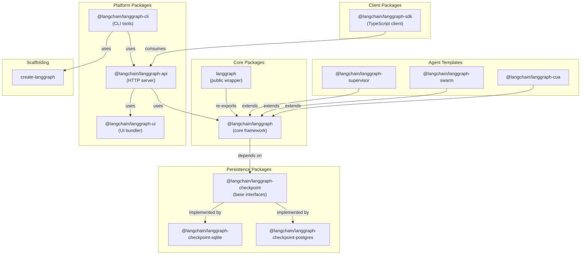
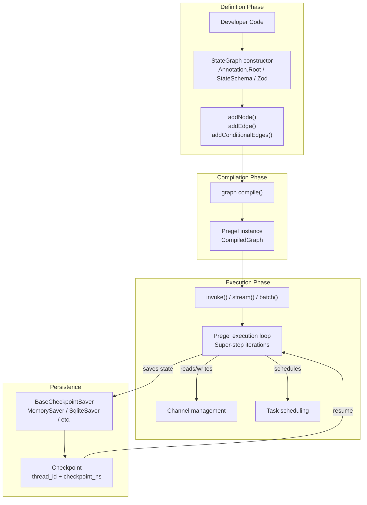
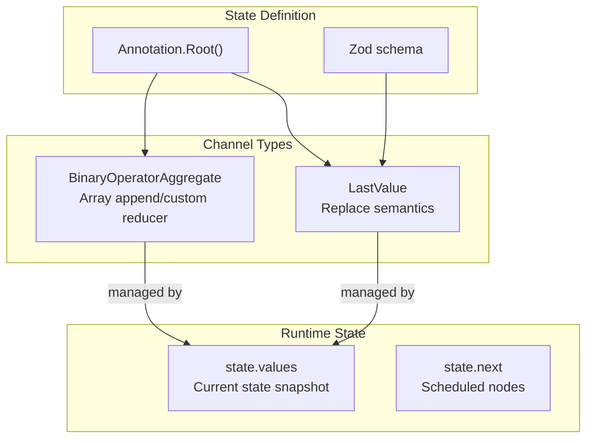
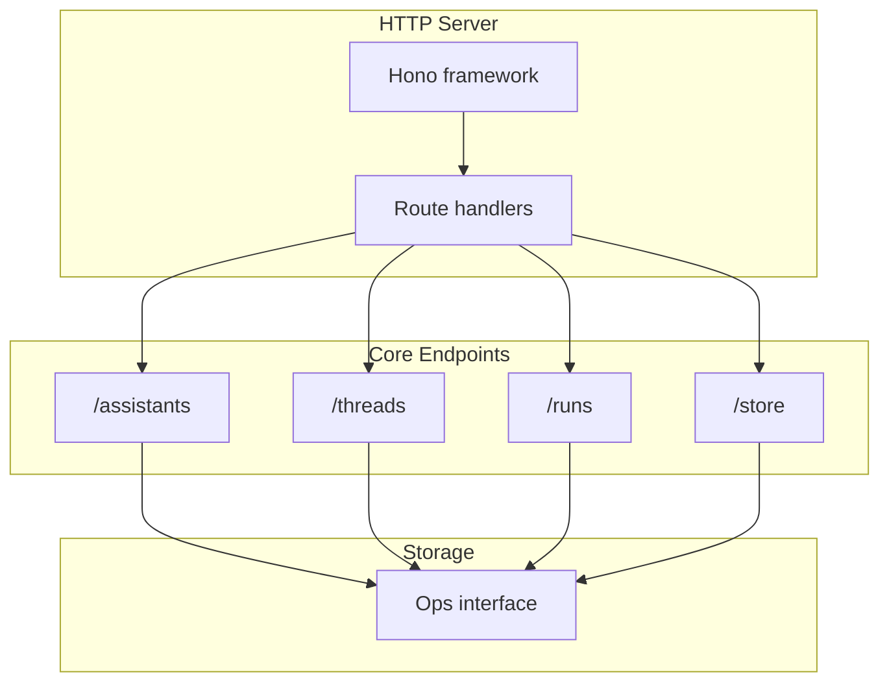

<!-- source: DeepWiki mcp.deepwiki.com · repo langchain-ai/langgraphjs · page 1 LangGraph.js Overview · fetched 2026-10-26 -->

# LangGraph.js Overview

Relevant source files

The following files were used as context for generating this wiki page:

- [.gitignore](.gitignore)
- [README.md](README.md)
- [deno.json](deno.json)
- [docs/docs/concepts/agentic_concepts.md](docs/docs/concepts/agentic_concepts.md)
- [docs/docs/concepts/img/multi_agent/architectures.png](docs/docs/concepts/img/multi_agent/architectures.png)
- [docs/docs/concepts/img/multi_agent/request.png](docs/docs/concepts/img/multi_agent/request.png)
- [docs/docs/concepts/img/multi_agent/response.png](docs/docs/concepts/img/multi_agent/response.png)
- [docs/docs/concepts/low_level.md](docs/docs/concepts/low_level.md)
- [docs/docs/concepts/multi_agent.md](docs/docs/concepts/multi_agent.md)
- [examples/how-tos/define-state.ipynb](examples/how-tos/define-state.ipynb)
- [examples/ui-react-transport/package.json](examples/ui-react-transport/package.json)
- [examples/ui-svelte/package.json](examples/ui-svelte/package.json)
- [examples/ui-vue/package.json](examples/ui-vue/package.json)
- [libs/checkpoint-validation/README.md](libs/checkpoint-validation/README.md)
- [libs/checkpoint-validation/bin/cli.js](libs/checkpoint-validation/bin/cli.js)
- [libs/langgraph-api/CHANGELOG.md](libs/langgraph-api/CHANGELOG.md)
- [libs/langgraph-api/package.json](libs/langgraph-api/package.json)
- [libs/langgraph-cli/CHANGELOG.md](libs/langgraph-cli/CHANGELOG.md)
- [libs/langgraph-cli/package.json](libs/langgraph-cli/package.json)
- [libs/langgraph-core/CHANGELOG.md](libs/langgraph-core/CHANGELOG.md)
- [libs/langgraph-core/package.json](libs/langgraph-core/package.json)
- [libs/langgraph-ui/CHANGELOG.md](libs/langgraph-ui/CHANGELOG.md)
- [libs/langgraph-ui/package.json](libs/langgraph-ui/package.json)
- [libs/langgraph/CHANGELOG.md](libs/langgraph/CHANGELOG.md)
- [libs/langgraph/README.md](libs/langgraph/README.md)
- [libs/langgraph/package.json](libs/langgraph/package.json)
- [libs/sdk/CHANGELOG.md](libs/sdk/CHANGELOG.md)
- [libs/sdk/package.json](libs/sdk/package.json)
- [package.json](package.json)
- [pnpm-lock.yaml](pnpm-lock.yaml)

## Purpose and Scope

This document provides a high-level introduction to LangGraph.js, an orchestration framework for building stateful, multi-actor LLM applications with built-in persistence, streaming, and human-in-the-loop capabilities. It covers the overall system architecture, package ecosystem, core execution model, and key subsystems.

For detailed information on specific subsystems, see:
- Package ecosystem details: [Package Ecosystem](#1.1)
- Architecture deep dive: [Architecture Overview](#1.2)
- Core framework implementation: [Core Framework](#2)
- Persistence mechanisms: [Persistence and Checkpointing](#3)
- Multi-agent patterns: [Multi-Agent Systems](#4)
- API server and deployment: [LangGraph Platform](#5)
- Client libraries: [Client SDK](#6)

## What is LangGraph.js?

LangGraph.js is a low-level orchestration framework for building controllable AI agents. It enables developers to construct graph-based workflows where nodes represent computation (LLM calls, tool executions, custom logic) and edges define control flow. The framework maintains state across execution steps through a checkpointing system, enabling features like fault tolerance, human-in-the-loop workflows, and time-travel debugging. [README.md:22-41]().

The framework is built around three key abstractions:
- **`StateGraph`**: A graph builder API for defining nodes, edges, and state schemas. [libs/langgraph/package.json:123-146]().
- **`Pregel`**: A Pregel-inspired execution engine that runs compiled graphs. [libs/langgraph/package.json:87-98]().
- **`BaseCheckpointSaver`**: A persistence interface for storing and retrieving execution state. [libs/langgraph-core/package.json:32]().

LangGraph.js is designed to be used either standalone or deployed as a service via LangGraph Platform, with full support for streaming, multiple LLM providers, and integration with the broader LangChain ecosystem. [README.md:48-60]().

Sources: [README.md:1-65](), [libs/langgraph/package.json:1-152](), [libs/langgraph-core/package.json:1-194]()

## Package Ecosystem

The LangGraph.js repository is organized as a monorepo containing multiple packages serving different purposes:

**Core Framework Layer:**
- `langgraph`: Public-facing package that re-exports from `@langchain/langgraph`. [libs/langgraph/package.json:28]().
- `@langchain/langgraph`: Core framework containing `StateGraph`, `Pregel`, channels, and control flow primitives. [libs/langgraph-core/package.json:2]().

**Platform Layer:**
- `@langchain/langgraph-api`: Hono-based HTTP server implementing REST endpoints for assistants, threads, runs, and store. [libs/langgraph-api/package.json:75]().
- `@langchain/langgraph-cli`: CLI providing `dev`, `build`, `new`, and `deploy` commands. [libs/langgraph-cli/package.json:11-13]().
- `@langchain/langgraph-ui`: UI bundler for generative UI components and LangGraph Studio integration. [libs/langgraph-ui/package.json:11]().

**Client Layer:**
- `@langchain/langgraph-sdk`: TypeScript client with `AssistantsClient`, `ThreadsClient`, `RunsClient`, `CronsClient`, and React hooks. [libs/sdk/package.json:95-130]().

**Persistence Layer:**
- `@langchain/langgraph-checkpoint`: Base interfaces for state persistence. [libs/langgraph-core/package.json:32]().
- Implementations include SQLite and PostgreSQL. [libs/langgraph-core/package.json:50-51]().

Sources: [libs/langgraph/package.json:1-152](), [libs/langgraph-core/package.json:1-194](), [libs/langgraph-api/package.json:1-121](), [libs/langgraph-cli/package.json:1-63](), [libs/sdk/package.json:1-196](), [libs/langgraph-ui/package.json:1-43]()

## Core Execution Model

LangGraph.js uses a graph-based execution model where developers define workflows using `StateGraph` and the framework compiles them into `Pregel` instances for execution.

**Definition Phase:**
- Developers create a `StateGraph` instance with a state schema (using `Annotation.Root` or Zod schemas). [libs/langgraph/package.json:123-134]().
- Nodes are added where functions receive state and return state updates.
- Edges define control flow via static routing or conditional routing.

**Compilation Phase:**
- `graph.compile()` validates the graph structure and returns a `Pregel` instance. [libs/langgraph/package.json:87-98]().
- The `Pregel` instance implements the `Runnable` interface from `@langchain/core`. [libs/langgraph-core/package.json:38]().

**Execution Phase:**
- `invoke()`, `stream()`, or `batch()` methods start execution.
- The Pregel loop iterates through "super-steps", executing nodes that have pending tasks.
- Channels manage state with custom reducers. [libs/langgraph/package.json:75-86]().

Sources: [libs/langgraph/package.json:1-152](), [libs/langgraph-core/package.json:1-194]()

## State Management Architecture

State in LangGraph.js flows through a channel-based system where each state key corresponds to a channel with a reducer function that controls how updates are merged.

**State Schema Options:**
- **`Annotation.Root()`**: TypeScript-first approach for field definition.
- **Zod schemas**: Direct Zod object schema support. [libs/langgraph/package.json:123-146]().

**Channel Types:**
- **`LastValue`**: Default channel that replaces the previous value.
- **`BinaryOperatorAggregate`**: Accumulates values using a reducer (e.g., array concatenation).

Sources: [libs/langgraph/package.json:75-86](), [libs/langgraph/package.json:123-146]()

## API Server Architecture

The LangGraph API server (`@langchain/langgraph-api`) provides HTTP endpoints for deploying and managing graph execution as a service using the Hono framework. [libs/langgraph-api/package.json:75]().

**Server Components:**
- **Hono HTTP framework**: Lightweight, fast HTTP server. [libs/langgraph-api/package.json:75]().
- **Route handlers**: REST endpoints for CRUD operations on resources. [libs/langgraph-api/package.json:18-46]().

Sources: [libs/langgraph-api/package.json:1-121]()

## Client SDK and React Integration

The SDK (`@langchain/langgraph-sdk`) provides programmatic access to the API server with TypeScript type safety and React integration. [libs/sdk/package.json:95-130]().

**Client API:**
- **`Client`**: Base class with HTTP/SSE methods. [libs/sdk/package.json:95-106]().
- **React Integration**: `useStream()` hook for streaming graph execution. [libs/sdk/package.json:119-130]().
- **Auto-reconnect**: SSE and WebSocket streams reconnect after disconnects. [libs/sdk/CHANGELOG.md:78-80]().

Sources: [libs/sdk/package.json:1-196](), [libs/sdk/CHANGELOG.md:1-42]()

## Development Workflow

LangGraph.js supports local development with hot reload and production deployment via the CLI. [libs/langgraph-cli/package.json:11-13]().

- **`langgraphjs dev`**: Starts development server with file watching. [libs/langgraph-cli/package.json:28-29]().
- **`langgraphjs build`**: Prepares artifacts for deployment. [libs/langgraph-cli/package.json:24-25]().
- **`langgraphjs deploy`**: Deploys to LangSmith Deployment. [libs/langgraph-cli/CHANGELOG.md:18-21]().

Sources: [libs/langgraph-cli/package.json:1-63](), [libs/langgraph-cli/CHANGELOG.md:1-135]()

---

