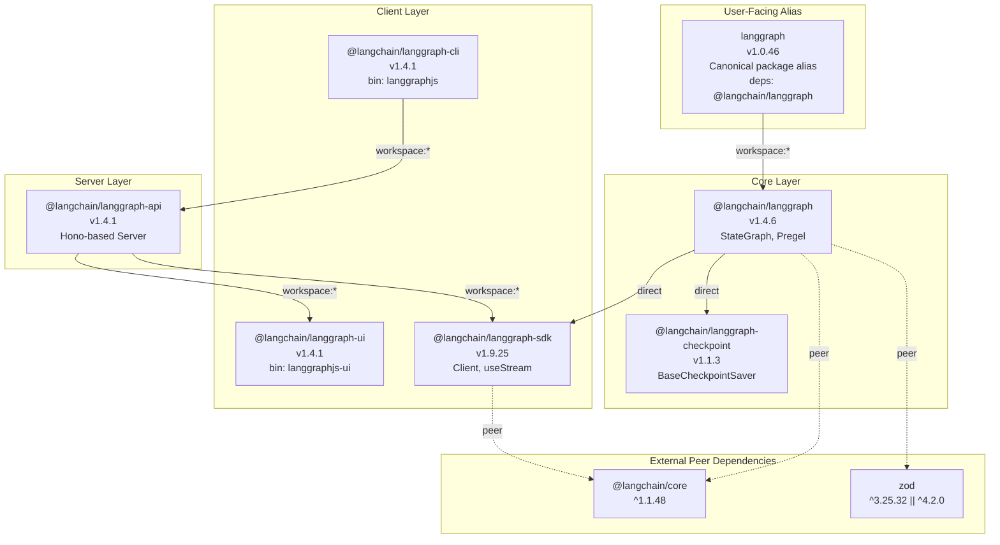

<!-- source: DeepWiki mcp.deepwiki.com · repo langchain-ai/langgraphjs · page 1.1 Package Ecosystem · fetched 2026-10-26 -->

# Package Ecosystem

Relevant source files

The following files were used as context for generating this wiki page:

- [examples/ai-elements/CHANGELOG.md](examples/ai-elements/CHANGELOG.md)
- [examples/ai-elements/package.json](examples/ai-elements/package.json)
- [examples/assistant-ui-claude/CHANGELOG.md](examples/assistant-ui-claude/CHANGELOG.md)
- [examples/assistant-ui-claude/package.json](examples/assistant-ui-claude/package.json)
- [examples/ui-angular/CHANGELOG.md](examples/ui-angular/CHANGELOG.md)
- [examples/ui-angular/package.json](examples/ui-angular/package.json)
- [libs/checkpoint-mongodb/CHANGELOG.md](libs/checkpoint-mongodb/CHANGELOG.md)
- [libs/checkpoint-mongodb/package.json](libs/checkpoint-mongodb/package.json)
- [libs/checkpoint-postgres/package.json](libs/checkpoint-postgres/package.json)
- [libs/checkpoint-redis/CHANGELOG.md](libs/checkpoint-redis/CHANGELOG.md)
- [libs/checkpoint-redis/package.json](libs/checkpoint-redis/package.json)
- [libs/checkpoint-sqlite/package.json](libs/checkpoint-sqlite/package.json)
- [libs/checkpoint-validation/package.json](libs/checkpoint-validation/package.json)
- [libs/checkpoint/package.json](libs/checkpoint/package.json)
- [libs/create-langgraph/package.json](libs/create-langgraph/package.json)
- [libs/langgraph-api/CHANGELOG.md](libs/langgraph-api/CHANGELOG.md)
- [libs/langgraph-api/package.json](libs/langgraph-api/package.json)
- [libs/langgraph-cli/CHANGELOG.md](libs/langgraph-cli/CHANGELOG.md)
- [libs/langgraph-cli/package.json](libs/langgraph-cli/package.json)
- [libs/langgraph-core/CHANGELOG.md](libs/langgraph-core/CHANGELOG.md)
- [libs/langgraph-core/package.json](libs/langgraph-core/package.json)
- [libs/langgraph-cua/package.json](libs/langgraph-cua/package.json)
- [libs/langgraph-supervisor/CHANGELOG.md](libs/langgraph-supervisor/CHANGELOG.md)
- [libs/langgraph-supervisor/package.json](libs/langgraph-supervisor/package.json)
- [libs/langgraph-swarm/package.json](libs/langgraph-swarm/package.json)
- [libs/langgraph-ui/CHANGELOG.md](libs/langgraph-ui/CHANGELOG.md)
- [libs/langgraph-ui/package.json](libs/langgraph-ui/package.json)
- [libs/langgraph/CHANGELOG.md](libs/langgraph/CHANGELOG.md)
- [libs/langgraph/package.json](libs/langgraph/package.json)
- [libs/sdk-angular/CHANGELOG.md](libs/sdk-angular/CHANGELOG.md)
- [libs/sdk-angular/package.json](libs/sdk-angular/package.json)
- [libs/sdk-react/CHANGELOG.md](libs/sdk-react/CHANGELOG.md)
- [libs/sdk-react/package.json](libs/sdk-react/package.json)
- [libs/sdk-svelte/CHANGELOG.md](libs/sdk-svelte/CHANGELOG.md)
- [libs/sdk-svelte/package.json](libs/sdk-svelte/package.json)
- [libs/sdk-vue/CHANGELOG.md](libs/sdk-vue/CHANGELOG.md)
- [libs/sdk-vue/package.json](libs/sdk-vue/package.json)
- [libs/sdk/CHANGELOG.md](libs/sdk/CHANGELOG.md)
- [libs/sdk/package.json](libs/sdk/package.json)

This document details the package structure and interdependencies within the LangGraph.js monorepo. It covers the core packages, their relationships, specialized extensions, and how they work together to provide a complete graph-based AI application development platform.

## Monorepo Structure

The LangGraph.js project is organized as a pnpm workspace monorepo with multiple interconnected packages. The workspace configuration defines the package locations and build orchestration across core libraries, persistence implementations, multi-agent patterns, tooling, and framework-specific SDKs.

**Workspace Organization**

```mermaid
graph TB
    subgraph "Monorepo Root"
        ROOT["package.json<br/>pnpm workspaces config"]
        TURBO["turbo.json<br/>Build orchestration"]
    end
    
    subgraph "Package Directories"
        LIBS["libs/*"]
        EXAMPLES["examples/*"]
    end
    
    subgraph "Core Runtime & Platform"
        LANGGRAPH_CORE["libs/langgraph-core/<br/>@langchain/langgraph<br/>StateGraph, Pregel"]
        LANGGRAPH_ALIAS["libs/langgraph/<br/>langgraph<br/>Canonical alias package"]
        API["libs/langgraph-api/<br/>@langchain/langgraph-api<br/>Hono server"]
        CLI["libs/langgraph-cli/<br/>@langchain/langgraph-cli<br/>CLI commands"]
        SDK["libs/sdk/<br/>@langchain/langgraph-sdk<br/>Client library"]
        UI["libs/langgraph-ui/<br/>@langchain/langgraph-ui<br/>React components"]
    end
    
    subgraph "Persistence Layer"
        CHECKPOINT["libs/checkpoint/<br/>@langchain/langgraph-checkpoint<br/>BaseCheckpointSaver"]
        SQLITE["libs/checkpoint-sqlite/<br/>SQLiteSaver"]
        MONGODB["libs/checkpoint-mongodb/<br/>MongoDBSaver"]
        POSTGRES["libs/checkpoint-postgres/<br/>PostgresSaver"]
        REDIS["libs/checkpoint-redis/<br/>RedisSaver"]
    end
    
    subgraph "Framework SDKs"
        SDK_REACT["libs/sdk-react/<br/>@langchain/react"]
        SDK_ANGULAR["libs/sdk-angular/<br/>@langchain/angular"]
        SDK_VUE["libs/sdk-vue/<br/>@langchain/vue"]
        SDK_SVELTE["libs/sdk-svelte/<br/>@langchain/svelte"]
    end
    
    subgraph "Multi-Agent Patterns"
        SUPERVISOR["libs/langgraph-supervisor/<br/>Supervisor pattern"]
        SWARM["libs/langgraph-swarm/<br/>Swarm coordination"]
        CUA["libs/langgraph-cua/<br/>Computer use agent"]
    end
    
    subgraph "Development Tools"
        CREATE["libs/create-langgraph/<br/>create-langgraph<br/>Project scaffolder"]
    end
    
    ROOT --> LIBS
    ROOT --> EXAMPLES
    LIBS --> LANGGRAPH_CORE
    LIBS --> LANGGRAPH_ALIAS
    LIBS --> API
    LIBS --> CLI
    LIBS --> SDK
    LIBS --> UI
    LIBS --> CHECKPOINT
    LIBS --> SDK_REACT
    LIBS --> SDK_ANGULAR
    LIBS --> SDK_VUE
    LIBS --> SDK_SVELTE
    LIBS --> SUPERVISOR
    LIBS --> SWARM
    LIBS --> CUA
    LIBS --> CREATE
```

Sources: [libs/langgraph/package.json:12-16](), [libs/langgraph-core/package.json:11-15](), [libs/langgraph-api/package.json:48-52](), [libs/langgraph-cli/package.json:17-21](), [libs/sdk/package.json:6-10](), [libs/sdk-angular/package.json:15-19](), [libs/sdk-vue/package.json:14-19](), [libs/sdk-svelte/package.json:14-19]()

## Core Package Architecture

The core packages form a layered architecture. The `@langchain/langgraph` package (found in `libs/langgraph-core`) is the engine, while the `langgraph` package (found in `libs/langgraph`) acts as a canonical alias for simplified imports.

**Package Dependency Layers**

The `langgraph` alias package re-exports functionality from `@langchain/langgraph` [libs/langgraph/package.json:27-29](). The core runtime depends on the checkpointing system [libs/langgraph-core/package.json:32]() and the SDK [libs/langgraph-core/package.json:33]().

Sources: [libs/langgraph/package.json:2-3](), [libs/langgraph/package.json:27-29](), [libs/langgraph-core/package.json:2-3](), [libs/langgraph-core/package.json:31-41](), [libs/langgraph-api/package.json:2-3](), [libs/langgraph-api/package.json:63-90](), [libs/sdk/package.json:2-3](), [libs/sdk/package.json:47-53](), [libs/checkpoint/package.json:2-3]()

## Core Package Exports

Each package provides specific entry points through well-defined exports.

### @langchain/langgraph (Core) Exports

The main runtime package provides multiple entry points for different environments and use cases.

| Export Path | Input Source | Purpose | Key Components |
|-------------|--------------|---------|----------------|
| `.` | `./src/index.ts` | Main entry point | `StateGraph`, `Pregel`, `Command` |
| `./web` | `./src/web.ts` | Browser entry point | [libs/langgraph-core/package.json:81]() |
| `./channels` | `./src/channels/index.ts` | State channels | [libs/langgraph-core/package.json:106]() |
| `./pregel` | `./src/pregel/index.ts` | Runtime engine | [libs/langgraph-core/package.json:117]() |
| `./prebuilt` | `./src/prebuilt/index.ts` | Pre-built nodes | `ToolNode`, `createReactAgent` |
| `./remote` | `./src/remote.ts` | Remote Graph | [libs/langgraph-core/package.json:141]() |
| `./stream` | `./src/stream.ts` | Streaming utils | [libs/langgraph-core/package.json:153]() |

Sources: [libs/langgraph-core/package.json:79-188]()

### @langchain/langgraph-api Exports

The API server package provides the infrastructure for deploying graphs as REST services.

| Export Path | Types Path | Purpose | Key Components |
|-------------|-----------|---------|----------------|
| `.` | `./dist/cli/spawn.d.mts` | CLI spawn logic | [libs/langgraph-api/package.json:14]() |
| `./server` | `./dist/server.d.mts` | Hono server | `startServer` |
| `./auth` | `./dist/auth/index.d.mts` | Auth handlers | `AuthContext` |
| `./graph` | `./dist/graph/api.d.mts` | Graph loading | [libs/langgraph-api/package.json:26]() |
| `./storage` | `./dist/storage/types.d.mts`| Ops interface | `FileSystemOps` |

Sources: [libs/langgraph-api/package.json:13-47]()

### @langchain/langgraph-sdk Exports

The SDK provides client-side interaction with the API and framework-agnostic streaming logic.

| Export Path | Input Source | Purpose | Key Components |
|-------------|--------------|---------|----------------|
| `.` | `./src/index.ts` | Main SDK | `Client` |
| `./client` | `./src/client.ts` | Client classes | `ThreadsClient`, `RunsClient` |
| `./react` | `./src/react/index.ts` | React integration| `useStream` |
| `./stream` | `./src/stream/index.ts` | Protocol logic | `StreamController` |

Sources: [libs/sdk/package.json:70-192]()

## Framework SDK Integrations

LangGraph.js provides dedicated packages for major frontend frameworks, wrapping the core SDK streaming logic into framework-native reactive primitives.

| Package | Purpose | Key Reactive Primitive |
|---------|---------|------------------------|
| `@langchain/angular` | Angular integration | `injectStream` [libs/sdk-angular/package.json:2]() |
| `@langchain/vue` | Vue integration | `useStream` [libs/sdk-vue/package.json:2]() |
| `@langchain/svelte` | Svelte integration | `useStream` [libs/sdk-svelte/package.json:2]() |

These packages depend on `@langchain/langgraph-sdk` [libs/sdk-angular/package.json:21](), [libs/sdk-vue/package.json:21](), [libs/sdk-svelte/package.json:21]().

## Specialized Extension Packages

### Checkpoint Implementations
Implement the `BaseCheckpointSaver` interface for state persistence.
- `@langchain/langgraph-checkpoint-sqlite`: Local development [libs/langgraph-core/package.json:51]().
- `@langchain/langgraph-checkpoint-postgres`: Production relational storage [libs/langgraph-core/package.json:50]().
- `@langchain/langgraph-checkpoint-mongodb`: Document-based storage.
- `@langchain/langgraph-checkpoint-redis`: In-memory storage with persistence.

### Agent Patterns
Pre-built coordination patterns.
- `@langchain/langgraph-supervisor`: Centralized LLM supervisor [libs/langgraph-supervisor/package.json:2]().
- `@langchain/langgraph-swarm`: Decentralized handoffs [libs/langgraph-swarm/package.json:2]().
- `@langchain/langgraph-cua`: Computer Use Agent [libs/langgraph-cua/package.json:2]().

## Build and Release Infrastructure

The monorepo uses `pnpm turbo` for task execution [libs/langgraph/package.json:18](). Build outputs are generated in both ESM and CJS formats using a shared internal build tool [libs/langgraph/package.json:19]().

**Release Coordination**
- Versions are managed via Changesets.
- Core packages are on the `1.4.x` branch [libs/langgraph-core/package.json:3]().
- SDK and platform tools are on the `1.9.x` / `1.4.x` branches [libs/sdk/package.json:3](), [libs/langgraph-api/package.json:3]().

Sources: [libs/langgraph/package.json:17-24](), [libs/langgraph-core/package.json:16-28](), [libs/sdk/package.json:11-19]()

---

