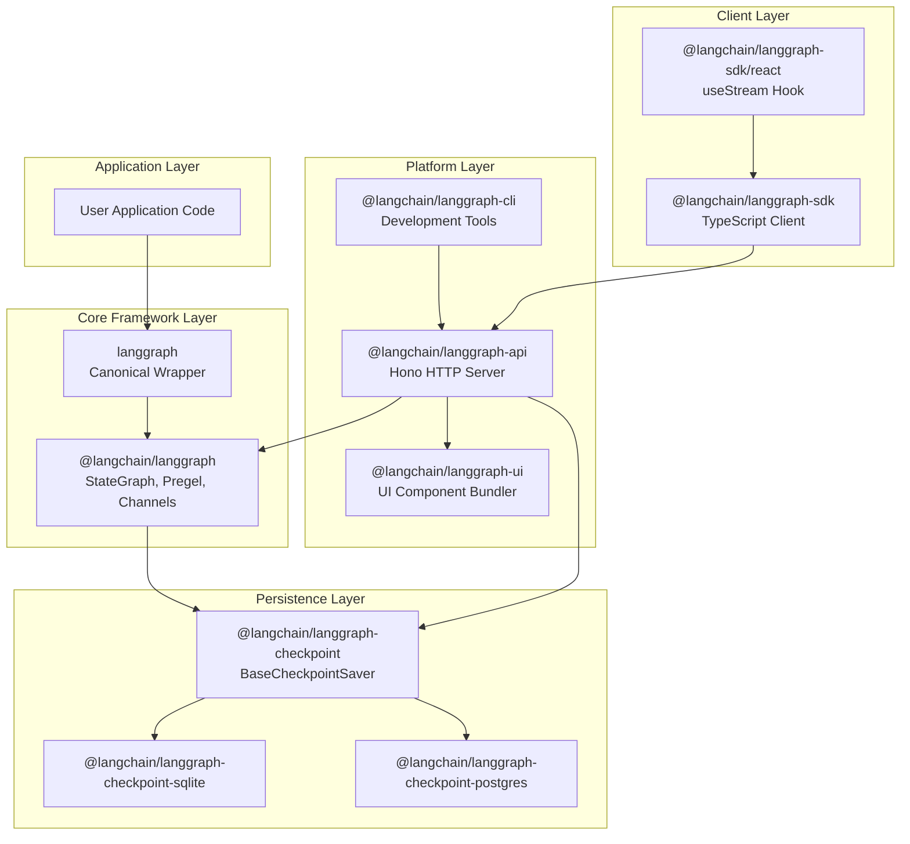
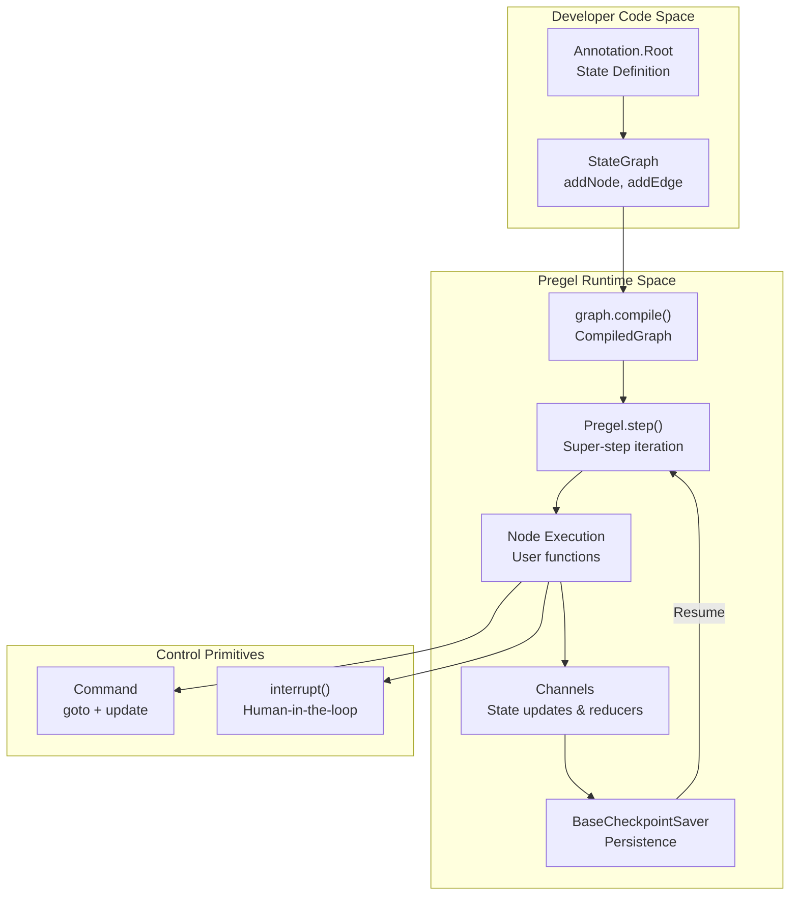
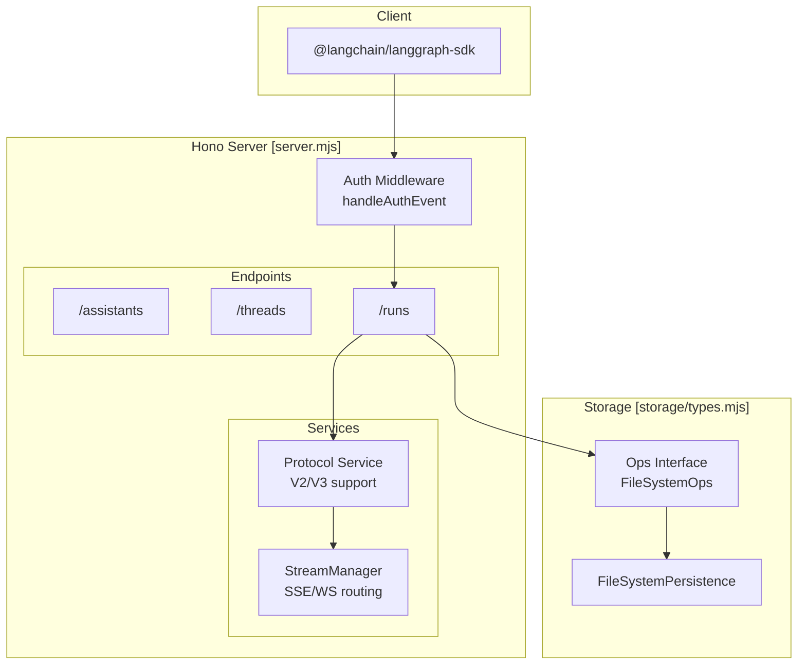
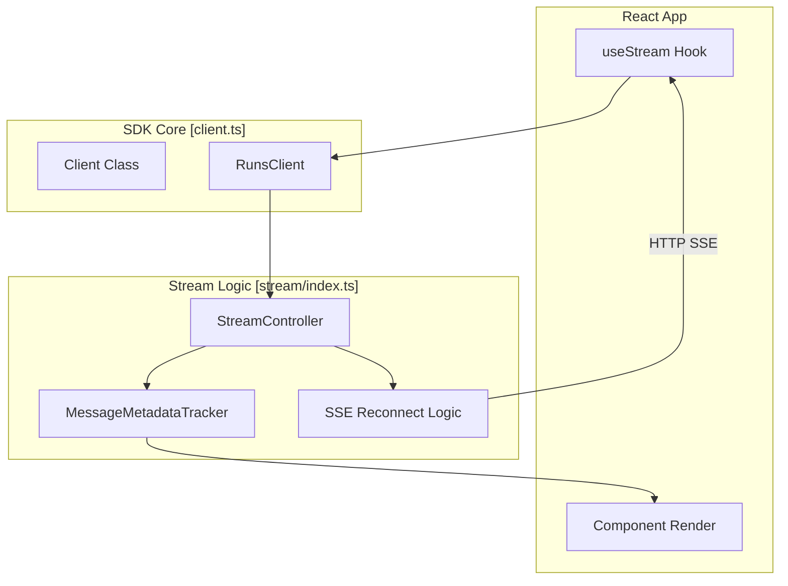

<!-- source: DeepWiki mcp.deepwiki.com · repo langchain-ai/langgraphjs · page 1.2 Architecture Overview · fetched 2026-10-26 -->

# Architecture Overview

Relevant source files

The following files were used as context for generating this wiki page:

- [libs/langgraph-api/CHANGELOG.md](libs/langgraph-api/CHANGELOG.md)
- [libs/langgraph-api/package.json](libs/langgraph-api/package.json)
- [libs/langgraph-cli/CHANGELOG.md](libs/langgraph-cli/CHANGELOG.md)
- [libs/langgraph-cli/package.json](libs/langgraph-cli/package.json)
- [libs/langgraph-core/CHANGELOG.md](libs/langgraph-core/CHANGELOG.md)
- [libs/langgraph-core/package.json](libs/langgraph-core/package.json)
- [libs/langgraph-core/src/constants.ts](libs/langgraph-core/src/constants.ts)
- [libs/langgraph-core/src/graph/index.ts](libs/langgraph-core/src/graph/index.ts)
- [libs/langgraph-core/src/graph/state.test.ts](libs/langgraph-core/src/graph/state.test.ts)
- [libs/langgraph-core/src/graph/state.ts](libs/langgraph-core/src/graph/state.ts)
- [libs/langgraph-core/src/graph/types.ts](libs/langgraph-core/src/graph/types.ts)
- [libs/langgraph-core/src/tests/constants.test.ts](libs/langgraph-core/src/tests/constants.test.ts)
- [libs/langgraph-core/src/tests/run_control.test.ts](libs/langgraph-core/src/tests/run_control.test.ts)
- [libs/langgraph-core/src/tests/set_node_defaults.test.ts](libs/langgraph-core/src/tests/set_node_defaults.test.ts)
- [libs/langgraph-core/src/tests/state_graph_compat.test-d.ts](libs/langgraph-core/src/tests/state_graph_compat.test-d.ts)
- [libs/langgraph-core/src/tests/types.test-d.ts](libs/langgraph-core/src/tests/types.test-d.ts)
- [libs/langgraph-core/src/tests/zod_state.test.ts](libs/langgraph-core/src/tests/zod_state.test.ts)
- [libs/langgraph-core/src/web.ts](libs/langgraph-core/src/web.ts)
- [libs/langgraph-core/tsconfig.json](libs/langgraph-core/tsconfig.json)
- [libs/langgraph-ui/CHANGELOG.md](libs/langgraph-ui/CHANGELOG.md)
- [libs/langgraph-ui/package.json](libs/langgraph-ui/package.json)
- [libs/langgraph/CHANGELOG.md](libs/langgraph/CHANGELOG.md)
- [libs/langgraph/package.json](libs/langgraph/package.json)
- [libs/langgraph/src/pregel/index.ts](libs/langgraph/src/pregel/index.ts)
- [libs/langgraph/src/web.ts](libs/langgraph/src/web.ts)
- [libs/sdk/CHANGELOG.md](libs/sdk/CHANGELOG.md)
- [libs/sdk/package.json](libs/sdk/package.json)

This document provides a high-level view of the LangGraph.js system architecture, describing how the core framework, persistence layer, platform services, and client libraries interact to enable building and deploying stateful multi-actor LLM applications. This overview focuses on the structural organization of packages, execution flow, and deployment architecture.

For detailed information about graph construction and state management, see [Core Framework](#2). For persistence implementation details, see [Persistence and Checkpointing](#3). For API server endpoints and authentication, see [LangGraph Platform](#5).

---

## System Layers

LangGraph.js is structured as a layered monorepo with clear separation of concerns:

**Sources:** [libs/langgraph/package.json:1-152](), [libs/langgraph-core/package.json:1-194](), [libs/langgraph-api/package.json:1-121](), [libs/sdk/package.json:1-196]()

### Core Framework Layer

The **Core Framework Layer** provides the execution engine for building graph-based LLM applications:

| Package | Purpose | Key Exports |
|---------|---------|-------------|
| `@langchain/langgraph` | Execution engine with `StateGraph`, `Pregel` runtime, and `Channels` | `StateGraph`, `Pregel`, `Annotation`, `Command`, `Send` |
| `langgraph` | Convenience wrapper that re-exports the core package | Identical to `@langchain/langgraph` |

The `langgraph` package serves as a canonical wrapper for those who prefer the simpler package name, while the core logic resides in `@langchain/langgraph`.

**Sources:** [libs/langgraph/package.json:27-29](), [libs/langgraph/src/pregel/index.ts:1-11](), [libs/langgraph-core/package.json:1-10]()

### Persistence Layer

The **Persistence Layer** provides pluggable checkpoint storage. All implementations conform to the `BaseCheckpointSaver` interface, enabling fault tolerance and human-in-the-loop workflows.

| Package | Storage Backend | Use Case |
|---------|----------------|----------|
| `@langchain/langgraph-checkpoint` | Base interface | Defines `BaseCheckpointSaver` and `BaseStore` |
| `@langchain/langgraph-checkpoint-sqlite` | SQLite | Local development and lightweight file storage |
| `@langchain/langgraph-checkpoint-postgres` | PostgreSQL | Production-grade relational storage |

**Sources:** [libs/langgraph-core/package.json:31-33](), [libs/langgraph-core/package.json:50-51]()

### Platform Layer

The **Platform Layer** provides development tools and production deployment infrastructure:

| Package | Purpose | Main Components |
|---------|---------|-----------------|
| `@langchain/langgraph-api` | HTTP API server | `Hono` server, route handlers, `AuthContext` |
| `@langchain/langgraph-cli` | Development CLI | `langgraphjs dev`, `langgraphjs build`, `langgraphjs deploy` |
| `@langchain/langgraph-ui` | UI component bundler | `esbuild`-based bundling, `langgraphjs-ui` CLI |

**Sources:** [libs/langgraph-api/package.json:13-47](), [libs/langgraph-cli/package.json:11-13](), [libs/langgraph-ui/package.json:9-12]()

### Client Layer

The **Client Layer** provides programmatic access to deployed graphs through the `@langchain/langgraph-sdk`.

| Package Export | Purpose | Key Classes/Hooks |
|---------------|---------|-----------|
| `@langchain/langgraph-sdk/client` | API Client | `Client`, `ThreadsClient`, `RunsClient` |
| `@langchain/langgraph-sdk/react` | React integration | `useStream`, `useChannel` |
| `@langchain/langgraph-sdk/stream` | Stream processing | `StreamController`, `acquireChannelEffect` |

**Sources:** [libs/sdk/package.json:95-130](), [libs/sdk/CHANGELOG.md:70-73]()

---

## Core Execution Architecture

The execution flow follows a compilation and runtime model based on the Pregel execution engine.

### Execution Flow Details

1.  **State Definition**: Developers define state using `Annotation.Root` which specifies how values are reduced and stored in `Channels`.
2.  **Graph Construction**: Nodes and edges are added to a `StateGraph`.
3.  **Compilation**: `compile()` converts the graph into a `CompiledGraph` (a `Pregel` instance) capable of execution.
4.  **Runtime Execution**: The `Pregel` engine iterates through "super-steps":
    *   Executes nodes whose input channels have updated.
    *   Applies updates to `Channels` via defined reducers.
    *   Saves a checkpoint via the `BaseCheckpointSaver` after each step.
    *   Handles `Command` for dynamic routing or `interrupt()` for pausing execution.

**Sources:** [libs/langgraph-core/package.json:117-128](), [libs/sdk/CHANGELOG.md:15-24]()

---

## API Server Architecture

The `@langchain/langgraph-api` package implements a `Hono`-based server that exposes graph execution over HTTP and WebSockets.

### API Server Components

| Component | Code Entity | Purpose |
|-----------|-------------|---------|
| HTTP Server | `hono` | Lightweight server handling REST and WebSocket traffic |
| Storage Ops | `Ops` interface | Abstraction for managing assistants, threads, and runs |
| Auth | `handleAuthEvent` | Extensible authentication and authorization system |
| Streaming | `ProtocolSseTransportAdapter` | Handles real-time SSE streaming of graph events |

**Sources:** [libs/langgraph-api/package.json:18-41](), [libs/langgraph-api/package.json:75-84](), [libs/sdk/CHANGELOG.md:58-58]()

---

## Client SDK and Streaming

The `@langchain/langgraph-sdk` facilitates interaction with the API server, providing high-level abstractions for streaming.

### SDK Streaming Features
*   **Automatic Reconnection**: Detects half-open SSE connections via heartbeats and reconnects with `Last-Event-ID`.
*   **Optimistic Updates**: `respond()` applies state updates synchronously in the same tick as the event to prevent UI flicker.
*   **Message Tracking**: `MessageMetadataTracker` reconciles server-side message deltas with local optimistic state.

**Sources:** [libs/sdk/package.json:95-106](), [libs/sdk/package.json:179-190](), [libs/sdk/CHANGELOG.md:15-40](), [libs/sdk/CHANGELOG.md:54-56]()

---

## Summary

LangGraph.js architecture is designed for scalability and flexibility across the full stack:
1.  **Core**: A Pregel-based execution engine (`@langchain/langgraph`).
2.  **Persistence**: Pluggable checkpointers for state durability.
3.  **Platform**: A robust API server (`@langchain/langgraph-api`) and CLI (`@langchain/langgraph-cli`) for deployment.
4.  **Client**: A reactive SDK (`@langchain/langgraph-sdk`) for seamless frontend integration.

---

