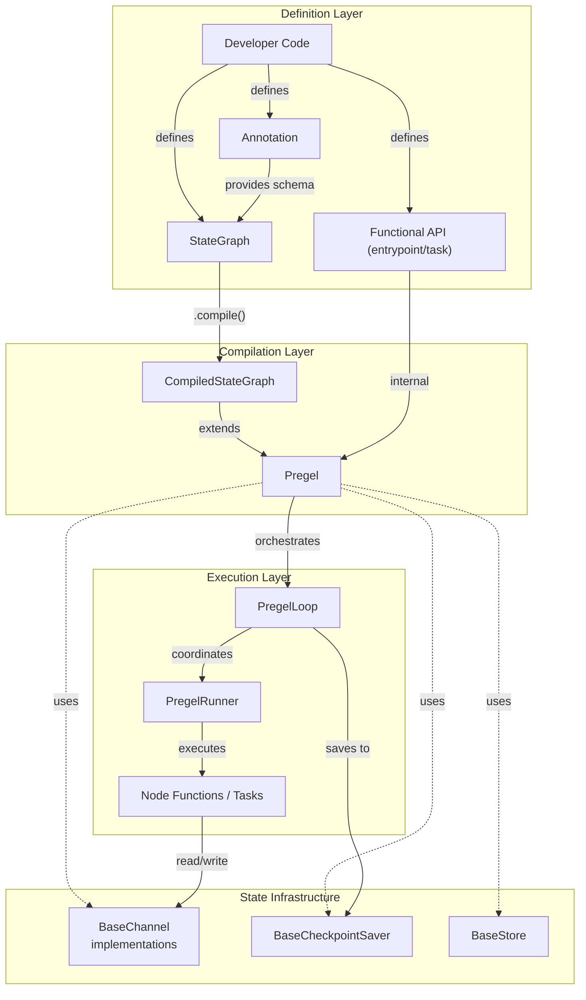

<!-- source: DeepWiki mcp.deepwiki.com · repo langchain-ai/langgraphjs · page 2 Core Framework · fetched 2026-10-26 -->

# Core Framework

<details>
<summary>Relevant source files</summary>

The following files were used as context for generating this wiki page:

- [libs/langgraph-core/src/channels/base.ts](libs/langgraph-core/src/channels/base.ts)
- [libs/langgraph-core/src/channels/index.ts](libs/langgraph-core/src/channels/index.ts)
- [libs/langgraph-core/src/constants.ts](libs/langgraph-core/src/constants.ts)
- [libs/langgraph-core/src/graph/index.ts](libs/langgraph-core/src/graph/index.ts)
- [libs/langgraph-core/src/graph/state.test.ts](libs/langgraph-core/src/graph/state.test.ts)
- [libs/langgraph-core/src/graph/state.ts](libs/langgraph-core/src/graph/state.ts)
- [libs/langgraph-core/src/graph/types.ts](libs/langgraph-core/src/graph/types.ts)
- [libs/langgraph-core/src/pregel/algo.ts](libs/langgraph-core/src/pregel/algo.ts)
- [libs/langgraph-core/src/pregel/index.ts](libs/langgraph-core/src/pregel/index.ts)
- [libs/langgraph-core/src/pregel/loop.ts](libs/langgraph-core/src/pregel/loop.ts)
- [libs/langgraph-core/src/pregel/utils/config.test.ts](libs/langgraph-core/src/pregel/utils/config.test.ts)
- [libs/langgraph-core/src/pregel/utils/config.ts](libs/langgraph-core/src/pregel/utils/config.ts)
- [libs/langgraph-core/src/tests/concurrent-thread-isolation.test.ts](libs/langgraph-core/src/tests/concurrent-thread-isolation.test.ts)
- [libs/langgraph-core/src/tests/constants.test.ts](libs/langgraph-core/src/tests/constants.test.ts)
- [libs/langgraph-core/src/tests/delta_channel.test.ts](libs/langgraph-core/src/tests/delta_channel.test.ts)
- [libs/langgraph-core/src/tests/execution_info.test.ts](libs/langgraph-core/src/tests/execution_info.test.ts)
- [libs/langgraph-core/src/tests/pregel.test.ts](libs/langgraph-core/src/tests/pregel.test.ts)
- [libs/langgraph-core/src/tests/run_control.test.ts](libs/langgraph-core/src/tests/run_control.test.ts)
- [libs/langgraph-core/src/tests/set_node_defaults.test.ts](libs/langgraph-core/src/tests/set_node_defaults.test.ts)
- [libs/langgraph-core/src/tests/state_graph_compat.test-d.ts](libs/langgraph-core/src/tests/state_graph_compat.test-d.ts)
- [libs/langgraph-core/src/tests/tracing.test.ts](libs/langgraph-core/src/tests/tracing.test.ts)
- [libs/langgraph-core/src/tests/types.test-d.ts](libs/langgraph-core/src/tests/types.test-d.ts)
- [libs/langgraph-core/src/tests/zod_state.test.ts](libs/langgraph-core/src/tests/zod_state.test.ts)
- [libs/langgraph-core/src/web.ts](libs/langgraph-core/src/web.ts)
- [libs/langgraph-core/tsconfig.json](libs/langgraph-core/tsconfig.json)

</details>


The Core Framework is the foundation for building stateful, graph-based agent workflows in LangGraph.js. At its core, LangGraph models agent behavior as directed graphs where **nodes** represent computations and **edges** define control flow. The framework handles state persistence, parallel execution, and coordination between nodes through a Pregel-inspired runtime engine.

The Core Framework consists of several primary components:

1.  **StateGraph** - A declarative API for defining graph topology and state management (see [StateGraph and Graph Building](#2.1)).
2.  **Pregel Runtime** - The execution engine that orchestrates node execution and state updates (see [Pregel Runtime Engine](#2.2)).
3.  **State Management System** - Channels and reducers that control how state flows and merges (see [State Management](#2.3)).
4.  **Control Flow and Commands** - Primitives for routing, dynamic fan-out, and interrupts (see [Control Flow and Commands](#2.4)).
5.  **Functional API** - A task-based alternative to the graph API (see [Functional API and Tasks](#2.5)).

## System Architecture

The Core Framework is organized into definition, compilation, and execution layers. This separation enables flexibility in how workflows are defined while maintaining a consistent execution model.

### Core Framework Architecture



**Layer Responsibilities:**

| Layer | Component | Responsibility | Key Files |
| :--- | :--- | :--- | :--- |
| **Definition** | `StateGraph` | Graph topology and node registration | [libs/langgraph-core/src/graph/state.ts:121-127]() |
| **Definition** | `Annotation` | State schema and reducer definitions | [libs/langgraph-core/src/graph/annotation.ts:1-74]() |
| **Compilation** | `CompiledStateGraph` | Converts graph definition to executable form | [libs/langgraph-core/src/graph/state.ts:22-29]() |
| **Execution** | `Pregel` | Main runtime orchestrator | [libs/langgraph-core/src/pregel/index.ts:196-240]() |
| **Execution** | `PregelLoop` | Superstep coordination and checkpointing | [libs/langgraph-core/src/pregel/loop.ts:241-280]() |
| **Execution** | `PregelRunner` | Parallel task execution | [libs/langgraph-core/src/pregel/runner.ts:1-50]() |

Sources: [libs/langgraph-core/src/graph/state.ts:121-232](), [libs/langgraph-core/src/pregel/index.ts:196-240](), [libs/langgraph-core/src/pregel/loop.ts:136-187]()

### Execution Flow

The typical execution flow from graph definition to completion:

```mermaid
sequenceDiagram
    participant DEV as Developer
    participant SG as StateGraph
    participant COMP as CompiledStateGraph
    participant PREG as Pregel
    participant LOOP as PregelLoop
    
    DEV->>SG: new StateGraph(annotation)
    DEV->>SG: .addNode(name, fn)
    DEV->>SG: .addEdge(from, to)
    DEV->>SG: .compile(options)
    SG->>COMP: Create CompiledStateGraph
    
    DEV->>COMP: .invoke(input, config)
    COMP->>PREG: delegate to Pregel._invoke()
    PREG->>LOOP: PregelLoop.initialize()
    
    loop For each superstep
        LOOP->>LOOP: _prepareNextTasks()
        LOOP->>LOOP: PregelRunner.tick()
        LOOP->>LOOP: _applyWrites()
        LOOP->>LOOP: Save checkpoint
    end
    
    LOOP->>PREG: Return final state
    PREG->>DEV: Output
```

Sources: [libs/langgraph-core/src/pregel/index.ts:89-120](), [libs/langgraph-core/src/pregel/loop.ts:77-100](), [libs/langgraph-core/src/pregel/algo.ts:98-125]()

## Core Concepts

### Graphs and Supersteps

LangGraph models agent workflows as directed graphs where execution proceeds in discrete steps called **supersteps**. In each superstep, all nodes that have received new input are executed in parallel.

*   **Nodes**: JavaScript/TypeScript functions that process state.
*   **Edges**: Connections that define control flow between nodes.
*   **State**: Shared data structure that flows through the graph.
*   **Channels**: Communication pathways that control how state updates are merged.

Sources: [libs/langgraph-core/src/pregel/index.ts:196-240](), [libs/langgraph-core/src/pregel/loop.ts:113-113]()

### StateGraph and Graph Building

The `StateGraph` class is the primary API for defining graphs. It uses a builder pattern to construct graph topology and associate it with a state schema defined via `Annotation`.

*   **Nodes**: Registered via `.addNode()`.
*   **Edges**: Defined via `.addEdge()` (static) or `.addConditionalEdges()` (dynamic).
*   **Compilation**: The `.compile()` method transforms the graph into an executable `CompiledStateGraph`.

For details, see [StateGraph and Graph Building](#2.1).

Sources: [libs/langgraph-core/src/graph/state.ts:22-29](), [libs/langgraph-core/src/graph/index.ts:1-29]()

### Pregel Runtime Engine

The runtime engine implements a message-passing model where nodes communicate via channels. The engine coordinates the execution loop, manages task scheduling, and handles parallel execution via `PregelRunner`.

*   **Supersteps**: Discrete execution rounds.
*   **Task Preparation**: Identifying nodes ready to run based on channel updates.
*   **Write Application**: Merging node outputs back into the graph state.

For details, see [Pregel Runtime Engine](#2.2).

Sources: [libs/langgraph-core/src/pregel/index.ts:83-88](), [libs/langgraph-core/src/pregel/loop.ts:136-187](), [libs/langgraph-core/src/pregel/algo.ts:98-109]()

### State Management

State is managed through **Channels**. Each field in the graph state corresponds to a channel, which may have a **Reducer** function to determine how new updates are merged with the existing value.

*   **Annotation**: Used to define state schemas with custom reducers and default values.
*   **Reducers**: Functions like `messagesStateReducer` that handle complex state merging (e.g., appending to a message history).
*   **Persistence**: The state is automatically saved to a checkpointer after each superstep.

For details, see [State Management](#2.3).

Sources: [libs/langgraph-core/src/graph/annotation.ts:1-9](), [libs/langgraph-core/src/graph/messages_reducer.ts:31-35](), [libs/langgraph-core/src/pregel/loop.ts:160-165]()

### Control Flow and Commands

LangGraph provides several primitives for controlling the flow of execution beyond simple edges:

*   **Command**: A special return value that allows a node to update state and route to the next node simultaneously.
*   **Send**: Enables dynamic fan-out (map-reduce patterns) by sending multiple inputs to the same node.
*   **interrupt()**: Pauses graph execution to wait for human-in-the-loop input.

For details, see [Control Flow and Commands](#2.4).

Sources: [libs/langgraph-core/src/constants.ts:119-133](), [libs/langgraph-core/src/constants.ts:195-204](), [libs/langgraph-core/src/interrupt.ts:1-18]()

### Functional API and Tasks

The Functional API provides an alternative way to build stateful workflows using `entrypoint` and `task` decorators. This API is built on top of the same Pregel runtime but offers a more imperative coding style compared to the declarative `StateGraph`.

For details, see [Functional API and Tasks](#2.5).

Sources: [libs/langgraph-core/src/func/index.ts:157-162](), [libs/langgraph-core/src/web.ts:157-162]()

---

