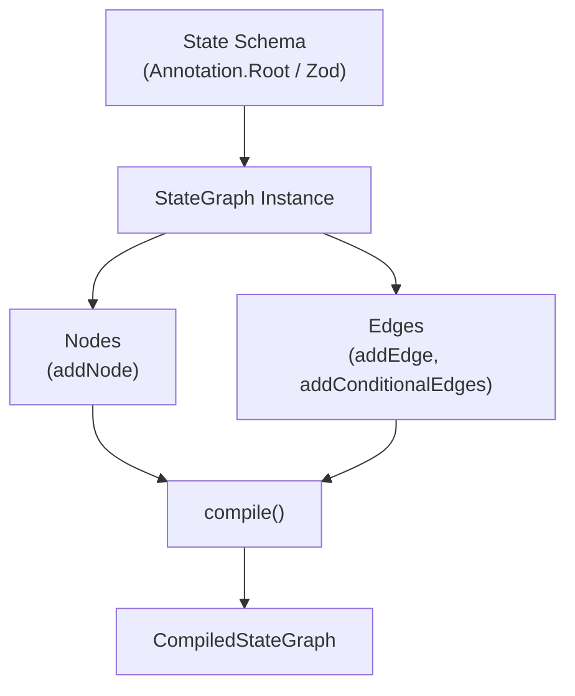
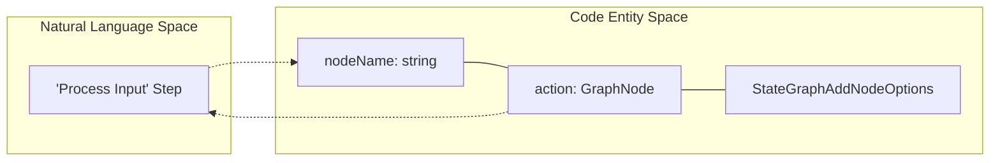
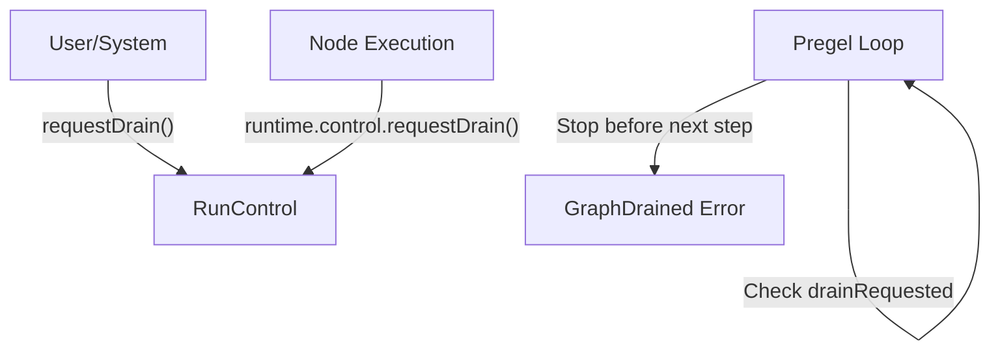

<!-- source: DeepWiki mcp.deepwiki.com · repo langchain-ai/langgraphjs · page 2.1 StateGraph and Graph Building · fetched 2026-10-26 -->

# StateGraph and Graph Building

<details>
<summary>Relevant source files</summary>

The following files were used as context for generating this wiki page:

- [docs/docs/versions/.meta.yml](docs/docs/versions/.meta.yml)
- [docs/docs/versions/index.md](docs/docs/versions/index.md)
- [examples/how-tos/create-react-agent.ipynb](examples/how-tos/create-react-agent.ipynb)
- [examples/how-tos/react-human-in-the-loop.ipynb](examples/how-tos/react-human-in-the-loop.ipynb)
- [examples/how-tos/react-memory.ipynb](examples/how-tos/react-memory.ipynb)
- [examples/how-tos/react-system-prompt.ipynb](examples/how-tos/react-system-prompt.ipynb)
- [libs/langgraph-core/src/constants.ts](libs/langgraph-core/src/constants.ts)
- [libs/langgraph-core/src/graph/graph.ts](libs/langgraph-core/src/graph/graph.ts)
- [libs/langgraph-core/src/graph/index.ts](libs/langgraph-core/src/graph/index.ts)
- [libs/langgraph-core/src/graph/state.test.ts](libs/langgraph-core/src/graph/state.test.ts)
- [libs/langgraph-core/src/graph/state.ts](libs/langgraph-core/src/graph/state.ts)
- [libs/langgraph-core/src/graph/types.ts](libs/langgraph-core/src/graph/types.ts)
- [libs/langgraph-core/src/pregel/read.ts](libs/langgraph-core/src/pregel/read.ts)
- [libs/langgraph-core/src/pregel/retry.ts](libs/langgraph-core/src/pregel/retry.ts)
- [libs/langgraph-core/src/pregel/utils/index.ts](libs/langgraph-core/src/pregel/utils/index.ts)
- [libs/langgraph-core/src/tests/constants.test.ts](libs/langgraph-core/src/tests/constants.test.ts)
- [libs/langgraph-core/src/tests/run_control.test.ts](libs/langgraph-core/src/tests/run_control.test.ts)
- [libs/langgraph-core/src/tests/set_node_defaults.test.ts](libs/langgraph-core/src/tests/set_node_defaults.test.ts)
- [libs/langgraph-core/src/tests/state_graph_compat.test-d.ts](libs/langgraph-core/src/tests/state_graph_compat.test-d.ts)
- [libs/langgraph-core/src/tests/types.test-d.ts](libs/langgraph-core/src/tests/types.test-d.ts)
- [libs/langgraph-core/src/tests/zod_state.test.ts](libs/langgraph-core/src/tests/zod_state.test.ts)
- [libs/langgraph-core/src/web.ts](libs/langgraph-core/src/web.ts)
- [libs/langgraph-core/tsconfig.json](libs/langgraph-core/tsconfig.json)
- [libs/langgraph/src/prebuilt/index.ts](libs/langgraph/src/prebuilt/index.ts)

</details>


This document explains how to construct graph-based applications using the `StateGraph` class. It covers state schema definition, adding nodes and edges, routing logic, and graph compilation.

For information about graph execution after compilation, see [Pregel Runtime Engine](#2.2). For details on state management patterns and reducers, see [State Management](#2.3). For advanced control flow primitives like `Command` and `Send`, see [Control Flow and Commands](#2.4).

## StateGraph Overview

The `StateGraph` class is the primary interface for building stateful, graph-based applications in LangGraph. A graph consists of:

- **State Schema**: Defines the structure of data that flows through the graph.
- **Nodes**: Functions that process the state and return updates.
- **Edges**: Define the execution flow between nodes.
- **Compilation**: Transforms the graph definition into an executable `CompiledStateGraph` (a specialized `Pregel` instance).



**Graph Construction Flow**

Sources: [libs/langgraph-core/src/graph/state.ts:4-5](), [libs/langgraph-core/src/graph/index.ts:20-22]()

## State Schema Definition

State schemas define the "channels" through which data flows. LangGraph supports multiple ways to define these schemas: `Annotation.Root`, Zod objects, or internal `StateSchema` classes.

### Schema Initialization Patterns

The `StateGraph` constructor is highly flexible, supporting both direct schema arguments and configuration objects [libs/langgraph-core/src/graph/state.ts:121-127]().

| Pattern | Code Entity | Description |
| :--- | :--- | :--- |
| **Annotation** | `Annotation.Root` | Recommended for complex state with custom reducers [libs/langgraph-core/src/graph/annotation.ts:69-74]() |
| **Zod** | `z.object({})` | Familiar validation-first approach [libs/langgraph-core/src/tests/zod_state.test.ts:18-23]() |
| **StateSchema** | `new StateSchema()` | Internal low-level schema definition [libs/langgraph-core/src/state/schema.ts:17-20]() |

### Using Annotation.Root

```typescript
import { Annotation } from "@langchain/langgraph";

const StateAnnotation = Annotation.Root({
  messages: Annotation<BaseMessage[]>({
    reducer: (current, update) => current.concat(update),
    default: () => [],
  }),
  count: Annotation<number>({
    default: () => 0,
  }),
});
```

### Using Zod for State

LangGraph.js provides deep integration with Zod (v3 and v4). You can pass a Zod object directly to the `StateGraph` constructor [libs/langgraph-core/src/tests/zod_state.test.ts:69-73]().

```typescript
import { z } from "zod";
const stateSchema = z.object({
  messages: z.array(z.string()),
  count: z.number(),
});
const graph = new StateGraph(stateSchema);
```

Sources: [libs/langgraph-core/src/graph/types.ts:49-53](), [libs/langgraph-core/src/tests/zod_state.test.ts:18-33]()

## Adding Nodes

Nodes are the computational units of the graph. They are added using `addNode(name, action, options)`.



**Bridging Logic to Code Entities**

### Node Configuration and Policies

When adding a node, you can specify `NodePolicyOptions` to control its runtime behavior [libs/langgraph-core/src/graph/state.ts:138-167]():

- **`retryPolicy`**: Configures backoff and max attempts for failed nodes [libs/langgraph-core/src/pregel/utils/index.ts:56-92]().
- **`cachePolicy`**: Controls how results are keyed and persisted [libs/langgraph-core/src/pregel/utils/index.ts:100-112]().
- **`timeout`**: Hard wall-clock cap on node execution [libs/langgraph-core/src/graph/state.ts:159-166]().
- **`errorHandler`**: A specific function to run after a node's retry policy is exhausted [libs/langgraph-core/src/graph/state.ts:225-230]().

### Node Input Validation

Nodes can define their own `input` schema, which may be a subset of the global state [libs/langgraph-core/src/graph/state.ts:198-204]().

```typescript
graph.addNode("myNode", myHandler, {
  input: z.object({ query: z.string() }), // Node only sees 'query'
  retryPolicy: { maxAttempts: 3 }
});
```

Sources: [libs/langgraph-core/src/graph/state.ts:198-230](), [libs/langgraph-core/src/graph/graph.ts:26-29]()

## Adding Edges

Edges define the control flow. LangGraph uses reserved constants `START` and `END` to manage entry and exit [libs/langgraph-core/src/constants.ts:8-10]().

### Normal Edges
Direct transitions between two nodes:
```typescript
graph.addEdge("nodeA", "nodeB");
```

### Conditional Edges
Dynamic routing based on state values:
```typescript
graph.addConditionalEdges(
  "nodeA",
  (state) => state.score > 0.5 ? "nodeB" : "nodeC"
);
```

### Dynamic Fan-out (Send)
To trigger multiple nodes in parallel with different states, nodes or conditional edges can return `Send` objects [libs/langgraph-core/src/constants.ts:119-121]().

```typescript
// Inside a conditional edge router
return [new Send("worker", { task: 1 }), new Send("worker", { task: 2 })];
```

Sources: [libs/langgraph-core/src/graph/graph.ts:25](), [libs/langgraph-core/src/constants.ts:195-204]()

## Compilation

The `compile()` method converts the `StateGraph` builder into a `CompiledStateGraph` [libs/langgraph-core/src/graph/state.ts:22-23](). This process validates the graph structure and attaches the execution runtime (`Pregel`).

### Checkpointing and Persistence
To enable "Time Travel" and persistence, provide a `checkpointer` during compilation [libs/langgraph-core/src/graph/state.ts:464-467]().

```typescript
const app = graph.compile({
  checkpointer: new MemorySaver(),
  interruptBefore: ["human_review_node"]
});
```

### Run Control and Draining
The `RunControl` class allows managing the lifecycle of a graph run, such as requesting a "drain" (graceful shutdown) [libs/langgraph-core/src/pregel/runtime.ts:175](). Nodes can access this via `runtime.control` to signal the graph should stop after the current step [libs/langgraph-core/src/tests/run_control.test.ts:109-113]().



**RunControl and Draining Flow**

Sources: [libs/langgraph-core/src/tests/run_control.test.ts:28-40](), [libs/langgraph-core/src/graph/state.ts:464-480]()

## Input and Output Schemas

Graphs often have different requirements for what they accept as input versus what they return as a final result. `StateGraph` supports defining these boundaries explicitly [libs/langgraph-core/src/graph/types.ts:122-141]().

```typescript
const graph = new StateGraph({
  state: FullStateAnnotation,
  input: InputSchema,   // Only these keys required to start
  output: OutputSchema  // Only these keys returned on finish
});
```

If only `input` is provided, it defaults to being the `state` schema as well [libs/langgraph-core/src/graph/types.ts:184-186]().

Sources: [libs/langgraph-core/src/graph/types.ts:122-148](), [libs/langgraph-core/src/graph/state.test.ts:93-108]()

---

