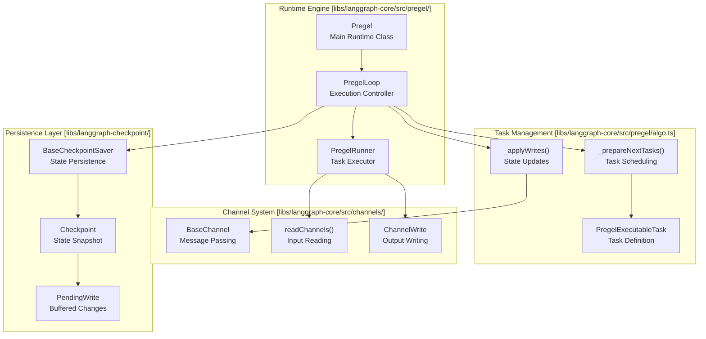
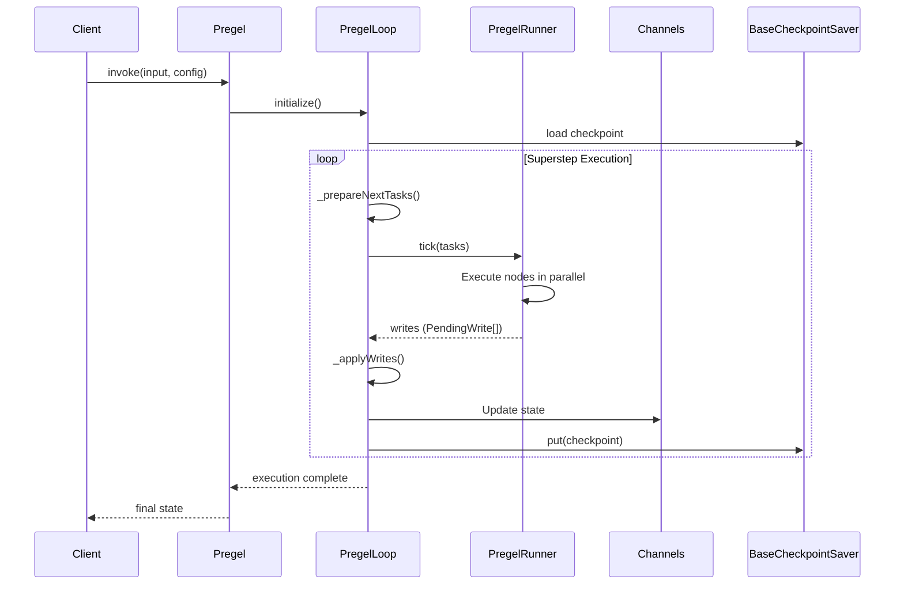
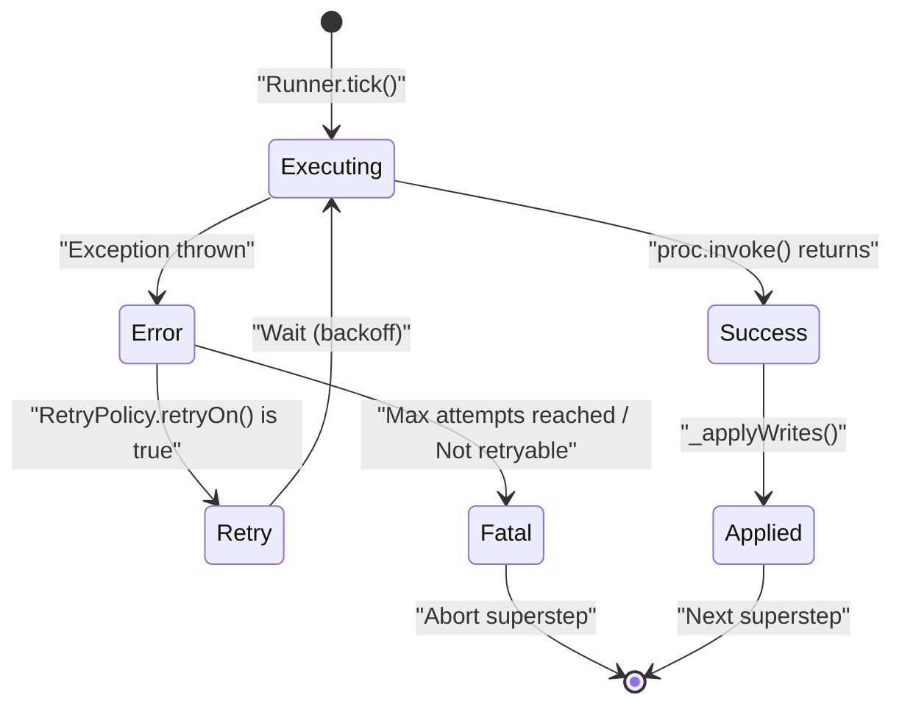
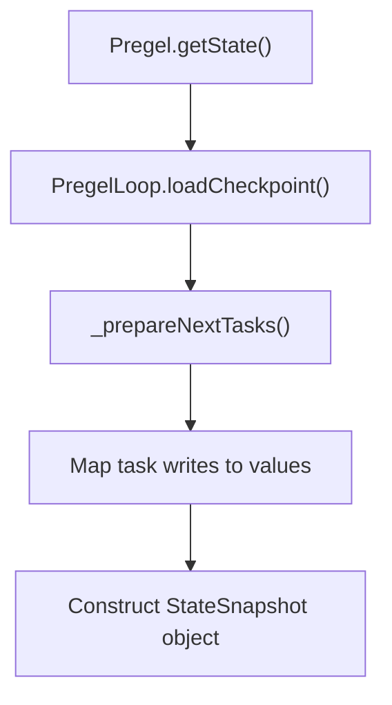

<!-- source: DeepWiki mcp.deepwiki.com · repo langchain-ai/langgraphjs · page 2.2 Pregel Runtime Engine · fetched 2026-10-26 -->

# Pregel Runtime Engine

<details>
<summary>Relevant source files</summary>

The following files were used as context for generating this wiki page:

- [libs/langgraph-core/src/channels/base.ts](libs/langgraph-core/src/channels/base.ts)
- [libs/langgraph-core/src/channels/index.ts](libs/langgraph-core/src/channels/index.ts)
- [libs/langgraph-core/src/errors.ts](libs/langgraph-core/src/errors.ts)
- [libs/langgraph-core/src/pregel/algo.ts](libs/langgraph-core/src/pregel/algo.ts)
- [libs/langgraph-core/src/pregel/index.ts](libs/langgraph-core/src/pregel/index.ts)
- [libs/langgraph-core/src/pregel/loop.ts](libs/langgraph-core/src/pregel/loop.ts)
- [libs/langgraph-core/src/pregel/runnable_types.ts](libs/langgraph-core/src/pregel/runnable_types.ts)
- [libs/langgraph-core/src/pregel/runner.ts](libs/langgraph-core/src/pregel/runner.ts)
- [libs/langgraph-core/src/pregel/runtime.ts](libs/langgraph-core/src/pregel/runtime.ts)
- [libs/langgraph-core/src/pregel/stream.test.ts](libs/langgraph-core/src/pregel/stream.test.ts)
- [libs/langgraph-core/src/pregel/stream.ts](libs/langgraph-core/src/pregel/stream.ts)
- [libs/langgraph-core/src/pregel/types.ts](libs/langgraph-core/src/pregel/types.ts)
- [libs/langgraph-core/src/pregel/utils/config.test.ts](libs/langgraph-core/src/pregel/utils/config.test.ts)
- [libs/langgraph-core/src/pregel/utils/config.ts](libs/langgraph-core/src/pregel/utils/config.ts)
- [libs/langgraph-core/src/stream/convert.test.ts](libs/langgraph-core/src/stream/convert.test.ts)
- [libs/langgraph-core/src/stream/convert.ts](libs/langgraph-core/src/stream/convert.ts)
- [libs/langgraph-core/src/stream/index.ts](libs/langgraph-core/src/stream/index.ts)
- [libs/langgraph-core/src/stream/mux.ts](libs/langgraph-core/src/stream/mux.ts)
- [libs/langgraph-core/src/tests/concurrent-thread-isolation.test.ts](libs/langgraph-core/src/tests/concurrent-thread-isolation.test.ts)
- [libs/langgraph-core/src/tests/delta_channel.test.ts](libs/langgraph-core/src/tests/delta_channel.test.ts)
- [libs/langgraph-core/src/tests/execution_info.test.ts](libs/langgraph-core/src/tests/execution_info.test.ts)
- [libs/langgraph-core/src/tests/pregel.test.ts](libs/langgraph-core/src/tests/pregel.test.ts)
- [libs/langgraph-core/src/tests/tracing.test.ts](libs/langgraph-core/src/tests/tracing.test.ts)

</details>


The Pregel runtime engine is the core execution system that powers LangGraph.js. It implements a message-passing graph computation model inspired by [Google's Pregel system](https://research.google/pubs/pregel-a-system-for-large-scale-graph-processing/), providing the foundation for reliable, controllable agent workflows that can evolve state over time.

The Pregel engine is responsible for:
- Executing graph nodes in discrete "supersteps"
- Managing message passing between nodes via channels
- Handling state persistence through checkpointing
- Supporting real-time streaming of execution progress
- Enabling human-in-the-loop workflows via interrupts

## Architecture Overview

The Pregel runtime engine consists of several key components that work together to execute graph-based workflows in discrete "supersteps" with message-passing between nodes.

### Core Components Diagram



Sources: [libs/langgraph-core/src/pregel/index.ts:294-457](), [libs/langgraph-core/src/pregel/loop.ts:238-371](), [libs/langgraph-core/src/pregel/algo.ts:87-122]()

### Class Hierarchy and Responsibilities

The `Pregel` class serves as the main runtime engine, extending `Runnable` to integrate with LangChain's execution model while providing graph-specific functionality:

```mermaid
classDiagram
    class Runnable {
        +invoke(input, options)
        +stream(input, options)
    }
    
    class Pregel {
        +nodes: Record~string, PregelNode~
        +channels: Record~string, BaseChannel~
        +inputChannels: string[]
        +outputChannels: string[]
        +checkpointer: BaseCheckpointSaver
        +interruptBefore: string[] | All
        +interruptAfter: string[] | All
        +invoke(input, config): Promise
        +stream(input, config): Promise
        +getState(config): Promise~StateSnapshot~
    }
    
    class PregelLoop {
        +step: number
        +checkpoint: Checkpoint
        +channels: Record~string, BaseChannel~
        +tasks: Record~string, PregelExecutableTask~
        +tick(params): Promise~boolean~
        +putWrites(taskId, writes): void
        -_prepareNextTasks(): void
        -_applyWrites(): void
    }
    
    class PregelExecutableTask {
        +id: string
        +name: string
        +input: any
        +proc: Runnable
        +writes: PendingWrite[]
        +config: RunnableConfig
    }
    
    Runnable <|-- Pregel
    Pregel --> PregelLoop : "instantiates in [libs/langgraph-core/src/pregel/index.ts:1210]"
    PregelLoop --> PregelExecutableTask : "manages in [libs/langgraph-core/src/pregel/loop.ts:718]"
```

Sources: [libs/langgraph-core/src/pregel/index.ts:294-322](), [libs/langgraph-core/src/pregel/loop.ts:238-371](), [libs/langgraph-core/src/pregel/types.ts:110-120]()

## Execution Model - Supersteps

The Pregel engine executes graphs in discrete "supersteps" where all ready tasks run in parallel. Their outputs are buffered and then applied atomically to the channels before the next superstep begins.

### Superstep Execution Flow



Sources: [libs/langgraph-core/src/pregel/loop.ts:696-797](), [libs/langgraph-core/src/pregel/algo.ts:394-512](), [libs/langgraph-core/src/pregel/index.ts:1204-1258]()

### Task Preparation Algorithm

The `_prepareNextTasks` function determines which nodes should execute in the current superstep based on channel updates and triggers.

| Step | Function | Purpose |
|------|----------|---------|
| 1 | Channel Version Check | Compare current `channel_versions` with `versions_seen` in the checkpoint [libs/langgraph-core/src/pregel/algo.ts:127-163](). |
| 2 | Trigger Evaluation | Identify nodes triggered by updated channels based on `triggerToNodes` mapping [libs/langgraph-core/src/pregel/algo.ts:98-109](). |
| 3 | Input Preparation | Read values from channels using `readChannels` [libs/langgraph-core/src/pregel/io.ts:212-250](). |
| 4 | Task Creation | Instantiate `PregelExecutableTask` with stable IDs [libs/langgraph-core/src/pregel/algo.ts:394-512](). |

Sources: [libs/langgraph-core/src/pregel/algo.ts:394-512](), [libs/langgraph-core/src/pregel/loop.ts:696-797]()

## Task Management and Scheduling

Tasks represent individual node executions. The `PregelRunner` manages the concurrent execution of these tasks while adhering to `maxConcurrency` limits.

### Task Lifecycle and Retries

The engine uses `_runWithRetry` to execute tasks. This function handles exponential backoff and classifying errors as retryable or fatal.



Sources: [libs/langgraph-core/src/pregel/retry.ts:64-178](), [libs/langgraph-core/src/pregel/runner.ts:122-178](), [libs/langgraph-core/src/errors.ts:134-162]()

## Channel System Integration

Channels are the communication pathways. Nodes do not talk to each other directly; they read from and write to channels.

### Version Management

The engine tracks channel versions to ensure "exactly-once" triggering logic within the superstep model.

- **`channel_versions`**: Monotonically increasing versions for each channel in the checkpoint [libs/langgraph-checkpoint/src/index.ts]().
- **`versions_seen`**: A map within the checkpoint tracking which version of a channel a specific node has already consumed [libs/langgraph-core/src/pregel/algo.ts:133-154]().
- **`increment()`**: A helper to advance versions during `_applyWrites` [libs/langgraph-core/src/pregel/algo.ts:94-96]().

Sources: [libs/langgraph-core/src/pregel/algo.ts:127-163](), [libs/langgraph-core/src/pregel/loop.ts:539-591]()

## Checkpointing and State Management

Persistence is achieved by snapshotting the entire state (channels + versions) into a `Checkpoint` at the end of every superstep.

### State Snapshot Preparation

The `getState` method calls `_prepareStateSnapshot` to provide a user-facing view of the graph state, including pending tasks.



Sources: [libs/langgraph-core/src/pregel/index.ts:725-901](), [libs/langgraph-core/src/pregel/loop.ts:373-505]()

## Streaming System

Pregel supports real-time streaming of execution data via `IterableReadableWritableStream`.

### Stream Modes

The runtime supports multiple `StreamMode` values simultaneously:
- **`values`**: Emits the full state of the graph after each superstep [libs/langgraph-core/src/pregel/io.ts:173-210]().
- **`updates`**: Emits only the updates produced by nodes in the current superstep [libs/langgraph-core/src/pregel/io.ts:252-294]().
- **`debug`**: Emits internal execution events (task start/end, writes) [libs/langgraph-core/src/pregel/debug.ts:90-147]().
- **`messages`**: Emits message-level deltas for chat-based applications [libs/langgraph-core/src/pregel/messages.ts]().

Sources: [libs/langgraph-core/src/pregel/stream.ts:122-198](), [libs/langgraph-core/src/pregel/types.ts:37-38]()

## Error Handling and Interrupts

Errors in Pregel are categorized to support complex control flows like "Human-in-the-loop".

- **`GraphInterrupt`**: Raised when a node hits a breakpoint or `interrupt()` is called. It stops execution and saves the checkpoint so it can be resumed later [libs/langgraph-core/src/errors.ts:85-97]().
- **`NodeError`**: Wraps an error from a node, providing context for node-level error handlers [libs/langgraph-core/src/errors.ts:134-149]().
- **`GraphRecursionError`**: Raised if the superstep count exceeds the `recursionLimit` [libs/langgraph-core/src/errors.ts:36-45]().

Sources: [libs/langgraph-core/src/errors.ts:1-214](), [libs/langgraph-core/src/pregel/runner.ts:156-178]()

---

