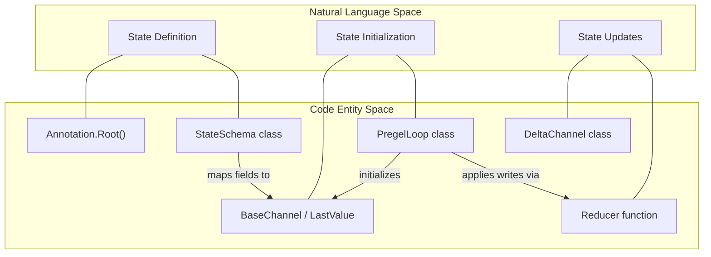
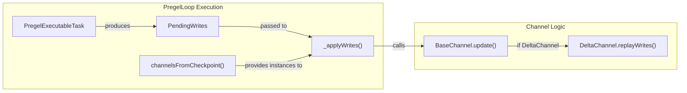

<!-- source: DeepWiki mcp.deepwiki.com · repo langchain-ai/langgraphjs · page 2.3 State Management · fetched 2026-10-26 -->

# State Management

Relevant source files

The following files were used as context for generating this wiki page:

- [libs/checkpoint-validation/src/index.ts](libs/checkpoint-validation/src/index.ts)
- [libs/checkpoint-validation/src/spec/delta_channel_history.ts](libs/checkpoint-validation/src/spec/delta_channel_history.ts)
- [libs/checkpoint-validation/src/spec/index.ts](libs/checkpoint-validation/src/spec/index.ts)
- [libs/checkpoint-validation/src/tests/memory.spec.ts](libs/checkpoint-validation/src/tests/memory.spec.ts)
- [libs/checkpoint-validation/src/tests/mongodb.spec.ts](libs/checkpoint-validation/src/tests/mongodb.spec.ts)
- [libs/checkpoint-validation/src/tests/postgres.spec.ts](libs/checkpoint-validation/src/tests/postgres.spec.ts)
- [libs/checkpoint-validation/src/tests/redis.spec.ts](libs/checkpoint-validation/src/tests/redis.spec.ts)
- [libs/checkpoint-validation/src/tests/sqlite.spec.ts](libs/checkpoint-validation/src/tests/sqlite.spec.ts)
- [libs/langgraph-core/src/channels/base.ts](libs/langgraph-core/src/channels/base.ts)
- [libs/langgraph-core/src/channels/delta.ts](libs/langgraph-core/src/channels/delta.ts)
- [libs/langgraph-core/src/channels/index.ts](libs/langgraph-core/src/channels/index.ts)
- [libs/langgraph-core/src/graph/messages_reducer.ts](libs/langgraph-core/src/graph/messages_reducer.ts)
- [libs/langgraph-core/src/pregel/algo.ts](libs/langgraph-core/src/pregel/algo.ts)
- [libs/langgraph-core/src/pregel/loop.ts](libs/langgraph-core/src/pregel/loop.ts)
- [libs/langgraph-core/src/state/prebuilt/index.ts](libs/langgraph-core/src/state/prebuilt/index.ts)
- [libs/langgraph-core/src/state/prebuilt/messages.ts](libs/langgraph-core/src/state/prebuilt/messages.ts)
- [libs/langgraph-core/src/state/schema.test.ts](libs/langgraph-core/src/state/schema.test.ts)
- [libs/langgraph-core/src/state/schema.ts](libs/langgraph-core/src/state/schema.ts)
- [libs/langgraph-core/src/state/values/delta.test.ts](libs/langgraph-core/src/state/values/delta.test.ts)
- [libs/langgraph-core/src/state/values/delta.ts](libs/langgraph-core/src/state/values/delta.ts)
- [libs/langgraph-core/src/state/values/index.ts](libs/langgraph-core/src/state/values/index.ts)
- [libs/langgraph-core/src/tests/delta_channel.test.ts](libs/langgraph-core/src/tests/delta_channel.test.ts)

State Management in LangGraph.js defines how data is structured, updated, and persisted throughout a graph's execution. It relies on a "channel" architecture where each piece of state is stored in a named channel that can have specific logic for merging updates (reducers) and providing initial values (defaults).

For deep dives into specific implementation details, see the child pages:
- [Annotation System](#2.3.1) — How to define state schemas using the primary `Annotation` API.
- [Zod Schema Integration](#2.3.2) — Using Zod for runtime validation and schema definition.

## Overview

State in LangGraph represents the data structure that flows through your graph. Every node receives the current state as input and returns updates that are merged back into the state using reducer functions. The Pregel runtime engine manages these updates in "super-steps," ensuring that all node writes are applied before the next set of nodes executes [libs/langgraph-core/src/pregel/loop.ts:68-76]().

### State Lifecycle and Code Entities

The following diagram maps the conceptual state lifecycle to the internal code entities that manage it.

**State Management Entity Mapping**

Sources: [libs/langgraph-core/src/state/schema.ts:190-205](), [libs/langgraph-core/src/pregel/loop.ts:136-154](), [libs/langgraph-core/src/channels/base.ts:30-45]()

## The Annotation System

The `Annotation.Root()` function is the primary entry point for defining state. It creates a `StateSchema` object that maps field names to specific `BaseChannel` implementations [libs/langgraph-core/src/state/schema.ts:53-62]().

- **Value Type**: The type of data stored in the channel (e.g., `string[]`).
- **Update Type**: The type of data accepted as an update (e.g., a single `string` or an `Overwrite` command).
- **Reducers**: Functions that determine how the current value and a new update combine [libs/langgraph-core/src/channels/delta.ts:34-37]().

For details, see [Annotation System](#2.3.1).

## Reducers and Channels

Reducers are the core logic for state transitions. LangGraph provides several built-in channel types and reducers to handle common patterns.

| Channel Type | Behavior | Code Reference |
|--------------|----------|----------------|
| `LastValue` | Default behavior; the newest update overrides the existing value. | [libs/langgraph-core/src/channels/last_value.ts]() |
| `Topic` | Accumulates all updates into a list for the next step. | [libs/langgraph-core/src/channels/topic.ts]() |
| `DeltaChannel` | Optimizes persistence by replaying writes instead of saving full state blobs. | [libs/langgraph-core/src/channels/delta.ts:84-91]() |
| `BinaryOperatorAggregate` | Uses a binary function (like addition or array concat) to merge values. | [libs/langgraph-core/src/channels/binop.ts]() |

### DeltaChannel and Replay Logic
The `DeltaChannel` is a specialized implementation designed for high-frequency updates (like message lists). Instead of storing the full state in every checkpoint, it reconstructs state by replaying ancestor writes through a `DeltaReducer` [libs/langgraph-core/src/channels/delta.ts:49-57](). It periodically takes a `DeltaSnapshot` to bound the replay depth [libs/langgraph-core/src/channels/delta.ts:59-64]().

Sources: [libs/langgraph-core/src/channels/base.ts:21-23](), [libs/langgraph-core/src/channels/delta.ts:146-165]()

## Message State Handling

Managing chat history is a primary use case for LangGraph. The framework provides `messagesStateReducer` and `messagesDeltaReducer` to handle `BaseMessage` objects [libs/langgraph-core/src/graph/messages_reducer.ts:60-63]().

**Message Reducer Logic**
- **Append**: New messages are added to the list.
- **Update**: If a message has an existing `id`, it is replaced by the new version [libs/langgraph-core/src/graph/messages_reducer.ts:107-116]().
- **Remove**: A `RemoveMessage` instance triggers the removal of a message by ID [libs/langgraph-core/src/graph/messages_reducer.ts:111-112]().
- **Clear All**: The `REMOVE_ALL_MESSAGES` sentinel wipes the history [libs/langgraph-core/src/graph/messages_reducer.ts:14-15]().

Sources: [libs/langgraph-core/src/graph/messages_reducer.ts:14-131](), [libs/langgraph-core/src/tests/delta_channel.test.ts:154-190]()

## Execution and Updates

During the Pregel execution loop, state is updated at the end of each super-step. The `PregelLoop` class orchestrates this by calling `_applyWrites`, which iterates through all tasks and their respective channel updates [libs/langgraph-core/src/pregel/loop.ts:68-76]().

**Internal State Update Flow**

Sources: [libs/langgraph-core/src/pregel/loop.ts:156-187](), [libs/langgraph-core/src/pregel/algo.ts:216-222](), [libs/langgraph-core/src/channels/delta.ts:167-175]()

## Persistence and Checkpointing

State management is tightly coupled with the persistence layer. The `BaseCheckpointSaver` saves the `channel_values` (for standard channels) and `checkpoint_writes` (for `DeltaChannel` replay) [libs/langgraph-core/src/pregel/loop.ts:136-154](). This allows for "Time Travel," where the graph can be resumed from any previous checkpoint by reconstructing the state channels from the saved values and replayed writes.

For details on how checkpoints are stored, see [Persistence and Checkpointing](#3).

Sources: [libs/langgraph-core/src/pregel/loop.ts:136-154](), [libs/checkpoint-validation/src/spec/index.ts:27-30]()

---

