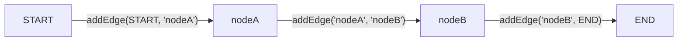
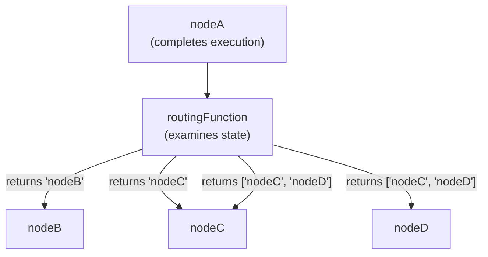
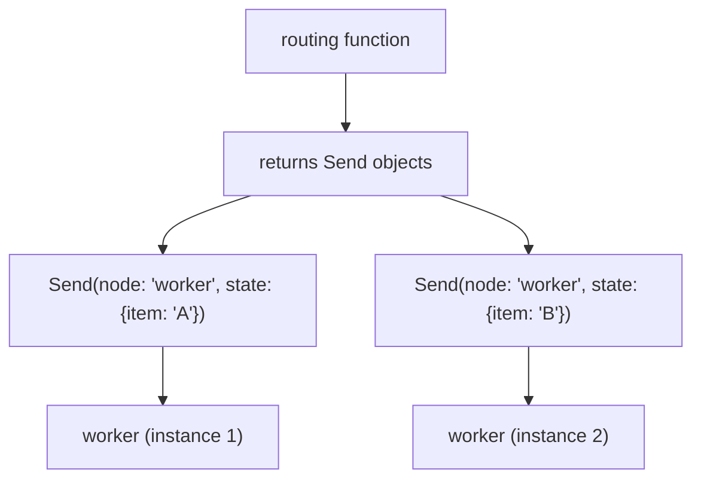
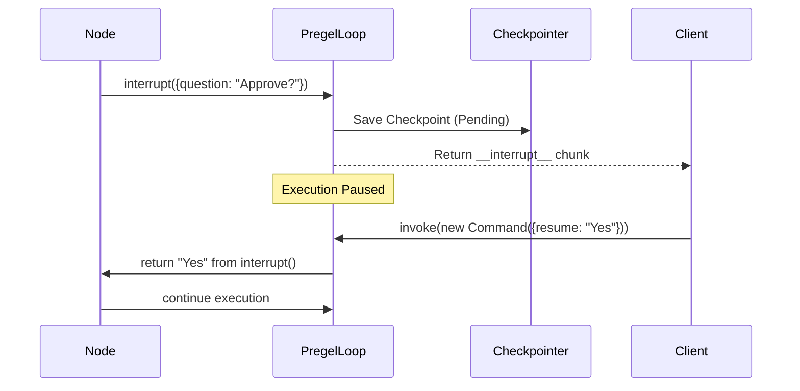
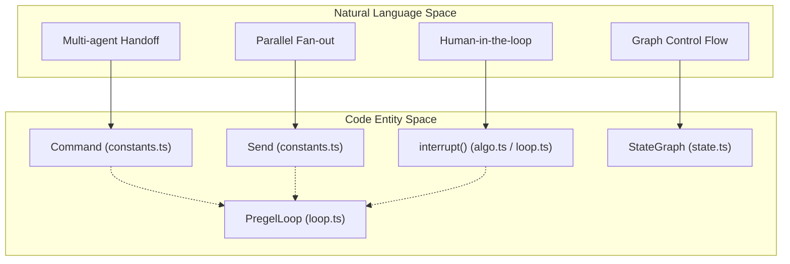

<!-- source: DeepWiki mcp.deepwiki.com · repo langchain-ai/langgraphjs · page 2.4 Control Flow and Commands · fetched 2026-10-26 -->

# Control Flow and Commands

<details>
<summary>Relevant source files</summary>

The following files were used as context for generating this wiki page:

- [docs/docs/concepts/high_level.md](docs/docs/concepts/high_level.md)
- [docs/docs/concepts/human_in_the_loop.md](docs/docs/concepts/human_in_the_loop.md)
- [docs/docs/concepts/memory.md](docs/docs/concepts/memory.md)
- [docs/docs/concepts/persistence.md](docs/docs/concepts/persistence.md)
- [docs/docs/concepts/streaming.md](docs/docs/concepts/streaming.md)
- [docs/docs/troubleshooting/errors/GRAPH_RECURSION_LIMIT.ipynb](docs/docs/troubleshooting/errors/GRAPH_RECURSION_LIMIT.ipynb)
- [docs/docs/troubleshooting/errors/INVALID_CONCURRENT_GRAPH_UPDATE.ipynb](docs/docs/troubleshooting/errors/INVALID_CONCURRENT_GRAPH_UPDATE.ipynb)
- [docs/docs/troubleshooting/errors/INVALID_GRAPH_NODE_RETURN_VALUE.ipynb](docs/docs/troubleshooting/errors/INVALID_GRAPH_NODE_RETURN_VALUE.ipynb)
- [docs/docs/troubleshooting/errors/MULTIPLE_SUBGRAPHS.ipynb](docs/docs/troubleshooting/errors/MULTIPLE_SUBGRAPHS.ipynb)
- [docs/docs/troubleshooting/errors/UNREACHABLE_NODE.ipynb](docs/docs/troubleshooting/errors/UNREACHABLE_NODE.ipynb)
- [docs/docs/troubleshooting/errors/index.md](docs/docs/troubleshooting/errors/index.md)
- [examples/how-tos/command.ipynb](examples/how-tos/command.ipynb)
- [examples/how-tos/dynamic_breakpoints.ipynb](examples/how-tos/dynamic_breakpoints.ipynb)
- [examples/how-tos/recursion-limit.ipynb](examples/how-tos/recursion-limit.ipynb)
- [examples/how-tos/update-state-from-tools.ipynb](examples/how-tos/update-state-from-tools.ipynb)
- [examples/how-tos/wait-user-input-functional.ipynb](examples/how-tos/wait-user-input-functional.ipynb)
- [libs/langgraph-core/src/channels/base.ts](libs/langgraph-core/src/channels/base.ts)
- [libs/langgraph-core/src/channels/index.ts](libs/langgraph-core/src/channels/index.ts)
- [libs/langgraph-core/src/pregel/algo.ts](libs/langgraph-core/src/pregel/algo.ts)
- [libs/langgraph-core/src/pregel/loop.ts](libs/langgraph-core/src/pregel/loop.ts)
- [libs/langgraph-core/src/tests/delta_channel.test.ts](libs/langgraph-core/src/tests/delta_channel.test.ts)

</details>


This document describes how to control execution flow in LangGraph using edges, conditional routing, `Command` objects, `Send` for dynamic fan-out, and the `interrupt()` mechanism. Control flow determines which nodes execute and in what order, enabling everything from simple sequential execution to complex multi-agent coordination.

For information about the Pregel execution engine that processes these control flow instructions, see [2.2 Pregel Runtime Engine](). For state management fundamentals, see [2.3 State Management]().

---

## Overview

LangGraph provides multiple mechanisms for controlling execution flow:

| Mechanism | Purpose | Definition Time | Use Case |
|-----------|---------|-----------------|----------|
| **Normal Edges** | Fixed routing between nodes | Graph build time | Sequential workflows with known structure |
| **Conditional Edges** | Dynamic routing based on state | Graph build time (function at runtime) | Branching logic, decision points |
| **Command** | Combine state updates with routing | Runtime (returned from nodes) | Multi-agent handoffs, tool-based routing |
| **Send** | Dynamic parallel execution | Runtime (returned from conditional edges) | Map-reduce, fan-out/fan-in patterns |
| **interrupt** | Pause execution for input | Runtime (called in nodes) | Human-in-the-loop workflows |

These mechanisms integrate with the Pregel execution model, where nodes execute in super-steps and edges determine the next set of nodes to activate.

**Sources:** [libs/langgraph-core/src/pregel/loop.ts:40-65](), [libs/langgraph-core/src/pregel/algo.ts:31-61](), [examples/how-tos/command.ipynb:32-59]()

---

## Normal Edges

Normal edges create fixed connections between nodes that always execute in the same order. They are defined at graph build time using the `addEdge` method on the `StateGraph` class.

### Basic Edge Definition



Normal edges are appropriate when the workflow structure is known ahead of time and routing does not depend on runtime state. The `addEdge` method accepts two arguments: the source node name and the target node name.

**Sources:** [libs/langgraph-core/src/pregel/algo.ts:60-61](), [docs/docs/concepts/persistence.md:49-51]()

### Entry and Exit Points

Entry points specify which node(s) execute first when the graph starts. They are defined by creating an edge from the special `START` node. The special `END` node represents graph termination.

**Code pattern:**
```typescript
import { START, END } from "@langchain/langgraph";

const graph = new StateGraph(...)
  .addEdge(START, "firstNode")
  .addEdge("finalNode", END)
  .compile();
```

**Sources:** [libs/langgraph-core/src/pregel/loop.ts:64-65](), [libs/langgraph-core/src/pregel/algo.ts:60-61]()

---

## Conditional Edges

Conditional edges execute different target nodes based on runtime state evaluation. They consist of a routing function that examines state and returns the name of the next node(s) to execute.

### Basic Conditional Routing



**Diagram: Conditional edge routing function determines next node(s) based on state**

The routing function receives the current state and returns a single node name, an array of node names for parallel execution, or a `Send` object.

**Sources:** [libs/langgraph-core/src/pregel/algo.ts:32-42](), [libs/langgraph-core/src/pregel/loop.ts:41-44]()

---

## Command API

The `Command` object allows a node to specify both a state update and a routing destination in a single return value. This is the recommended way to combine control flow and state updates, especially in multi-agent handoffs.

### Command Structure and Logic

A `Command` object (defined in `libs/langgraph-core/src/constants.ts`) contains the following key fields:

| Field | Type | Description |
|-------|------|-------------|
| `update` | `Record<string, any>` | Partial state to merge with current state |
| `goto` | `string` or `string[]` | Target node name(s) to execute next |
| `graph` | `Command.PARENT` | Navigate to parent graph (for subgraphs) |
| `resume` | `any` | Value used to resume execution after an `interrupt()` |

**Sources:** [libs/langgraph-core/src/pregel/loop.ts:40-44](), [examples/how-tos/command.ipynb:32-59]()

### Implementation in Nodes

When a node returns a `Command`, the Pregel loop processes it during the `_applyWrites` phase. If a `goto` is present, it overrides standard edges.

```typescript
const myNode = (state: typeof StateAnnotation.State) => {
  return new Command({
    update: { foo: "bar" },
    goto: "myOtherNode",
  });
};

// When adding a node that uses Command, you must specify 'ends'
graph.addNode("myNode", myNode, { ends: ["myOtherNode"] });
```

**Sources:** [libs/langgraph-core/src/pregel/loop.ts:83-88](), [examples/how-tos/command.ipynb:125-132](), [examples/how-tos/command.ipynb:168-176]()

### Tool State Updates

Tools can also return `Command` objects. This is useful for tools that need to update graph state (e.g., setting a `user_id` in state) while also returning a `ToolMessage`.

```typescript
const lookupUserInfo = tool(async (input, config) => {
  return new Command({
    update: {
      user_info: { id: "123", name: "Alice" },
      messages: [new ToolMessage({ ... })]
    }
  });
});
```

**Sources:** [examples/how-tos/update-state-from-tools.ipynb:36-55](), [examples/how-tos/update-state-from-tools.ipynb:174-200]()

---

## Send API (Dynamic Fan-out)

The `Send` primitive enables dynamic parallel execution. It is used when the number of parallel tasks is not known at graph definition time but depends on runtime data (e.g., generating a joke for every subject in a list).



The `Send` object takes two arguments: the name of the node to execute and the specific state to pass to that node instance.

**Sources:** [libs/langgraph-core/src/pregel/algo.ts:32-42](), [libs/langgraph-core/src/pregel/loop.ts:41-42]()

---

## Interrupt and Human-in-the-Loop

The `interrupt()` function pauses graph execution at a specific node, surfaces information to a human, and waits for a `Command` to resume.

### Interrupt Flow

1. **Pause**: The node calls `interrupt(value)`. This throws a `GraphInterrupt` error which is caught by the Pregel loop.
2. **Checkpoint**: The loop saves a checkpoint of the current state.
3. **Resume**: The client sends a `Command({ resume: input })`.
4. **Continue**: The `interrupt()` call returns the `input` value, and the node continues execution.



**Sources:** [libs/langgraph-core/src/pregel/loop.ts:52-54](), [libs/langgraph-core/src/pregel/loop.ts:90-93](), [docs/docs/concepts/human_in_the_loop.md:25-57]()

---

## Technical Implementation: Pregel Loop Control

The Pregel runtime engine (see `libs/langgraph-core/src/pregel/loop.ts`) manages these primitives through several internal functions:

| Code Entity | File Location | Role |
|-------------|---------------|------|
| `_applyWrites` | [libs/langgraph-core/src/pregel/algo.ts:216-222]() | Applies state updates from `Command` and `Send` to channels. |
| `shouldInterrupt` | [libs/langgraph-core/src/pregel/algo.ts:127-163]() | Determines if execution should pause based on `interruptBefore`/`After` config. |
| `isCommand` | [libs/langgraph-core/src/pregel/loop.ts:40]() | Type guard to identify `Command` objects in node returns. |
| `_isSend` | [libs/langgraph-core/src/pregel/loop.ts:41]() | Type guard to identify `Send` objects for dynamic fan-out. |
| `mapCommand` | [libs/langgraph-core/src/pregel/loop.ts:83]() | Maps `Command` updates and routing instructions into the execution loop. |

### Code Entity Space to Control Flow Space



**Sources:** [libs/langgraph-core/src/pregel/loop.ts:1-110](), [libs/langgraph-core/src/pregel/algo.ts:1-163](), [libs/langgraph-core/src/constants.ts:1-65]()

---

