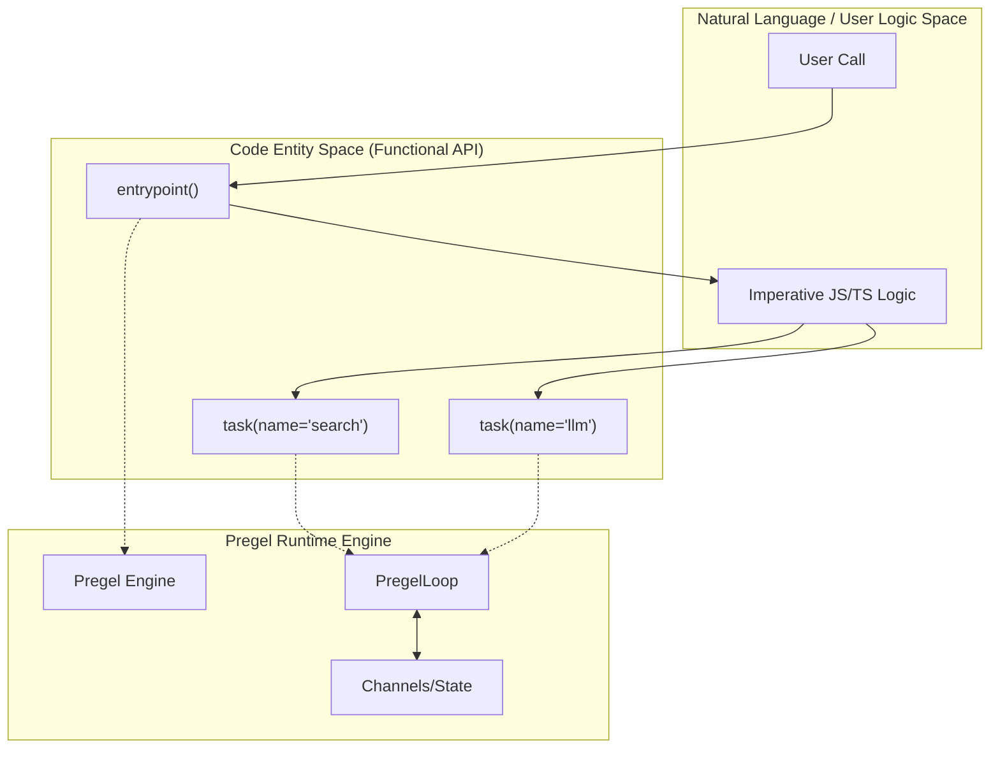
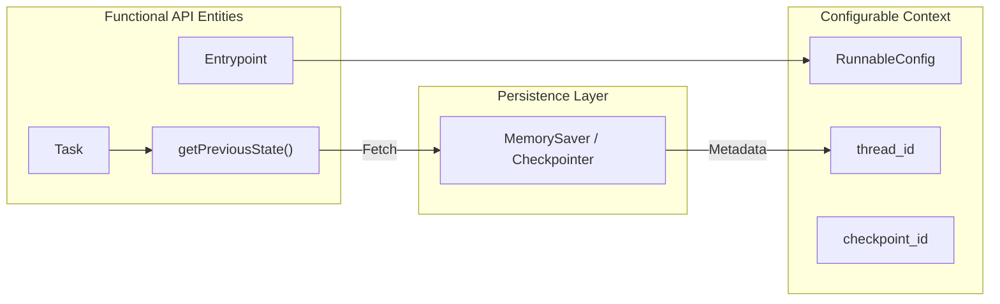

<!-- source: DeepWiki mcp.deepwiki.com · repo langchain-ai/langgraphjs · page 2.5 Functional API and Tasks · fetched 2026-10-26 -->

# Functional API and Tasks

Relevant source files

The following files were used as context for generating this wiki page:

- [examples/how-tos/branching.ipynb](examples/how-tos/branching.ipynb)
- [examples/how-tos/configuration.ipynb](examples/how-tos/configuration.ipynb)
- [examples/how-tos/dynamically-returning-directly.ipynb](examples/how-tos/dynamically-returning-directly.ipynb)
- [examples/how-tos/force-calling-a-tool-first.ipynb](examples/how-tos/force-calling-a-tool-first.ipynb)
- [examples/how-tos/managing-agent-steps.ipynb](examples/how-tos/managing-agent-steps.ipynb)
- [examples/how-tos/persistence.ipynb](examples/how-tos/persistence.ipynb)
- [examples/how-tos/respond-in-format.ipynb](examples/how-tos/respond-in-format.ipynb)
- [examples/how-tos/stream-tokens.ipynb](examples/how-tos/stream-tokens.ipynb)
- [examples/how-tos/subgraph.ipynb](examples/how-tos/subgraph.ipynb)
- [examples/how-tos/time-travel.ipynb](examples/how-tos/time-travel.ipynb)
- [libs/langgraph-core/src/constants.ts](libs/langgraph-core/src/constants.ts)
- [libs/langgraph-core/src/graph/index.ts](libs/langgraph-core/src/graph/index.ts)
- [libs/langgraph-core/src/graph/state.test.ts](libs/langgraph-core/src/graph/state.test.ts)
- [libs/langgraph-core/src/graph/state.ts](libs/langgraph-core/src/graph/state.ts)
- [libs/langgraph-core/src/graph/types.ts](libs/langgraph-core/src/graph/types.ts)
- [libs/langgraph-core/src/pregel/index.ts](libs/langgraph-core/src/pregel/index.ts)
- [libs/langgraph-core/src/pregel/utils/config.test.ts](libs/langgraph-core/src/pregel/utils/config.test.ts)
- [libs/langgraph-core/src/pregel/utils/config.ts](libs/langgraph-core/src/pregel/utils/config.ts)
- [libs/langgraph-core/src/tests/concurrent-thread-isolation.test.ts](libs/langgraph-core/src/tests/concurrent-thread-isolation.test.ts)
- [libs/langgraph-core/src/tests/constants.test.ts](libs/langgraph-core/src/tests/constants.test.ts)
- [libs/langgraph-core/src/tests/execution_info.test.ts](libs/langgraph-core/src/tests/execution_info.test.ts)
- [libs/langgraph-core/src/tests/pregel.test.ts](libs/langgraph-core/src/tests/pregel.test.ts)
- [libs/langgraph-core/src/tests/run_control.test.ts](libs/langgraph-core/src/tests/run_control.test.ts)
- [libs/langgraph-core/src/tests/set_node_defaults.test.ts](libs/langgraph-core/src/tests/set_node_defaults.test.ts)
- [libs/langgraph-core/src/tests/state_graph_compat.test-d.ts](libs/langgraph-core/src/tests/state_graph_compat.test-d.ts)
- [libs/langgraph-core/src/tests/tracing.test.ts](libs/langgraph-core/src/tests/tracing.test.ts)
- [libs/langgraph-core/src/tests/types.test-d.ts](libs/langgraph-core/src/tests/types.test-d.ts)
- [libs/langgraph-core/src/tests/zod_state.test.ts](libs/langgraph-core/src/tests/zod_state.test.ts)
- [libs/langgraph-core/src/web.ts](libs/langgraph-core/src/web.ts)
- [libs/langgraph-core/tsconfig.json](libs/langgraph-core/tsconfig.json)

The Functional API in LangGraph.js provides a streamlined, function-centric approach to building stateful applications. While `StateGraph` uses a structured graph definition with nodes and edges, the Functional API allows developers to define logic using standard TypeScript/JavaScript functions wrapped as **Tasks** and **Entrypoints**. This API is built on top of the same Pregel runtime as `StateGraph`, ensuring full compatibility with checkpointing, streaming, and human-in-the-loop features.

## Core Concepts

The Functional API revolves around two primary primitives defined in `libs/langgraph-core/src/func/index.ts`: `entrypoint` and `task`.

### Entrypoints
An `entrypoint` serves as the top-level container for a functional workflow. It defines the boundary for a thread and manages the lifecycle of the execution, including state persistence via checkpointers.

*   **Implementation**: Defined via the `entrypoint()` function [libs/langgraph-core/src/web.ts:158-162]().
*   **Role**: Acts as the "Main" function of a graph. It is responsible for orchestrating multiple tasks and managing the transition of state.

### Tasks
A `task` is a discrete unit of work within an entrypoint. Tasks are the functional equivalent of nodes in a `StateGraph`.

*   **Implementation**: Defined via the `task()` function [libs/langgraph-core/src/web.ts:160-162]().
*   **Features**: Tasks support advanced execution logic such as retry policies, caching, and timeouts [libs/langgraph-core/src/graph/state.ts:138-167]().

### Data Flow Architecture

The Functional API abstracts the underlying Pregel communication (channels and topics) into a more natural imperative flow. However, under the hood, it still uses the `Pregel` engine to manage execution steps.

#### Functional API Execution Logic
The following diagram illustrates how a functional `entrypoint` orchestrates `tasks` and interacts with the Pregel runtime.

**Functional Execution Model**

**Sources:** [libs/langgraph-core/src/func/index.ts:1-162](), [libs/langgraph-core/src/pregel/index.ts:196-221](), [libs/langgraph-core/src/pregel/loop.ts:1-100]()

## Task Configuration and Policies

Tasks can be configured with specific behaviors to handle failures and optimize performance. These options are defined in `TaskOptions` [libs/langgraph-core/src/func/index.ts:161-161]().

### Retry Policies
Tasks support a `retryPolicy` to handle transient errors. This policy defines how many times a task should be re-executed and the backoff strategy.
*   **RetryPolicy Schema**: Includes `maxAttempts`, `initialInterval`, `backoffFactor`, and `retryOn` (specific error types) [libs/langgraph-core/src/pregel/utils/index.ts:131-132]().

### Cache Policies
Caching allows the runtime to skip task execution if the inputs haven't changed, improving performance and reducing costs.
*   **CachePolicy**: Controls how results are keyed and their TTL (Time To Live) [libs/langgraph-core/src/graph/state.ts:146-157]().

### Timeout Policies
Timeouts ensure that a task does not hang indefinitely.
*   **TimeoutPolicy**: Can be a simple number (milliseconds) or a complex policy for idle/run timeouts [libs/langgraph-core/src/pregel/utils/timeout.js:4-5]().

| Option | Type | Description |
| :--- | :--- | :--- |
| `retryPolicy` | `RetryPolicy` | Defines error handling and backoff [libs/langgraph-core/src/graph/state.ts:140-145]() |
| `cachePolicy` | `CachePolicy \| boolean` | Controls result persistence and reuse [libs/langgraph-core/src/graph/state.ts:146-157]() |
| `timeout` | `number \| TimeoutPolicy` | Caps execution duration [libs/langgraph-core/src/graph/state.ts:158-166]() |

**Sources:** [libs/langgraph-core/src/graph/state.ts:138-167](), [libs/langgraph-core/src/pregel/utils/index.ts:114-117]()

## State and Context Management

In the Functional API, state management is more flexible than the fixed schema of a `StateGraph`.

### Accessing Previous State
The `getPreviousState` function allows an entrypoint or task to retrieve the state from the previous successful step in the current thread [libs/langgraph-core/src/web.ts:188-188](). This is critical for building conversational agents where history matters.

### Contextual Configuration
Functions can access the current execution context (like `thread_id` or `checkpoint_id`) using `getConfig()` [libs/langgraph-core/src/pregel/utils/config.ts:10-10]().

**Task Data Interaction**

**Sources:** [libs/langgraph-core/src/pregel/utils/config.ts:46-54](), [libs/langgraph-core/src/func/index.ts:188-188](), [libs/langgraph-core/src/web.ts:135-155]()

## Comparison with StateGraph

| Feature | StateGraph | Functional API |
| :--- | :--- | :--- |
| **Structure** | Explicit Nodes and Edges | Imperative Functions |
| **State** | Unified `StateAnnotation` | Local variables + `getPreviousState` |
| **Routing** | `addEdge`, `addConditionalEdges` | Standard `if/else`, `switch`, `loops` |
| **Persistence** | Compiled with `checkpointer` | Defined in `EntrypointOptions` |
| **Execution** | `graph.invoke(input)` | `entrypoint.invoke(input)` |

**Sources:** [libs/langgraph-core/src/graph/state.ts:21-39](), [libs/langgraph-core/src/func/index.ts:158-162]()

---

