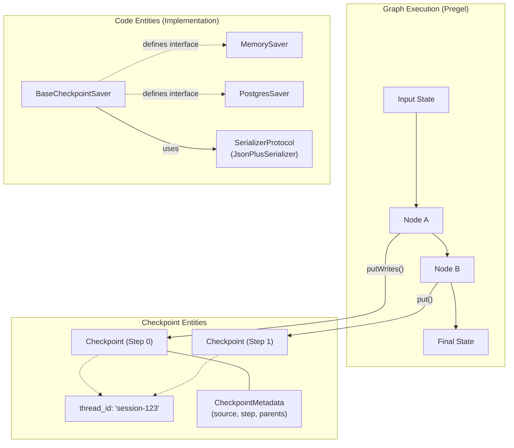

<!-- source: DeepWiki mcp.deepwiki.com · repo langchain-ai/langgraphjs · page 3 Persistence and Checkpointing · fetched 2026-10-26 -->

# Persistence and Checkpointing

Relevant source files

The following files were used as context for generating this wiki page:

- [docs/docs/concepts/high_level.md](docs/docs/concepts/high_level.md)
- [docs/docs/concepts/human_in_the_loop.md](docs/docs/concepts/human_in_the_loop.md)
- [docs/docs/concepts/memory.md](docs/docs/concepts/memory.md)
- [docs/docs/concepts/persistence.md](docs/docs/concepts/persistence.md)
- [docs/docs/concepts/streaming.md](docs/docs/concepts/streaming.md)
- [examples/how-tos/dynamic_breakpoints.ipynb](examples/how-tos/dynamic_breakpoints.ipynb)
- [examples/how-tos/recursion-limit.ipynb](examples/how-tos/recursion-limit.ipynb)
- [examples/how-tos/wait-user-input-functional.ipynb](examples/how-tos/wait-user-input-functional.ipynb)
- [libs/checkpoint-postgres/src/index.ts](libs/checkpoint-postgres/src/index.ts)
- [libs/checkpoint-postgres/src/sql.ts](libs/checkpoint-postgres/src/sql.ts)
- [libs/checkpoint-postgres/src/tests/checkpoints.int.test.ts](libs/checkpoint-postgres/src/tests/checkpoints.int.test.ts)
- [libs/checkpoint/src/base.ts](libs/checkpoint/src/base.ts)
- [libs/checkpoint/src/memory.ts](libs/checkpoint/src/memory.ts)
- [libs/checkpoint/src/serde/base.ts](libs/checkpoint/src/serde/base.ts)
- [libs/checkpoint/src/serde/jsonplus.ts](libs/checkpoint/src/serde/jsonplus.ts)
- [libs/checkpoint/src/serde/tests/jsonplus.test.ts](libs/checkpoint/src/serde/tests/jsonplus.test.ts)
- [libs/checkpoint/src/serde/types.ts](libs/checkpoint/src/serde/types.ts)
- [libs/checkpoint/src/serde/utils/fast-safe-stringify/LICENSE](libs/checkpoint/src/serde/utils/fast-safe-stringify/LICENSE)
- [libs/checkpoint/src/serde/utils/fast-safe-stringify/index.ts](libs/checkpoint/src/serde/utils/fast-safe-stringify/index.ts)
- [libs/checkpoint/src/tests/checkpoints.test.ts](libs/checkpoint/src/tests/checkpoints.test.ts)
- [libs/checkpoint/src/tests/memory-pollution.test.ts](libs/checkpoint/src/tests/memory-pollution.test.ts)
- [libs/checkpoint/src/types.ts](libs/checkpoint/src/types.ts)

This document provides an overview of LangGraph's checkpoint system for persisting graph state. Checkpointing enables state snapshots at each execution step, supporting features like resumable execution, time-travel debugging, and human-in-the-loop workflows. This page covers the fundamental concepts and purpose of checkpointing. For detailed architecture information, see [Checkpoint System Architecture](#3.1). For specific database implementations, see [Checkpoint Implementations](#3.2). For cross-thread data storage that is not tied to execution state, see [Long-term Memory Store](#3.3).

## Core Concepts

Checkpointing in LangGraph is a persistence mechanism that automatically saves snapshots of graph state after each super-step during execution. These snapshots, called **checkpoints**, are stored by a **checkpointer** implementation and are organized by **thread ID** to maintain separate conversation contexts.

### Checkpoints

A checkpoint represents a complete snapshot of the graph state at a specific point in execution. Each checkpoint is defined by the `Checkpoint` interface [libs/checkpoint/src/base.ts:18-46]() and contains:

- `v`: The version of the checkpoint format (currently 4) [libs/checkpoint/src/base.ts:25]().
- `id`: A unique identifier (UUID v6) [libs/checkpoint/src/base.ts:29]().
- `ts`: An ISO timestamp of when the checkpoint was created [libs/checkpoint/src/base.ts:33]().
- `channel_values`: The actual state data for all channels [libs/checkpoint/src/base.ts:37]().
- `channel_versions`: Versioning information for individual channels to support delta updates [libs/checkpoint/src/base.ts:41]().
- `versions_seen`: A map tracking which versions of channels have been seen by which nodes [libs/checkpoint/src/base.ts:45]().

### Threads

Threads are the organizational unit for checkpoints. Each thread represents an independent conversation or session, identified by a unique `thread_id`. When invoking a graph with a checkpointer, you **must** specify a `thread_id` in the `configurable` section of the `RunnableConfig` [docs/docs/concepts/persistence.md:9-13]().

Sources: [libs/checkpoint/src/base.ts:18-46](), [docs/docs/concepts/persistence.md:9-13]()

## Checkpoint System Overview

**Diagram: Checkpoint System and Code Entity Association**

Sources: [libs/checkpoint/src/base.ts:113-147](), [libs/checkpoint/src/types.ts:17-63](), [docs/docs/concepts/persistence.md:3-13]()

## BaseCheckpointSaver Interface

All checkpoint implementations extend the `BaseCheckpointSaver` abstract class [libs/checkpoint/src/base.ts:113](). It provides the standard contract for graph persistence:

- `put()`: Saves a full checkpoint for a given configuration [libs/checkpoint/src/base.ts:142]().
- `putWrites()`: Stores intermediate writes (pending updates) linked to a checkpoint [libs/checkpoint/src/base.ts:152]().
- `getTuple()`: Retrieves a `CheckpointTuple` containing the checkpoint, metadata, and pending writes [libs/checkpoint/src/base.ts:133]().
- `list()`: Lists historical checkpoints for a thread, supporting time-travel [libs/checkpoint/src/base.ts:137]().

Checkpointers use a `SerializerProtocol` (defaulting to `JsonPlusSerializer`) to handle complex JS types like `Map`, `Set`, and `Uint8Array` [libs/checkpoint/src/base.ts:114](), [libs/checkpoint/src/serde/jsonplus.ts:145]().

Sources: [libs/checkpoint/src/base.ts:113-162](), [libs/checkpoint/src/serde/jsonplus.ts:145-179]()

## Key Features Enabled by Checkpointing

### Resumable Execution
If a graph execution is interrupted, LangGraph can load the latest checkpoint for a `thread_id` and resume from the exact super-step where it stopped [docs/docs/concepts/persistence.md:134-151]().

### Time-Travel and Replay
By providing a specific `checkpoint_id` in the configuration, developers can "rewind" a thread to a previous state. LangGraph will re-play execution from that specific point [docs/docs/concepts/persistence.md:134-151]().

### Human-in-the-Loop (HITL)
The `interrupt()` function allows a graph to pause execution and wait for human input [docs/docs/concepts/human_in_the_loop.md:21-25](). The state is persisted in a checkpoint, and the graph remains "suspended" until a `Command({ resume: value })` is provided to continue [docs/docs/concepts/human_in_the_loop.md:55-56]().

Sources: [docs/docs/concepts/persistence.md:134-151](), [docs/docs/concepts/human_in_the_loop.md:21-56]()

## Persistence vs. Long-term Store

LangGraph distinguishes between **Checkpointing** (short-term execution memory) and **Store** (long-term cross-thread memory).

| Feature | Checkpointing (`BaseCheckpointSaver`) | Long-term Store (`BaseStore`) |
| :--- | :--- | :--- |
| **Scope** | Single Thread | Global / Cross-thread |
| **Data Type** | Graph State (Channels) | Custom Key-Value data |
| **Trigger** | Automatic per super-step | Manual via node code |
| **Primary Use** | Fault tolerance, HITL, Replay | User profiles, memories, RAG |

Sources: [docs/docs/concepts/persistence.md:1-3](), [libs/checkpoint/src/base.ts:113-115]()

## Available Implementations

LangGraph provides several official checkpointer implementations:

- **Memory**: `MemorySaver` [libs/checkpoint/src/memory.ts:104](). In-memory storage for development and testing.
- **Postgres**: `PostgresSaver` [libs/checkpoint-postgres/src/index.ts:84](). Production-grade persistence using PostgreSQL.
- **SQLite**: `SqliteSaver`. Lightweight file-based persistence.
- **Other**: Implementations for MongoDB and Redis are also available.

For detailed setup of these backends, see [Checkpoint Implementations](#3.2).

## Next Steps

- **[Checkpoint System Architecture](#3.1)**: Deep dive into serialization, metadata, and the `BaseCheckpointSaver` lifecycle.
- **[Checkpoint Implementations](#3.2)**: How to configure and deploy PostgreSQL, SQLite, and other backends.
- **[Long-term Memory Store](#3.3)**: Using the `BaseStore` interface for persisting information across different conversation threads.

---

