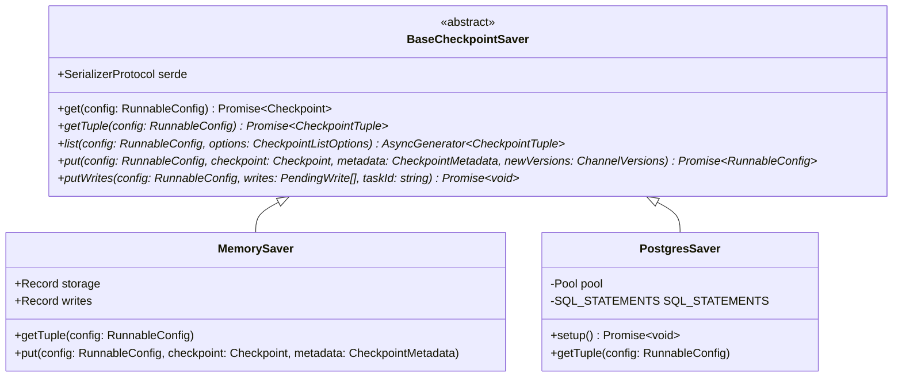
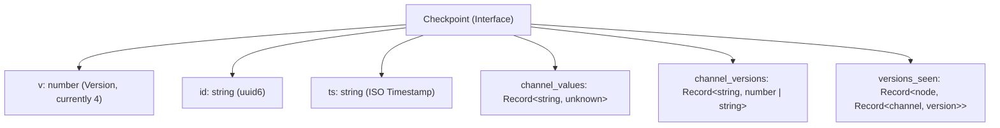
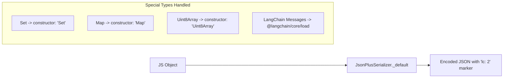
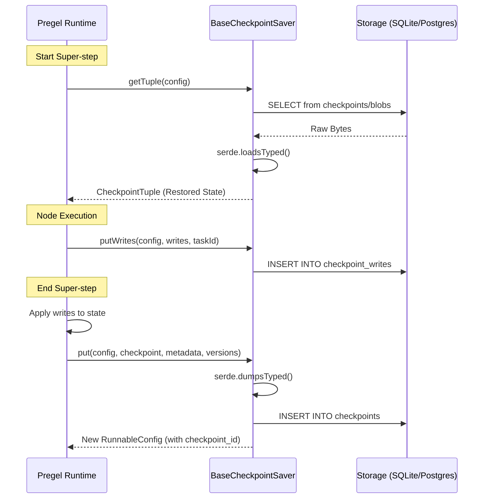

<!-- source: DeepWiki mcp.deepwiki.com · repo langchain-ai/langgraphjs · page 3.1 Checkpoint System Architecture · fetched 2026-10-26 -->

# Checkpoint System Architecture

Relevant source files

The following files were used as context for generating this wiki page:

- [libs/checkpoint-postgres/src/index.ts](libs/checkpoint-postgres/src/index.ts)
- [libs/checkpoint-postgres/src/sql.ts](libs/checkpoint-postgres/src/sql.ts)
- [libs/checkpoint-postgres/src/tests/checkpoints.int.test.ts](libs/checkpoint-postgres/src/tests/checkpoints.int.test.ts)
- [libs/checkpoint-validation/src/cli.ts](libs/checkpoint-validation/src/cli.ts)
- [libs/checkpoint-validation/src/import_utils.ts](libs/checkpoint-validation/src/import_utils.ts)
- [libs/checkpoint-validation/src/runner.ts](libs/checkpoint-validation/src/runner.ts)
- [libs/checkpoint-validation/src/spec/get_tuple.ts](libs/checkpoint-validation/src/spec/get_tuple.ts)
- [libs/checkpoint-validation/src/spec/list.ts](libs/checkpoint-validation/src/spec/list.ts)
- [libs/checkpoint-validation/src/spec/put.ts](libs/checkpoint-validation/src/spec/put.ts)
- [libs/checkpoint-validation/src/spec/put_writes.ts](libs/checkpoint-validation/src/spec/put_writes.ts)
- [libs/checkpoint-validation/src/test_utils.ts](libs/checkpoint-validation/src/test_utils.ts)
- [libs/checkpoint/src/base.ts](libs/checkpoint/src/base.ts)
- [libs/checkpoint/src/memory.ts](libs/checkpoint/src/memory.ts)
- [libs/checkpoint/src/serde/base.ts](libs/checkpoint/src/serde/base.ts)
- [libs/checkpoint/src/serde/jsonplus.ts](libs/checkpoint/src/serde/jsonplus.ts)
- [libs/checkpoint/src/serde/tests/jsonplus.test.ts](libs/checkpoint/src/serde/tests/jsonplus.test.ts)
- [libs/checkpoint/src/serde/types.ts](libs/checkpoint/src/serde/types.ts)
- [libs/checkpoint/src/serde/utils/fast-safe-stringify/LICENSE](libs/checkpoint/src/serde/utils/fast-safe-stringify/LICENSE)
- [libs/checkpoint/src/serde/utils/fast-safe-stringify/index.ts](libs/checkpoint/src/serde/utils/fast-safe-stringify/index.ts)
- [libs/checkpoint/src/tests/checkpoints.test.ts](libs/checkpoint/src/tests/checkpoints.test.ts)
- [libs/checkpoint/src/tests/memory-pollution.test.ts](libs/checkpoint/src/tests/memory-pollution.test.ts)
- [libs/checkpoint/src/types.ts](libs/checkpoint/src/types.ts)

## Purpose and Scope

The checkpoint system provides state persistence, time-travel, and fault tolerance capabilities for LangGraph applications. This document covers the core checkpoint interfaces, data structures, serialization mechanisms, and how checkpointers enable resumable execution by capturing snapshots of graph state at each super-step.

For details on the Pregel execution model that utilizes these checkpoints, see **Pregel Runtime Engine (2.2)**.

---

## Core Concepts

The checkpoint system captures complete snapshots of graph state. These snapshots enable three key capabilities:

1.  **State Persistence**: Save execution state to durable storage so that graph execution can continue across process restarts.
2.  **Time-Travel**: Navigate backward through execution history by loading previous checkpoints, enabling features like replay and debugging.
3.  **Fault Tolerance**: Resume execution from the last successful checkpoint after failures, avoiding recomputation of completed steps.

Each checkpoint includes channel values (the state data), channel versions (for concurrency control), and versions seen by each node (to determine which nodes need to run).

Sources: [libs/checkpoint/src/base.ts:18-46](), [libs/checkpoint/src/types.ts:17-63]()

---

## BaseCheckpointSaver Interface

The `BaseCheckpointSaver` abstract class defines the standard interface for persistence backends. It handles serialization using a `SerializerProtocol` (defaulting to `JsonPlusSerializer`) and manages the lifecycle of checkpoints and intermediate writes.

### Interface Structure and Implementations

The following diagram maps the high-level system names to the specific classes and methods found in the codebase.

**System to Code Entity Mapping**

Sources: [libs/checkpoint/src/base.ts:113-163](), [libs/checkpoint/src/memory.ts:104-122](), [libs/checkpoint-postgres/src/index.ts:84-103]()

### Key Methods

| Method | Purpose | Implementation Detail |
| :--- | :--- | :--- |
| `getTuple` | Retrieves a specific checkpoint and its associated metadata/writes. | Used to restore state for a specific `thread_id` and `checkpoint_id`. |
| `put` | Persists a complete checkpoint snapshot. | Generates a new `checkpoint_id` and saves it to the backend. |
| `putWrites` | Stores intermediate "pending" writes for a specific task. | Essential for multi-task super-steps and "checkpointing" progress mid-step. |
| `list` | Iterates through the history of checkpoints for a thread. | Supports `limit`, `before` (for pagination), and metadata `filter`. |
| `deleteThread` | Purges all data associated with a specific `thread_id`. | Used for cleanup and privacy compliance. |

Sources: [libs/checkpoint/src/base.ts:128-162](), [libs/checkpoint/src/memory.ts:155-231]()

---

## Checkpoint Data Structures

The system relies on several core interfaces to represent the state at any given point in time.

### The Checkpoint Object
The `Checkpoint` interface represents the internal state of the graph.

*   **`channel_values`**: Holds the actual data for every channel in the graph.
*   **`channel_versions`**: Tracks the version of each channel to detect updates.
*   **`versions_seen`**: A map tracking which version of which channel every node has last "seen," allowing the Pregel engine to determine if a node should trigger.

Sources: [libs/checkpoint/src/base.ts:18-46](), [libs/checkpoint/src/base.ts:75-84]()

### CheckpointTuple
A `CheckpointTuple` is the wrapper returned by the saver. It bundles the `Checkpoint` with its execution context.

| Property | Type | Description |
| :--- | :--- | :--- |
| `config` | `RunnableConfig` | Contains `thread_id`, `checkpoint_ns`, and `checkpoint_id`. |
| `checkpoint` | `Checkpoint` | The actual state snapshot. |
| `metadata` | `CheckpointMetadata` | Metadata like `source` (input, loop, update, fork) and `step`. |
| `parentConfig` | `RunnableConfig` | Pointer to the previous checkpoint in the history. |
| `pendingWrites` | `CheckpointPendingWrite[]` | Writes that occurred but haven't been committed to a snapshot yet. |

Sources: [libs/checkpoint/src/base.ts:98-104](), [libs/checkpoint/src/types.ts:17-63]()

---

## Serialization with JsonPlusSerializer

LangGraph uses a custom serialization layer called `JsonPlusSerializer` to handle complex JavaScript objects that standard `JSON.stringify` cannot (e.g., `Map`, `Set`, `RegExp`, `Error`, `Uint8Array`, and LangChain messages).

### Serialization Logic
The `JsonPlusSerializer` implements `SerializerProtocol`. It performs a bottom-up traversal to serialize and deserialize objects.

*   **`dumpsTyped`**: Converts an object into a tuple of `[type, Uint8Array]`. Types are usually `"json"` or `"bytes"`.
*   **`loadsTyped`**: Reconstructs the original object from the type and bytes.

**Type Handling in JsonPlusSerializer**

Sources: [libs/checkpoint/src/serde/jsonplus.ts:145-179](), [libs/checkpoint/src/serde/jsonplus.ts:108-143]()

---

## Resumable Execution Flow

The checkpoint system enables the Pregel runtime to stop and start execution seamlessly.

### Data Flow: Save and Resume
The following diagram illustrates how the `Pregel` runtime interacts with the `BaseCheckpointSaver` during an execution step.

### Thread Management and Namespacing
*   **`thread_id`**: Segregates execution history for different users or sessions.
*   **`checkpoint_ns`**: Used for subgraphs. Each subgraph execution has its own namespace to avoid channel name collisions in persistence.
*   **`checkpoint_id`**: A `uuid6` identifier that is time-sortable, allowing the checkpointer to find the "latest" state efficiently using `list` or `getTuple`.

Sources: [libs/checkpoint/src/base.ts:128-162](), [libs/checkpoint/src/memory.ts:155-231](), [libs/checkpoint-postgres/src/index.ts:178-206]()

---

## Delta Channel History

For `DeltaChannel` types, the checkpointer provides `getDeltaChannelHistory`. This function walks the parent chain of checkpoints to reconstruct the state of a channel that only stores incremental updates (deltas) rather than full snapshots.

*   **Walk Ancestors**: It follows `parentConfig` pointers until it finds a "seed" (a full snapshot or the root).
*   **Accumulate Writes**: It collects all `pendingWrites` for that channel across the ancestor path.
*   **Replay**: The consumer replays these writes onto the seed to get the current state.

Sources: [libs/checkpoint/src/base.ts:193-247](), [libs/checkpoint/src/types.ts:85-88]()

---

