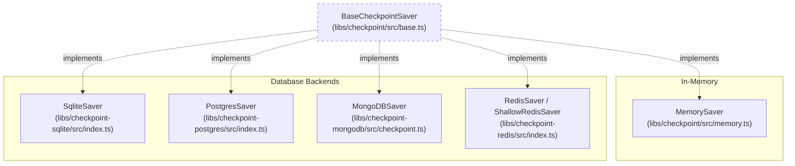
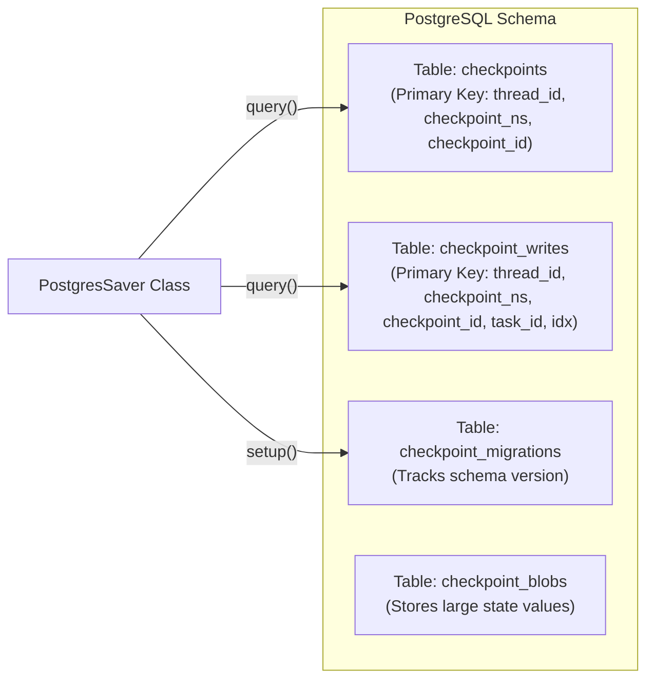
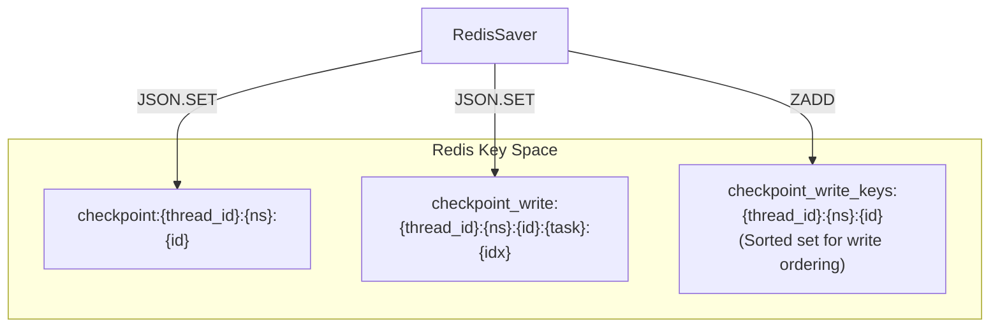

<!-- source: DeepWiki mcp.deepwiki.com · repo langchain-ai/langgraphjs · page 3.2 Checkpoint Implementations · fetched 2026-10-26 -->

# Checkpoint Implementations

Relevant source files

The following files were used as context for generating this wiki page:

- [docs/docs/tutorials/workflows/index.md](docs/docs/tutorials/workflows/index.md)
- [libs/checkpoint-mongodb/README.md](libs/checkpoint-mongodb/README.md)
- [libs/checkpoint-mongodb/src/checkpoint.ts](libs/checkpoint-mongodb/src/checkpoint.ts)
- [libs/checkpoint-mongodb/src/index.ts](libs/checkpoint-mongodb/src/index.ts)
- [libs/checkpoint-mongodb/src/tests/checkpoints.int.test.ts](libs/checkpoint-mongodb/src/tests/checkpoints.int.test.ts)
- [libs/checkpoint-mongodb/src/tests/checkpoints.test.ts](libs/checkpoint-mongodb/src/tests/checkpoints.test.ts)
- [libs/checkpoint-postgres/README.md](libs/checkpoint-postgres/README.md)
- [libs/checkpoint-postgres/src/index.ts](libs/checkpoint-postgres/src/index.ts)
- [libs/checkpoint-postgres/src/migrations.ts](libs/checkpoint-postgres/src/migrations.ts)
- [libs/checkpoint-postgres/src/sql.ts](libs/checkpoint-postgres/src/sql.ts)
- [libs/checkpoint-postgres/src/tests/checkpoints.int.test.ts](libs/checkpoint-postgres/src/tests/checkpoints.int.test.ts)
- [libs/checkpoint-redis/src/constants.ts](libs/checkpoint-redis/src/constants.ts)
- [libs/checkpoint-redis/src/index.ts](libs/checkpoint-redis/src/index.ts)
- [libs/checkpoint-redis/src/shallow.ts](libs/checkpoint-redis/src/shallow.ts)
- [libs/checkpoint-redis/src/store.ts](libs/checkpoint-redis/src/store.ts)
- [libs/checkpoint-redis/src/tests/checkpoint.int.test.ts](libs/checkpoint-redis/src/tests/checkpoint.int.test.ts)
- [libs/checkpoint-redis/src/tests/deleteThread.test.ts](libs/checkpoint-redis/src/tests/deleteThread.test.ts)
- [libs/checkpoint-redis/src/tests/putWrites.test.ts](libs/checkpoint-redis/src/tests/putWrites.test.ts)
- [libs/checkpoint-redis/src/tests/utils.test.ts](libs/checkpoint-redis/src/tests/utils.test.ts)
- [libs/checkpoint-redis/src/utils.ts](libs/checkpoint-redis/src/utils.ts)
- [libs/checkpoint-sqlite/README.md](libs/checkpoint-sqlite/README.md)
- [libs/checkpoint-sqlite/src/index.ts](libs/checkpoint-sqlite/src/index.ts)
- [libs/checkpoint-sqlite/src/tests/checkpoints.test.ts](libs/checkpoint-sqlite/src/tests/checkpoints.test.ts)
- [libs/checkpoint-validation/src/spec/delete_thread.ts](libs/checkpoint-validation/src/spec/delete_thread.ts)
- [libs/checkpoint/README.md](libs/checkpoint/README.md)
- [libs/checkpoint/src/base.ts](libs/checkpoint/src/base.ts)
- [libs/checkpoint/src/tests/checkpoints.test.ts](libs/checkpoint/src/tests/checkpoints.test.ts)

This document describes the concrete checkpoint saver implementations provided by LangGraph.js for persisting graph state. For the base checkpoint architecture and interfaces, see [Checkpoint System Architecture](3.1).

## Overview

LangGraph.js provides multiple checkpoint saver implementations that conform to the `BaseCheckpointSaver` interface [libs/checkpoint/src/base.ts:113-113](), each optimized for different deployment scenarios. The checkpoint system enables state persistence, time-travel debugging, and fault tolerance across graph executions.

**Sources:** [libs/checkpoint/src/base.ts:113-113](), [libs/checkpoint-sqlite/src/index.ts:90-90](), [libs/checkpoint-postgres/src/index.ts:84-84](), [libs/checkpoint-mongodb/src/checkpoint.ts:64-64](), [libs/checkpoint-redis/src/index.ts:89-89]()

## SqliteSaver

The `SqliteSaver` uses `better-sqlite3` for local file-based persistence. It is suitable for local development and single-server deployments.

### Schema and Setup
The implementation creates two primary tables during the `setup()` call [libs/checkpoint-sqlite/src/index.ts:109-143]():
- `checkpoints`: Stores serialized `Checkpoint` objects and `CheckpointMetadata`.
- `writes`: Stores intermediate `PendingWrite` data linked to specific checkpoints.

### Implementation Details
- **Journal Mode**: Automatically sets `PRAGMA journal_mode=WAL` for improved concurrency [libs/checkpoint-sqlite/src/index.ts:114-114]().
- **Serialization**: Uses the provided `SerializerProtocol` (defaults to `JsonPlusSerializer`) to handle complex state types [libs/checkpoint-sqlite/src/index.ts:194-197]().
- **Migration**: Includes logic to migrate older checkpoint versions (v < 4) by handling `pending_sends` [libs/checkpoint-sqlite/src/index.ts:199-205]().

**Sources:** [libs/checkpoint-sqlite/src/index.ts:115-137](), [libs/checkpoint-sqlite/src/index.ts:194-197]()

## PostgresSaver

The `PostgresSaver` provides production-grade persistence using PostgreSQL via the `pg` library. It supports connection pooling and distributed deployments.

### Database Entities

### Features
- **Schema Support**: Allows specifying a custom schema (defaults to `public`) [libs/checkpoint-postgres/src/index.ts:30-32]().
- **Migrations**: Uses an internal migration system to manage table updates automatically during `setup()` [libs/checkpoint-postgres/src/index.ts:134-176]().
- **Binary Data**: State values are stored as `jsonb` or binary depending on the serializer configuration [libs/checkpoint-postgres/src/tests/checkpoints.int.test.ts:197-201]().

**Sources:** [libs/checkpoint-postgres/src/index.ts:84-103](), [libs/checkpoint-postgres/src/index.ts:134-176](), [libs/checkpoint-postgres/src/sql.ts:1-50]()

## MongoDBSaver

The `MongoDBSaver` utilizes MongoDB for document-based persistence. It is designed for horizontal scalability and flexibility.

### Key Features
- **TTL Support**: Can automatically expire old checkpoints using MongoDB TTL indexes if a `ttl` (seconds) is provided [libs/checkpoint-mongodb/src/checkpoint.ts:145-156]().
- **Compound Indexes**: Creates indexes on `(thread_id, checkpoint_ns, checkpoint_id)` to ensure efficient retrieval as the collection grows [libs/checkpoint-mongodb/src/checkpoint.ts:126-143]().
- **Timestamps**: Optional `upserted_at` BSON dates can be enabled for auditing or TTL management [libs/checkpoint-mongodb/src/checkpoint.ts:24-31]().

### Data Flow
| Operation | Target Collection | Action |
|-----------|-------------------|--------|
| `put()` | `checkpoints` | `updateOne` with `upsert: true` [libs/checkpoint-mongodb/src/checkpoint.ts:316-335]() |
| `putWrites()` | `checkpoint_writes` | `bulkWrite` with `upsert: true` [libs/checkpoint-mongodb/src/checkpoint.ts:361-396]() |
| `getTuple()` | `checkpoints` + `checkpoint_writes` | `find().sort().limit(1)` then merge writes [libs/checkpoint-mongodb/src/checkpoint.ts:170-230]() |

**Sources:** [libs/checkpoint-mongodb/src/checkpoint.ts:64-109](), [libs/checkpoint-mongodb/src/checkpoint.ts:125-162](), [libs/checkpoint-mongodb/src/tests/checkpoints.test.ts:75-109]()

## RedisSaver

The Redis implementation provides two distinct strategies: `RedisSaver` (full history) and `ShallowRedisSaver` (memory-optimized).

### Comparison of Redis Implementations

| Feature | `RedisSaver` | `ShallowRedisSaver` |
|---------|--------------|---------------------|
| **History** | Keeps all checkpoints [libs/checkpoint-redis/src/index.ts:180-240]() | Only latest per thread [libs/checkpoint-redis/src/shallow.ts:78-85]() |
| **Blob Storage** | Separate blob keys [libs/checkpoint-redis/src/index.ts:242-260]() | Inline channel values [libs/checkpoint-redis/src/shallow.ts:157-163]() |
| **Cleanup** | Manual or TTL-based | Automatic cleanup on new `put()` [libs/checkpoint-redis/src/shallow.ts:153-155]() |
| **Data Format** | RedisJSON [libs/checkpoint-redis/src/index.ts:147-147]() | RedisJSON [libs/checkpoint-redis/src/shallow.ts:185-185]() |

### Implementation Entities

- **Write Ordering**: Uses a Redis Sorted Set (`ZSET`) to maintain the canonical order of writes for `DeltaChannel` reconstruction [libs/checkpoint-redis/src/index.ts:310-330]().
- **RediSearch**: Supports indexing for complex filtering (e.g., by metadata fields) using Redis Search schemas [libs/checkpoint-redis/src/index.ts:25-65]().

**Sources:** [libs/checkpoint-redis/src/index.ts:89-119](), [libs/checkpoint-redis/src/shallow.ts:86-105](), [libs/checkpoint-redis/src/index.ts:25-65]()

## Summary Table

| Implementation | Package | Best For | Key Classes |
|----------------|---------|----------|-------------|
| **SQLite** | `@langchain/langgraph-checkpoint-sqlite` | Local dev, single server | `SqliteSaver` [libs/checkpoint-sqlite/src/index.ts:90]() |
| **PostgreSQL** | `@langchain/langgraph-checkpoint-postgres` | Production, ACID requirements | `PostgresSaver` [libs/checkpoint-postgres/src/index.ts:84]() |
| **MongoDB** | `@langchain/langgraph-checkpoint-mongodb` | Scalable document storage | `MongoDBSaver` [libs/checkpoint-mongodb/src/checkpoint.ts:64]() |
| **Redis** | `@langchain/langgraph-checkpoint-redis` | High performance, TTL needs | `RedisSaver`, `ShallowRedisSaver` [libs/checkpoint-redis/src/index.ts:89]() |

**Sources:** [libs/checkpoint-sqlite/src/index.ts:90](), [libs/checkpoint-postgres/src/index.ts:84](), [libs/checkpoint-mongodb/src/checkpoint.ts:64](), [libs/checkpoint-redis/src/index.ts:89]()

---

