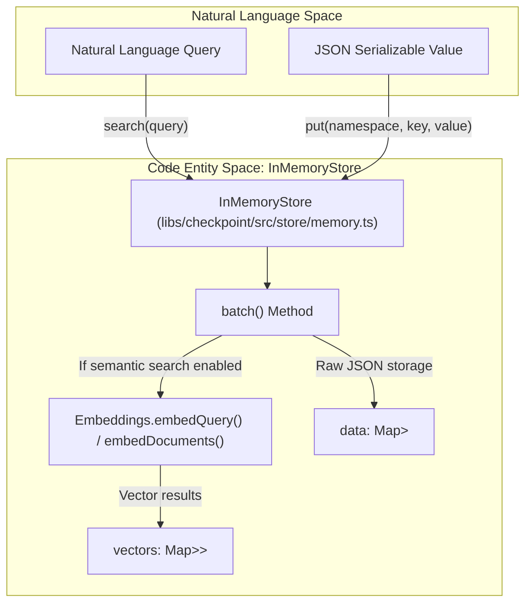
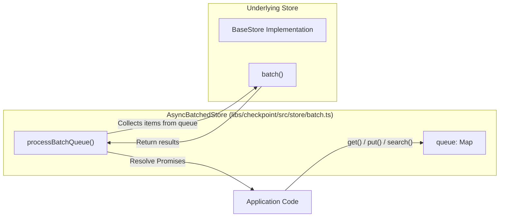

<!-- source: DeepWiki mcp.deepwiki.com · repo langchain-ai/langgraphjs · page 3.3 Long-term Memory Store · fetched 2026-10-26 -->

# Long-term Memory Store

<details>
<summary>Relevant source files</summary>

The following files were used as context for generating this wiki page:

- [examples/how-tos/cross-thread-persistence.ipynb](examples/how-tos/cross-thread-persistence.ipynb)
- [examples/how-tos/semantic-search.ipynb](examples/how-tos/semantic-search.ipynb)
- [libs/checkpoint-postgres/src/store/modules/utils.test.ts](libs/checkpoint-postgres/src/store/modules/utils.test.ts)
- [libs/checkpoint-postgres/src/store/modules/utils.ts](libs/checkpoint-postgres/src/store/modules/utils.ts)
- [libs/checkpoint/src/store/base.ts](libs/checkpoint/src/store/base.ts)
- [libs/checkpoint/src/store/batch.ts](libs/checkpoint/src/store/batch.ts)
- [libs/checkpoint/src/store/memory.ts](libs/checkpoint/src/store/memory.ts)
- [libs/checkpoint/src/store/utils.ts](libs/checkpoint/src/store/utils.ts)
- [libs/checkpoint/src/tests/namespace.test.ts](libs/checkpoint/src/tests/namespace.test.ts)
- [libs/checkpoint/src/tests/store.test.ts](libs/checkpoint/src/tests/store.test.ts)
- [libs/checkpoint/src/tests/utils.test.ts](libs/checkpoint/src/tests/utils.test.ts)
- [libs/checkpoint/src/tests/vector.test.ts](libs/checkpoint/src/tests/vector.test.ts)

</details>


The Long-term Memory Store provides a mechanism for persisting data across multiple execution threads. Unlike standard checkpointers which are scoped to a single thread ID, the `Store` interface allows for cross-thread persistence, namespaced key-value storage, and optional semantic search capabilities. This is primarily used for storing user preferences, global memories, or shared knowledge that needs to be accessible by any agent run regardless of the specific conversation thread.

## BaseStore Interface

The `BaseStore` is the abstract base class that defines the contract for all long-term memory implementations. It provides methods for basic CRUD operations and hierarchical namespace management.

### Key Operations

| Operation | Description | Implementation |
| :--- | :--- | :--- |
| `get` | Retrieves a single `Item` by its namespace and key. | [libs/checkpoint/src/store/base.ts:94-113]() |
| `put` | Stores or updates an object. Setting the value to `null` deletes the item. | [libs/checkpoint/src/store/base.ts:189-250]() |
| `search` | Searches for items within a `namespacePrefix`. Supports filtering and semantic query. | [libs/checkpoint/src/store/base.ts:118-184]() |
| `listNamespaces` | Lists and filters available namespaces based on prefix, suffix, or depth. | [libs/checkpoint/src/store/base.ts:255-260]() |
| `batch` | Executes multiple operations in a single call. This is the primary method implemented by subclasses. | [libs/checkpoint/src/store/base.ts:285-287]() |

### Namespaces and Keys
Memories are organized using a hierarchical structure:
*   **Namespaces**: An array of strings (e.g., `["users", "123", "memories"]`) acting like a directory path [libs/checkpoint/src/store/base.ts:61-65]().
*   **Keys**: Unique identifiers within a namespace (e.g., `"favorite_color"`) [libs/checkpoint/src/store/base.ts:57-59]().

**Sources:**
* [libs/checkpoint/src/store/base.ts:4-287]()
* [examples/how-tos/semantic-search.ipynb:101-108]()

## Memory Store Architecture

The system supports both transient (in-memory) and persistent (PostgreSQL) storage. The `AsyncBatchedStore` wrapper is often used to optimize performance by grouping concurrent operations into a single batch.

### Data Flow: Natural Language to Storage Entity

This diagram illustrates how a natural language query or a "put" operation flows from the high-level `BaseStore` API through the internal `InMemoryStore` logic.


**Sources:**
* [libs/checkpoint/src/store/memory.ts:49-70]()
* [libs/checkpoint/src/store/memory.ts:72-170]()

## Implementations

### 1. InMemoryStore
A lightweight implementation using JavaScript `Map` objects. It is suitable for testing or transient sessions but does not persist data after the process exits [libs/checkpoint/src/store/memory.ts:46-47]().

*   **Semantic Search**: Can be enabled by providing an `IndexConfig` with an `Embeddings` implementation [libs/checkpoint/src/store/memory.ts:59-69]().
*   **Indexing**: Supports field-specific indexing using JSON paths (e.g., `["metadata.title"]`) [libs/checkpoint/src/store/memory.ts:55-57]().

### 2. PostgreSQL Store
A persistent implementation for production environments. It uses a relational schema to store namespaces and items.

*   **Namespace Validation**: Enforces strict rules to prevent SQL injection and cross-tenant data leaks. Labels cannot contain periods `.` or SQL `LIKE` wildcards (`%`, `_`) [libs/checkpoint-postgres/src/store/modules/utils.ts:13-48]().
*   **Reserved Namespaces**: The root label `"langgraph"` is reserved for internal framework use and cannot be used by applications [libs/checkpoint-postgres/src/store/modules/utils.ts:50-54]().

### 3. AsyncBatchedStore
A decorator class that wraps another `BaseStore` to provide automatic batching of concurrent operations.


**Sources:**
* [libs/checkpoint/src/store/batch.ts:25-48]()
* [libs/checkpoint/src/store/batch.ts:131-157]()

## Semantic Search Capabilities

When configured with an `IndexConfig`, the store enables vector similarity search.

| Component | Description |
| :--- | :--- |
| `embeddings` | A `@langchain/core/embeddings` instance used to generate vectors. |
| `dims` | The dimensionality of the vectors (e.g., 1536 for OpenAI). |
| `fields` | (Optional) Array of JSON paths to index. Defaults to indexing the entire object. |

### Path Extraction
The store uses a utility `getTextAtPath` to extract searchable text from complex JSON objects. It supports:
*   **Wildcards**: `*` for all fields [libs/checkpoint/src/store/utils.ts:255-257]().
*   **Array Access**: `[0]`, `[-]`, or `[*]` for all elements [libs/checkpoint/src/store/utils.ts:195-201]().
*   **Multi-field**: `{field1, field2}` syntax [libs/checkpoint/src/store/utils.ts:216-222]().

**Sources:**
* [libs/checkpoint/src/store/memory.ts:31-36]()
* [libs/checkpoint/src/store/utils.ts:161-254]()

## Usage in Graphs

The store is integrated into the `StateGraph` compilation. Once compiled with a store, every node in the graph can access it via the `config.store` property.

```typescript
// Example usage in a node
const callModel = async (state: State, config: LangGraphRunnableConfig) => {
  const store = config.store;
  const userId = config.configurable?.userId;
  const namespace = ["memories", userId];
  
  // Semantic search for relevant memories
  const memories = await store.search(namespace, {
    query: state.messages[state.messages.length - 1].content,
    limit: 3
  });
  
  // ... logic to use memories in LLM prompt
};
```

**Sources:**
* [examples/how-tos/cross-thread-persistence.ipynb:143-162]()
* [libs/checkpoint/src/store/batch.ts:159-161]()

---

