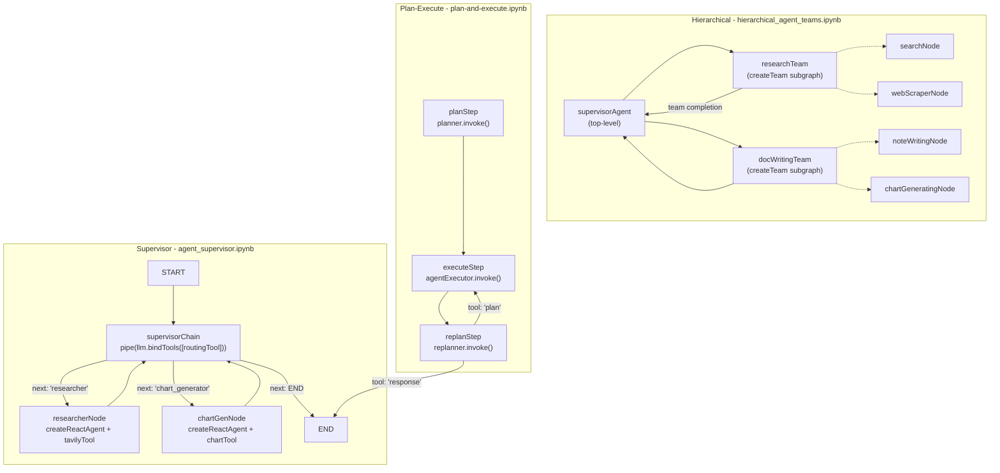
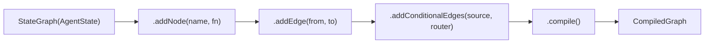
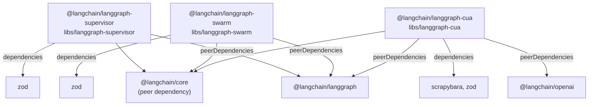
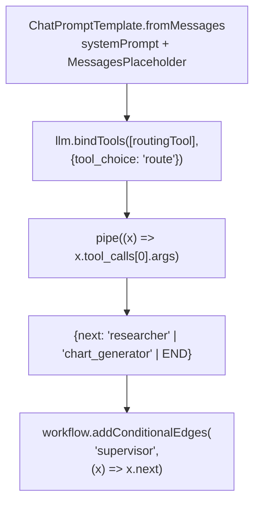
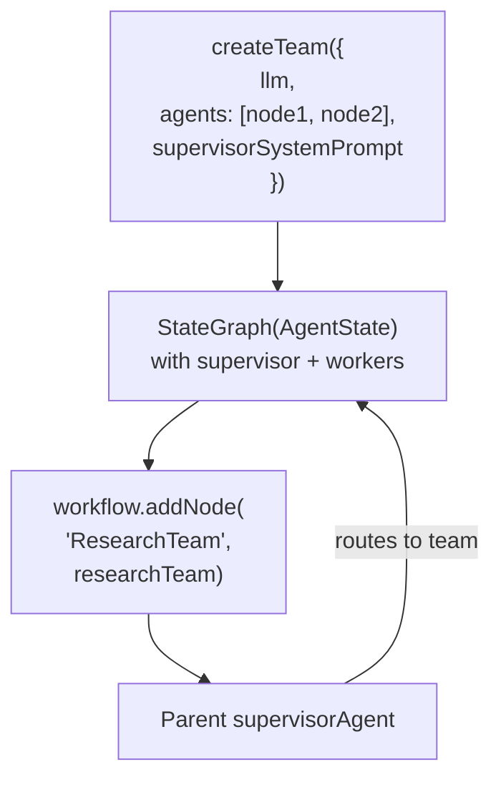

<!-- source: DeepWiki mcp.deepwiki.com · repo langchain-ai/langgraphjs · page 4 Multi-Agent Systems · fetched 2026-10-26 -->

# Multi-Agent Systems

<details>
<summary>Relevant source files</summary>

The following files were used as context for generating this wiki page:

- [examples/agent_executor/base.ipynb](examples/agent_executor/base.ipynb)
- [examples/chat_agent_executor_with_function_calling/base.ipynb](examples/chat_agent_executor_with_function_calling/base.ipynb)
- [examples/multi_agent/agent_supervisor.ipynb](examples/multi_agent/agent_supervisor.ipynb)
- [examples/multi_agent/hierarchical_agent_teams.ipynb](examples/multi_agent/hierarchical_agent_teams.ipynb)
- [examples/multi_agent/multi_agent_collaboration.ipynb](examples/multi_agent/multi_agent_collaboration.ipynb)
- [examples/plan-and-execute/plan-and-execute.ipynb](examples/plan-and-execute/plan-and-execute.ipynb)
- [examples/rag/langgraph_agentic_rag.ipynb](examples/rag/langgraph_agentic_rag.ipynb)
- [examples/rag/langgraph_crag.ipynb](examples/rag/langgraph_crag.ipynb)
- [examples/rag/langgraph_crag_mistral.ipynb](examples/rag/langgraph_crag_mistral.ipynb)
- [examples/rag/langgraph_self_rag.ipynb](examples/rag/langgraph_self_rag.ipynb)
- [examples/reflection/img/reflection.png](examples/reflection/img/reflection.png)
- [examples/reflection/reflection.ipynb](examples/reflection/reflection.ipynb)
- [examples/rewoo/rewoo.ipynb](examples/rewoo/rewoo.ipynb)
- [libs/checkpoint-mongodb/CHANGELOG.md](libs/checkpoint-mongodb/CHANGELOG.md)
- [libs/checkpoint-mongodb/package.json](libs/checkpoint-mongodb/package.json)
- [libs/checkpoint-postgres/package.json](libs/checkpoint-postgres/package.json)
- [libs/checkpoint-redis/CHANGELOG.md](libs/checkpoint-redis/CHANGELOG.md)
- [libs/checkpoint-redis/package.json](libs/checkpoint-redis/package.json)
- [libs/checkpoint-sqlite/package.json](libs/checkpoint-sqlite/package.json)
- [libs/checkpoint-validation/package.json](libs/checkpoint-validation/package.json)
- [libs/checkpoint/package.json](libs/checkpoint/package.json)
- [libs/langgraph-cua/package.json](libs/langgraph-cua/package.json)
- [libs/langgraph-supervisor/CHANGELOG.md](libs/langgraph-supervisor/CHANGELOG.md)
- [libs/langgraph-supervisor/package.json](libs/langgraph-supervisor/package.json)
- [libs/langgraph-swarm/package.json](libs/langgraph-swarm/package.json)

</details>


## Purpose and Scope

This document provides an overview of multi-agent orchestration patterns in LangGraphJS. Multi-agent systems enable complex task decomposition by coordinating multiple specialized agents, each with distinct tools, prompts, or capabilities. This approach is particularly effective when a single agent with many tools becomes unwieldy or when tasks naturally decompose into specialized subtasks.

For information about the core graph building primitives that underpin multi-agent systems, see [StateGraph and Graph Building](#2.1). For details on the LangGraph Platform's deployment infrastructure, see [LangGraph Platform](#5). For single-agent patterns, see [Core Framework](#2).

This page covers:
- Core multi-agent coordination concepts
- Overview of major orchestration patterns (supervisor, swarm, hierarchical)
- Specialized multi-agent packages in the LangGraphJS ecosystem
- Shared state management across agents
- Common implementation patterns

Detailed pattern-specific implementations are covered in child pages: [Supervisor Pattern](#4.1), [Swarm Pattern](#4.2), [Hierarchical Agent Teams](#4.3), [Specialized Agent Packages](#4.4), and [Remote Graphs](#4.5).

Sources: [examples/multi_agent/hierarchical_agent_teams.ipynb:1-50](), [examples/multi_agent/agent_supervisor.ipynb:1-27](), [examples/multi_agent/multi_agent_collaboration.ipynb:1-30]()

## Core Concepts

Multi-agent systems coordinate multiple agents through shared `StateGraph` instances with explicit routing logic encoded in conditional edges.

### Agent Specialization via createReactAgent

Worker agents are created using `createReactAgent` from `@langchain/langgraph/prebuilt`:

```typescript
// examples/multi_agent/agent_supervisor.ipynb
const researcherAgent = createReactAgent({
  llm,
  tools: [tavilyTool],
  stateModifier: new SystemMessage("You are a web researcher...")
});

const chartGenAgent = createReactAgent({
  llm,
  tools: [chartTool],
  stateModifier: new SystemMessage("You excel at generating bar charts...")
});
```

Each agent receives:
- Dedicated `tools` array (e.g., `TavilySearch`, custom tools defined with `tool()`)
- `stateModifier` parameter for system prompts
- Shared `llm` instance or agent-specific models

Sources: [examples/multi_agent/agent_supervisor.ipynb:357-394](), [examples/multi_agent/hierarchical_agent_teams.ipynb:455-457]()

### State Schemas with Annotation.Root

Agent state uses `Annotation.Root` with message concatenation reducers:

```typescript
// examples/multi_agent/agent_supervisor.ipynb:84-99
const AgentState = Annotation.Root({
  messages: Annotation<BaseMessage[]>({
    reducer: (x, y) => x.concat(y),
    default: () => [],
  }),
  // The agent node that last performed work
  next: Annotation<string>({
    reducer: (x, y) => y ?? x ?? END,
    default: () => END,
  }),
});
```

Alternative state schemas for task-specific patterns:

```typescript
// examples/plan-and-execute/plan-and-execute.ipynb:110-123
const PlanExecuteState = Annotation.Root({
  input: Annotation<string>(),
  plan: Annotation<string[]>(),
  pastSteps: Annotation<[string, string][]>({
    reducer: (x, y) => x.concat(y),
  }),
  response: Annotation<string>(),
});
```

Sources: [examples/multi_agent/agent_supervisor.ipynb:84-99](), [examples/multi_agent/multi_agent_collaboration.ipynb:169-177](), [examples/plan-and-execute/plan-and-execute.ipynb:110-123]()

### Node Functions and Message Attribution

Agent nodes wrap `createReactAgent` invocations and add `name` attribution:

```typescript
// examples/multi_agent/agent_supervisor.ipynb:364-375
const researcherNode = async (state, config) => {
  const result = await researcherAgent.invoke(state, config);
  const lastMessage = result.messages[result.messages.length - 1];
  return {
    messages: [
      new HumanMessage({ content: lastMessage.content, name: "Researcher" }),
    ],
  };
};
```

The `name` field identifies which agent produced the message, enabling supervisors to track conversation flow.

Sources: [examples/multi_agent/agent_supervisor.ipynb:364-375](), [examples/multi_agent/hierarchical_agent_teams.ipynb:224-230]()

## Multi-Agent Architecture Patterns



**Multi-Agent Pattern Code Entities**

Sources: [examples/multi_agent/agent_supervisor.ipynb:413-434](), [examples/multi_agent/hierarchical_agent_teams.ipynb:558-622](), [examples/plan-and-execute/plan-and-execute.ipynb:426-486]()

### Pattern Comparison

| Pattern | Coordination | Best For | State Complexity |
|---------|-------------|----------|------------------|
| **Supervisor** | Centralized LLM routing | Clear task delegation, 3-7 workers | Low - supervisor manages routing |
| **Swarm** | Peer-to-peer handoffs | Dynamic collaboration, flexible routing | Medium - agent-driven handoffs |
| **Hierarchical** | Nested supervisors | Complex workflows, 10+ agents | Medium - multi-level state |
| **Plan-Execute** | Upfront planning + sequential execution | Multi-step tasks, mixed LLM sizes | High - plan + execution tracking |

Sources: [examples/multi_agent/agent_supervisor.ipynb:1-27](), [examples/multi_agent/hierarchical_agent_teams.ipynb:1-36](), [examples/plan-and-execute/plan-and-execute.ipynb:1-24]()

## Building Blocks from Core LangGraph

Multi-agent systems leverage core LangGraph primitives without requiring specialized abstractions:

### StateGraph Construction



**Multi-Agent Graph Assembly**

Multi-agent graphs use the same `StateGraph` constructor as single-agent systems, with nodes representing agents or agent teams.

Sources: [examples/multi_agent/agent_supervisor.ipynb:407-434](), [examples/multi_agent/hierarchical_agent_teams.ipynb:558-622]()

### Agent Nodes

Agent nodes are typically functions that:
1. Invoke an LLM or agent executor with the current state
2. Return updated state (usually new messages)

```typescript
// Supervisor pattern example
const supervisorChain = formattedPrompt
  .pipe(llm.bindTools([routingTool]))
  .pipe((x) => (x.tool_calls[0].args));

// Worker agent node
const researcherNode = async (state, config) => {
  const result = await researcherAgent.invoke(state, config);
  const lastMessage = result.messages[result.messages.length - 1];
  return {
    messages: [
      new HumanMessage({ content: lastMessage.content, name: "Researcher" }),
    ],
  };
};
```

Sources: [examples/multi_agent/agent_supervisor.ipynb:236-294](), [examples/multi_agent/agent_supervisor.ipynb:346-394]()

### Conditional Routing

Routing logic determines which agent executes next:

```typescript
// Route based on supervisor's decision
workflow.addConditionalEdges(
  "supervisor",
  (x: typeof AgentState.State) => x.next,  // Extract routing decision
);

// Route based on tool calls
const shouldContinue = (state) => {
  const lastMessage = state.messages[state.messages.length - 1];
  if (!lastMessage.tool_calls?.length) {
    return END;
  }
  return "executeTools";
};
```

Sources: [examples/multi_agent/agent_supervisor.ipynb:427-430](), [examples/agent_executor/base.ipynb:162-172]()

### State Updates with Name Attribution

Agents use message `name` attributes to identify themselves in shared conversation history:

```typescript
return {
  messages: [
    new HumanMessage({ 
      content: lastMessage.content, 
      name: "Researcher"  // Identifies message sender
    }),
  ],
};
```

This enables supervisor agents to track which worker provided which information.

Sources: [examples/multi_agent/agent_supervisor.ipynb:369-375](), [examples/multi_agent/hierarchical_agent_teams.ipynb:224-230]()

## Specialized Multi-Agent Packages



**Package Dependency Graph**

Sources: [libs/langgraph-supervisor/package.json:29-35](), [libs/langgraph-swarm/package.json:29-35](), [libs/langgraph-cua/package.json:30-38]()

### Package Details

| Package | Purpose | Main Export | Dependencies |
|---------|---------|-------------|--------------|
| `@langchain/langgraph-supervisor` | Orchestrates specialized workers via LLM supervisor | `./dist/index.js` | `zod` |
| `@langchain/langgraph-swarm` | Implements peer-to-peer handoff patterns | `./dist/index.js` | `zod` |
| `@langchain/langgraph-cua` | Computer Use Agent implementation | `./dist/index.js` | `scrapybara`, `zod` |

Sources: [libs/langgraph-supervisor/package.json:1-10](), [libs/langgraph-swarm/package.json:1-10](), [libs/langgraph-cua/package.json:1-10]()

## Common Implementation Patterns

### Tool Definition with tool() and Zod

Tools use the `tool()` constructor from `@langchain/core/tools`:

```typescript
// examples/multi_agent/hierarchical_agent_teams.ipynb:104-120
import { tool } from "@langchain/core/tools";
import { z } from "zod";

const scrapeWebpage = tool(
  async (input) => {
    const loader = new CheerioWebBaseLoader(input.url);
    const docs = await loader.load();
    return docs.map(doc => 
      `<Document name="${doc.metadata?.title}">\n${doc.pageContent}\n</Document>`
    ).join("\n\n");
  },
  {
    name: "scrape_webpage",
    description: "Scrape the contents of a webpage.",
    schema: z.object({ url: z.string() }),
  }
);
```

Sources: [examples/multi_agent/hierarchical_agent_teams.ipynb:104-120](), [examples/multi_agent/agent_supervisor.ipynb:133-219]()

### Worker Agent Node Wrapper Pattern

Pattern: Invoke `createReactAgent` result, extract final message, re-wrap with `name` attribution, return in state update object.

```typescript
// examples/multi_agent/agent_supervisor.ipynb:364-375
const researcherNode = async (state, config) => {
  const result = await researcherAgent.invoke(state, config);
  const lastMessage = result.messages[result.messages.length - 1];
  return {
    messages: [
      new HumanMessage({ content: lastMessage.content, name: "Researcher" }),
    ],
  };
};
```

Sources: [examples/multi_agent/agent_supervisor.ipynb:364-394](), [examples/multi_agent/hierarchical_agent_teams.ipynb:224-230]()

### Supervisor Routing Implementation



**Supervisor Chain Construction (agent_supervisor.ipynb)**

Supervisor routing via structured output:

| Component | Code Entity | Purpose |
|-----------|-------------|---------|
| Schema | `z.object({ next: z.enum([END, ...members]) })` | Constrains routing decisions |
| Tool | `routingTool = { name: "route", schema: ... }` | Enables tool calling API |
| Chain | `supervisorChain = prompt.pipe(llm.bindTools([routingTool])).pipe(extractArgs)` | Produces `{next: string}` |
| Router | `(x: typeof AgentState.State) => x.next` | Extracts routing target from state |

Sources: [examples/multi_agent/agent_supervisor.ipynb:257-293](), [examples/multi_agent/agent_supervisor.ipynb:427-430]()

### Hierarchical Subgraph Composition

Teams are created via `createTeam` helper and added as single nodes to parent graphs. Each team internally manages its own supervisor-worker coordination.



**Hierarchical Team Construction (hierarchical_agent_teams.ipynb)**

Sources: [examples/multi_agent/hierarchical_agent_teams.ipynb:439-526](), [examples/multi_agent/hierarchical_agent_teams.ipynb:558-622]()

## Relationship to Core Framework

Multi-agent systems are applications of core LangGraph primitives:

| Core Primitive | Multi-Agent Usage |
|----------------|-------------------|
| `StateGraph` | Same constructor, agent-specific state schemas |
| `addNode` | Nodes represent agents or agent teams |
| `addConditionalEdges` | Implements routing logic (supervisor decisions, tool presence checks) |
| `Annotation` with reducers | Manages message concatenation, metadata updates |
| `createReactAgent` | Prebuilt for creating tool-using worker agents |

The key difference is **coordination strategy**: multi-agent graphs explicitly model agent interactions through routing nodes, whereas single-agent graphs often rely on tool execution to determine control flow.

Sources: [examples/multi_agent/agent_supervisor.ipynb:407-434](), [examples/agent_executor/base.ipynb:200-223]()

## Advanced Patterns

Beyond basic coordination, multi-agent systems support:

- **Reflection and critique**: Agents review each other's outputs (see [examples/reflection/reflection.ipynb:1-18]())
- **Plan-then-execute**: Planner agent creates task list, executor agents complete steps (see [examples/plan-and-execute/plan-and-execute.ipynb:1-24]())
- **ReWOO**: Variable substitution reduces redundant LLM calls (see [examples/rewoo/rewoo.ipynb:1-50]())
- **Remote Orchestration**: Invoking remotely deployed graphs as sub-agents using `RemoteGraph` (see [Remote Graphs](#4.5)).

Sources: [examples/reflection/reflection.ipynb:1-18](), [examples/plan-and-execute/plan-and-execute.ipynb:1-24](), [examples/rewoo/rewoo.ipynb:1-50]()

---

