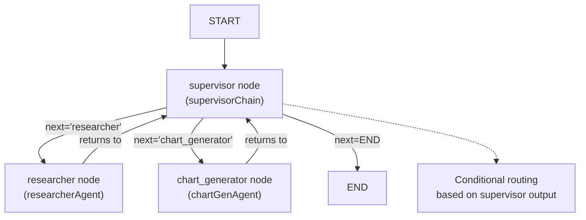
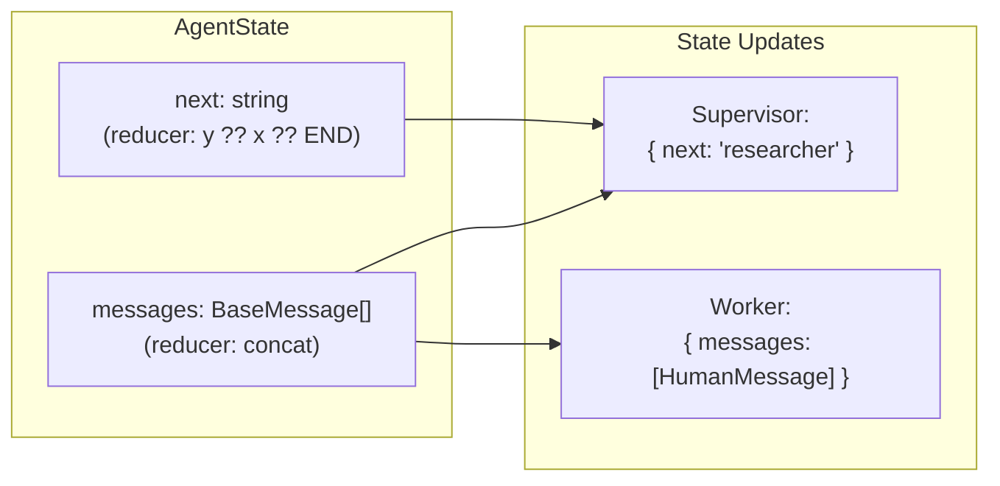
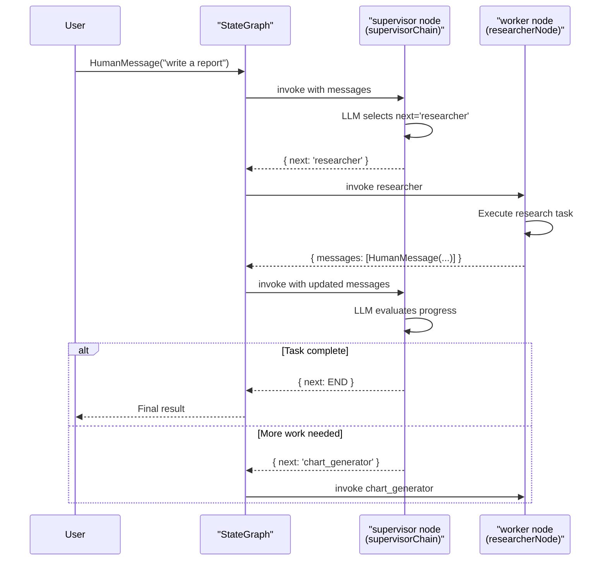
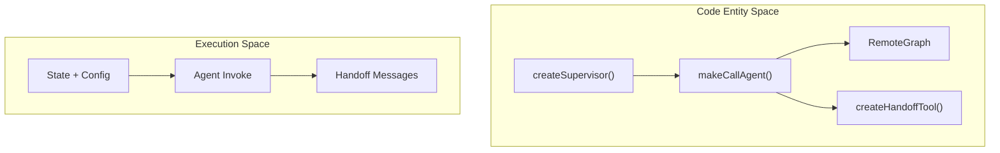

<!-- source: DeepWiki mcp.deepwiki.com · repo langchain-ai/langgraphjs · page 4.1 Supervisor Pattern · fetched 2026-10-26 -->

# Supervisor Pattern

<details>
<summary>Relevant source files</summary>

The following files were used as context for generating this wiki page:

- [examples/agent_executor/base.ipynb](examples/agent_executor/base.ipynb)
- [examples/chat_agent_executor_with_function_calling/base.ipynb](examples/chat_agent_executor_with_function_calling/base.ipynb)
- [examples/multi_agent/agent_supervisor.ipynb](examples/multi_agent/agent_supervisor.ipynb)
- [examples/multi_agent/hierarchical_agent_teams.ipynb](examples/multi_agent/hierarchical_agent_teams.ipynb)
- [examples/multi_agent/multi_agent_collaboration.ipynb](examples/multi_agent/multi_agent_collaboration.ipynb)
- [examples/plan-and-execute/plan-and-execute.ipynb](examples/plan-and-execute/plan-and-execute.ipynb)
- [examples/rag/langgraph_agentic_rag.ipynb](examples/rag/langgraph_agentic_rag.ipynb)
- [examples/rag/langgraph_crag.ipynb](examples/rag/langgraph_crag.ipynb)
- [examples/rag/langgraph_crag_mistral.ipynb](examples/rag/langgraph_crag_mistral.ipynb)
- [examples/rag/langgraph_self_rag.ipynb](examples/rag/langgraph_self_rag.ipynb)
- [examples/reflection/img/reflection.png](examples/reflection/img/reflection.png)
- [examples/reflection/reflection.ipynb](examples/reflection/reflection.ipynb)
- [examples/rewoo/rewoo.ipynb](examples/rewoo/rewoo.ipynb)
- [libs/checkpoint-mongodb/CHANGELOG.md](libs/checkpoint-mongodb/CHANGELOG.md)
- [libs/checkpoint-mongodb/package.json](libs/checkpoint-mongodb/package.json)
- [libs/checkpoint-postgres/package.json](libs/checkpoint-postgres/package.json)
- [libs/checkpoint-redis/CHANGELOG.md](libs/checkpoint-redis/CHANGELOG.md)
- [libs/checkpoint-redis/package.json](libs/checkpoint-redis/package.json)
- [libs/checkpoint-sqlite/package.json](libs/checkpoint-sqlite/package.json)
- [libs/checkpoint-validation/package.json](libs/checkpoint-validation/package.json)
- [libs/checkpoint/package.json](libs/checkpoint/package.json)
- [libs/langgraph-cua/package.json](libs/langgraph-cua/package.json)
- [libs/langgraph-supervisor/.gitignore](libs/langgraph-supervisor/.gitignore)
- [libs/langgraph-supervisor/CHANGELOG.md](libs/langgraph-supervisor/CHANGELOG.md)
- [libs/langgraph-supervisor/package.json](libs/langgraph-supervisor/package.json)
- [libs/langgraph-supervisor/src/handoff.ts](libs/langgraph-supervisor/src/handoff.ts)
- [libs/langgraph-supervisor/src/index.ts](libs/langgraph-supervisor/src/index.ts)
- [libs/langgraph-supervisor/src/supervisor.ts](libs/langgraph-supervisor/src/supervisor.ts)
- [libs/langgraph-supervisor/src/tests/supervisor.test.ts](libs/langgraph-supervisor/src/tests/supervisor.test.ts)
- [libs/langgraph-supervisor/src/tests/supervisorRemote.test.ts](libs/langgraph-supervisor/src/tests/supervisorRemote.test.ts)
- [libs/langgraph-supervisor/src/tests/supervisorSubgraph.test.ts](libs/langgraph-supervisor/src/tests/supervisorSubgraph.test.ts)
- [libs/langgraph-supervisor/src/tests/utils.ts](libs/langgraph-supervisor/src/tests/utils.ts)
- [libs/langgraph-swarm/package.json](libs/langgraph-swarm/package.json)

</details>


## Overview

The Supervisor Pattern implements centralized multi-agent coordination where an LLM-based supervisor node routes work among specialized worker agents. The supervisor acts as an orchestrator, deciding which agent should handle each task based on the conversation context and agent capabilities.

This pattern is suitable for workflows requiring:
- Centralized decision-making and task delegation.
- Clear separation between routing logic and task execution.
- Dynamic selection of agents based on task requirements.

For decentralized peer-to-peer coordination, see the Swarm Pattern. For multi-level hierarchical coordination, see Hierarchical Agent Teams.

## Core Architecture

The Supervisor Pattern consists of a central supervisor node that coordinates multiple worker agent nodes through routing decisions.

### Graph Structure



Sources: [examples/multi_agent/agent_supervisor.ipynb:413-435]()

### State Schema

The supervisor pattern uses a shared state that includes messages and routing information:



Sources: [examples/multi_agent/agent_supervisor.ipynb:78-100]()

### Execution Flow



Sources: [examples/multi_agent/agent_supervisor.ipynb:229-434]()

## Implementation Components

### State Definition

The state tracks conversation messages and the next node to execute:

```typescript
const AgentState = Annotation.Root({
  messages: Annotation<BaseMessage[]>({
    reducer: (x, y) => x.concat(y),
    default: () => [],
  }),
  next: Annotation<string>({
    reducer: (x, y) => y ?? x ?? END,
    default: () => END,
  }),
});
```

| Field | Type | Reducer | Purpose |
|-------|------|---------|---------|
| `messages` | `BaseMessage[]` | Concatenate | Full conversation history |
| `next` | `string` | Replace (`y ?? x ?? END`) | Next node to execute |

Sources: [examples/multi_agent/agent_supervisor.ipynb:78-100]()

### Supervisor Node

The supervisor node uses an LLM with a routing tool to determine which agent should act next:

**Routing Tool Schema:**
```typescript
const routingTool = {
  name: "route",
  description: "Select the next role.",
  schema: z.object({
    next: z.enum([END, ...members]),
  }),
}
```

**Supervisor Chain Construction:**
```typescript
const supervisorChain = formattedPrompt
  .pipe(llm.bindTools([routingTool], { tool_choice: "route" }))
  .pipe((x) => (x.tool_calls[0].args));
```

The supervisor chain:
1. Takes messages as input via `ChatPromptTemplate`.
2. Binds a routing tool to the LLM with forced tool choice.
3. Extracts the `next` field from tool call arguments.
4. Returns `{ next: string }` to update the state.

Sources: [examples/multi_agent/agent_supervisor.ipynb:236-294]()

### Worker Agent Nodes

Each worker agent is created using `createReactAgent` with specialized tools and wrapped in a node function:

```typescript
const researcherAgent = createReactAgent({
  llm,
  tools: [tavilyTool],
  stateModifier: new SystemMessage("You are a web researcher...")
});

const researcherNode = async (state, config) => {
  const result = await researcherAgent.invoke(state, config);
  const lastMessage = result.messages[result.messages.length - 1];
  return {
    messages: [
      new HumanMessage({ content: lastMessage.content, name: "Researcher" }),
    ],
  };
};
```

**Worker Node Responsibilities:**
- Execute specialized tasks using `createReactAgent` [libs/langgraph-supervisor/src/supervisor.ts:16-21]().
- Extract final results from agent messages.
- Return results as `HumanMessage` with an agent name to identify the source [examples/multi_agent/agent_supervisor.ipynb:364-375]().
- Update state to trigger return to supervisor.

Sources: [examples/multi_agent/agent_supervisor.ipynb:345-395](), [libs/langgraph-supervisor/src/supervisor.ts:16-21]()

### Conditional Routing

The routing function determines which node to execute based on supervisor output:

```typescript
workflow.addConditionalEdges(
  "supervisor",
  (x: typeof AgentState.State) => x.next,
);
```

**Routing Logic:**
- Reads the `next` field from state.
- Maps the value to a target node name.
- Routes to `END` if the supervisor signals completion.
- Routes to a worker node if the supervisor selects an agent.

Sources: [examples/multi_agent/agent_supervisor.ipynb:427-430]()

## Pre-built Supervisor Package

For production use cases, the `@langchain/langgraph-supervisor` package provides a managed implementation of this pattern.

### createSupervisor Function

The `createSupervisor` function [libs/langgraph-supervisor/src/supervisor.ts:265-392]() automates the creation of the supervisor graph.

**Key Parameters (`CreateSupervisorParams`):**
- `agents`: A list of `CompiledStateGraph` or `RemoteGraph` objects [libs/langgraph-supervisor/src/supervisor.ts:129-140]().
- `llm`: The language model used for routing [libs/langgraph-supervisor/src/supervisor.ts:145]().
- `outputMode`: Determines if the full history or only the `last_message` is added to the state [libs/langgraph-supervisor/src/supervisor.ts:200-205]().
- `addHandoffBackMessages`: If true, adds handoff messages when control returns to the supervisor [libs/langgraph-supervisor/src/supervisor.ts:207-212]().

### Data Flow in createSupervisor



Sources: [libs/langgraph-supervisor/src/supervisor.ts:74-115](), [libs/langgraph-supervisor/src/supervisor.ts:265-392]()

### Remote Graph Integration

The supervisor pattern supports `RemoteGraph` workers. When an agent is a `RemoteGraph`, the supervisor automatically manages thread IDs using `uuidv5` to ensure consistent execution context across distributed nodes [libs/langgraph-supervisor/src/supervisor.ts:90-102]().

### Structured Responses

The supervisor can be configured to return structured output after the agent loop finishes using the `responseFormat` parameter [libs/langgraph-supervisor/src/supervisor.ts:179-187](). This uses the model's `.withStructuredOutput()` capability.

## Pattern Comparison

| Aspect | Supervisor | Swarm |
|--------|------------|-------|
| **Coordination** | Centralized routing via LLM | Peer-to-peer via handoff tools |
| **State Management** | Centralized in Supervisor state | Shared across swarm agents |
| **Routing Decision** | Supervisor LLM chooses next agent | Current agent chooses next agent |
| **Best For** | Clear hierarchy and delegation | Fluid, autonomous collaboration |

Sources: [libs/langgraph-supervisor/package.json:1-10](), [libs/langgraph-swarm/package.json:1-10]()

## Implementation Code References

| Component | File Path | Key Functions/Classes |
|-----------|-----------|----------------------|
| **Main Supervisor Factory** | [libs/langgraph-supervisor/src/supervisor.ts]() | `createSupervisor` |
| **Agent Wrapper** | [libs/langgraph-supervisor/src/supervisor.ts]() | `makeCallAgent` |
| **Handoff Utilities** | [libs/langgraph-supervisor/src/handoff.ts]() | `createHandoffTool`, `createHandoffBackMessages` |
| **Remote Graph Support** | [libs/langgraph-supervisor/src/supervisor.ts]() | `isRemoteGraph` |
| **Agent Naming** | [libs/langgraph-supervisor/src/supervisor.ts]() | `withAgentName` |

Sources: [libs/langgraph-supervisor/src/supervisor.ts:1-395](), [libs/langgraph-supervisor/src/handoff.ts:1-50]()

---

