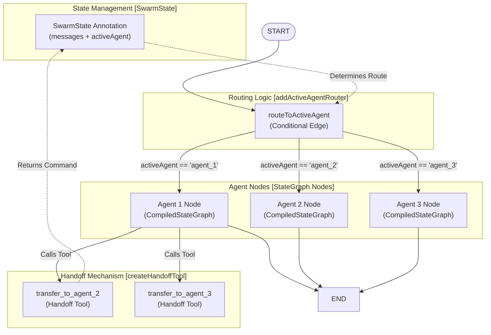
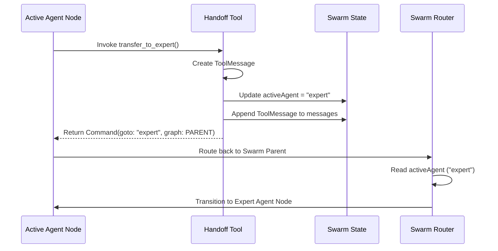

<!-- source: DeepWiki mcp.deepwiki.com · repo langchain-ai/langgraphjs · page 4.2 Swarm Pattern · fetched 2026-10-26 -->

# Agent Swarm Pattern

<details>
<summary>Relevant source files</summary>

The following files were used as context for generating this wiki page:

- [libs/checkpoint-mongodb/CHANGELOG.md](libs/checkpoint-mongodb/CHANGELOG.md)
- [libs/checkpoint-mongodb/package.json](libs/checkpoint-mongodb/package.json)
- [libs/checkpoint-postgres/package.json](libs/checkpoint-postgres/package.json)
- [libs/checkpoint-redis/CHANGELOG.md](libs/checkpoint-redis/CHANGELOG.md)
- [libs/checkpoint-redis/package.json](libs/checkpoint-redis/package.json)
- [libs/checkpoint-sqlite/package.json](libs/checkpoint-sqlite/package.json)
- [libs/checkpoint-validation/package.json](libs/checkpoint-validation/package.json)
- [libs/checkpoint/package.json](libs/checkpoint/package.json)
- [libs/langgraph-cua/.release-it.json](libs/langgraph-cua/.release-it.json)
- [libs/langgraph-cua/LICENSE](libs/langgraph-cua/LICENSE)
- [libs/langgraph-cua/README.md](libs/langgraph-cua/README.md)
- [libs/langgraph-cua/examples/price-finder.ts](libs/langgraph-cua/examples/price-finder.ts)
- [libs/langgraph-cua/package.json](libs/langgraph-cua/package.json)
- [libs/langgraph-cua/src/index.ts](libs/langgraph-cua/src/index.ts)
- [libs/langgraph-cua/src/nodes/call-model.ts](libs/langgraph-cua/src/nodes/call-model.ts)
- [libs/langgraph-cua/src/nodes/create-vm-instance.ts](libs/langgraph-cua/src/nodes/create-vm-instance.ts)
- [libs/langgraph-cua/src/nodes/take-computer-action.ts](libs/langgraph-cua/src/nodes/take-computer-action.ts)
- [libs/langgraph-cua/src/tests/cua.test.ts](libs/langgraph-cua/src/tests/cua.test.ts)
- [libs/langgraph-cua/src/types.ts](libs/langgraph-cua/src/types.ts)
- [libs/langgraph-cua/src/utils.ts](libs/langgraph-cua/src/utils.ts)
- [libs/langgraph-supervisor/CHANGELOG.md](libs/langgraph-supervisor/CHANGELOG.md)
- [libs/langgraph-supervisor/package.json](libs/langgraph-supervisor/package.json)
- [libs/langgraph-swarm/package.json](libs/langgraph-swarm/package.json)
- [libs/langgraph-swarm/src/handoff.ts](libs/langgraph-swarm/src/handoff.ts)
- [libs/langgraph-swarm/src/swarm.ts](libs/langgraph-swarm/src/swarm.ts)

</details>


## Purpose and Scope

This document describes the **Agent Swarm Pattern** implementation in LangGraph.js, a decentralized multi-agent orchestration pattern where peer agents coordinate through shared memory and direct handoffs. This pattern enables autonomous agent collaboration without a central supervisor, using specialized tools to transfer control between nodes.

For centralized coordination where an LLM directs workers, see [Supervisor Pattern](#4.1). For implementation of agents capable of browser/OS interaction, see [Specialized Agent Packages](#4.4).

## Pattern Overview

The Agent Swarm Pattern implements a decentralized architecture where multiple agents operate as peers. Each agent has the ability to transfer control directly to other agents in the swarm. Unlike the supervisor pattern, no central authority decides agent routing—instead, agents autonomously determine when to hand off tasks to their peers based on their specialized capabilities.

**Key Characteristics:**
- **Decentralized control**: Agents decide handoffs independently via tool calls.
- **Shared Memory**: All agents share a common message history and state.
- **Tool-based handoffs**: Transitions are implemented as specialized tools in each agent's toolkit.
- **Dynamic routing**: The active agent determines the next destination based on task requirements.

Sources: [libs/langgraph-swarm/src/swarm.ts:1-149]()

## Architecture Diagram

The following diagram bridges the conceptual swarm pattern to the code entities in `libs/langgraph-swarm`.



Sources: [libs/langgraph-swarm/src/swarm.ts:14-70](), [libs/langgraph-swarm/src/handoff.ts:56-100]()

## Core Components

### createSwarm Function

The `createSwarm` function is the primary entry point for constructing a swarm graph. It accepts a list of compiled agent graphs and wires them together with handoff capabilities.

**Function Definition:** [libs/langgraph-swarm/src/swarm.ts:72-149]()

**Parameters:**
| Parameter | Type | Description |
|-----------|------|-------------|
| `agents` | `CompiledStateGraph[]` | List of compiled agent graphs to include in the swarm. |
| `defaultActiveAgent` | `string` | Name of the agent to activate initially if none is specified. |
| `stateSchema` | `AnnotationRootT` | Optional custom state schema (must extend `SwarmState`). |
| `contextSchema` | `AnnotationRootT` | Optional context schema for graph execution. |

**Process:**
1. Validates that all agents have unique, non-empty names [libs/langgraph-swarm/src/swarm.ts:117-126]().
2. Initializes a `StateGraph` using the `SwarmState` annotation [libs/langgraph-swarm/src/swarm.ts:109-115]().
3. Adds each agent as a subgraph node [libs/langgraph-swarm/src/swarm.ts:128-132]().
4. Configures dynamic routing via `addActiveAgentRouter` [libs/langgraph-swarm/src/swarm.ts:134-142]().

### SwarmState Annotation

The `SwarmState` annotation extends `MessagesAnnotation` with an `activeAgent` field to track which agent currently has control.

```typescript
const SwarmState = Annotation.Root({
  ...MessagesAnnotation.spec,
  activeAgent: Annotation<string>
});
```

Sources: [libs/langgraph-swarm/src/swarm.ts:13-17]()

## Handoff Mechanism

### createHandoffTool Function

The `createHandoffTool` function generates specialized tools that enable peer-to-peer transfers. When an agent decides it can no longer handle a request, it calls one of these tools.

**Implementation Details:**
- **Naming**: Tools are named `transfer_to_<agent_name>` [libs/langgraph-swarm/src/handoff.ts:57-57]().
- **Behavior**: When invoked, the tool returns a `Command` object [libs/langgraph-swarm/src/handoff.ts:71-89]().
- **Command Routing**: The `Command` uses `graph: Command.PARENT` to navigate out of the agent subgraph and back to the swarm graph level [libs/langgraph-swarm/src/handoff.ts:83-83]().
- **State Update**: The tool appends a `ToolMessage` and updates the `activeAgent` state field [libs/langgraph-swarm/src/handoff.ts:84-87]().

Sources: [libs/langgraph-swarm/src/handoff.ts:56-100]()

### Handoff Tool Data Flow



Sources: [libs/langgraph-swarm/src/handoff.ts:68-89](), [libs/langgraph-swarm/src/swarm.ts:20-70]()

## Active Agent Routing

### addActiveAgentRouter

The routing logic determines which node to execute based on the `activeAgent` field in the state.

**Logic:**
- If `state.activeAgent` is present, route to that agent [libs/langgraph-swarm/src/swarm.ts:21-23]().
- If `state.activeAgent` is undefined, route to the `defaultActiveAgent` [libs/langgraph-swarm/src/swarm.ts:22-22]().
- The router uses `addConditionalEdges` from the `START` node to all available agent nodes [libs/langgraph-swarm/src/swarm.ts:47-64]().

Sources: [libs/langgraph-swarm/src/swarm.ts:20-70]()

## Specialized Swarm Implementation: Computer Use Agent (CUA)

While the general swarm pattern is decentralized, the `createCua` function provides a specialized implementation for a **Computer Use Agent** that coordinates with a virtual machine environment.

### CUA Components
- **callModel**: LLM node that determines if a computer action is needed [libs/langgraph-cua/src/nodes/call-model.ts]().
- **takeComputerAction**: Node that executes tool calls on a Scrapybara VM [libs/langgraph-cua/src/nodes/take-computer-action.ts]().
- **createVMInstance**: Lifecycle node for VM provisioning [libs/langgraph-cua/src/nodes/create-vm-instance.ts]().

### CUA Graph Logic
The CUA uses conditional edges `takeActionOrEnd` and `reinvokeModelOrEnd` to manage the loop between model reasoning and computer interaction [libs/langgraph-cua/src/index.ts:28-57]().

Sources: [libs/langgraph-cua/src/index.ts:186-206]()

## Comparison: Swarm vs Supervisor

| Feature | Swarm Pattern | Supervisor Pattern |
| :--- | :--- | :--- |
| **Control** | Decentralized (Peer-to-Peer) | Centralized (Top-Down) |
| **Routing Entity** | The agents themselves via handoff tools | A dedicated "Supervisor" LLM node |
| **State Field** | `activeAgent` | Typically a `next` field in supervisor state |
| **Complexity** | Higher autonomy, harder to predict | Lower autonomy, easier to control |
| **Handoff Logic** | `createHandoffTool` | `createSupervisor` |

Sources: [libs/langgraph-swarm/package.json](), [libs/langgraph-supervisor/package.json]()

## Summary of Implementation Files

| Package | Key File | Role |
| :--- | :--- | :--- |
| `@langchain/langgraph-swarm` | `swarm.ts` | Orchestrates the top-level swarm graph and routing. |
| `@langchain/langgraph-swarm` | `handoff.ts` | Implements the `Command`-based tool handoff logic. |
| `@langchain/langgraph-cua` | `index.ts` | Specialized implementation for computer-use swarms. |

Sources: [libs/langgraph-swarm/package.json](), [libs/langgraph-cua/package.json]()

---

