<!-- source: DeepWiki mcp.deepwiki.com · repo langchain-ai/langgraphjs · page 4.3 Hierarchical Agent Teams · fetched 2026-10-26 -->

# Hierarchical Agent Teams

<details>
<summary>Relevant source files</summary>

The following files were used as context for generating this wiki page:

- [examples/agent_executor/base.ipynb](examples/agent_executor/base.ipynb)
- [examples/chat_agent_executor_with_function_calling/base.ipynb](examples/chat_agent_executor_with_function_calling/base.ipynb)
- [examples/multi_agent/agent_supervisor.ipynb](examples/multi_agent/agent_supervisor.ipynb)
- [examples/multi_agent/hierarchical_agent_teams.ipynb](examples/multi_agent/hierarchical_agent_teams.ipynb)
- [examples/multi_agent/multi_agent_collaboration.ipynb](examples/multi_agent/multi_agent_collaboration.ipynb)
- [examples/plan-and-execute/plan-and-execute.ipynb](examples/plan-and-execute/plan-and-execute.ipynb)
- [examples/rag/langgraph_agentic_rag.ipynb](examples/rag/langgraph_agentic_rag.ipynb)
- [examples/rag/langgraph_crag.ipynb](examples/rag/langgraph_crag.ipynb)
- [examples/rag/langgraph_crag_mistral.ipynb](examples/rag/langgraph_crag_mistral.ipynb)
- [examples/rag/langgraph_self_rag.ipynb](examples/rag/langgraph_self_rag.ipynb)
- [examples/reflection/img/reflection.png](examples/reflection/img/reflection.png)
- [examples/reflection/reflection.ipynb](examples/reflection/reflection.ipynb)
- [examples/rewoo/rewoo.ipynb](examples/rewoo/rewoo.ipynb)
- [libs/langgraph-supervisor/.gitignore](libs/langgraph-supervisor/.gitignore)
- [libs/langgraph-supervisor/src/handoff.ts](libs/langgraph-supervisor/src/handoff.ts)
- [libs/langgraph-supervisor/src/index.ts](libs/langgraph-supervisor/src/index.ts)
- [libs/langgraph-supervisor/src/supervisor.ts](libs/langgraph-supervisor/src/supervisor.ts)
- [libs/langgraph-supervisor/src/tests/supervisor.test.ts](libs/langgraph-supervisor/src/tests/supervisor.test.ts)
- [libs/langgraph-supervisor/src/tests/supervisorRemote.test.ts](libs/langgraph-supervisor/src/tests/supervisorRemote.test.ts)
- [libs/langgraph-supervisor/src/tests/supervisorSubgraph.test.ts](libs/langgraph-supervisor/src/tests/supervisorSubgraph.test.ts)
- [libs/langgraph-supervisor/src/tests/utils.ts](libs/langgraph-supervisor/src/tests/utils.ts)

</details>


## Purpose and Scope

This document describes the hierarchical agent team pattern in LangGraph.js, where multiple layers of supervisors coordinate specialized worker agents organized into teams. This architectural pattern enables complex task decomposition by creating mid-level supervisors that manage domain-specific teams, all coordinated by a top-level supervisor. Each team operates as a compiled subgraph that becomes a node in the parent graph.

For single-layer supervisor patterns, see [Supervisor Pattern](#4.1). For autonomous agent coordination, see [Swarm Pattern](#4.2). For pre-built supervisor implementations, see [Specialized Agent Packages](#4.4).

## Architecture Overview

The hierarchical agent team pattern uses three organizational levels:

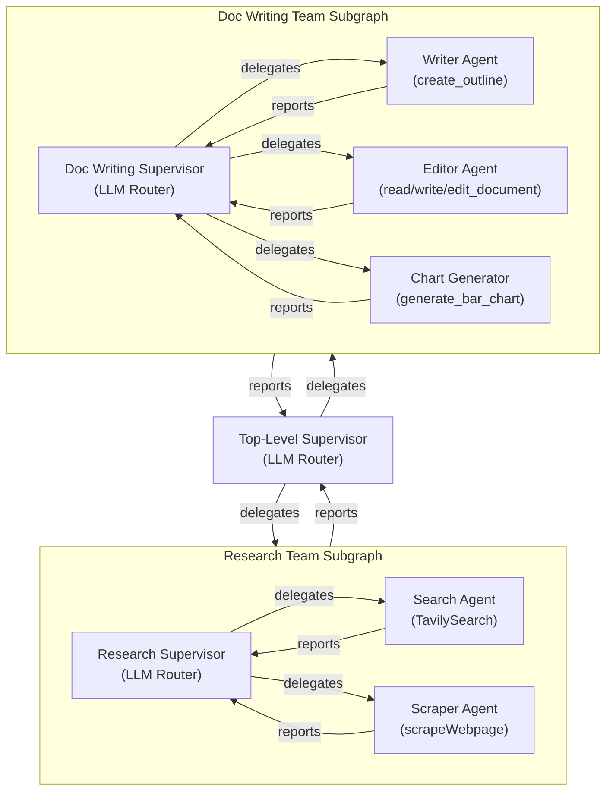

Sources: [examples/multi_agent/hierarchical_agent_teams.ipynb:1-38]()

### Key Components

| Component | Type | Purpose |
|-----------|------|---------|
| Top-Level Supervisor | LLM Router | Routes tasks to appropriate teams |
| Mid-Level Supervisors | LLM Routers | Manage workers within specific domains |
| Worker Agents | `createReactAgent` | Execute specialized tasks using tools |
| Team Subgraphs | Compiled `StateGraph` | Encapsulate team logic as reusable nodes |

## State Management

### Team State Schema

Each team uses `Annotation.Root` to define its state with a message reducer:

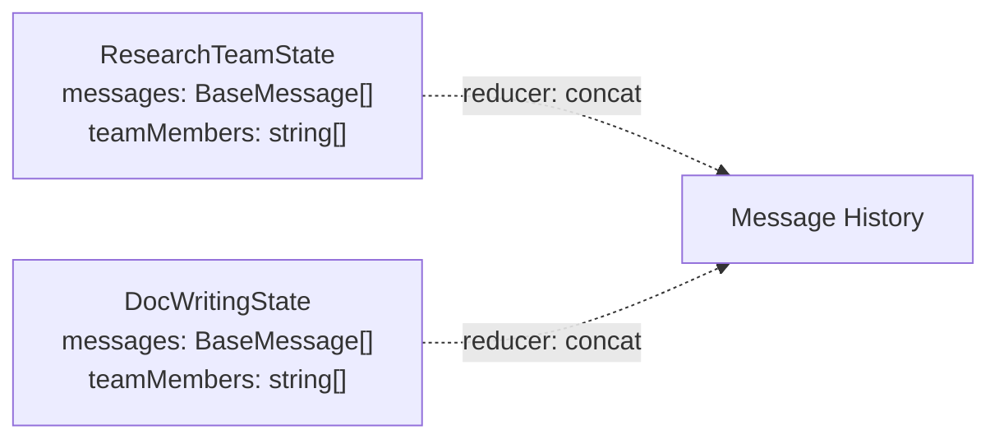

The state annotation includes:
- `messages`: Array of `BaseMessage` with concat reducer [examples/multi_agent/hierarchical_agent_teams.ipynb:564-622]()
- `teamMembers`: String array of agent names [examples/multi_agent/hierarchical_agent_teams.ipynb:564-622]()
- `next`: String indicating next node to route to [examples/multi_agent/hierarchical_agent_teams.ipynb:564-622]()

Sources: [examples/multi_agent/hierarchical_agent_teams.ipynb:564-622]()

## Worker Agent Implementation

### Agent Creation Pattern

Worker agents are created using `createReactAgent` with specialized tools and a `stateModifier`:

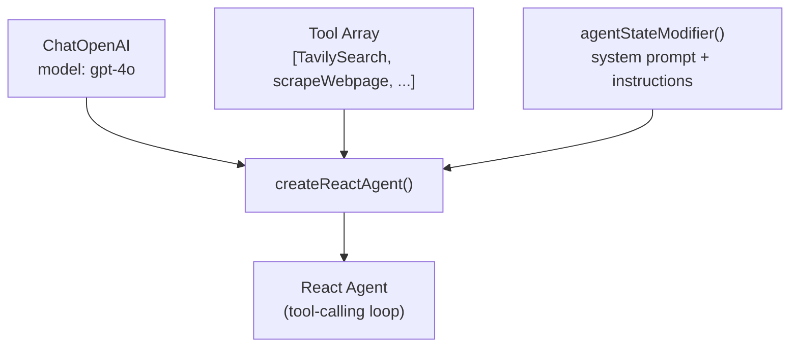

The `agentStateModifier` function constructs system messages:

**System Message Structure:**
1. Initial prompt with agent specialty
2. Team member context
3. Tool availability notice
4. End-of-execution instructions

Sources: [examples/multi_agent/hierarchical_agent_teams.ipynb:461-493]()

### Agent Node Execution

The `runAgentNode` function wraps agent invocation:

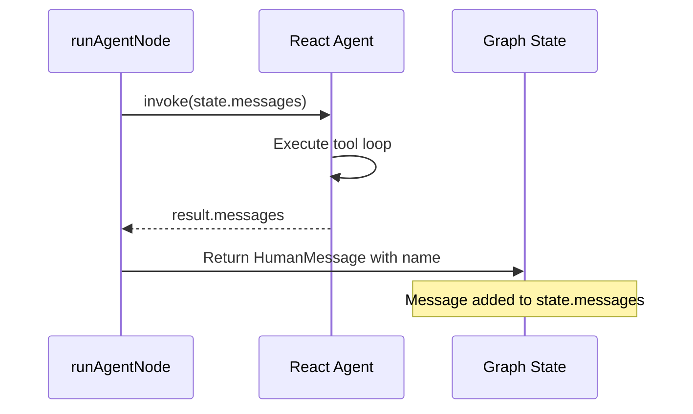

Key implementation details at [examples/multi_agent/hierarchical_agent_teams.ipynb:480-493]():
- Invokes agent with current messages
- Extracts last message from result
- Wraps content in `HumanMessage` with agent name
- Returns update object for state

## Supervisor Implementation

### Supervisor Chain Construction

Supervisors use structured output for routing decisions:

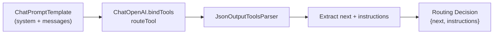

**Route Tool Schema:**
```typescript
{
  name: "route",
  schema: z.object({
    reasoning: z.string(),
    next: z.enum(["FINISH", ...members]),
    instructions: z.string()
  })
}
```

Sources: [examples/multi_agent/hierarchical_agent_teams.ipynb:495-537]()

### Conditional Routing

Supervisors return routing decisions used in conditional edges:

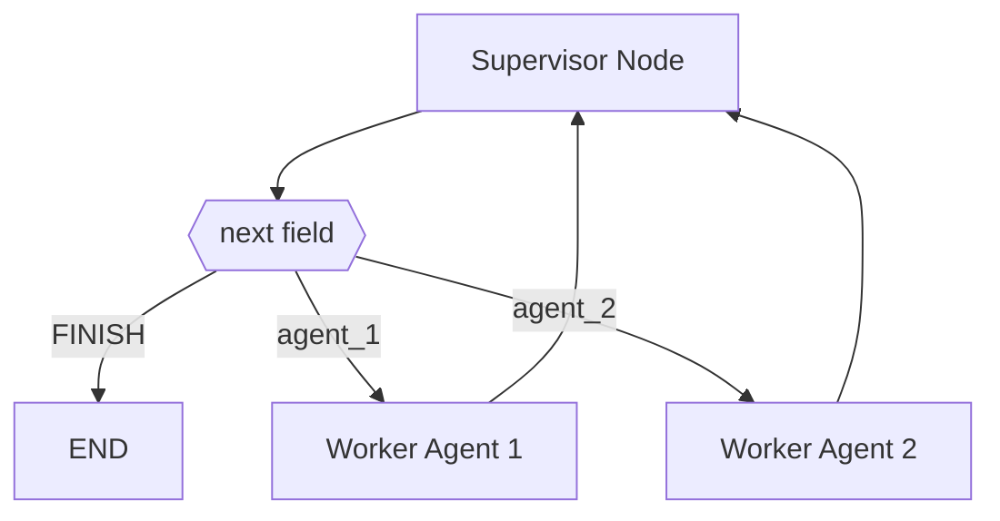

## Team Subgraph Construction

### Research Team Example

The research team graph demonstrates subgraph composition:

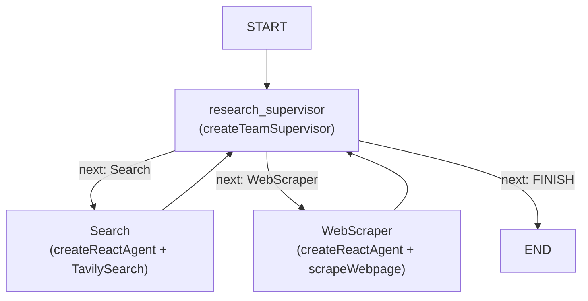

**Graph Construction Code Pattern:**

The pattern at [examples/multi_agent/hierarchical_agent_teams.ipynb:751-839]() follows:

1. Define `Annotation.Root` for team state
2. Create worker agent nodes using `createReactAgent`
3. Create supervisor using `createTeamSupervisor`
4. Build `StateGraph` with supervisor entry point
5. Add conditional edges from supervisor to workers
6. Add edges from workers back to supervisor
7. Compile graph to create reusable subgraph

Sources: [examples/multi_agent/hierarchical_agent_teams.ipynb:751-839]()

### Document Writing Team Structure

The doc writing team includes file manipulation tools:

**Tool Set:**
- `createOutlineTool`: Generate document outline [examples/multi_agent/hierarchical_agent_teams.ipynb:161-180]()
- `readDocumentTool`: Read file contents [examples/multi_agent/hierarchical_agent_teams.ipynb:182-205]()
- `writeDocumentTool`: Create new documents [examples/multi_agent/hierarchical_agent_teams.ipynb:207-224]()
- `editDocumentTool`: Insert text at line numbers [examples/multi_agent/hierarchical_agent_teams.ipynb:226-249]()
- `chartTool`: Generate bar charts with D3.js [examples/multi_agent/hierarchical_agent_teams.ipynb:251-338]()

These tools are distributed across specialized agents (Writer, Editor, Chart Generator) coordinated by a mid-level supervisor.

Sources: [examples/multi_agent/hierarchical_agent_teams.ipynb:138-338]()

## Top-Level Orchestration

### Hierarchical Graph Assembly

The top-level graph treats compiled subgraphs as nodes:

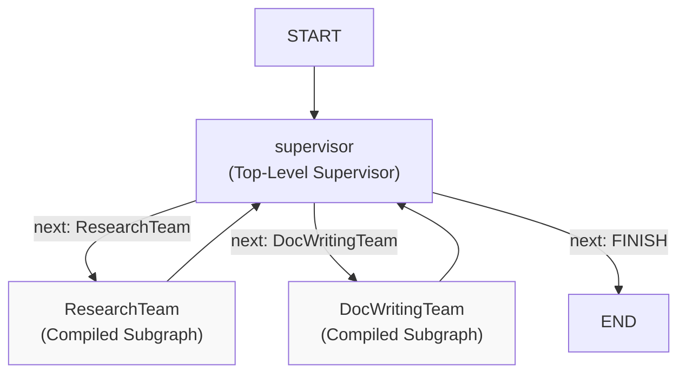

**Assembly Pattern:**

```typescript
const workflow = new StateGraph(State)
  .addNode("supervisor", supervisorChain)
  .addNode("ResearchTeam", researchGraph)  // Compiled subgraph
  .addNode("DocWritingTeam", docWritingGraph)  // Compiled subgraph
  .addEdge(START, "supervisor")
  .addConditionalEdges("supervisor", (x) => x.next)
  .addEdge("ResearchTeam", "supervisor")
  .addEdge("DocWritingTeam", "supervisor");

const graph = workflow.compile();
```

Sources: [examples/multi_agent/hierarchical_agent_teams.ipynb:846-924]()

### Execution Flow

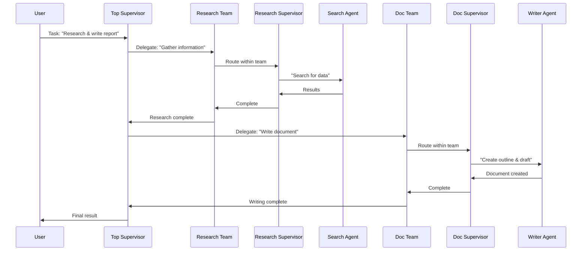

## Implementation Utilities

### State Modifier Factory

The `agentStateModifier` creates state transformation functions:

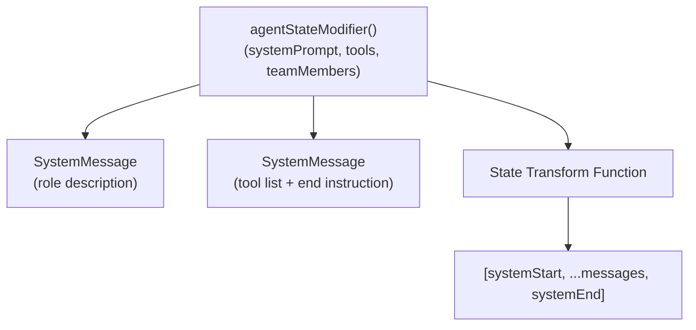

**Function Signature:**
```typescript
const agentStateModifier = (
  systemPrompt: string,
  tools: StructuredToolInterface[],
  teamMembers: string[]
): ((state: typeof MessagesAnnotation.State) => BaseMessage[])
```

This factory pattern ensures each agent receives:
1. Context about its role and team
2. Current conversation history
3. Available tools reminder
4. Completion criteria

Sources: [examples/multi_agent/hierarchical_agent_teams.ipynb:461-478]()

### Supervisor Factory

The `createTeamSupervisor` function creates routing chains:

**Inputs:**
- `llm`: `ChatOpenAI` instance
- `systemPrompt`: Supervisor-specific instructions
- `members`: Array of worker agent names

**Output:**
- `Runnable` that returns `{next, instructions}`

**Prompt Template:**
1. System context describing supervisor role
2. Message placeholder for conversation history
3. Human message requesting routing decision with options

Sources: [examples/multi_agent/hierarchical_agent_teams.ipynb:495-537]()

## Tool Distribution Patterns

### Research Team Tools

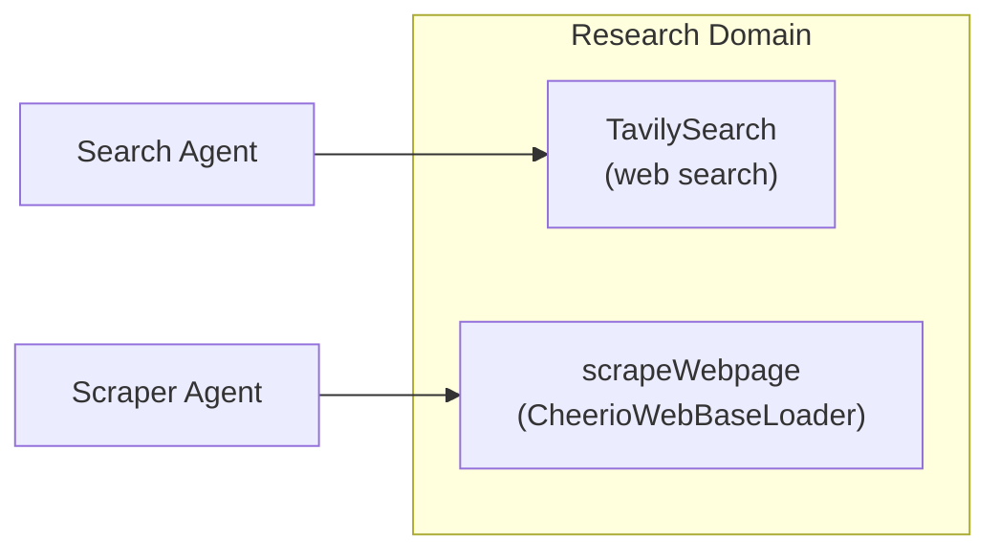

### Document Writing Team Tools

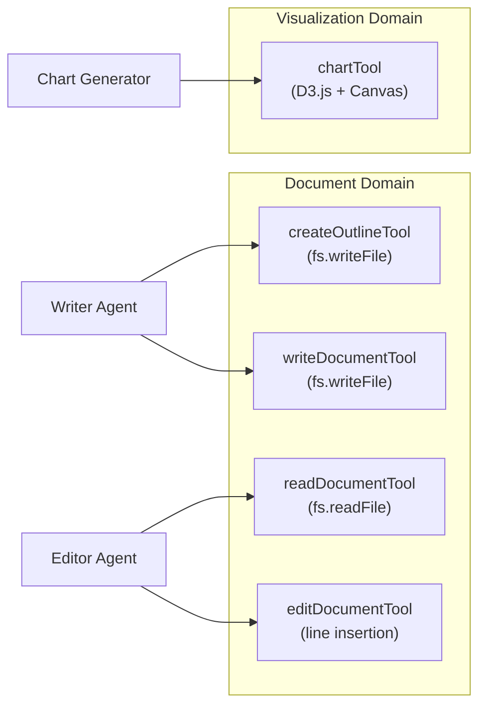

Tool definitions use the `tool` function with Zod schemas at [examples/multi_agent/hierarchical_agent_teams.ipynb:97-338]().

## Comparison with Other Patterns

### Pattern Characteristics

| Pattern | Coordination | Complexity | Use Case |
|---------|-------------|------------|----------|
| **Hierarchical Teams** | Multi-level supervisors | High | Complex multi-domain tasks |
| Flat Supervisor | Single supervisor | Medium | Single domain with specialists |
| Swarm | Shared memory | Medium | Autonomous collaboration |
| Plan-and-Execute | Sequential planner | Low | Linear task decomposition |

### When to Use Hierarchical Teams

**Advantages:**
- Clear separation of concerns across domains
- Scalable to many specialized agents
- Reusable team subgraphs
- Isolated team state management

**Trade-offs:**
- More LLM calls (multiple supervisor levels)
- Increased latency from routing overhead
- Complex state management across levels

**Best suited for:**
- Tasks requiring distinct expertise domains
- Systems with 5+ specialized agents
- Applications needing team-level isolation
- Scenarios where teams can be developed independently

Sources: [examples/multi_agent/hierarchical_agent_teams.ipynb:8-36]()

## Integration with LangGraph Core

### Subgraph Compilation

Compiled subgraphs become standard nodes:

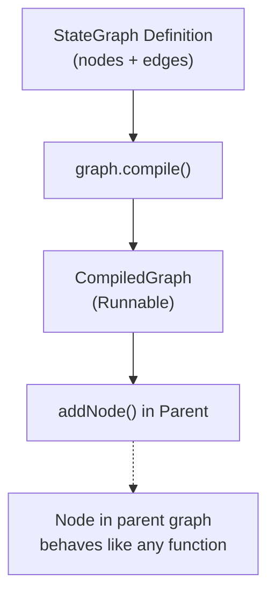

The compilation process at [examples/multi_agent/hierarchical_agent_teams.ipynb:774-839]() creates a `Runnable` that:
- Accepts parent state as input
- Executes complete team workflow internally
- Returns state updates to parent graph

### State Isolation

Each subgraph maintains independent state:

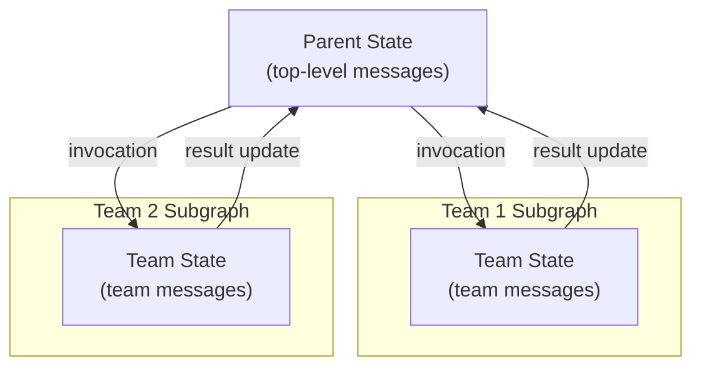

State is passed at invocation time and returned as updates, maintaining clean boundaries between organizational levels.

Sources: [examples/multi_agent/hierarchical_agent_teams.ipynb:564-622](), [examples/multi_agent/hierarchical_agent_teams.ipynb:628-720]()

---

