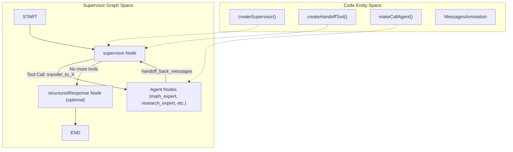
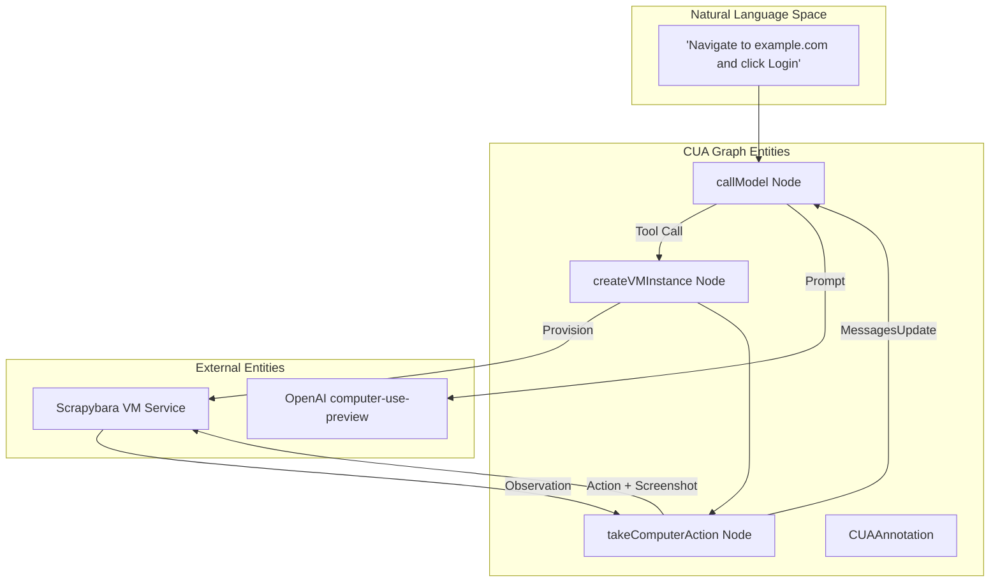

<!-- source: DeepWiki mcp.deepwiki.com · repo langchain-ai/langgraphjs · page 4.4 Specialized Agent Packages · fetched 2026-10-26 -->

# Specialized Agent Packages

Relevant source files

The following files were used as context for generating this wiki page:

- [libs/checkpoint-mongodb/CHANGELOG.md](libs/checkpoint-mongodb/CHANGELOG.md)
- [libs/checkpoint-mongodb/package.json](libs/checkpoint-mongodb/package.json)
- [libs/checkpoint-postgres/package.json](libs/checkpoint-postgres/package.json)
- [libs/checkpoint-redis/CHANGELOG.md](libs/checkpoint-redis/CHANGELOG.md)
- [libs/checkpoint-redis/package.json](libs/checkpoint-redis/package.json)
- [libs/checkpoint-sqlite/package.json](libs/checkpoint-sqlite/package.json)
- [libs/checkpoint-validation/package.json](libs/checkpoint-validation/package.json)
- [libs/checkpoint/package.json](libs/checkpoint/package.json)
- [libs/langgraph-cua/.release-it.json](libs/langgraph-cua/.release-it.json)
- [libs/langgraph-cua/LICENSE](libs/langgraph-cua/LICENSE)
- [libs/langgraph-cua/README.md](libs/langgraph-cua/README.md)
- [libs/langgraph-cua/examples/price-finder.ts](libs/langgraph-cua/examples/price-finder.ts)
- [libs/langgraph-cua/package.json](libs/langgraph-cua/package.json)
- [libs/langgraph-cua/src/index.ts](libs/langgraph-cua/src/index.ts)
- [libs/langgraph-cua/src/nodes/call-model.ts](libs/langgraph-cua/src/nodes/call-model.ts)
- [libs/langgraph-cua/src/nodes/create-vm-instance.ts](libs/langgraph-cua/src/nodes/create-vm-instance.ts)
- [libs/langgraph-cua/src/nodes/take-computer-action.ts](libs/langgraph-cua/src/nodes/take-computer-action.ts)
- [libs/langgraph-cua/src/tests/cua.test.ts](libs/langgraph-cua/src/tests/cua.test.ts)
- [libs/langgraph-cua/src/types.ts](libs/langgraph-cua/src/types.ts)
- [libs/langgraph-cua/src/utils.ts](libs/langgraph-cua/src/utils.ts)
- [libs/langgraph-supervisor/.gitignore](libs/langgraph-supervisor/.gitignore)
- [libs/langgraph-supervisor/CHANGELOG.md](libs/langgraph-supervisor/CHANGELOG.md)
- [libs/langgraph-supervisor/package.json](libs/langgraph-supervisor/package.json)
- [libs/langgraph-supervisor/src/handoff.ts](libs/langgraph-supervisor/src/handoff.ts)
- [libs/langgraph-supervisor/src/index.ts](libs/langgraph-supervisor/src/index.ts)
- [libs/langgraph-supervisor/src/supervisor.ts](libs/langgraph-supervisor/src/supervisor.ts)
- [libs/langgraph-supervisor/src/tests/supervisor.test.ts](libs/langgraph-supervisor/src/tests/supervisor.test.ts)
- [libs/langgraph-supervisor/src/tests/supervisorRemote.test.ts](libs/langgraph-supervisor/src/tests/supervisorRemote.test.ts)
- [libs/langgraph-supervisor/src/tests/supervisorSubgraph.test.ts](libs/langgraph-supervisor/src/tests/supervisorSubgraph.test.ts)
- [libs/langgraph-supervisor/src/tests/utils.ts](libs/langgraph-supervisor/src/tests/utils.ts)
- [libs/langgraph-swarm/package.json](libs/langgraph-swarm/package.json)
- [libs/langgraph-swarm/src/handoff.ts](libs/langgraph-swarm/src/handoff.ts)
- [libs/langgraph-swarm/src/swarm.ts](libs/langgraph-swarm/src/swarm.ts)

This page documents the pre-built agent package implementations available in the LangGraph ecosystem: `@langchain/langgraph-supervisor`, `@langchain/langgraph-swarm`, and `@langchain/langgraph-cua`. While previous sections cover the conceptual patterns for supervisor and swarm architectures, this page focuses on the technical implementation details of these npm packages, their APIs, configuration options, and integration with the core LangGraph framework.

These packages provide production-ready implementations of common multi-agent patterns and specialized capabilities:

- **Supervisor Package**: Implements the supervisor pattern with LLM-based routing among worker agents.
- **Swarm Package**: Implements autonomous agent coordination through dynamic handoffs.
- **Computer Use Agent (CUA)**: Enables LLMs to interact with computer environments through browser and desktop automation.

Sources: [libs/langgraph-supervisor/package.json:1-70](), [libs/langgraph-swarm/package.json:1-71](), [libs/langgraph-cua/package.json:1-87]()

## Multi-Agent Supervisor Package

**Package**: `@langchain/langgraph-supervisor`

The supervisor package provides a high-level API for creating a central LLM-based supervisor that orchestrates work among multiple specialized agents. It handles the complexity of handoffs, message history management, and structured responses.

### createSupervisor Function

The `createSupervisor` function [libs/langgraph-supervisor/src/supervisor.ts:241-241]() is the primary factory for creating a supervisor graph. It accepts `CreateSupervisorParams` [libs/langgraph-supervisor/src/supervisor.ts:118-239]() and returns a `CompiledStateGraph`.

**Key Implementation Details:**
- **Agent Normalization**: The supervisor accepts `CompiledStateGraph` instances or `RemoteGraph` objects. It wraps them in a standardized execution logic via `makeCallAgent` [libs/langgraph-supervisor/src/supervisor.ts:74-115]().
- **Handoff Mechanism**: Coordination is achieved through specialized tools created via `createHandoffTool` [libs/langgraph-supervisor/src/handoff.ts:21-48](). These tools allow the supervisor to "transfer" control to a specific worker agent.
- **Output Modes**: Supports `full_history` (adds the entire worker conversation to main state) or `last_message` (adds only the worker's final result) [libs/langgraph-supervisor/src/supervisor.ts:33-33]().
- **Remote Support**: It automatically handles thread ID mapping for `RemoteGraph` agents using UUID v5 based on the agent's name [libs/langgraph-supervisor/src/supervisor.ts:90-102]().

### Supervisor Data Flow

Sources: [libs/langgraph-supervisor/src/supervisor.ts:241-450](), [libs/langgraph-supervisor/src/handoff.ts:50-71](), [libs/langgraph-supervisor/src/tests/supervisor.test.ts:41-157]()

## Multi-Agent Swarm Package

**Package**: `@langchain/langgraph-swarm`

The swarm package implements a decentralized multi-agent pattern where agents coordinate through dynamic handoffs without a central supervisor.

### Core Logic

The swarm implementation relies on the `createHandoffTool` [libs/langgraph-swarm/src/handoff.ts:21-45]() to facilitate transitions between agents. Unlike the supervisor pattern, any agent in the swarm can call a handoff tool to transfer execution to another agent.

**Implementation Components:**
- **Swarm State**: Typically uses a shared message history where agents append their turns.
- **Dynamic Routing**: The graph structure is often dynamic, where the next node is determined by the specific handoff tool called by the current agent.

Sources: [libs/langgraph-swarm/src/swarm.ts:1-50](), [libs/langgraph-swarm/package.json:1-35]()

## Computer Use Agent (CUA)

**Package**: `@langchain/langgraph-cua`

The CUA package implements an agent capable of controlling computers through browser and desktop interactions using OpenAI's computer use preview and the Scrapybara VM service.

### CUA Architecture

The CUA follows a cyclical pattern of observation (screenshot), reasoning (LLM), and action (VM interaction).

Sources: [libs/langgraph-cua/src/index.ts:186-223](), [libs/langgraph-cua/src/nodes/call-model.ts:101-163](), [libs/langgraph-cua/src/nodes/take-computer-action.ts:1-50]()

### Core Components

| Component | File Path | Role |
|-----------|-----------|------|
| `createCua` | [libs/langgraph-cua/src/index.ts:63-145]() | Main factory function for the CUA graph. |
| `CUAAnnotation` | [libs/langgraph-cua/src/index.ts:14-18]() | Defines state including `instanceId` and `lastScreenshot`. |
| `callModel` | [libs/langgraph-cua/src/nodes/call-model.ts:101-163]() | Invokes OpenAI with computer-use tool definitions. |
| `takeComputerAction` | [libs/langgraph-cua/src/nodes/take-computer-action.ts:1-50]() | Executes actions on the Scrapybara VM. |

**Environment Support:**
The CUA supports three target environments: `web`, `ubuntu`, and `windows` [libs/langgraph-cua/src/nodes/call-model.ts:17-28](). These are mapped to specific Scrapybara instance types and OpenAI tool configurations.

Sources: [libs/langgraph-cua/src/index.ts:1-235](), [libs/langgraph-cua/src/nodes/call-model.ts:1-164]()

## Package Comparison and Infrastructure

### Dependency Matrix

| Feature | Supervisor | Swarm | CUA |
|---------|------------|-------|-----|
| **Core Dependency** | `@langchain/langgraph` | `@langchain/langgraph` | `@langchain/langgraph` |
| **LLM Support** | `LanguageModelLike` | `LanguageModelLike` | `ChatOpenAI` (OpenAI specific) |
| **External Services** | None | None | Scrapybara |
| **Schema Validation** | `zod` | `zod` | `zod` |

Sources: [libs/langgraph-supervisor/package.json:29-35](), [libs/langgraph-swarm/package.json:29-36](), [libs/langgraph-cua/package.json:30-38]()

### Build and Test Infrastructure
All specialized packages reside in the `libs/` directory of the monorepo and utilize a shared build pipeline:
- **Build System**: Turbo and tsdown [libs/langgraph-supervisor/package.json:17-18]().
- **Testing**: Vitest for unit and integration tests [libs/langgraph-supervisor/package.json:23-25]().
- **Circular Dependency Check**: DPDM is used to ensure clean architecture [libs/langgraph-supervisor/package.json:21-21]().

Sources: [libs/langgraph-supervisor/package.json:16-26](), [libs/langgraph-swarm/package.json:16-26](), [libs/langgraph-cua/package.json:17-27]()

---

