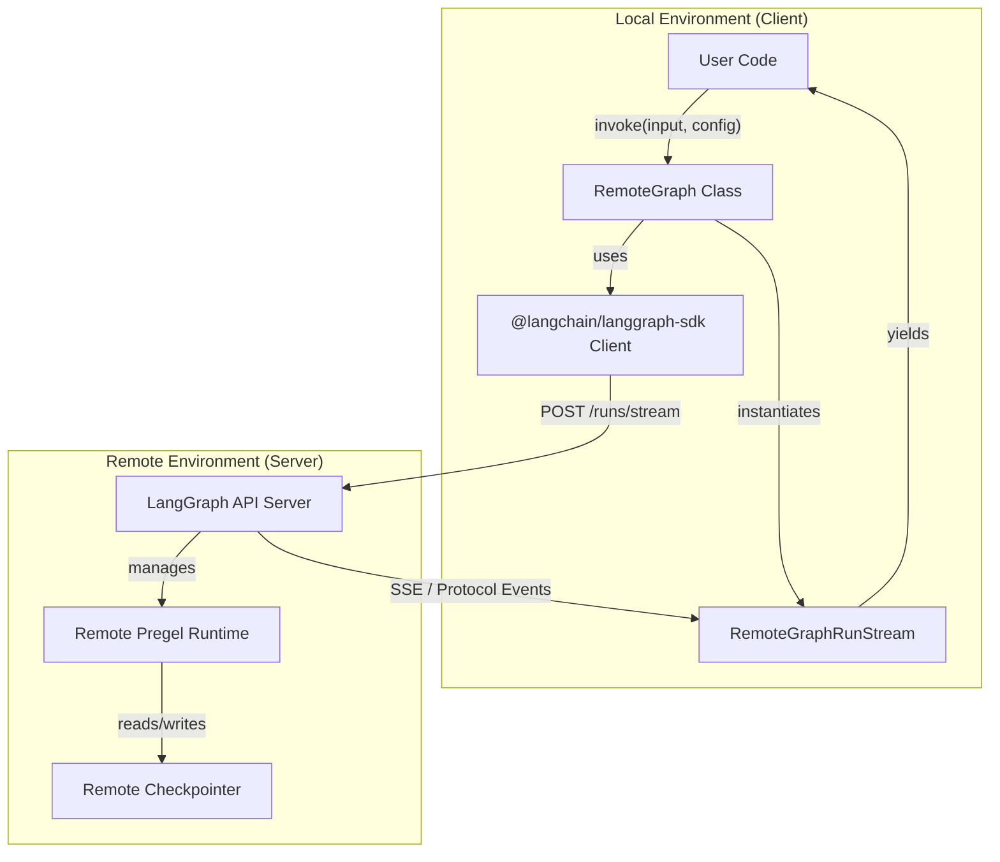
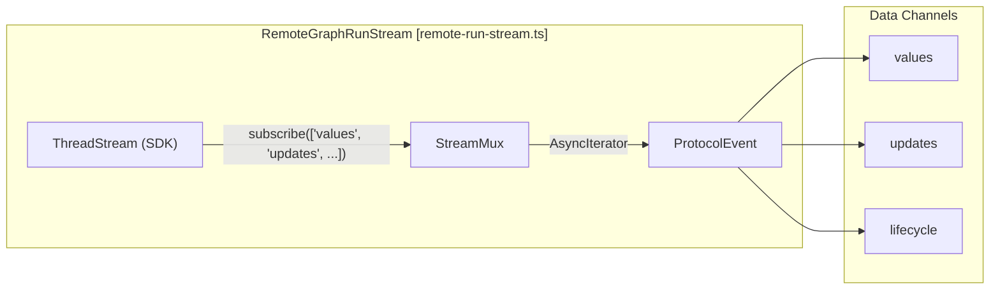

<!-- source: DeepWiki mcp.deepwiki.com · repo langchain-ai/langgraphjs · page 4.5 Remote Graphs · fetched 2026-10-26 -->

# Remote Graphs

<details>
<summary>Relevant source files</summary>

The following files were used as context for generating this wiki page:

- [libs/langgraph-core/src/pregel/index.ts](libs/langgraph-core/src/pregel/index.ts)
- [libs/langgraph-core/src/pregel/remote-run-stream.ts](libs/langgraph-core/src/pregel/remote-run-stream.ts)
- [libs/langgraph-core/src/pregel/remote.ts](libs/langgraph-core/src/pregel/remote.ts)
- [libs/langgraph-core/src/pregel/utils/config.test.ts](libs/langgraph-core/src/pregel/utils/config.test.ts)
- [libs/langgraph-core/src/pregel/utils/config.ts](libs/langgraph-core/src/pregel/utils/config.ts)
- [libs/langgraph-core/src/tests/concurrent-thread-isolation.test.ts](libs/langgraph-core/src/tests/concurrent-thread-isolation.test.ts)
- [libs/langgraph-core/src/tests/execution_info.test.ts](libs/langgraph-core/src/tests/execution_info.test.ts)
- [libs/langgraph-core/src/tests/pregel.stream.test.ts](libs/langgraph-core/src/tests/pregel.stream.test.ts)
- [libs/langgraph-core/src/tests/pregel.test.ts](libs/langgraph-core/src/tests/pregel.test.ts)
- [libs/langgraph-core/src/tests/remote.int.test.ts](libs/langgraph-core/src/tests/remote.int.test.ts)
- [libs/langgraph-core/src/tests/remote.test.ts](libs/langgraph-core/src/tests/remote.test.ts)
- [libs/langgraph-core/src/tests/tracing.test.ts](libs/langgraph-core/src/tests/tracing.test.ts)

</details>


The `RemoteGraph` class enables seamless orchestration between local and remote LangGraph deployments. It implements the `PregelInterface`, allowing a remotely hosted graph to be treated as a first-class node within a local `StateGraph` or invoked independently using the standard `Runnable` interface.

## Overview

`RemoteGraph` acts as a proxy for the LangGraph Server API. It abstracts the network communication, state synchronization, and streaming protocols required to interact with graphs deployed on platforms like LangCloud or local LangGraph API instances [libs/langgraph-core/src/pregel/remote.ts:160-168]().

### Key Capabilities
- **Subgraph Integration**: Use a remote deployment as a node in a local graph.
- **State Management**: Fetch and update remote thread states using `getState` and `updateState` [libs/langgraph-core/src/pregel/remote.ts:384-466]().
- **Streaming**: Supports high-level streaming via `RemoteGraphRunStream` and protocol-level streaming via `streamEvents` (v3) [libs/langgraph-core/src/pregel/remote.ts:285-336]().
- **Cross-Deployment Orchestration**: Manage complex workflows where different parts of the logic reside in different infrastructure environments.

## Architecture and Data Flow

The following diagram illustrates how `RemoteGraph` bridges the local execution environment (Natural Language Space/Local Code) to the remote server entities (Code Entity Space).

### Remote Graph Invocation Flow

Sources: [libs/langgraph-core/src/pregel/remote.ts:285-336](), [libs/langgraph-core/src/pregel/remote-run-stream.ts:28-59]()

## Implementation Details

### RemoteGraph Class
The `RemoteGraph` class extends `Runnable` and implements `PregelInterface` [libs/langgraph-core/src/pregel/remote.ts:196-208](). It requires a `graphId` and connectivity details (URL, API Key, or a pre-configured `Client`) [libs/langgraph-core/src/pregel/remote.ts:51-61]().

#### Key Methods
- **`invoke`**: Performs a remote run and returns the final state [libs/langgraph-core/src/pregel/remote.ts:251-283]().
- **`stream`**: Initiates a streaming run, returning an `IterableReadableStream` [libs/langgraph-core/src/pregel/remote.ts:285-313]().
- **`streamEvents`**: Specifically handles "v3" protocol events, allowing for complex streaming modes like `values`, `updates`, and `messages` [libs/langgraph-core/src/pregel/remote.ts:315-336]().
- **`getState` / `getStateHistory`**: Interfaces with the remote `ThreadsClient` to retrieve snapshots of the graph's state [libs/langgraph-core/src/pregel/remote.ts:384-443]().

### RemoteRunStream and Muxing
`RemoteGraphRunStream` adapts the SDK's `ThreadStream` into the framework's internal `GraphRunStream` shape [libs/langgraph-core/src/pregel/remote-run-stream.ts:28-31](). It uses a `StreamMux` to handle multiple concurrent data channels (values, updates, tools, etc.) [libs/langgraph-core/src/pregel/remote-run-stream.ts:49]().


Sources: [libs/langgraph-core/src/pregel/remote-run-stream.ts:13-23](), [libs/langgraph-core/src/pregel/remote-run-stream.ts:141-152]()

## Configuration and Metadata Propagation

When invoking a `RemoteGraph`, local configuration keys are filtered and propagated to the remote server.
- **`thread_id`**: Essential for state persistence and resuming remote runs [libs/langgraph-core/src/pregel/utils/config.ts:46-54]().
- **Metadata**: Keys like `assistant_id` and `graph_id` are used to construct `ServerInfo` for the remote execution context [libs/langgraph-core/src/tests/execution_info.test.ts:159-181]().
- **Stream Modes**: `RemoteGraph` automatically ensures that `updates` mode is included in remote requests to facilitate interrupt detection, even if the user only requested `values` [libs/langgraph-core/src/pregel/remote.ts:98-127]().

### Input Serialization
Before sending data to the remote API, `RemoteGraph` recursively serializes inputs. Notably, it converts LangChain `BaseMessage` objects into their dictionary representations (adding the `role` field) to ensure compatibility with the server-side REST API [libs/langgraph-core/src/pregel/remote.ts:66-87]().

## Integration Example

A `RemoteGraph` can be added to a local `StateGraph` just like any other node. The local graph will manage the `thread_id` and pass the necessary state to the remote graph.

```typescript
import { StateGraph } from "@langchain/langgraph";
import { RemoteGraph } from "@langchain/langgraph/remote";

const remote = new RemoteGraph({
  graphId: "my-remote-agent",
  url: "https://api.langgraph.app"
});

const workflow = new StateGraph(MyStateSchema)
  .addNode("local_processing", localFunc)
  .addNode("remote_agent", remote) // RemoteGraph used as a node
  .addEdge("local_processing", "remote_agent");
```
Sources: [libs/langgraph-core/src/pregel/remote.ts:169-195](), [libs/langgraph-core/src/tests/remote.test.ts:11-38]()

## Error Handling
If a remote execution encounters an error, the `RemoteGraph` catches the exception and wraps it in a `RemoteException`, preserving the server-side stack trace and error message for local debugging [libs/langgraph-core/src/pregel/remote.ts:28-29]().

Sources:
- [libs/langgraph-core/src/pregel/remote.ts]()
- [libs/langgraph-core/src/pregel/remote-run-stream.ts]()
- [libs/langgraph-core/src/pregel/utils/config.ts]()
- [libs/langgraph-core/src/tests/remote.test.ts]()
- [libs/langgraph-core/src/tests/execution_info.test.ts]()

---

