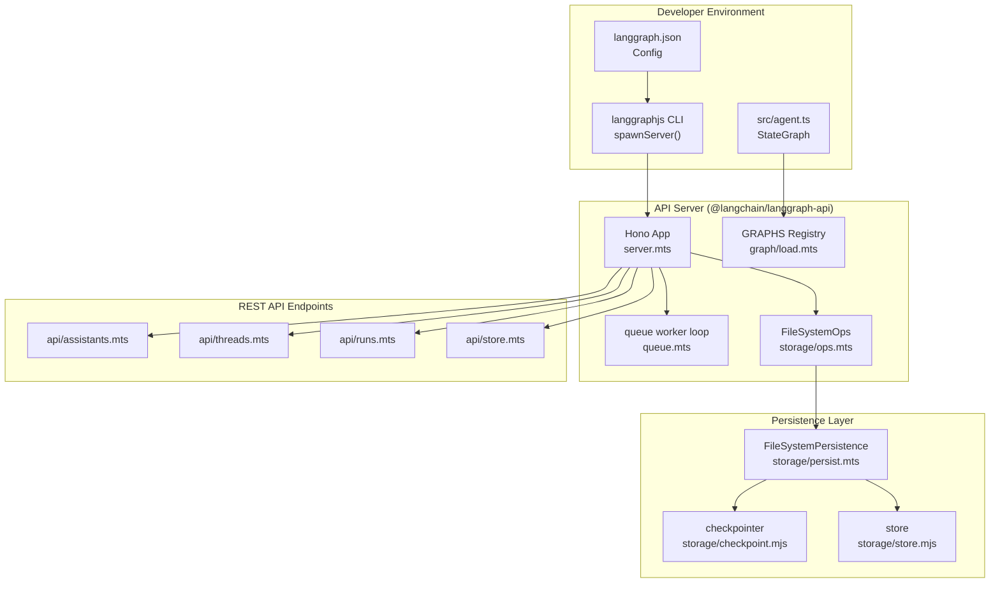
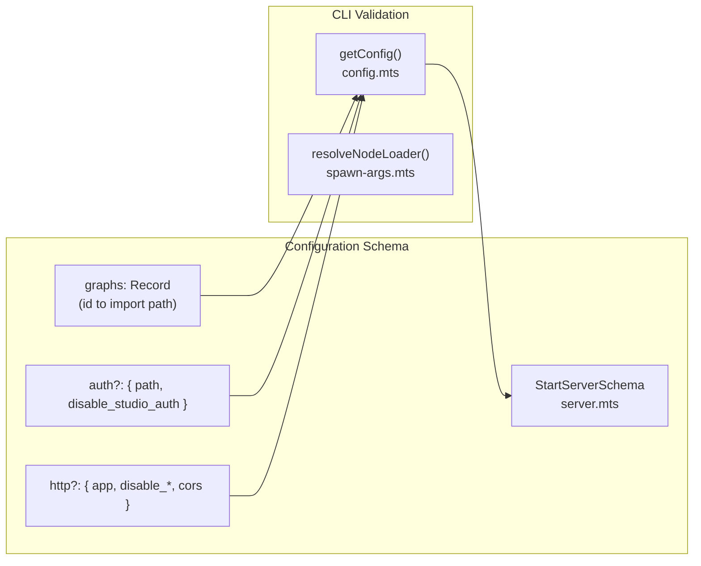
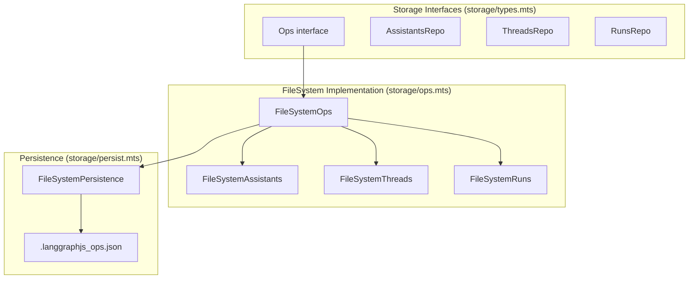

<!-- source: DeepWiki mcp.deepwiki.com · repo langchain-ai/langgraphjs · page 5 LangGraph Platform · fetched 2026-10-26 -->

# LangGraph Platform

Relevant source files

The following files were used as context for generating this wiki page:

- [docs/docs/concepts/application_structure.md](docs/docs/concepts/application_structure.md)
- [docs/docs/concepts/assistants.md](docs/docs/concepts/assistants.md)
- [docs/docs/concepts/deployment_options.md](docs/docs/concepts/deployment_options.md)
- [docs/docs/concepts/double_texting.md](docs/docs/concepts/double_texting.md)
- [docs/docs/concepts/langgraph_cli.md](docs/docs/concepts/langgraph_cli.md)
- [docs/docs/concepts/langgraph_cloud.md](docs/docs/concepts/langgraph_cloud.md)
- [docs/docs/concepts/langgraph_server.md](docs/docs/concepts/langgraph_server.md)
- [docs/docs/concepts/sdk.md](docs/docs/concepts/sdk.md)
- [docs/docs/tutorials/index.md](docs/docs/tutorials/index.md)
- [examples/chatbot-simulation-evaluation/agent-simulation-evaluation.ipynb](examples/chatbot-simulation-evaluation/agent-simulation-evaluation.ipynb)
- [examples/chatbot-simulation-evaluation/img/virtual_user_diagram.png](examples/chatbot-simulation-evaluation/img/virtual_user_diagram.png)
- [libs/langgraph-api/src/api/assistants.mts](libs/langgraph-api/src/api/assistants.mts)
- [libs/langgraph-api/src/api/meta.mts](libs/langgraph-api/src/api/meta.mts)
- [libs/langgraph-api/src/api/runs.mts](libs/langgraph-api/src/api/runs.mts)
- [libs/langgraph-api/src/api/threads.mts](libs/langgraph-api/src/api/threads.mts)
- [libs/langgraph-api/src/cli/spawn-args.mts](libs/langgraph-api/src/cli/spawn-args.mts)
- [libs/langgraph-api/src/cli/spawn.mts](libs/langgraph-api/src/cli/spawn.mts)
- [libs/langgraph-api/src/graph/load.mts](libs/langgraph-api/src/graph/load.mts)
- [libs/langgraph-api/src/http/middleware.mts](libs/langgraph-api/src/http/middleware.mts)
- [libs/langgraph-api/src/queue.mts](libs/langgraph-api/src/queue.mts)
- [libs/langgraph-api/src/schemas.mts](libs/langgraph-api/src/schemas.mts)
- [libs/langgraph-api/src/semver/index.mts](libs/langgraph-api/src/semver/index.mts)
- [libs/langgraph-api/src/semver/satisfiesPeerRange.mts](libs/langgraph-api/src/semver/satisfiesPeerRange.mts)
- [libs/langgraph-api/src/server.mts](libs/langgraph-api/src/server.mts)
- [libs/langgraph-api/src/storage/ops.mts](libs/langgraph-api/src/storage/ops.mts)
- [libs/langgraph-api/src/storage/types.mts](libs/langgraph-api/src/storage/types.mts)
- [libs/langgraph-api/src/stream.mts](libs/langgraph-api/src/stream.mts)
- [libs/langgraph-api/tests/api.test.mts](libs/langgraph-api/tests/api.test.mts)
- [libs/langgraph-api/tests/graphs/langgraph.json](libs/langgraph-api/tests/graphs/langgraph.json)
- [libs/langgraph-api/tests/semver.test.mts](libs/langgraph-api/tests/semver.test.mts)
- [libs/langgraph-api/tests/spawn-args.test.mts](libs/langgraph-api/tests/spawn-args.test.mts)
- [libs/langgraph-cli/src/utils/config.mts](libs/langgraph-cli/src/utils/config.mts)
- [libs/langgraph-cli/tests/config.test.mts](libs/langgraph-cli/tests/config.test.mts)
- [libs/sdk/src/auth/types.ts](libs/sdk/src/auth/types.ts)

The **LangGraph Platform** is the deployment infrastructure built on top of the LangGraph core framework, providing production-ready APIs, development tooling, and UI components for running LangGraph agents as persistent, stateful services. While the core framework focuses on graph execution and state management, the platform adds server infrastructure, authentication, background job processing, and developer tooling.

For information about using the platform via client applications, see [Client SDK](#6). For details on the core graph execution engine, see [Core Framework](#2).

---

## Platform Components

The LangGraph Platform consists of several integrated packages providing a complete deployment solution:

| Package | Purpose | Key Entry Points |
|---------|---------|------------------|
| `@langchain/langgraph-api` | Hono-based REST API server | `startServer()` in [libs/langgraph-api/src/server.mts](), `api/*.mts` routes |
| `@langchain/langgraph-cli` | CLI for local development and deployment | `langgraphjs` binary, `spawnServer()` in [libs/langgraph-api/src/cli/spawn.mts]() |
| `@langchain/langgraph-ui` | UI components and bundling system | `registerGraphUi`, UI bundling middleware |

The platform transforms a directory of LangGraph code into a deployable API service with persistence, authentication, job queuing, and visual debugging tools.

**Sources:** [libs/langgraph-api/package.json:1-116](), [libs/langgraph-cli/package.json:1-64](), [libs/langgraph-api/src/server.mts:82-121]()

---

## Platform Architecture

**Platform Architecture with Code Entities**

The platform centers on a Hono HTTP server [libs/langgraph-api/src/server.mts:165]() that exposes API endpoints. The `GRAPHS` registry in [libs/langgraph-api/src/graph/load.mts:19-22]() stores compiled graph instances. `FileSystemOps` in [libs/langgraph-api/src/storage/ops.mts:36-48]() implements the `Ops` interface for managing assistants, threads, and runs. Background workers poll `ops.runs.next()` [libs/langgraph-api/src/storage/types.mts:225-229]() and execute graphs.

**Sources:** [libs/langgraph-api/src/server.mts:165-219](), [libs/langgraph-api/src/storage/ops.mts:36-48](), [libs/langgraph-api/src/graph/load.mts:19-22](), [libs/langgraph-api/src/queue.mts:15-24]()

---

## Configuration and Initialization

### langgraph.json Configuration

The platform is configured via a `langgraph.json` file. The CLI and server validate this against the `StartServerSchema`:

**Configuration Schema and Validation**

The `StartServerSchema` [libs/langgraph-api/src/server.mts:38-78]() validates the configuration structure. The `getConfig()` function in the CLI [libs/langgraph-cli/src/utils/config.mts:108-144]() performs additional validation to infer runtime requirements and handle Python/Node versioning.

**Sources:** [libs/langgraph-api/src/server.mts:38-78](), [libs/langgraph-cli/src/utils/config.mts:108-144](), [libs/langgraph-api/src/cli/spawn-args.mts:1-40]()

### Initialization Sequence

The `startServer()` function [libs/langgraph-api/src/server.mts:82-121]() performs initialization in this order:

1. **Semver Validation:** Checks dependencies via `checkLangGraphSemver()` [libs/langgraph-api/src/server.mts:86]().
2. **Storage Initialization:** Initializes `checkpointer` and `graphStore` [libs/langgraph-api/src/server.mts:101-104]().
3. **Ops Setup:** Creates `FileSystemOps` with `FileSystemPersistence` [libs/langgraph-api/src/server.mts:108-120]().
4. **Graph Registration:** Loads graphs from environment via `registerFromEnv()` [libs/langgraph-api/src/server.mts:153]().
5. **Hono App Setup:** Configures middleware, routes, and custom auth/HTTP apps [libs/langgraph-api/src/server.mts:165-219]().

**Sources:** [libs/langgraph-api/src/server.mts:82-219](), [libs/langgraph-api/src/graph/load.mts:37-77]()

---

## Storage Layer Architecture

The platform abstracts persistence through the `Ops` interface. `FileSystemOps` provides the default implementation for local development:

**Storage Layer with Code Entities**

`FileSystemOps` [libs/langgraph-api/src/storage/ops.mts:36-48]() implements the `Ops` interface, delegating to three repository classes: `FileSystemAssistants` [libs/langgraph-api/src/storage/ops.mts:226](), `FileSystemThreads` [libs/langgraph-api/src/storage/ops.mts:664](), and `FileSystemRuns`. Each is backed by `FileSystemPersistence<Store>` [libs/langgraph-api/src/storage/persist.mts]().

**Sources:** [libs/langgraph-api/src/storage/ops.mts:36-48](), [libs/langgraph-api/src/storage/types.mts:224-315](), [libs/langgraph-api/src/server.mts:108-120]()

---

## Request Processing Flow

The platform handles requests by transforming API payloads into internal repository calls:

1. **API Layer:** `api/runs.mts` receives a `RunCreate` payload [libs/langgraph-api/src/api/runs.mts:200]().
2. **Validation:** `createValidRun()` builds the execution configuration and `RunKwargs` [libs/langgraph-api/src/api/runs.mts:22-29]().
3. **Repository:** `runs().put()` persists the run with a "pending" status [libs/langgraph-api/src/api/runs.mts:98-127]().
4. **Streaming:** For streaming runs, `runs().stream.join()` manages SSE event delivery [libs/langgraph-api/src/api/runs.mts:217-229]().

**Sources:** [libs/langgraph-api/src/api/runs.mts:22-229](), [libs/langgraph-api/src/storage/types.mts:231-246]()

---

## Development Workflow

The `langgraphjs` CLI provides a `dev` command that orchestrates the local server:

1. **Spawn:** `spawnServer()` in [libs/langgraph-api/src/cli/spawn.mts:6-29]() initializes the environment.
2. **Args:** `buildSpawnArgs()` [libs/langgraph-api/src/cli/spawn.mts:60]() configures the node loader and hot-reload.
3. **Execution:** The server starts and provides a local API URL and LangGraph Studio UI URL [libs/langgraph-api/src/cli/spawn.mts:30-46]().

**Sources:** [libs/langgraph-api/src/cli/spawn.mts:6-76](), [libs/langgraph-api/src/cli/spawn-args.mts:1-40]()

---

## Sub-Pages

This page provides an overview of the LangGraph Platform. For detailed information on specific subsystems:

- **[API Server Architecture](#5.1):** Hono-based HTTP server architecture and middleware.
- **[Storage and Operations Layer](#5.2):** Storage abstraction and `FileSystemOps` implementation.
- **[API Endpoints and Resources](#5.3):** REST API endpoints for assistants, threads, and runs.
- **[Authentication and Authorization](#5.4):** Authentication system and resource access control.
- **[Run Execution and Streaming](#5.5):** Run lifecycle, queue workers, and streaming protocols.
- **[CLI and Development Tools](#5.6):** CLI commands and project scaffolding.
- **[UI Components and Studio](#5.7):** UI bundling and LangGraph Studio integration.

---

