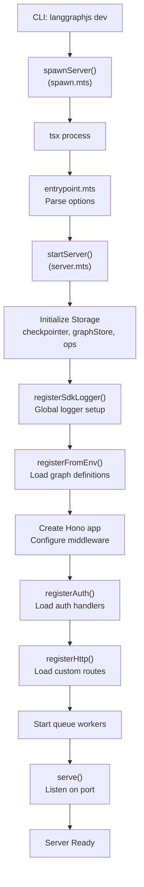
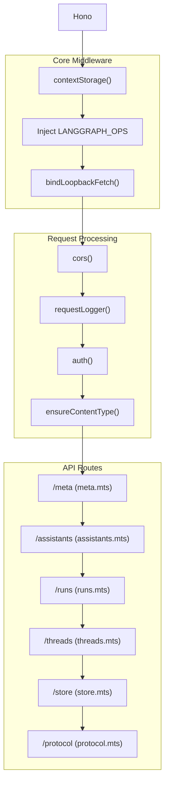
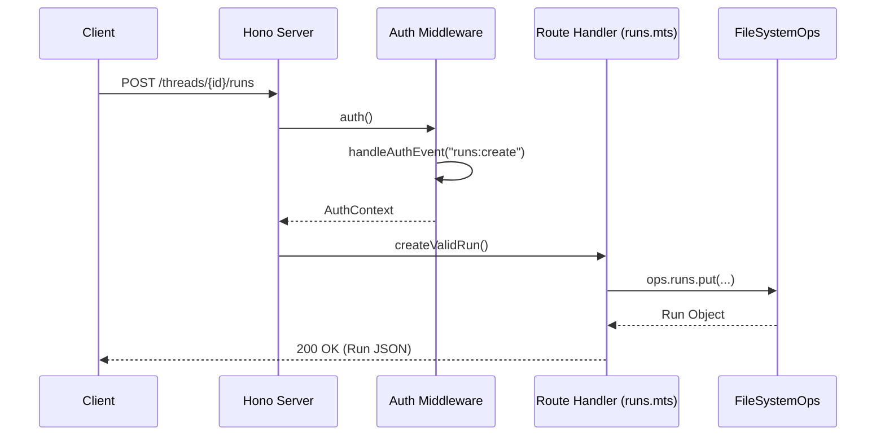

<!-- source: DeepWiki mcp.deepwiki.com · repo langchain-ai/langgraphjs · page 5.1 API Server Architecture · fetched 2026-10-26 -->

# API Server Architecture

<details>
<summary>Relevant source files</summary>

The following files were used as context for generating this wiki page:

- [libs/langgraph-api/src/api/assistants.mts](libs/langgraph-api/src/api/assistants.mts)
- [libs/langgraph-api/src/api/meta.mts](libs/langgraph-api/src/api/meta.mts)
- [libs/langgraph-api/src/api/runs.mts](libs/langgraph-api/src/api/runs.mts)
- [libs/langgraph-api/src/api/threads.mts](libs/langgraph-api/src/api/threads.mts)
- [libs/langgraph-api/src/cli/entrypoint.mts](libs/langgraph-api/src/cli/entrypoint.mts)
- [libs/langgraph-api/src/cli/spawn-args.mts](libs/langgraph-api/src/cli/spawn-args.mts)
- [libs/langgraph-api/src/cli/spawn.mts](libs/langgraph-api/src/cli/spawn.mts)
- [libs/langgraph-api/src/graph/load.hooks.mjs](libs/langgraph-api/src/graph/load.hooks.mjs)
- [libs/langgraph-api/src/graph/load.mts](libs/langgraph-api/src/graph/load.mts)
- [libs/langgraph-api/src/http/middleware.mts](libs/langgraph-api/src/http/middleware.mts)
- [libs/langgraph-api/src/queue.mts](libs/langgraph-api/src/queue.mts)
- [libs/langgraph-api/src/schemas.mts](libs/langgraph-api/src/schemas.mts)
- [libs/langgraph-api/src/semver/index.mts](libs/langgraph-api/src/semver/index.mts)
- [libs/langgraph-api/src/semver/satisfiesPeerRange.mts](libs/langgraph-api/src/semver/satisfiesPeerRange.mts)
- [libs/langgraph-api/src/server.mts](libs/langgraph-api/src/server.mts)
- [libs/langgraph-api/src/storage/ops.mts](libs/langgraph-api/src/storage/ops.mts)
- [libs/langgraph-api/src/storage/persist.mts](libs/langgraph-api/src/storage/persist.mts)
- [libs/langgraph-api/src/storage/types.mts](libs/langgraph-api/src/storage/types.mts)
- [libs/langgraph-api/src/stream.mts](libs/langgraph-api/src/stream.mts)
- [libs/langgraph-api/tests/api.test.mts](libs/langgraph-api/tests/api.test.mts)
- [libs/langgraph-api/tests/graphs/agent.mts](libs/langgraph-api/tests/graphs/agent.mts)
- [libs/langgraph-api/tests/graphs/agent/ui.tsx](libs/langgraph-api/tests/graphs/agent/ui.tsx)
- [libs/langgraph-api/tests/graphs/langgraph.json](libs/langgraph-api/tests/graphs/langgraph.json)
- [libs/langgraph-api/tests/semver.test.mts](libs/langgraph-api/tests/semver.test.mts)
- [libs/langgraph-api/tests/spawn-args.test.mts](libs/langgraph-api/tests/spawn-args.test.mts)
- [libs/langgraph-api/tsconfig.json](libs/langgraph-api/tsconfig.json)
- [libs/langgraph-cli/src/utils/config.mts](libs/langgraph-cli/src/utils/config.mts)
- [libs/langgraph-cli/tests/config.test.mts](libs/langgraph-cli/tests/config.test.mts)
- [libs/sdk/src/auth/types.ts](libs/sdk/src/auth/types.ts)

</details>


**Purpose and Scope**: This document covers the HTTP API server implementation in `@langchain/langgraph-api`, including the Hono-based server architecture, middleware stack, route structure, request processing flow, configuration system, and storage integration. For information about specific API endpoints and their request/response schemas, see [API Endpoints and Resources](#5.3). For authentication and authorization details, see [Authentication and Authorization](#5.4). For run execution and streaming mechanics, see [Run Execution and Streaming](#5.5).

## Overview

The LangGraph API server provides an HTTP interface for deploying and managing LangGraph applications. It is built on the [Hono](https://hono.dev/) web framework and supports local development via the CLI as well as production deployment. The server exposes REST endpoints for managing assistants, threads, runs, and cross-thread storage, while also supporting Server-Sent Events (SSE) and WebSockets for real-time streaming.

## Server Initialization and Lifecycle

### Startup Flow

The server initialization follows a multi-stage process coordinated between the CLI and the server runtime:



**Server Initialization Flow Diagram**

Sources: [libs/langgraph-api/src/server.mts:82-235](), [libs/langgraph-api/src/cli/spawn.mts:6-76](), [libs/langgraph-api/src/graph/load.mts:37-77]()

### Semver Validation
Before starting, the server executes `checkLangGraphSemver()` to ensure that installed dependencies (like `@langchain/langgraph`) satisfy the required version ranges. If versions are incompatible, a warning is logged to the console.

Sources: [libs/langgraph-api/src/server.mts:86-98](), [libs/langgraph-api/src/semver/index.mts:1-15]()

### Configuration Schema

The server accepts configuration via the `StartServerSchema` which validates all server options:

| Configuration Field | Type | Description |
|-------------------|------|-------------|
| `port` | `number` | HTTP port to bind |
| `nWorkers` | `number` | Number of background queue workers |
| `host` | `string` | Host address to bind |
| `cwd` | `string` | Working directory for graph resolution |
| `graphs` | `Record<string, string \| object>` | Graph definitions with paths |
| `auth` | `object` | Authentication configuration |
| `http` | `object` | HTTP server options (CORS, enabled endpoints) |

Sources: [libs/langgraph-api/src/server.mts:38-78](), [libs/langgraph-cli/src/utils/config.mts:11-74]()

### Storage Initialization

The server initializes three persistence layers concurrently:

```typescript
// From server.mts:101-104
const initCalls: Promise<FileSystemPersistence<unknown>>[] = [
  checkpointer.initialize(options.cwd),
  graphStore.initialize(options.cwd),
];
```

If no storage operations object is provided, it defaults to `FileSystemOps` backed by a local JSON file (`.langgraphjs_ops.json`). This store tracks runs, threads, assistants, and assistant versions.

Sources: [libs/langgraph-api/src/server.mts:100-121](), [libs/langgraph-api/src/storage/ops.mts:36-74]()

## HTTP Server Stack

### Hono Application Structure

The server uses Hono, a lightweight web framework. The application is composed of a middleware stack followed by modular route groups.



**Hono Middleware and Route Organization**

Sources: [libs/langgraph-api/src/server.mts:165-220]()

### Middleware Stack Details

1.  **Context Storage**: Uses `contextStorage()` to allow accessing the Hono context from anywhere in the call stack.
2.  **Ops Injection**: Injects the `LANGGRAPH_OPS` instance into the Hono environment variables (`c.var.LANGGRAPH_OPS`), making storage operations available to all routes.
3.  **Loopback Fetch**: Binds a loopback fetch mechanism to the app, allowing the server to make internal requests to itself (useful for webhooks or sub-requests).
4.  **CORS**: Configures Cross-Origin Resource Sharing based on the provided `http.cors` options.
5.  **Auth**: If configured via `options.auth.path`, the `auth()` middleware is applied to validate requests using `handleAuthEvent`.
6.  **Content Type**: `ensureContentType()` ensures that incoming POST/PATCH requests have the correct headers for JSON processing.

Sources: [libs/langgraph-api/src/server.mts:168-213](), [libs/langgraph-api/src/auth/index.mjs:4-15]()

## Request Processing Flow

### typical Request Lifecycle (Create Run)



**Request Processing Sequence**

Sources: [libs/langgraph-api/src/api/runs.mts:22-165](), [libs/langgraph-api/src/storage/ops.mts:226-242]()

### Context Propagation
The server uses a `StorageEnv` type to define the Hono environment, ensuring type safety when accessing `c.var.LANGGRAPH_OPS` and `c.var.auth`.

Sources: [libs/langgraph-api/src/storage/types.mts:12-16](), [libs/langgraph-api/src/server.mts:165-172]()

## Storage and Operations Layer

### Ops Interface
The `Ops` interface (and its `FileSystemOps` implementation) abstracts the underlying persistence. It is divided into repositories:
*   `assistants`: Manages assistant definitions and metadata.
*   `threads`: Manages thread state and history.
*   `runs`: Manages run lifecycle, queuing, and status.

Sources: [libs/langgraph-api/src/storage/ops.mts:36-48](), [libs/langgraph-api/src/storage/types.mts:224-306]()

### FileSystemPersistence
The `FileSystemPersistence` class handles the actual reading and writing of JSON files to disk. It uses a `with()` method to ensure atomic updates to the in-memory state before flushing to the filesystem.

Sources: [libs/langgraph-api/src/storage/persist.mts:26-45](), [libs/langgraph-api/src/storage/ops.mts:57-73]()

## API Endpoints Overview

The server mounts several route modules:
*   **Assistants (`/assistants`)**: CRUD operations for assistants, searching, and schema extraction. [libs/langgraph-api/src/api/assistants.mts:45-214]()
*   **Threads (`/threads`)**: Thread creation, state retrieval (`/state`), history (`/history`), and thread-specific runs. [libs/langgraph-api/src/api/threads.mts:16-254]()
*   **Runs (`/runs`)**: Stateless runs, streaming runs, and run management. [libs/langgraph-api/src/api/runs.mts:200-234]()
*   **Meta (`/info`, `/ok`)**: Provides server version, `langgraph-js` version, and system status. [libs/langgraph-api/src/api/meta.mts:40-76]()

## Internal Truncate Endpoint
For development and testing, the server includes a `POST /internal/truncate` endpoint. This allows clearing specific parts of the storage (runs, threads, assistants, checkpointer, or store) without a full server restart.

Sources: [libs/langgraph-api/src/server.mts:177-196](), [libs/langgraph-api/src/storage/ops.mts:50-74]()

---

