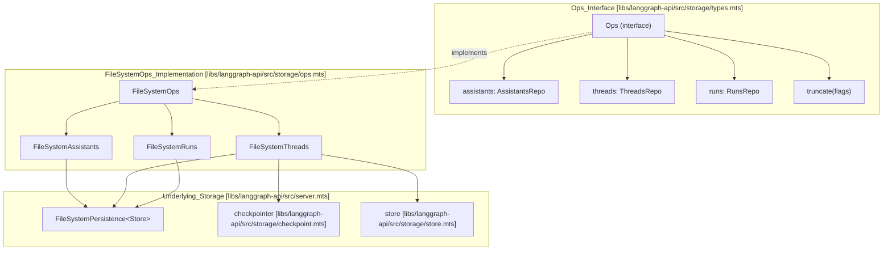
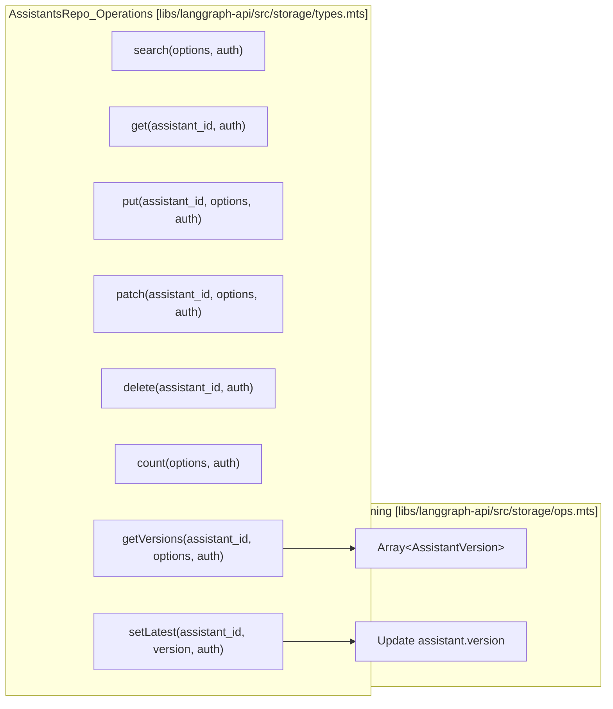
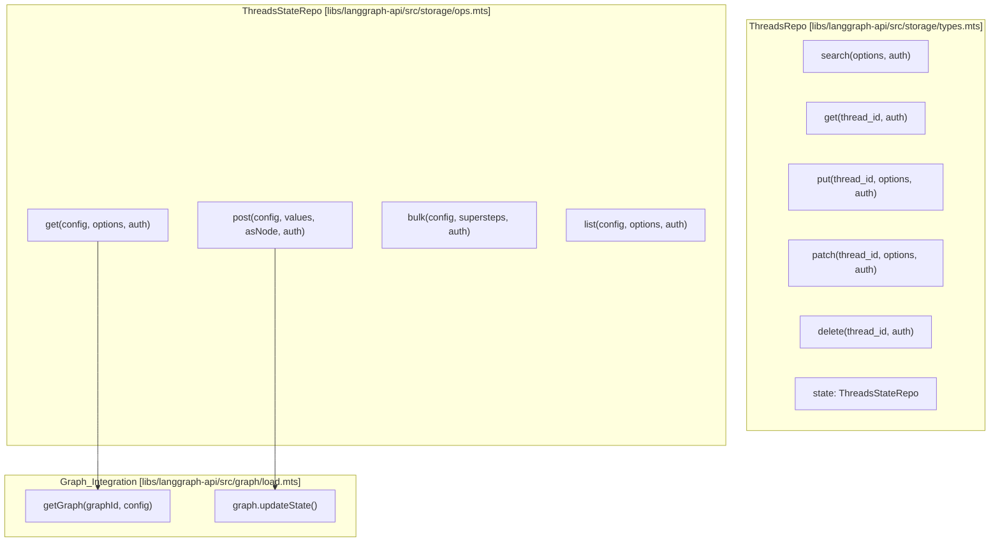
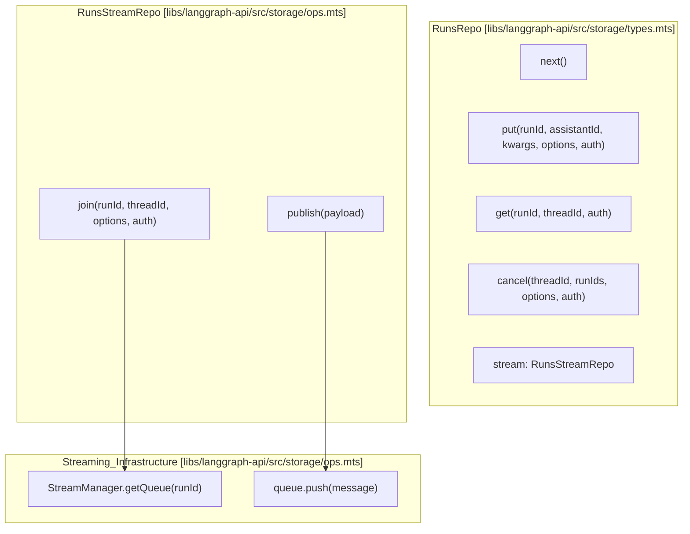
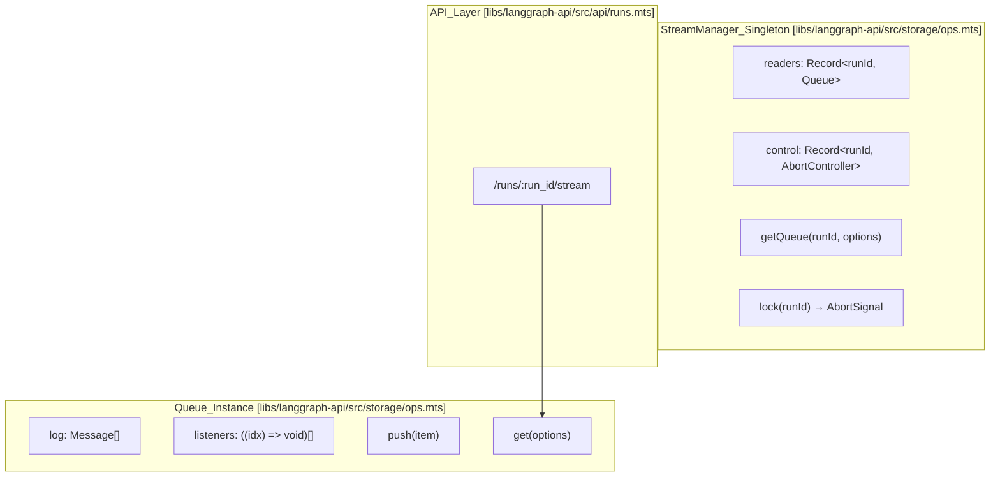
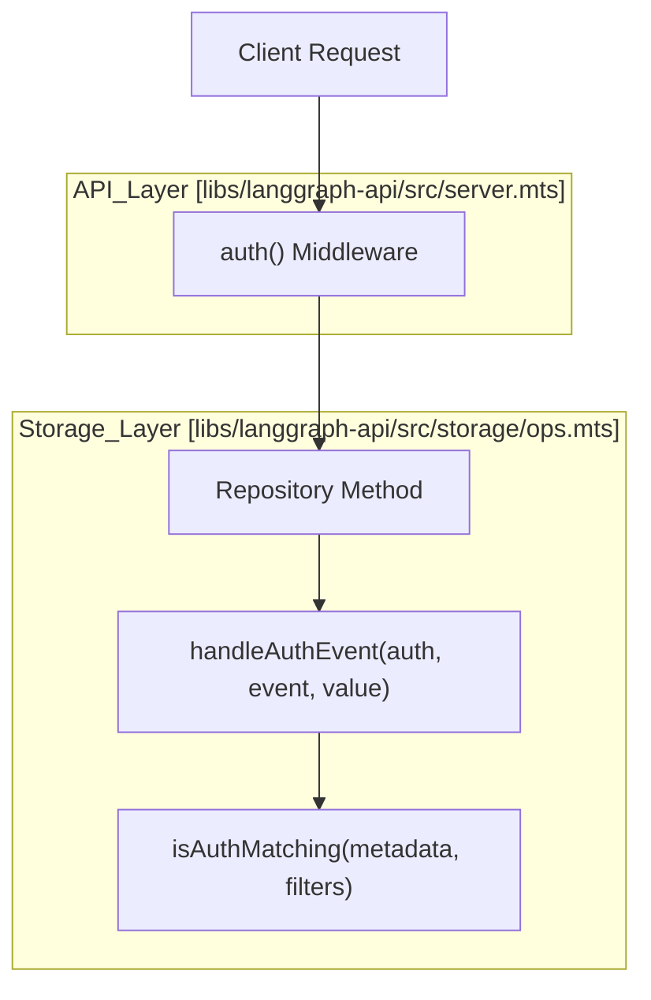

<!-- source: DeepWiki mcp.deepwiki.com · repo langchain-ai/langgraphjs · page 5.2 Storage and Operations Layer · fetched 2026-10-26 -->

# Storage and Operations Layer

<details>
<summary>Relevant source files</summary>

The following files were used as context for generating this wiki page:

- [libs/langgraph-api/src/api/assistants.mts](libs/langgraph-api/src/api/assistants.mts)
- [libs/langgraph-api/src/api/meta.mts](libs/langgraph-api/src/api/meta.mts)
- [libs/langgraph-api/src/api/runs.mts](libs/langgraph-api/src/api/runs.mts)
- [libs/langgraph-api/src/api/threads.mts](libs/langgraph-api/src/api/threads.mts)
- [libs/langgraph-api/src/cli/spawn-args.mts](libs/langgraph-api/src/cli/spawn-args.mts)
- [libs/langgraph-api/src/cli/spawn.mts](libs/langgraph-api/src/cli/spawn.mts)
- [libs/langgraph-api/src/graph/load.mts](libs/langgraph-api/src/graph/load.mts)
- [libs/langgraph-api/src/http/middleware.mts](libs/langgraph-api/src/http/middleware.mts)
- [libs/langgraph-api/src/queue.mts](libs/langgraph-api/src/queue.mts)
- [libs/langgraph-api/src/schemas.mts](libs/langgraph-api/src/schemas.mts)
- [libs/langgraph-api/src/semver/index.mts](libs/langgraph-api/src/semver/index.mts)
- [libs/langgraph-api/src/semver/satisfiesPeerRange.mts](libs/langgraph-api/src/semver/satisfiesPeerRange.mts)
- [libs/langgraph-api/src/server.mts](libs/langgraph-api/src/server.mts)
- [libs/langgraph-api/src/storage/ops.mts](libs/langgraph-api/src/storage/ops.mts)
- [libs/langgraph-api/src/storage/types.mts](libs/langgraph-api/src/storage/types.mts)
- [libs/langgraph-api/src/stream.mts](libs/langgraph-api/src/stream.mts)
- [libs/langgraph-api/tests/api.test.mts](libs/langgraph-api/tests/api.test.mts)
- [libs/langgraph-api/tests/graphs/langgraph.json](libs/langgraph-api/tests/graphs/langgraph.json)
- [libs/langgraph-api/tests/semver.test.mts](libs/langgraph-api/tests/semver.test.mts)
- [libs/langgraph-api/tests/spawn-args.test.mts](libs/langgraph-api/tests/spawn-args.test.mts)
- [libs/langgraph-cli/src/utils/config.mts](libs/langgraph-cli/src/utils/config.mts)
- [libs/langgraph-cli/tests/config.test.mts](libs/langgraph-cli/tests/config.test.mts)
- [libs/sdk/src/auth/types.ts](libs/sdk/src/auth/types.ts)

</details>


The Storage and Operations Layer provides a unified abstraction for managing persistent state in LangGraph applications. This layer implements the repository pattern through the `Ops` interface and its concrete implementation `FileSystemOps`, orchestrating storage for assistants, threads, runs, and their associated metadata. It serves as the bridge between the API endpoints and the underlying persistence mechanisms (filesystem or database backends).

## Ops Interface and Implementation

The `Ops` interface defines the contract for all storage operations in the system. The primary implementation is `FileSystemOps`, which coordinates access to three main repositories: `assistants`, `runs`, and `threads`.

### Ops Interface Structure



Sources: [libs/langgraph-api/src/storage/types.mts:485-497](), [libs/langgraph-api/src/storage/ops.mts:36-74](), [libs/langgraph-api/src/server.mts:100-120]()

The `FileSystemOps` class receives a `FileSystemPersistence<Store>` connection object and instantiates the three repository implementations:

| Repository | Purpose | Implementation Class |
|------------|---------|---------------------|
| `assistants` | Manages assistant configurations and versions | `FileSystemAssistants` |
| `threads` | Manages thread lifecycle and metadata | `FileSystemThreads` |
| `runs` | Manages run execution and streaming | `FileSystemRuns` |

Sources: [libs/langgraph-api/src/storage/ops.mts:36-48]()

## Repository Pattern

Each repository implements a specific interface defining CRUD operations and domain-specific queries. All operations accept an `AuthContext` parameter for access control.

### AssistantsRepo Interface

The `AssistantsRepo` manages assistant configurations, which define graph IDs, configs, and metadata for reusable agent definitions.



Key implementation details:
- **Version Management**: Each update to an assistant creates a new version entry in `STORE.assistant_versions`, incrementing the version number. [libs/langgraph-api/src/storage/ops.mts:460-482]()
- **Cascading Deletes**: Deleting an assistant removes associated versions and can optionally delete threads. [libs/langgraph-api/src/storage/ops.mts:506-518](), [libs/langgraph-api/src/api/assistants.mts:137-144]()
- **Authorization**: Every operation calls `handleAuthEvent()` to obtain filters, then validates with `isAuthMatching()`. [libs/langgraph-api/src/storage/ops.mts:242-247](), [libs/langgraph-api/src/storage/ops.mts:266-268]()

Sources: [libs/langgraph-api/src/storage/types.mts:410-483](), [libs/langgraph-api/src/storage/ops.mts:226-636]()

### ThreadsRepo Interface

The `ThreadsRepo` manages thread lifecycle and provides nested access to thread state through `ThreadsStateRepo`.



Key implementation details:
- **Thread Status Management**: The `setStatus()` method computes thread status based on checkpoint state (interrupts/errors) and pending runs. [libs/langgraph-api/src/storage/ops.mts:831-878]()
- **State Operations**: The nested `ThreadsStateRepo` interfaces directly with the graph execution engine via `getGraph()`. [libs/langgraph-api/src/storage/ops.mts:1002-1249]()
- **Concurrency Control**: `post()` prevents concurrent modifications by checking if a thread is already busy. [libs/langgraph-api/src/storage/ops.mts:1084-1094]()

Sources: [libs/langgraph-api/src/storage/types.mts:307-408](), [libs/langgraph-api/src/storage/ops.mts:638-1250]()

### RunsRepo Interface

The `RunsRepo` manages run lifecycle and provides nested access to streaming through `RunsStreamRepo`.



Key implementation details:
- **Run Queueing**: The `next()` method is an async generator yielding pending runs for the worker. [libs/langgraph-api/src/storage/ops.mts:1264-1287]()
- **Multitask Strategy**: The `put()` method enforces concurrency behaviors: `reject`, `rollback`, `interrupt`, or `enqueue`. [libs/langgraph-api/src/storage/ops.mts:1289-1420]()
- **Cancellation**: `cancel()` uses `StreamManager` to send abort signals to active run threads. [libs/langgraph-api/src/storage/ops.mts:1524-1575]()

Sources: [libs/langgraph-api/src/storage/types.mts:215-305](), [libs/langgraph-api/src/storage/ops.mts:1252-1800]()

## FileSystemPersistence and Store Schema

The `FileSystemPersistence` class provides thread-safe read/write access to the `Store` data structure.

### Store Schema

```typescript
interface Store {
  runs: Record<string, Run>;
  threads: Record<string, Thread>;
  assistants: Record<string, Assistant>;
  assistant_versions: AssistantVersion[];
  retry_counter: Record<string, number>;
}
```

Sources: [libs/langgraph-api/src/storage/types.mts:148-154]()

### Metadata-Based Filtering

The repository implementations use `isJsonbContained()` for PostgreSQL-compatible JSONB subset matching during searches. [libs/langgraph-api/src/storage/ops.mts:208-224]()

Sources: [libs/langgraph-api/src/storage/ops.mts:204-224]()

## Streaming Infrastructure

The streaming infrastructure enables real-time delivery of graph execution events via Server-Sent Events (SSE).

### StreamManager and Queue Architecture



Sources: [libs/langgraph-api/src/storage/ops.mts:79-202]()

### Queue Behavior

The `Queue` class supports two modes:
1. **Resumable Mode**: Retains full message log for reconnections via `Last-Event-ID`. [libs/langgraph-api/src/storage/ops.mts:101-115]()
2. **Non-Resumable Mode**: Messages are consumed and removed from the log to save memory. [libs/langgraph-api/src/storage/ops.mts:116-122]()

### Run Cancellation

`StreamManager.lock(runId)` creates an `AbortController`. [libs/langgraph-api/src/storage/ops.mts:189-195]() When `runs().cancel()` is invoked, it triggers the abort signal, which the execution engine monitors to stop the run. [libs/langgraph-api/src/storage/ops.mts:1553-1563]()

Sources: [libs/langgraph-api/src/storage/ops.mts:159-202](), [libs/langgraph-api/src/storage/ops.mts:1524-1575]()

## Authorization Integration

All repository methods integrate with the authentication layer through `handleAuthEvent()`.



Sources: [libs/langgraph-api/src/storage/ops.mts:4](), [libs/langgraph-api/src/storage/ops.mts:242-247](), [libs/langgraph-api/src/storage/ops.mts:266-268]()

Key authorization patterns:
- **Search**: Filters are applied to the result set before pagination. [libs/langgraph-api/src/storage/ops.mts:250-276]()
- **Get/Update**: Resource metadata is validated against auth filters; unauthorized access results in 404. [libs/langgraph-api/src/storage/ops.mts:306-312](), [libs/langgraph-api/src/storage/ops.mts:420-422]()

Sources: [libs/langgraph-api/src/storage/ops.mts:242-312](), [libs/langgraph-api/src/storage/ops.mts:328-422]()

---

