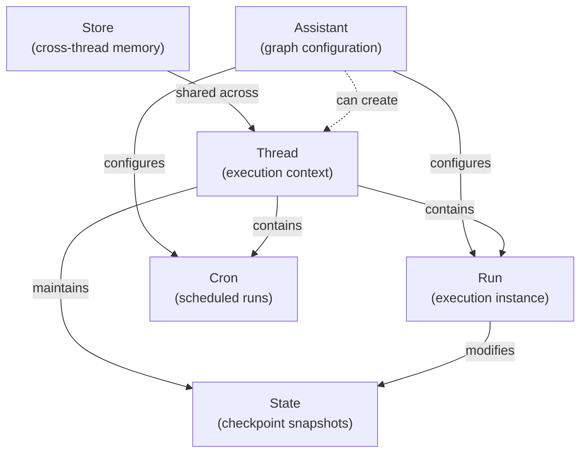
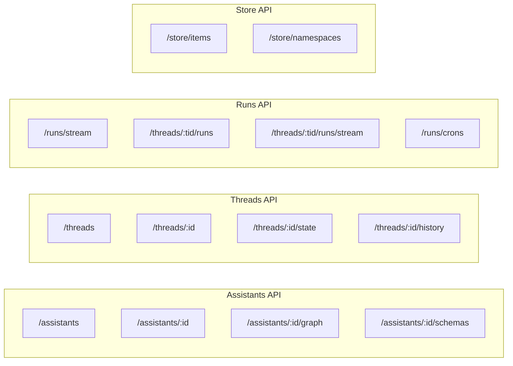
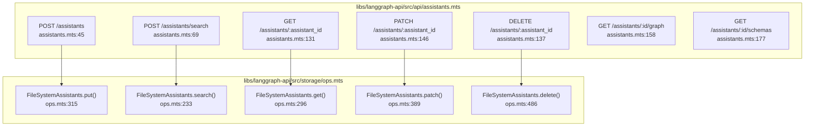
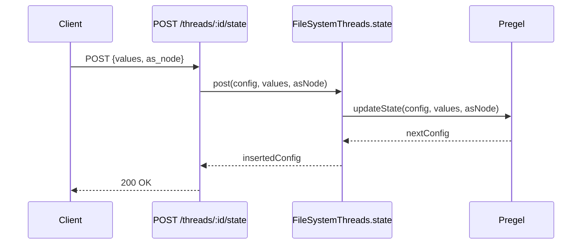
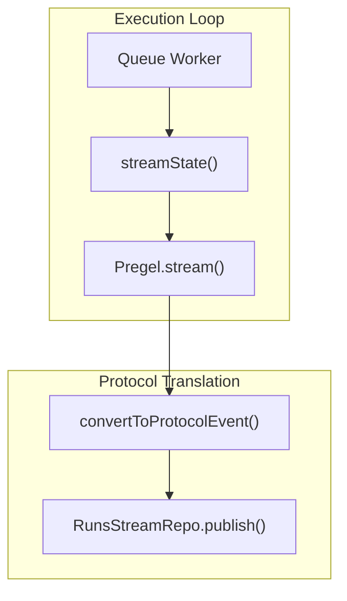

<!-- source: DeepWiki mcp.deepwiki.com · repo langchain-ai/langgraphjs · page 5.3 API Endpoints and Resources · fetched 2026-10-26 -->

# API Endpoints and Resources

<details>
<summary>Relevant source files</summary>

The following files were used as context for generating this wiki page:

- [docs/docs/how-tos/http/custom_middleware.md](docs/docs/how-tos/http/custom_middleware.md)
- [docs/docs/how-tos/http/custom_routes.md](docs/docs/how-tos/http/custom_routes.md)
- [libs/langgraph-api/src/api/assistants.mts](libs/langgraph-api/src/api/assistants.mts)
- [libs/langgraph-api/src/api/runs.mts](libs/langgraph-api/src/api/runs.mts)
- [libs/langgraph-api/src/api/threads.mts](libs/langgraph-api/src/api/threads.mts)
- [libs/langgraph-api/src/graph/load.mts](libs/langgraph-api/src/graph/load.mts)
- [libs/langgraph-api/src/queue.mts](libs/langgraph-api/src/queue.mts)
- [libs/langgraph-api/src/schemas.mts](libs/langgraph-api/src/schemas.mts)
- [libs/langgraph-api/src/storage/ops.mts](libs/langgraph-api/src/storage/ops.mts)
- [libs/langgraph-api/src/storage/types.mts](libs/langgraph-api/src/storage/types.mts)
- [libs/langgraph-api/src/stream.mts](libs/langgraph-api/src/stream.mts)
- [libs/langgraph-api/tests/api.test.mts](libs/langgraph-api/tests/api.test.mts)
- [libs/langgraph-api/tests/graphs/langgraph.json](libs/langgraph-api/tests/graphs/langgraph.json)
- [libs/sdk/src/auth/types.ts](libs/sdk/src/auth/types.ts)
- [libs/sdk/src/client/crons/index.test.ts](libs/sdk/src/client/crons/index.test.ts)
- [libs/sdk/src/client/crons/index.ts](libs/sdk/src/client/crons/index.ts)

</details>


This document describes the RESTful API endpoints exposed by the LangGraph Platform for managing and interacting with deployed graphs. The API provides CRUD operations for core resources: **Assistants**, **Threads**, **Runs**, and **Crons**, along with endpoints for state management and cross-thread memory storage.

For information about the underlying server architecture and how these endpoints are registered, see [API Server Architecture](). For details on the storage layer that implements these operations, see [Storage and Operations Layer](). For client-side interaction with these endpoints, see [Client SDK]().

## Resource Model

The LangGraph Platform API is organized around five primary resources that work together to enable stateful graph execution:

**Resource Relationships**



Sources: [libs/langgraph-api/src/storage/types.mts:85-222](), [libs/langgraph-api/src/schemas.mts:72-80]()

| Resource | Purpose | Primary Key | Lifecycle |
|----------|---------|-------------|-----------|
| **Assistant** | Represents a compiled graph with configuration and metadata | `assistant_id` (UUID) | Persistent, versioned |
| **Thread** | Execution context with state history | `thread_id` (UUID) | Persistent until deleted |
| **Run** | Single execution of a graph within a thread | `run_id` (UUID) | Transient or persistent |
| **Cron** | Scheduled execution of a graph on a thread | `cron_id` (UUID) | Persistent until end_time |
| **State** | Point-in-time checkpoint of thread execution | `checkpoint_id` (UUID) | Versioned within thread |
| **Store** | Cross-thread key-value memory | `namespace` + `key` | Persistent, shared |

Sources: [libs/langgraph-api/src/storage/types.mts:43-222](), [libs/langgraph-api/src/schemas.mts:72-80]()

## API Route Structure

All endpoints are implemented as Hono route handlers and follow RESTful conventions. The routing hierarchy mirrors the resource relationships:

**Endpoint Organization**



Sources: [libs/langgraph-api/src/api/assistants.mts:18-313](), [libs/langgraph-api/src/api/threads.mts:13-295](), [libs/langgraph-api/src/api/runs.mts:20-515]()

## Assistants Endpoints

Assistants represent deployable graph configurations. Each assistant references a `graph_id` and includes configuration parameters, metadata, and versioning.

### Route Mapping



Sources: [libs/langgraph-api/src/api/assistants.mts:45-313](), [libs/langgraph-api/src/storage/ops.mts:226-636]()

### Core Operations

| Method | Endpoint | Request Body Schema | Response | Description |
|--------|----------|---------------------|----------|-------------|
| POST | `/assistants` | `AssistantCreate` | `Assistant` | Create new assistant |
| POST | `/assistants/search` | `AssistantSearchRequest` | `Assistant[]` | Search assistants with filters |
| POST | `/assistants/count` | `AssistantCountRequest` | `number` | Count matching assistants |
| GET | `/assistants/:assistant_id` | - | `Assistant` | Get assistant by ID |
| PATCH | `/assistants/:assistant_id` | `AssistantPatch` | `Assistant` | Update assistant metadata/config |
| DELETE | `/assistants/:assistant_id` | - | `string[]` | Delete assistant (optional `delete_threads=true`) |

Sources: [libs/langgraph-api/src/api/assistants.mts:45-156](), [libs/langgraph-api/src/schemas.mts:28-64]()

### Schema and Structure Operations

| Method | Endpoint | Query Params | Response | Description |
|--------|----------|--------------|----------|-------------|
| GET | `/assistants/:assistant_id/graph` | `xray?: boolean` | `GraphJSON` | Get drawable graph structure |
| GET | `/assistants/:assistant_id/schemas` | - | `GraphSchema` | Get JSON schemas for input/output/state/config |
| GET | `/assistants/:assistant_id/subgraphs/:namespace?` | `recurse?: boolean` | `Record<string, GraphSchema>` | Get subgraph schemas |

The schemas endpoint returns type definitions extracted through static analysis via `getCachedStaticGraphSchema` or runtime introspection via `getRuntimeGraphSchema`:

```typescript
{
  graph_id: string,
  input_schema: JSONSchema,    // Graph input validation
  output_schema: JSONSchema,   // Graph output validation
  state_schema: JSONSchema,    // State structure
  config_schema: JSONSchema,   // Configurable parameters
  context_schema: JSONSchema   // Same as config_schema in JS
}
```

Sources: [libs/langgraph-api/src/api/assistants.mts:177-214](), [libs/langgraph-api/src/schemas.mts:135-141](), [libs/langgraph-api/src/graph/load.mts:116-148]()

## Threads Endpoints

Threads represent isolated execution contexts with persistent state. Each thread maintains a checkpoint history and can execute multiple runs.

### Route Mapping



```mermaid
graph TB
    subgraph "libs/langgraph-api/src/api/threads.mts"
        POST_CREATE["POST /threads<br/>threads.mts:16"]
        POST_SEARCH["POST /threads/search<br/>threads.mts:36"]
        GET_ONE["GET /threads/:thread_id<br/>threads.mts:249"]
        DELETE["DELETE /threads/:thread_id<br/>threads.mts:259"]
        
        GET_STATE["GET /threads/:id/state<br/>threads.mts:92"]
        POST_STATE["POST /threads/:id/state<br/>threads.mts:116"]
        GET_STATE_AT["GET /threads/:id/state/:checkpoint_id<br/>threads.mts:146"]
        
        GET_HISTORY["GET /threads/:id/history<br/>threads.mts:202"]
    end
    
    subgraph "libs/langgraph-api/src/storage/ops.mts"
        THREADS_PUT["FileSystemThreads.put()<br/>ops.mts:752"]
        THREADS_SEARCH["FileSystemThreads.search()<br/>ops.mts:647"]
        THREADS_GET["FileSystemThreads.get()<br/>ops.mts:729"]
        THREADS_DELETE["FileSystemThreads.delete()<br/>ops.mts:880"]
        
        STATE_GET["FileSystemThreads.state.get()<br/>ops.mts:1014"]
        STATE_POST["FileSystemThreads.state.post()<br/>ops.mts:1056"]
        STATE_LIST["FileSystemThreads.state.list()<br/>ops.mts:1207"]
    end
    
    POST_CREATE --> THREADS_PUT
    POST_SEARCH --> THREADS_SEARCH
    GET_ONE --> THREADS_GET
    DELETE --> THREADS_DELETE
    
    GET_STATE --> STATE_GET
    POST_STATE --> STATE_POST
    GET_HISTORY --> STATE_LIST
```

Sources: [libs/langgraph-api/src/api/threads.mts:16-295](), [libs/langgraph-api/src/storage/ops.mts:638-1250]()

### State Management

Threads expose endpoints for reading and modifying state at different checkpoints:

| Method | Endpoint | Purpose | Query/Body Params |
|--------|----------|---------|-------------------|
| GET | `/threads/:id/state` | Get latest state | `subgraphs?: boolean` |
| POST | `/threads/:id/state` | Update state (manual intervention) | `values, as_node?, checkpoint_id?` |
| GET | `/threads/:id/state/:checkpoint_id` | Get state at specific checkpoint | `subgraphs?: boolean` |
| GET | `/threads/:id/history` | List checkpoint history | `limit?, before?` |
| POST | `/threads/:id/history` | List history with metadata filter | `limit?, before?, metadata?, checkpoint?` |

Sources: [libs/langgraph-api/src/api/threads.mts:92-247]()

**State Update Flow**

Manual state updates use the `ThreadsStateRepo.post` method which invokes the underlying graph's `updateState` mechanism to persist a new checkpoint.



Sources: [libs/langgraph-api/src/storage/ops.mts:1056-1130](), [libs/langgraph-api/src/api/threads.mts:116-144]()

## Runs Endpoints

Runs represent individual executions of a graph. They can be stateless (ephemeral) or associated with a thread (stateful).

### Core Operations

| Method | Endpoint | Purpose | Response Type |
|--------|----------|---------|---------------|
| POST | `/runs/stream` | Create stateless run and stream events | SSE stream |
| POST | `/threads/:tid/runs` | Create thread-attached run | `Run` object |
| POST | `/threads/:tid/runs/stream` | Create and stream (stateful) | SSE stream |
| GET | `/threads/:tid/runs` | List thread runs | `Run[]` |
| GET | `/runs/:run_id/stream` | Re-join an existing run stream | SSE stream |
| POST | `/threads/:tid/runs/:rid/cancel` | Cancel a running task | 200 |

Sources: [libs/langgraph-api/src/api/runs.mts:200-513](), [libs/langgraph-api/src/schemas.mts:143-161]()

### Run Configuration

The `RunCreate` schema includes extensive configuration for execution:

```typescript
{
  assistant_id: string,          // Required: which graph/assistant to run
  input?: unknown,               // Graph input
  command?: RunCommand,          // Command object (goto/update/resume)
  stream_mode?: StreamMode[],    // values|updates|events|messages|debug|etc
  interrupt_before?: string[],   // Breakpoints before specific nodes
  interrupt_after?: string[],    // Breakpoints after specific nodes
  multitask_strategy?: "reject" | "rollback" | "interrupt" | "enqueue",
  on_disconnect?: "cancel" | "continue"
}
```

Sources: [libs/langgraph-api/src/schemas.mts:188-248](), [libs/langgraph-api/src/storage/types.mts:110-134]()

### Streaming Implementation

Streaming is handled by the `streamState` function which wraps the `Pregel` graph execution. It transforms internal graph events into the LangGraph Protocol format.



Sources: [libs/langgraph-api/src/stream.mts:152-240](), [libs/langgraph-api/src/queue.mts:71-95]()

## Crons Endpoints

Crons allow for scheduled execution of runs on specific threads.

| Method | Endpoint | Request Body Schema | Purpose |
|--------|----------|---------------------|---------|
| POST | `/runs/crons` | `CronCreate` | Create a global scheduled run |
| POST | `/threads/:tid/runs/crons` | `CronCreate` | Create a thread-specific schedule |
| POST | `/runs/crons/search` | `CronSearch` | Search for active crons |
| DELETE | `/runs/crons/:cron_id` | - | Cancel a scheduled run |

*Note: In the current implementation, these endpoints may return 501 Not Implemented depending on the deployment environment.*

Sources: [libs/langgraph-api/src/api/runs.mts:167-199](), [libs/langgraph-api/src/schemas.mts:88-114]()

## Store Endpoints

The Store API provides cross-thread key-value storage organized by namespaces.

| Method | Endpoint | Request Schema | Purpose |
|--------|----------|----------------|---------|
| POST | `/store/items` | `StorePutItem` | Put item in store |
| GET | `/store/items` | - | Get item from store |
| POST | `/store/items/search` | `StoreSearchItems` | Search items by namespace/filter |
| POST | `/store/namespaces/list` | `StoreListNamespaces` | List namespaces |

Sources: [libs/langgraph-api/src/schemas.mts:496-535]()

## Common Patterns

### Pagination

Search endpoints use `limit` and `offset` for pagination, returning metadata in response headers:

*   `X-Pagination-Next`: Offset for the next page.
*   `X-Pagination-Total`: Total count of matching records.

Sources: [libs/langgraph-api/src/api/assistants.mts:102-116](), [libs/langgraph-api/src/api/threads.mts:71-78]()

### Metadata Filtering

Filtering by metadata uses JSON containment logic via `isJsonbContained`. A search matches if the resource's metadata contains all key-value pairs specified in the search filter.

Sources: [libs/langgraph-api/src/storage/ops.mts:208-224](), [libs/langgraph-api/src/storage/ops.mts:243-250]()

### Error Handling

The API uses `HTTPException` from Hono to return structured errors. Common codes:
*   `404`: Resource not found (Assistant, Thread, or Run).
*   `422`: Validation error or rejected multitask execution.
*   `500`: Internal execution error.

Sources: [libs/langgraph-api/src/api/runs.mts:156-160](), [libs/langgraph-api/src/graph/load.mts:106-110]()

---

