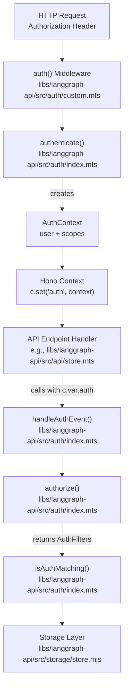
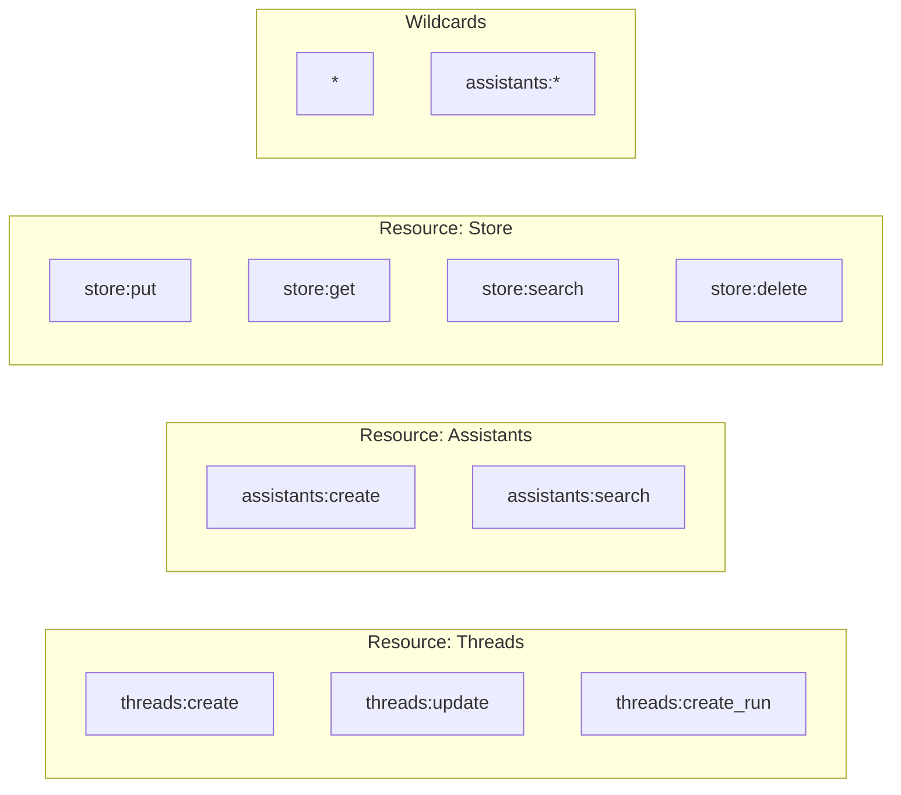
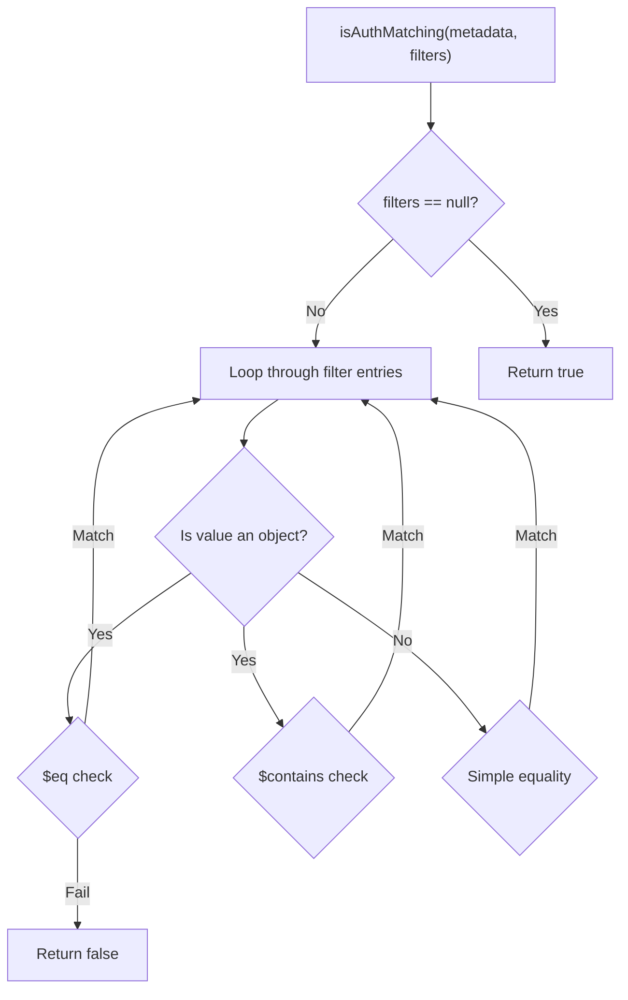

<!-- source: DeepWiki mcp.deepwiki.com · repo langchain-ai/langgraphjs · page 5.4 Authentication and Authorization · fetched 2026-10-26 -->

# Authentication and Authorization

<details>
<summary>Relevant source files</summary>

The following files were used as context for generating this wiki page:

- [docs/docs/concepts/auth.md](docs/docs/concepts/auth.md)
- [docs/docs/how-tos/auth/custom_auth.md](docs/docs/how-tos/auth/custom_auth.md)
- [libs/langgraph-api/src/api/store.mts](libs/langgraph-api/src/api/store.mts)
- [libs/langgraph-api/src/auth/custom.mts](libs/langgraph-api/src/auth/custom.mts)
- [libs/langgraph-api/src/auth/index.mts](libs/langgraph-api/src/auth/index.mts)
- [libs/langgraph-api/src/logging.mts](libs/langgraph-api/src/logging.mts)
- [libs/langgraph-api/tests/auth.test.mts](libs/langgraph-api/tests/auth.test.mts)
- [libs/langgraph-api/tests/graphs/agent_simple.mts](libs/langgraph-api/tests/graphs/agent_simple.mts)
- [libs/langgraph-api/tests/graphs/auth.mts](libs/langgraph-api/tests/graphs/auth.mts)
- [libs/langgraph-api/tests/utils.mts](libs/langgraph-api/tests/utils.mts)
- [libs/langgraph-api/tests/utils.server.mts](libs/langgraph-api/tests/utils.server.mts)
- [libs/sdk/src/auth/error.ts](libs/sdk/src/auth/error.ts)
- [libs/sdk/src/auth/index.ts](libs/sdk/src/auth/index.ts)
- [libs/sdk/src/logging/index.ts](libs/sdk/src/logging/index.ts)

</details>


## Purpose and Scope

This document covers the authentication and authorization system in the LangGraph API server. The system provides event-based authorization with metadata-based filtering for controlling access to assistants, threads, runs, crons, and store resources. 

For information about the API endpoints themselves, see [API Endpoints and Resources](#5.3). For details on the API server architecture, see [API Server Architecture](#5.1).

## Authentication and Authorization Architecture

The LangGraph API implements a flexible authentication and authorization system that decouples authentication logic from the core operations layer. Authentication occurs at the HTTP middleware layer, while authorization is enforced through an event-based callback system with metadata filtering.

**System Architecture**



Sources: [libs/langgraph-api/src/auth/custom.mts:24-49](), [libs/langgraph-api/src/auth/index.mts:104-151](), [libs/langgraph-api/src/auth/index.mts:175-192]()

## AuthContext Structure

The `AuthContext` object carries authentication and authorization information throughout the request lifecycle. It is created by the `authenticate` function and stored in the Hono context variables.

**AuthContext Interface**

| Property | Type | Description |
|----------|------|-------------|
| `user` | `object` | Identity and profile of the authenticated user [libs/langgraph-api/src/auth/index.mts:22-28]() |
| `scopes` | `string[]` | List of permissions/scopes assigned to the user [libs/langgraph-api/src/auth/index.mts:29]() |

**User Identity Object**

| Property | Type | Description |
|----------|------|-------------|
| `identity` | `string` | Unique user identifier [libs/langgraph-api/src/auth/index.mts:23]() |
| `permissions` | `string[]` | Permission strings for access control [libs/langgraph-api/src/auth/index.mts:24]() |
| `display_name` | `string` | Human-readable name [libs/langgraph-api/src/auth/index.mts:25]() |
| `is_authenticated` | `boolean` | Boolean flag for authentication status [libs/langgraph-api/src/auth/index.mts:26]() |

Sources: [libs/langgraph-api/src/auth/index.mts:21-30](), [libs/langgraph-api/src/auth/custom.mts:10-14]()

## Event-Based Authorization System

Authorization is enforced through the `Auth` class in the SDK, which allows developers to register callbacks for specific resource events.

**Authorization Event Categories**



Sources: [libs/langgraph-api/src/auth/index.mts:64-69](), [libs/langgraph-api/tests/graphs/auth.mts:79-120]()

### Registration and Dispatch
The `Auth` class uses a `~handlerCache` to store callbacks [libs/sdk/src/auth/index.ts:20-23](). When `handleAuthEvent` is called, it triggers the `authorize` function which looks up the handler using a priority chain:
1. Exact match (`resource:action`)
2. Resource wildcard (`resource`)
3. Action wildcard (`*:action`)
4. Global wildcard (`*`)

Sources: [libs/langgraph-api/src/auth/index.mts:64-70](), [libs/sdk/src/auth/index.ts:32-40]()

## handleAuthEvent and authorize Functions

The `handleAuthEvent` function is the primary entry point for authorization in API routes. It splits the event string and delegates to `authorize`.

**Flow of Authorization Logic**

[libs/langgraph-api/src/auth/index.mts:54-102]()

1. **Handler Lookup**: Finds the appropriate callback in `CUSTOM_AUTH`.
2. **Execution**: Invokes the handler with `event`, `resource`, `action`, `value`, `permissions`, and `user`.
3. **Result Processing**:
    - `null` / `undefined` / `true`: Authorization granted, no filters applied [libs/langgraph-api/src/auth/index.mts:86-88]().
    - `false`: Access denied (throws 403) [libs/langgraph-api/src/auth/index.mts:90]().
    - `object`: Access granted with metadata `AuthFilters` [libs/langgraph-api/src/auth/index.mts:98]().

Sources: [libs/langgraph-api/src/auth/index.mts:175-192](), [libs/langgraph-api/src/auth/index.mts:54-102]()

## Metadata-Based Resource Filtering

The system uses `AuthFilters` to restrict which resources a user can see or modify. These filters are matched against resource metadata using the `isAuthMatching` function.

**Supported Filter Operators**

| Operator | Behavior |
|----------|----------|
| `$eq` | Exact equality match [libs/langgraph-api/src/auth/index.mts:201-202]() |
| `$contains` | Checks if a list contains a value or subset of values [libs/langgraph-api/src/auth/index.mts:203-221]() |
| Simple Value | Shorthand for exact equality [libs/langgraph-api/src/auth/index.mts:223]() |

**isAuthMatching Logic**

[libs/langgraph-api/src/auth/index.mts:194-228]()



Sources: [libs/langgraph-api/src/auth/index.mts:194-228]()

## Custom Auth Handlers

Developers implement authentication by instantiating the `Auth` class and providing an `authenticate` callback.

**Implementation Example**

[libs/langgraph-api/tests/graphs/auth.mts:42-120]()

```typescript
export const auth = new Auth()
  .authenticate(async (request) => {
    // 1. Extract credentials (e.g., JWT from header)
    // 2. Validate (e.g., jose.jwtVerify)
    // 3. Return user object with identity and permissions
    return { identity: "user_123", permissions: ["threads:read"] };
  })
  .on("threads:create", ({ value, user }) => {
    // Inject owner into metadata for persistence
    value.metadata ??= {};
    value.metadata["owner"] = user.identity;
    // Return filter to ensure user only sees their own threads
    return { owner: user.identity };
  });
```

The server registers this handler via `registerAuth`, which dynamically imports the specified file and symbol [libs/langgraph-api/src/auth/index.mts:153-173]().

Sources: [libs/langgraph-api/tests/graphs/auth.mts:42-120](), [libs/langgraph-api/src/auth/index.mts:153-173]()

## Resource Access Control (Store Example)

The Store API demonstrates how `handleAuthEvent` is integrated into endpoint logic to protect namespaced data.

**Store Endpoint Authorization**

[libs/langgraph-api/src/api/store.mts:96-108]()

```typescript
api.put("/store/items", zValidator("json", schemas.StorePutItem), async (c) => {
  const payload = c.req.valid("json");
  
  // Authorization check
  await handleAuthEvent(c.var.auth, "store:put", {
    namespace: payload.namespace,
    key: payload.key,
    value: payload.value,
  });

  // Proceed to storage if handleAuthEvent didn't throw
  await storageStore.put(payload.namespace, payload.key, payload.value);
  return c.body(null, 204);
});
```

If the `on("store")` handler throws an `HTTPException` (e.g., if the user identity doesn't match the namespace), the request is terminated with the corresponding status code [libs/langgraph-api/tests/graphs/auth.mts:101-106]().

Sources: [libs/langgraph-api/src/api/store.mts:96-108](), [libs/langgraph-api/src/auth/index.mts:175-192]()

## Studio Integration

LangGraph Studio requires special handling for authentication. The `isStudioUser` helper determines if a request originates from the Studio environment.

**Studio User Constants**
- **Identity**: `"langgraph-studio-user"` [libs/langgraph-api/src/auth/custom.mts:19]()
- **Kind**: `"StudioUser"` [libs/langgraph-api/src/auth/custom.mts:17]()

The `auth()` middleware automatically sets a `STUDIO_USER` context if the `x-auth-scheme` is set to `langsmith` and Studio auth is not explicitly disabled [libs/langgraph-api/src/auth/custom.mts:34-43]().

Sources: [libs/langgraph-api/src/auth/custom.mts:16-22](), [libs/sdk/src/auth/index.ts:51-54](), [libs/langgraph-api/src/auth/custom.mts:34-43]()

---

