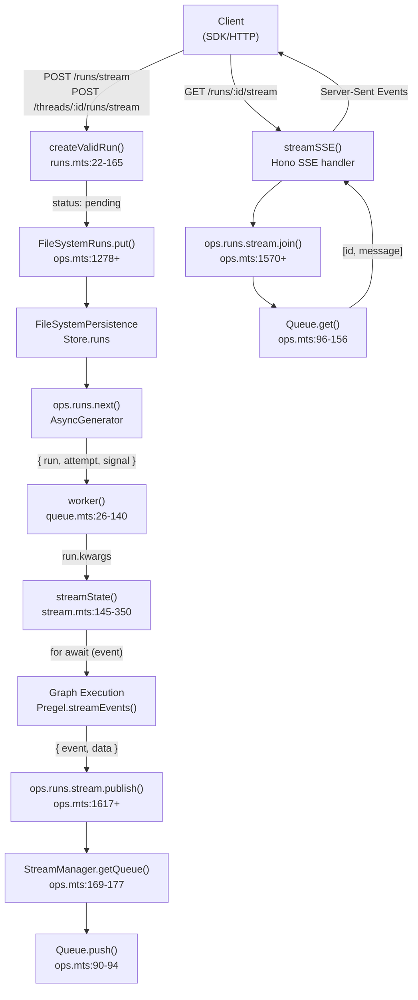
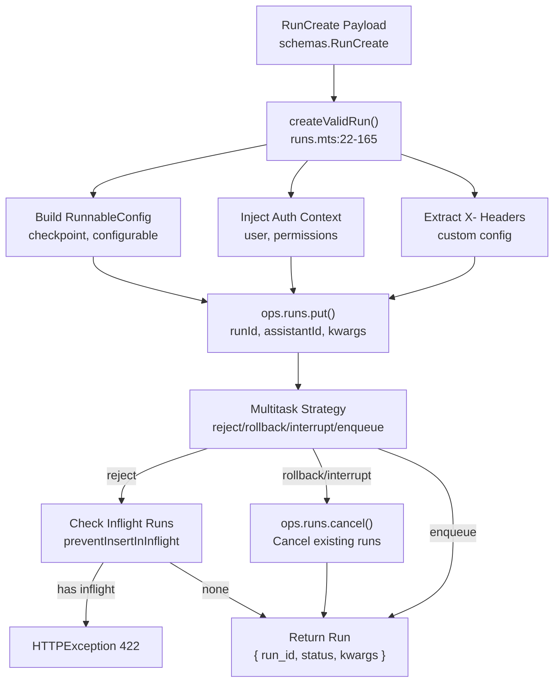

<!-- source: DeepWiki mcp.deepwiki.com · repo langchain-ai/langgraphjs · page 5.5 Run Execution and Streaming · fetched 2026-10-26 -->

# Run Execution and Streaming

<details>
<summary>Relevant source files</summary>

The following files were used as context for generating this wiki page:

- [examples/streaming/src/api/_shared.ts](examples/streaming/src/api/_shared.ts)
- [examples/streaming/src/api/basic.ts](examples/streaming/src/api/basic.ts)
- [examples/streaming/src/api/channels.ts](examples/streaming/src/api/channels.ts)
- [examples/streaming/src/api/commands.ts](examples/streaming/src/api/commands.ts)
- [examples/streaming/src/api/multimodal_stream_websocket.ts](examples/streaming/src/api/multimodal_stream_websocket.ts)
- [examples/streaming/src/api/reconnect.ts](examples/streaming/src/api/reconnect.ts)
- [examples/streaming/src/api/unsupported-channel.ts](examples/streaming/src/api/unsupported-channel.ts)
- [examples/streaming/src/api/websocket.ts](examples/streaming/src/api/websocket.ts)
- [libs/langgraph-api/src/api/assistants.mts](libs/langgraph-api/src/api/assistants.mts)
- [libs/langgraph-api/src/api/protocol.mts](libs/langgraph-api/src/api/protocol.mts)
- [libs/langgraph-api/src/api/runs.mts](libs/langgraph-api/src/api/runs.mts)
- [libs/langgraph-api/src/api/threads.mts](libs/langgraph-api/src/api/threads.mts)
- [libs/langgraph-api/src/experimental/embed/protocol.mts](libs/langgraph-api/src/experimental/embed/protocol.mts)
- [libs/langgraph-api/src/graph/load.mts](libs/langgraph-api/src/graph/load.mts)
- [libs/langgraph-api/src/protocol/service.mts](libs/langgraph-api/src/protocol/service.mts)
- [libs/langgraph-api/src/queue.mts](libs/langgraph-api/src/queue.mts)
- [libs/langgraph-api/src/schemas.mts](libs/langgraph-api/src/schemas.mts)
- [libs/langgraph-api/src/storage/ops.mts](libs/langgraph-api/src/storage/ops.mts)
- [libs/langgraph-api/src/storage/types.mts](libs/langgraph-api/src/storage/types.mts)
- [libs/langgraph-api/src/stream.mts](libs/langgraph-api/src/stream.mts)
- [libs/langgraph-api/tests/api.test.mts](libs/langgraph-api/tests/api.test.mts)
- [libs/langgraph-api/tests/graphs/langgraph.json](libs/langgraph-api/tests/graphs/langgraph.json)
- [libs/langgraph-api/tests/protocol-v2/multitask-strategy.test.mts](libs/langgraph-api/tests/protocol-v2/multitask-strategy.test.mts)
- [libs/langgraph-api/tests/protocol-v2/stream-sdk.test.mts](libs/langgraph-api/tests/protocol-v2/stream-sdk.test.mts)
- [libs/sdk/src/auth/types.ts](libs/sdk/src/auth/types.ts)
- [libs/sdk/src/stream/types.ts](libs/sdk/src/stream/types.ts)

</details>


This document explains how graph runs are created, executed, and streamed in the LangGraph API server. It covers the complete lifecycle from run creation through background execution to real-time event streaming over Server-Sent Events (SSE) and WebSocket protocols.

## Purpose and Scope

This page documents:
- Run lifecycle from creation to completion.
- Background worker queue architecture and `worker()` logic.
- `Protocol V2/V3` service and the new `streamStateV2` entrypoints.
- SSE streaming implementation and the `StreamManager`.
- Multitask strategies (reject, rollback, interrupt, enqueue).
- Event types and normalization for protocol-framed events.

## Run Lifecycle Overview

The following diagram shows the complete flow from run creation to event delivery:



**Sources:** [libs/langgraph-api/src/api/runs.mts:200-233](), [libs/langgraph-api/src/queue.mts:15-24](), [libs/langgraph-api/src/storage/ops.mts:79-202]()

## Run Creation and Validation

When a client requests run execution, the `createValidRun()` function validates parameters and creates a run record:



**Sources:** [libs/langgraph-api/src/api/runs.mts:22-165](), [libs/langgraph-api/src/storage/ops.mts:1278-1568]()

### Key Configuration Elements

The `RunnableConfig` object assembled during run creation includes:

| Config Field | Source | Purpose |
|--------------|--------|---------|
| `checkpoint_id` | `payload.checkpoint_id` | Resume from specific checkpoint ID [libs/langgraph-api/src/api/runs.mts:46-49]() |
| `langsmith_project` | `payload.langsmith_tracer.project_name` | LangSmith tracing project [libs/langgraph-api/src/api/runs.mts:56-62]() |
| `langgraph_auth_user` | `auth.user` | User object from auth context [libs/langgraph-api/src/api/runs.mts:82-88]() |
| Custom headers | `x-*` headers | Application-specific config injected via headers [libs/langgraph-api/src/api/runs.mts:64-79]() |

**Sources:** [libs/langgraph-api/src/api/runs.mts:44-89]()

## Background Queue Workers

The `queue()` function spawns worker loops that continuously poll for pending runs using `ops.runs.next()` [libs/langgraph-api/src/queue.mts:15-24]().

### Worker Execution Flow

The `worker()` function handles a single run:

1.  **Initialization**: Logs start time and queue latency [libs/langgraph-api/src/queue.mts:31-47]().
2.  **Stream Setup**: Calls `streamState()` to create the graph execution generator [libs/langgraph-api/src/queue.mts:71-76]().
3.  **Event Publishing**: Each event from the stream is published to the `StreamManager` via `ops.runs.stream.publish()` [libs/langgraph-api/src/queue.mts:78-86]().
4.  **Error Handling**: Catches exceptions, publishes an `error` event, and updates run status [libs/langgraph-api/src/queue.mts:87-95]().
5.  **Cleanup**: Deletes temporary threads or updates the thread status with the final checkpoint [libs/langgraph-api/src/queue.mts:128-132]().

**Sources:** [libs/langgraph-api/src/queue.mts:26-140]()

## Protocol V2 and V3 Service

LangGraph.js supports multiple protocol versions for streaming. Protocol V2 and V3 introduce standardized event framing and normalization.

### streamStateV2

If a run is marked with `PROTOCOL_STREAM_RUN_KEY`, execution routes to `streamStateV2` [libs/langgraph-api/src/stream.mts:181-185](). This mode handles:
-   **Normalization**: Events are converted to the protocol shape using `convertToProtocolEvent` [libs/langgraph-api/src/stream.mts:11-14]().
-   **Standardized Modes**: Supports `values`, `updates`, `messages`, `events`, `debug`, etc. [libs/langgraph-api/src/storage/types.mts:53-63]().

### WebSocket Support

The platform supports WebSocket-based streaming (Protocol V3) allowing full-duplex communication, which is particularly useful for interactive features like human-in-the-loop interrupts and tool call approvals.

**Sources:** [libs/langgraph-api/src/stream.mts:177-185](), [libs/langgraph-api/src/protocol/service.mts]()

## StreamManager and Queue

The `StreamManager` is a singleton that coordinates in-memory queues for every active run.

```typescript
class StreamManagerImpl {
  readers: Record<string, Queue> = {}; // runId -> Queue
  control: Record<string, CancellationAbortController> = {}; // runId -> AbortController
  // ...
}
```

### Queue Resumability
The `Queue` class stores a `log` of messages. If `resumable` is enabled, it uses the `lastEventId` to replay events to a client that disconnected and reconnected [libs/langgraph-api/src/storage/ops.mts:101-115]().

**Sources:** [libs/langgraph-api/src/storage/ops.mts:79-202]()

## Multitask Strategies

When multiple runs are triggered on the same thread, the `multitask_strategy` determines the behavior:

| Strategy | Action |
| :--- | :--- |
| `reject` | Fails the request if a run is already active on the thread [libs/langgraph-api/src/api/runs.mts:155-160](). |
| `rollback` | Cancels in-flight runs and rolls back the thread state [libs/langgraph-api/src/api/runs.mts:131-141](). |
| `interrupt` | Interrupts in-flight runs but preserves state [libs/langgraph-api/src/api/runs.mts:131-141](). |
| `enqueue` | Adds the run to the queue to be processed after current runs finish [libs/langgraph-api/src/api/runs.mts:41-42](). |

**Sources:** [libs/langgraph-api/src/storage/types.mts:65](), [libs/langgraph-api/src/api/runs.mts:41-42, 131-160]()

## Event Types and Normalization

The streaming layer emits several event types:

-   **metadata**: Emitted at the start of a run containing `run_id` and `attempt` [libs/langgraph-api/src/stream.mts:205-208]().
-   **values**: The complete state of the graph after a step [libs/langgraph-api/src/storage/types.mts:54]().
-   **messages**: Stream of message chunks or completed messages [libs/langgraph-api/src/stream.mts:311-338]().
-   **updates**: Partial state updates from nodes [libs/langgraph-api/src/storage/types.mts:58]().
-   **debug**: Detailed internal execution events including checkpoints and task results [libs/langgraph-api/src/stream.mts:259-283]().
-   **error**: Emitted when execution fails [libs/langgraph-api/src/queue.mts:88-93]().

### Normalization
Events published via the queue can be marked as `normalized: true`. This indicates they have already been formatted according to the Protocol V2/V3 spec, allowing the transport layer (SSE or WebSocket) to skip redundant processing [libs/langgraph-api/src/storage/types.mts:156-167]().

**Sources:** [libs/langgraph-api/src/stream.mts:205-338](), [libs/langgraph-api/src/storage/types.mts:53-63, 156-167]()

---

