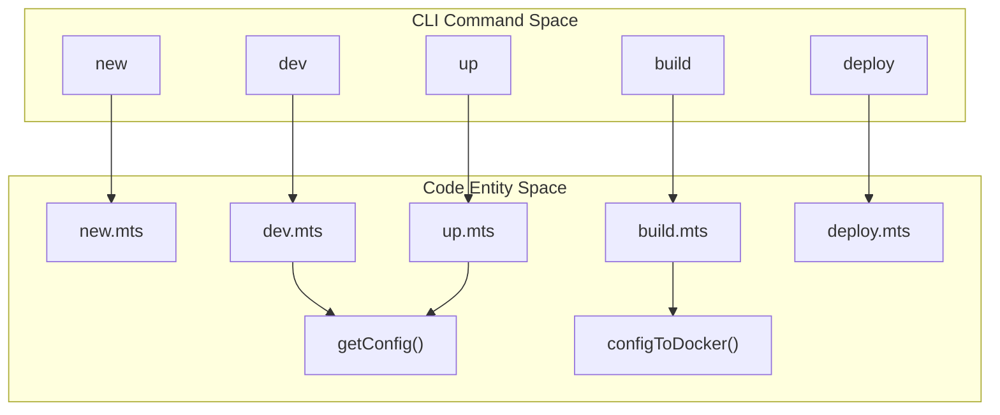
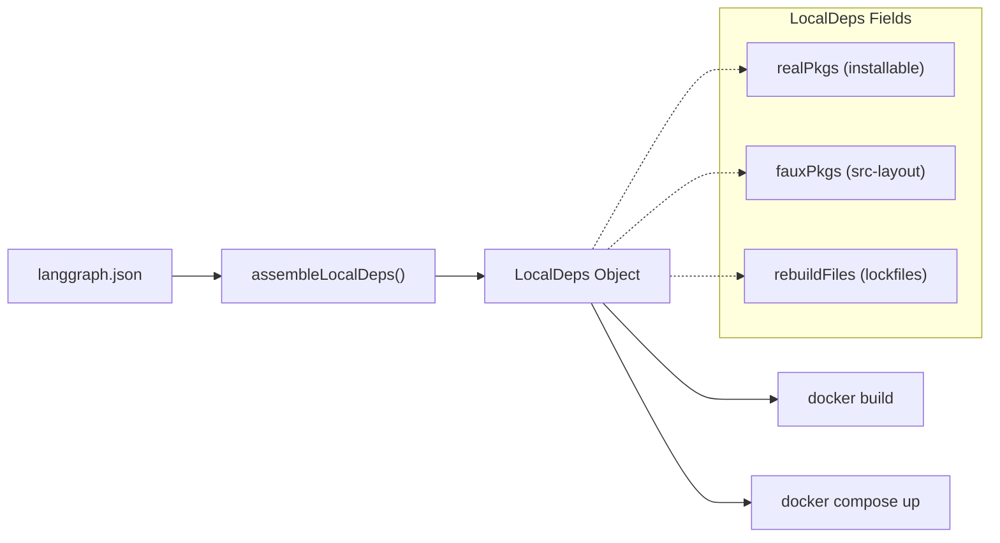

<!-- source: DeepWiki mcp.deepwiki.com · repo langchain-ai/langgraphjs · page 5.6 CLI and Development Tools · fetched 2026-10-26 -->

# CLI and Development Tools

Relevant source files

The following files were used as context for generating this wiki page:

- [docs/docs/agents/deployment.md](docs/docs/agents/deployment.md)
- [docs/docs/agents/ui.md](docs/docs/agents/ui.md)
- [libs/create-langgraph/README.md](libs/create-langgraph/README.md)
- [libs/create-langgraph/package.json](libs/create-langgraph/package.json)
- [libs/create-langgraph/src/cli.ts](libs/create-langgraph/src/cli.ts)
- [libs/create-langgraph/src/config.ts](libs/create-langgraph/src/config.ts)
- [libs/create-langgraph/src/index.ts](libs/create-langgraph/src/index.ts)
- [libs/create-langgraph/src/tests/config.test.ts](libs/create-langgraph/src/tests/config.test.ts)
- [libs/create-langgraph/src/utils/analytics.ts](libs/create-langgraph/src/utils/analytics.ts)
- [libs/create-langgraph/src/utils/version.ts](libs/create-langgraph/src/utils/version.ts)
- [libs/create-langgraph/tsconfig.json](libs/create-langgraph/tsconfig.json)
- [libs/langgraph-cli/src/cli/build.mts](libs/langgraph-cli/src/cli/build.mts)
- [libs/langgraph-cli/src/cli/cli.mts](libs/langgraph-cli/src/cli/cli.mts)
- [libs/langgraph-cli/src/cli/deploy.mts](libs/langgraph-cli/src/cli/deploy.mts)
- [libs/langgraph-cli/src/cli/dev.mts](libs/langgraph-cli/src/cli/dev.mts)
- [libs/langgraph-cli/src/cli/dev.python.mts](libs/langgraph-cli/src/cli/dev.python.mts)
- [libs/langgraph-cli/src/cli/docker.mts](libs/langgraph-cli/src/cli/docker.mts)
- [libs/langgraph-cli/src/cli/up.mts](libs/langgraph-cli/src/cli/up.mts)
- [libs/langgraph-cli/src/cli/utils/archive.mts](libs/langgraph-cli/src/cli/utils/archive.mts)
- [libs/langgraph-cli/src/cli/utils/deploy-helpers.mts](libs/langgraph-cli/src/cli/utils/deploy-helpers.mts)
- [libs/langgraph-cli/src/cli/utils/deploy-ignore.mts](libs/langgraph-cli/src/cli/utils/deploy-ignore.mts)
- [libs/langgraph-cli/src/cli/utils/deploy-output.mts](libs/langgraph-cli/src/cli/utils/deploy-output.mts)
- [libs/langgraph-cli/src/cli/utils/host-backend.mts](libs/langgraph-cli/src/cli/utils/host-backend.mts)
- [libs/langgraph-cli/src/docker/docker.mts](libs/langgraph-cli/src/docker/docker.mts)
- [libs/langgraph-cli/src/utils/logging.mts](libs/langgraph-cli/src/utils/logging.mts)
- [libs/langgraph-cli/tests/archive.test.mts](libs/langgraph-cli/tests/archive.test.mts)
- [libs/langgraph-cli/tsconfig.json](libs/langgraph-cli/tsconfig.json)

The `langgraphjs` ecosystem provides a suite of command-line tools designed to streamline the lifecycle of stateful multi-actor applications, from initial scaffolding to local development and production deployment. The primary tools include the `langgraph-cli` for server management and `create-langgraph` for project initialization.

## Project Scaffolding with `create-langgraph`

The `create-langgraph` package serves as the entry point for new projects. It provides an interactive CLI to bootstrap a LangGraph.js application with the necessary directory structure and configuration files.

| Feature | Description |
|---------|-------------|
| **Interactive Prompts** | Uses `@clack/prompts` to guide users through project naming and configuration [libs/create-langgraph/package.json:28-28](). |
| **Command-Line Interface** | Built using `commander` for robust argument parsing [libs/create-langgraph/package.json:29-30](). |
| **Template Extraction** | Capable of extracting project templates from zip archives [libs/create-langgraph/package.json:32-32](). |

**Sources:** [libs/create-langgraph/package.json:1-48]()

## LangGraph CLI Overview

The `langgraph-cli` is the central tool for managing LangGraph API servers. It supports local development with hot-reloading, Docker image generation, and deployment to LangSmith.

**Sources:** [libs/langgraph-cli/src/cli/cli.mts:1-18](), [libs/langgraph-cli/src/cli/dev.mts:19-50]()

## Local Development Workflow

The `dev` command launches a local development server for testing graphs. It includes features for environment variable management and automatic browser integration with LangGraph Studio.

### Server Execution and Hot Reloading
The `dev` command uses `chokidar` to watch for changes in the configuration file (`langgraph.json`) and associated environment files [libs/langgraph-cli/src/cli/dev.mts:5-6](), [libs/langgraph-cli/src/cli/dev.mts:55-60](). When changes are detected, the server is automatically restarted [libs/langgraph-cli/src/cli/dev.mts:189-192]().

### Browser Integration
If enabled, the CLI automatically opens the LangGraph Studio UI. It can also utilize Cloudflare Tunnels to expose the local server to the internet for remote testing [libs/langgraph-cli/src/cli/dev.mts:10-10](), [libs/langgraph-cli/src/cli/dev.mts:71-82]().

### Python Compatibility
The CLI includes experimental support for launching Python-based LangGraph servers by downloading and managing a `uv` binary [libs/langgraph-cli/src/cli/dev.python.mts:17-25](), [libs/langgraph-cli/src/cli/dev.python.mts:140-190]().

**Sources:** [libs/langgraph-cli/src/cli/dev.mts:19-196](), [libs/langgraph-cli/src/cli/dev.python.mts:123-190]()

## Docker Integration and Deployment

The CLI provides extensive tools for containerizing LangGraph applications.

### Image Building
The `build` command generates a Docker image for the API server. It translates the `langgraph.json` configuration into a Dockerfile and executes the build via the Docker CLI [libs/langgraph-cli/src/cli/build.mts:22-70]().

### Local Composition (`up`)
The `up` command orchestrates a local environment using `docker-compose`. It manages:
*   **Postgres Lifecycle**: Optionally launches a local Postgres instance if a URI is not provided [libs/langgraph-cli/src/cli/up.mts:65-67]().
*   **Volume Management**: Handles persistent storage for graph state [libs/langgraph-cli/src/cli/up.mts:139-146]().
*   **Healthchecks**: Waits for the server to be ready before reporting status [libs/langgraph-cli/src/cli/up.mts:29-42]().

### Dependency Assembly
The `assembleLocalDeps` function analyzes the project to identify local directory dependencies that must be included in the Docker context [libs/langgraph-cli/src/docker/docker.mts:26-29]().

**Sources:** [libs/langgraph-cli/src/cli/build.mts:42-70](), [libs/langgraph-cli/src/cli/up.mts:82-187](), [libs/langgraph-cli/src/docker/docker.mts:26-175]()

## Production Deployment to LangSmith

The `deploy` command manages the lifecycle of deployments on LangSmith. It supports both local Docker builds (build → push → update) and remote source builds (archive → upload → trigger) [libs/langgraph-cli/src/cli/deploy.mts:4-7]().

### Deployment Process
1.  **Validation**: Checks `langgraph.json` and build commands for disallowed characters [libs/langgraph-cli/src/cli/deploy.mts:172-186]().
2.  **Secret Management**: Filters environment variables to prevent leaking reserved keys like `LANGCHAIN_API_KEY` to the deployment [libs/langgraph-cli/src/cli/utils/deploy-helpers.mts:15-57](), [libs/langgraph-cli/src/cli/utils/deploy-helpers.mts:181-195]().
3.  **Archiving**: Creates a tarball of the project source, respecting `.gitignore` and `.dockerignore` patterns [libs/langgraph-cli/src/cli/deploy.mts:34-34]().
4.  **Backend Interaction**: Uses `HostBackendClient` to communicate with the LangSmith Deployment API [libs/langgraph-cli/src/cli/utils/host-backend.mts:64-89]().

### Command Sub-tree
The `deploy` command includes several subcommands for resource management:
*   `list`: View existing deployments.
*   `revisions list`: View build history for a deployment.
*   `logs`: Stream logs from a running deployment.
*   `delete`: Remove a deployment.

**Sources:** [libs/langgraph-cli/src/cli/deploy.mts:1-166](), [libs/langgraph-cli/src/cli/utils/deploy-helpers.mts:15-210](), [libs/langgraph-cli/src/cli/utils/host-backend.mts:193-205]()

---

