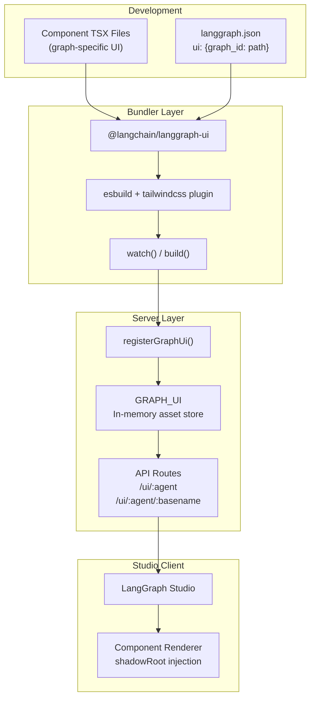
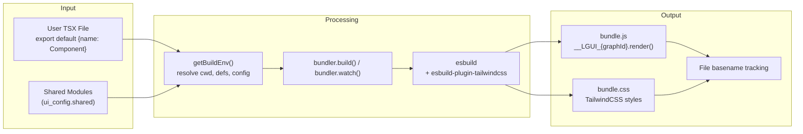
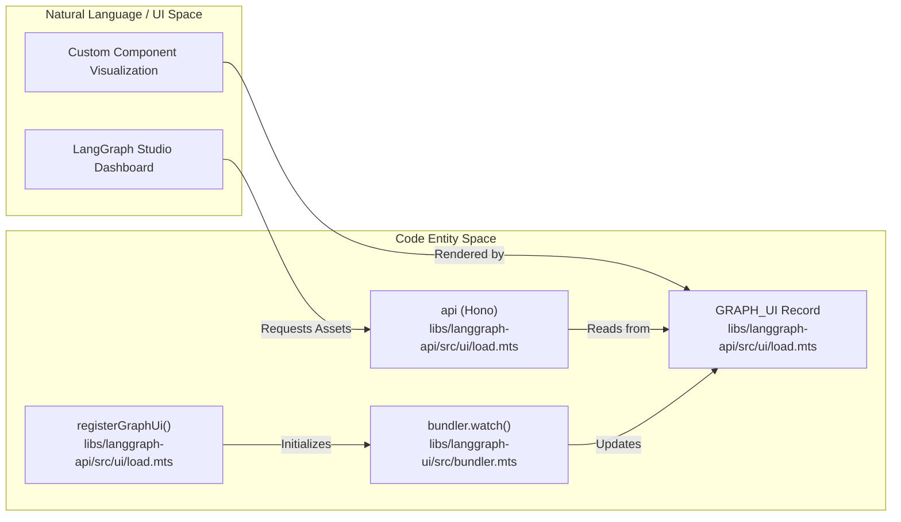

<!-- source: DeepWiki mcp.deepwiki.com · repo langchain-ai/langgraphjs · page 5.7 UI Components and Studio · fetched 2026-10-26 -->

# UI Components and Studio

<details>
<summary>Relevant source files</summary>

The following files were used as context for generating this wiki page:

- [libs/langgraph-api/scripts/build.mjs](libs/langgraph-api/scripts/build.mjs)
- [libs/langgraph-api/src/api/assistants.mts](libs/langgraph-api/src/api/assistants.mts)
- [libs/langgraph-api/src/api/runs.mts](libs/langgraph-api/src/api/runs.mts)
- [libs/langgraph-api/src/api/threads.mts](libs/langgraph-api/src/api/threads.mts)
- [libs/langgraph-api/src/graph/load.mts](libs/langgraph-api/src/graph/load.mts)
- [libs/langgraph-api/src/queue.mts](libs/langgraph-api/src/queue.mts)
- [libs/langgraph-api/src/schemas.mts](libs/langgraph-api/src/schemas.mts)
- [libs/langgraph-api/src/storage/ops.mts](libs/langgraph-api/src/storage/ops.mts)
- [libs/langgraph-api/src/storage/types.mts](libs/langgraph-api/src/storage/types.mts)
- [libs/langgraph-api/src/stream.mts](libs/langgraph-api/src/stream.mts)
- [libs/langgraph-api/src/ui/load.mts](libs/langgraph-api/src/ui/load.mts)
- [libs/langgraph-api/tests/api.test.mts](libs/langgraph-api/tests/api.test.mts)
- [libs/langgraph-api/tests/graphs/langgraph.json](libs/langgraph-api/tests/graphs/langgraph.json)
- [libs/langgraph-cli/scripts/build.mjs](libs/langgraph-cli/scripts/build.mjs)
- [libs/langgraph-ui/scripts/build.mjs](libs/langgraph-ui/scripts/build.mjs)
- [libs/langgraph-ui/src/api.mts](libs/langgraph-ui/src/api.mts)
- [libs/langgraph-ui/src/bundler.mts](libs/langgraph-ui/src/bundler.mts)
- [libs/langgraph-ui/src/cli.mts](libs/langgraph-ui/src/cli.mts)
- [libs/langgraph-ui/src/index.mts](libs/langgraph-ui/src/index.mts)
- [libs/langgraph-ui/src/render.template.mts](libs/langgraph-ui/src/render.template.mts)
- [libs/sdk/src/auth/types.ts](libs/sdk/src/auth/types.ts)

</details>


This document describes the UI component system and Studio integration within the LangGraph Platform. It covers how custom React components are bundled, served, and rendered for graph visualization in LangGraph Studio using the `@langchain/langgraph-ui` package and `registerGraphUi` utility.

## Overview

The LangGraph Platform supports custom generative UI components that enable developers to define graph-specific visualizations. These components are authored as TypeScript/React (TSX) files, bundled at development or build time, and served as static assets through the API server for rendering within LangGraph Studio.

**Sources:** [libs/langgraph-api/src/ui/load.mts:1-78](), [libs/langgraph-ui/src/api.mts:1-127]()

## Architecture Overview

The UI component system consists of three primary layers: bundling, serving, and rendering.



**Component Flow:**
1. Developer defines UI components in TSX and declares them in `langgraph.json`.
2. `@langchain/langgraph-ui` bundles components into JS/CSS assets using `esbuild`.
3. `registerGraphUi()` in `libs/langgraph-api/src/ui/load.mts` loads assets into the `GRAPH_UI` in-memory store.
4. API routes serve assets on-demand to LangGraph Studio.
5. Studio renders components within isolated shadow DOM contexts.

**Sources:** [libs/langgraph-api/src/ui/load.mts:1-78](), [libs/langgraph-ui/src/api.mts:1-127](), [libs/langgraph-ui/src/bundler.mts:1-50]()

## Configuration Schema

UI components are declared in the project configuration under the `ui` and `ui_config` fields.

### Basic Structure

```json
{
  "graphs": {
    "agent": "./src/agent.ts:graph"
  },
  "ui": {
    "agent": "./src/agent/ui.tsx"
  },
  "ui_config": {
    "shared": ["./src/shared/utils.ts"]
  }
}
```

| Field | Type | Description |
|-------|------|-------------|
| `ui` | `Record<string, string>` | Maps graph IDs to component file paths |
| `ui_config.shared` | `string[]` (optional) | Shared modules imported across all UI bundles |

**Sources:** [libs/langgraph-ui/src/api.mts:6-7](), [libs/langgraph-api/src/ui/load.mts:11-21]()

### Configuration Validation

The configuration schema is validated using Zod:

[libs/langgraph-ui/src/api.mts:6-7]()
```typescript
const ConfigSchema = z.object({ shared: z.array(z.string()).optional() });
const DefsSchema = z.record(z.string(), z.string());
```

**Sources:** [libs/langgraph-ui/src/api.mts:1-29]()

## Component Bundling System

The `@langchain/langgraph-ui` package handles the transformation of source TSX files into deployable assets.

### Bundler Architecture



**Key Functions:**

| Function | Purpose | File |
|----------|---------|------|
| `build(options)` | One-time bundling to disk | [libs/langgraph-ui/src/api.mts:35-64]() |
| `watch(options)` | Continuous bundling with callbacks for hot-reloading | [libs/langgraph-ui/src/api.mts:77-126]() |
| `getBuildEnv(options)` | Configuration resolution for build environment | [libs/langgraph-ui/src/api.mts:17-29]() |

**Sources:** [libs/langgraph-ui/src/api.mts:1-127](), [libs/langgraph-ui/src/bundler.mts:1-50]()

### Build Modes

The bundler supports two operational modes:

**1. Build Mode (`build()`)**
Produces static assets and a `schemas.json` manifest written to the filesystem.

[libs/langgraph-ui/src/api.mts:35-64]()
```typescript
export async function build(options: BuildOptionsType) {
  const { cwd, defs, config } = getBuildEnv(options);
  // ... mkdir public/graphId
  const files = await bundler.build(graphId, { userPath, cwd, config });
  // ... fs.writeFile target
}
```

**2. Watch Mode (`watch()`)**
Enables hot-reloading by passing updated `Uint8Array` file contents to a callback.

[libs/langgraph-ui/src/api.mts:80-89]()
```typescript
if ("onOutput" in options) {
  await Promise.all(
    Object.entries(defs).map(async ([graphId, userPath]) => {
      await bundler.watch(graphId, { cwd, config, userPath }, (files) =>
        options.onOutput(graphId, files)
      );
    })
  );
}
```

**Sources:** [libs/langgraph-ui/src/api.mts:35-126]()

## Asset Serving Infrastructure

The API server provides HTTP endpoints for retrieving bundled UI assets via the `api` Hono instance in `libs/langgraph-api/src/ui/load.mts`.

### In-Memory Asset Store

[libs/langgraph-api/src/ui/load.mts:8-21]()
```typescript
const GRAPH_UI: Record<string, { basename: string; contents: Uint8Array }[]> = {};

export async function registerGraphUi(
  defs: Record<string, string>,
  options: { cwd: string; config?: { shared?: string[] } }
) {
  await watch({
    defs,
    cwd: options.cwd,
    config: options.config,
    onOutput: (graphId, files) => (GRAPH_UI[graphId] = files),
  });
}
```

The `GRAPH_UI` object stores bundled assets keyed by graph ID.

**Sources:** [libs/langgraph-api/src/ui/load.mts:8-21]()

### API Routes

**1. HTML Generation (`POST /ui/:agent`)**
Generates the entry point HTML that links CSS and JS bundles.

[libs/langgraph-api/src/ui/load.mts:25-66]()
```typescript
api.post("/ui/:agent", zValidator("json", z.object({ name: z.string() })), async (c) => {
    // ... logic to find files in GRAPH_UI[agent]
    // ... push link tags for .css files
    // ... push script tag for .js file with onload rendering
    return c.text(result.join("\n"), { headers: { "Content-Type": "text/html" } });
});
```

**2. Asset Retrieval (`GET /ui/:agent/:basename`)**
Serves the raw file contents with appropriate MIME types.

[libs/langgraph-api/src/ui/load.mts:68-77]()
```typescript
api.get("/ui/:agent/:basename", async (c) => {
  const agent = c.req.param("agent");
  const basename = c.req.param("basename");
  const file = GRAPH_UI[agent]?.find((item) => item.basename === basename);
  if (!file) return c.text("File not found", 404);

  return c.body(file.contents as unknown as ArrayBuffer, {
    headers: { "Content-Type": getMimeType(file.basename) ?? "text/plain" },
  });
});
```

**Sources:** [libs/langgraph-api/src/ui/load.mts:23-78]()

## LangGraph Studio Integration

LangGraph Studio consumes these assets to provide an interactive developer experience. When a project is launched via `langgraph dev`, the CLI spawns a server that registers UI components.

### Code Entity Mapping

The following diagram bridges the high-level Studio concepts to the internal code entities:



**Sources:** [libs/langgraph-api/src/ui/load.mts:1-78](), [libs/langgraph-ui/src/bundler.mts:1-50]()

## Embedded Server Support

The UI system is designed to work seamlessly with the embedded development server used by the CLI.

1. **CLI Spawning**: The CLI uses `libs/langgraph-api/src/ui/load.mts` to register UI definitions provided in the project configuration.
2. **Local Protocol Detection**: The `POST /ui/:agent` route detects if the host is `localhost` or `127.0.0.1` to correctly set the asset URL protocol (`http:`). [libs/langgraph-api/src/ui/load.mts:33-38]()
3. **Shadow Root Injection**: The generated script tag uses a `{{shadowRootId}}` placeholder which Studio replaces with the actual ID of the shadow DOM container. [libs/langgraph-api/src/ui/load.mts:58]()

**Sources:** [libs/langgraph-api/src/ui/load.mts:1-78](), [libs/langgraph-api/tests/api.test.mts:50-69]()

---

