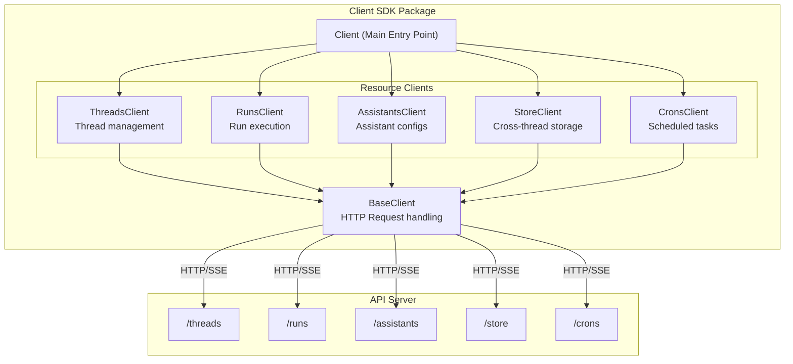
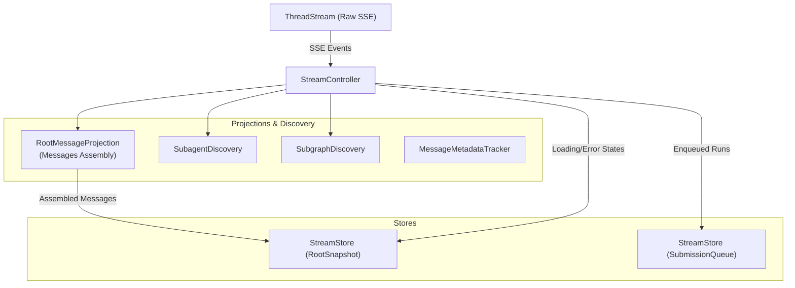

<!-- source: DeepWiki mcp.deepwiki.com · repo langchain-ai/langgraphjs · page 6 Client SDK · fetched 2026-10-26 -->

# Client SDK

<details>
<summary>Relevant source files</summary>

The following files were used as context for generating this wiki page:

- [libs/sdk-angular/src/use-stream.ts](libs/sdk-angular/src/use-stream.ts)
- [libs/sdk-react/src/use-stream.ts](libs/sdk-react/src/use-stream.ts)
- [libs/sdk-svelte/src/use-stream.svelte.ts](libs/sdk-svelte/src/use-stream.svelte.ts)
- [libs/sdk-vue/docs/interrupts.md](libs/sdk-vue/docs/interrupts.md)
- [libs/sdk-vue/src/use-stream.ts](libs/sdk-vue/src/use-stream.ts)
- [libs/sdk/src/client.ts](libs/sdk/src/client.ts)
- [libs/sdk/src/client/base.ts](libs/sdk/src/client/base.ts)
- [libs/sdk/src/client/runs/index.ts](libs/sdk/src/client/runs/index.ts)
- [libs/sdk/src/client/stream/types.ts](libs/sdk/src/client/stream/types.ts)
- [libs/sdk/src/schema.ts](libs/sdk/src/schema.ts)
- [libs/sdk/src/stream/controller.test.ts](libs/sdk/src/stream/controller.test.ts)
- [libs/sdk/src/stream/controller.ts](libs/sdk/src/stream/controller.ts)
- [libs/sdk/src/stream/root-message-projection.test.ts](libs/sdk/src/stream/root-message-projection.test.ts)
- [libs/sdk/src/stream/root-message-projection.ts](libs/sdk/src/stream/root-message-projection.ts)
- [libs/sdk/src/stream/submit-coordinator.test.ts](libs/sdk/src/stream/submit-coordinator.test.ts)
- [libs/sdk/src/stream/submit-coordinator.ts](libs/sdk/src/stream/submit-coordinator.ts)
- [libs/sdk/src/types.ts](libs/sdk/src/types.ts)
- [libs/sdk/src/utils/idle-reconnect.test.ts](libs/sdk/src/utils/idle-reconnect.test.ts)
- [libs/sdk/src/utils/stream.ts](libs/sdk/src/utils/stream.ts)

</details>


The Client SDK (`@langchain/langgraph-sdk`) provides programmatic access to LangGraph Platform APIs, enabling applications to interact with deployed graphs via HTTP and Server-Sent Events (SSE). This package includes both a core HTTP client for general-purpose API access and specialized framework integrations for building streaming chat applications.

For information about the API Server that this SDK connects to, see [API Server Architecture](#5.1). For details on streaming infrastructure and event processing, see [Run Execution and Streaming](#5.5).

---

## Package Structure

The SDK is organized into multiple subpath exports, each serving a distinct purpose:

| Export Path | Purpose | Key Components |
|------------|---------|----------------|
| `@langchain/langgraph-sdk` | Core client classes and types | `Client`, `ThreadsClient`, `RunsClient`, `AssistantsClient`, `StoreClient` |
| `@langchain/langgraph-sdk/client` | HTTP client implementation | `BaseClient`, `ThreadStream`, `ProtocolSseTransportAdapter` |
| `@langchain/langgraph-sdk/stream` | Framework-agnostic streaming logic | `StreamController`, `StreamStore`, `ChannelRegistry`, `RootMessageProjection` |
| `@langchain/langgraph-sdk/react` | React integration | `useStream` hook, `useMessages`, `useValues` |

The framework-specific packages (`@langchain/langgraph-sdk-react`, `-vue`, `-angular`, `-svelte`) build upon the core `StreamController` to provide reactive primitives.

**Sources:** [libs/sdk/src/client.ts:1-66](), [libs/sdk/src/stream/controller.ts:1-100]()

---

## Client Architecture



The `Client` class serves as the main entry point, providing access to specialized resource clients. Each resource client handles a specific API domain and utilizes `BaseClient` for underlying HTTP communication.

**Sources:** [libs/sdk/src/client.ts:1-23](), [libs/sdk/src/client/base.ts:1-50]()

---

## Core Client Classes

### Client

The `Client` class is instantiated with configuration options and provides access to all resource-specific clients:

```typescript
import { Client } from "@langchain/langgraph-sdk";

const client = new Client({
  apiUrl: "http://localhost:2024",
  apiKey: "pt-...",
});

// Access resource clients
const thread = await client.threads.create();
const assistant = await client.assistants.get("assistant-id");
```

**Sources:** [libs/sdk/src/client.ts:2-10]()

### ThreadsClient

Manages thread lifecycle and state. Threads represent persistent conversation sessions.

| Method | Purpose | Returns |
|--------|---------|---------|
| `create(options)` | Create new thread | `Thread` |
| `get(threadId)` | Retrieve thread details | `Thread` |
| `getState(threadId)` | Get current state values | `ThreadState` |
| `getHistory(threadId)` | Get state history (checkpoints) | `ThreadState[]` |
| `updateState(threadId, options)` | Manually update thread state | `Checkpoint` |

**Sources:** [libs/sdk/src/client.ts:7-7](), [libs/sdk/src/schema.ts:193-226]()

### RunsClient

Handles the execution of assistants on threads. Supports both single-invocation and streaming.

| Method | Purpose | Returns |
|--------|---------|---------|
| `create(threadId, assistantId, payload)` | Start a background run | `Run` |
| `stream(threadId, assistantId, payload)` | Stream run events (SSE) | `ThreadStream` |
| `wait(threadId, runId)` | Wait for completion | `Run` |
| `cancel(threadId, runId)` | Interrupt a running execution | `void` |

**Sources:** [libs/sdk/src/client.ts:8-8](), [libs/sdk/src/types.ts:48-216]()

---

## Streaming and Reactivity

The SDK features a sophisticated streaming architecture designed for UI responsiveness. At its core is the `StreamController`, which manages the lifecycle of a `ThreadStream` and projects raw SSE events into usable state.

### Stream Controller Architecture



The `StreamController` handles:
1. **Message Assembly**: Merging token deltas into full `BaseMessage` objects via `RootMessageProjection`.
2. **Optimistic Updates**: Showing user messages immediately before the server responds.
3. **Multitask Coordination**: Managing run queues and interrupts via `SubmitCoordinator`.
4. **Subagent Discovery**: Detecting and tracking sub-graph executions.

**Sources:** [libs/sdk/src/stream/controller.ts:1-100](), [libs/sdk/src/stream/root-message-projection.ts:1-70](), [libs/sdk/src/stream/submit-coordinator.ts:1-55]()

---

## Framework Integrations

The SDK provides reactive hooks for major frontend frameworks, all powered by the shared `StreamController`.

### React (`useStream`)
The `useStream` hook provides the most comprehensive integration, managing thread state, messages, and run lifecycle.

```typescript
const { messages, values, isLoading, submit } = useStream({
  assistantId: "my-assistant",
});
```

For details, see [React Integration](#6.2).

### Angular, Vue, and Svelte
Framework-specific packages provide idiomatic reactive primitives:
- **Angular**: Uses `Signal<T>` for projections and `injectMessages()` selectors.
- **Vue**: Uses `Readonly<ShallowRef<T>>` and `useMessages()` composables.
- **Svelte**: Uses Svelte 5 getters for auto-tracking reactivity.

For details, see [Framework SDK Integrations](#6.4).

---

## Child Pages

- [Client API Reference](#6.1) — Detailed documentation of the `Client` class and resource-specific methods.
- [React Integration](#6.2) — Deep dive into the `useStream` hook and companion selectors.
- [Branching and State History](#6.3) — Managing thread forks, time-travel, and historical state navigation.
- [Framework SDK Integrations](#6.4) — Documentation for Angular, Vue, and Svelte SDK packages.

**Sources:** [libs/sdk-react/src/use-stream.ts:69-176](), [libs/sdk-angular/src/use-stream.ts:96-188](), [libs/sdk-vue/src/use-stream.ts:99-190](), [libs/sdk-svelte/src/use-stream.svelte.ts:97-188]()

---

