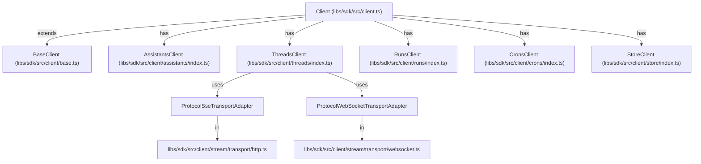
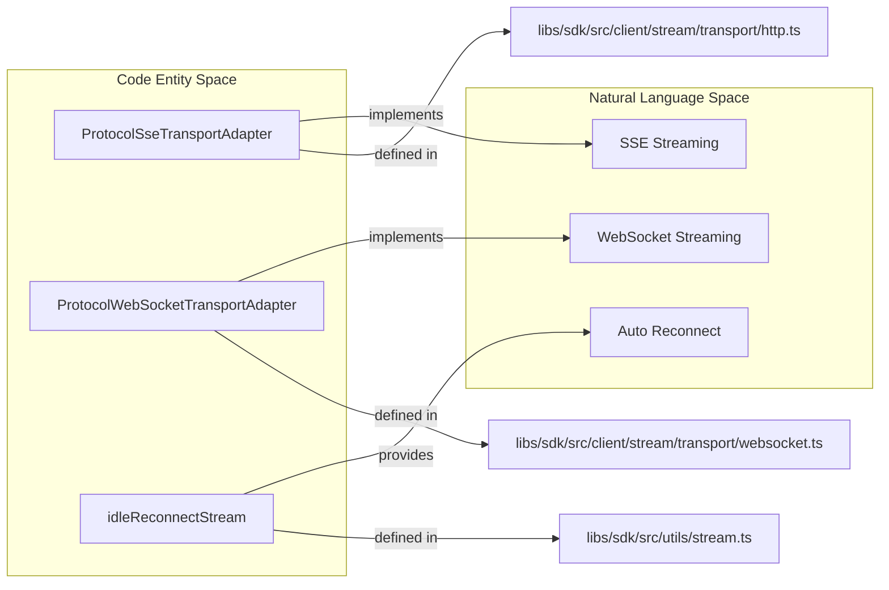
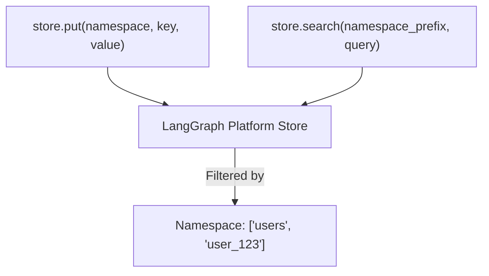

<!-- source: DeepWiki mcp.deepwiki.com · repo langchain-ai/langgraphjs · page 6.1 Client API Reference · fetched 2026-10-26 -->

# Client API Reference

Relevant source files

The following files were used as context for generating this wiki page:

- [libs/sdk/src/client.ts](libs/sdk/src/client.ts)
- [libs/sdk/src/client/base.ts](libs/sdk/src/client/base.ts)
- [libs/sdk/src/client/crons/index.test.ts](libs/sdk/src/client/crons/index.test.ts)
- [libs/sdk/src/client/crons/index.ts](libs/sdk/src/client/crons/index.ts)
- [libs/sdk/src/client/runs/index.ts](libs/sdk/src/client/runs/index.ts)
- [libs/sdk/src/client/stream/transport.ts](libs/sdk/src/client/stream/transport.ts)
- [libs/sdk/src/client/stream/transport/agent-server.test.ts](libs/sdk/src/client/stream/transport/agent-server.test.ts)
- [libs/sdk/src/client/stream/transport/agent-server.ts](libs/sdk/src/client/stream/transport/agent-server.ts)
- [libs/sdk/src/client/stream/transport/http.test.ts](libs/sdk/src/client/stream/transport/http.test.ts)
- [libs/sdk/src/client/stream/transport/http.ts](libs/sdk/src/client/stream/transport/http.ts)
- [libs/sdk/src/client/stream/transport/types.ts](libs/sdk/src/client/stream/transport/types.ts)
- [libs/sdk/src/client/stream/transport/websocket.test.ts](libs/sdk/src/client/stream/transport/websocket.test.ts)
- [libs/sdk/src/client/stream/transport/websocket.ts](libs/sdk/src/client/stream/transport/websocket.ts)
- [libs/sdk/src/client/stream/types.ts](libs/sdk/src/client/stream/types.ts)
- [libs/sdk/src/client/threads/index.ts](libs/sdk/src/client/threads/index.ts)
- [libs/sdk/src/schema.ts](libs/sdk/src/schema.ts)
- [libs/sdk/src/types.ts](libs/sdk/src/types.ts)
- [libs/sdk/src/utils/idle-reconnect.test.ts](libs/sdk/src/utils/idle-reconnect.test.ts)
- [libs/sdk/src/utils/stream.ts](libs/sdk/src/utils/stream.ts)

This document provides a comprehensive reference for the `@langchain/langgraph-sdk` client library, which enables programmatic interaction with the LangGraph Platform API from Node.js and browser environments. The SDK provides strongly-typed TypeScript clients for managing assistants, threads, runs, cron jobs, and the cross-thread store.

For information about React-specific integrations using these clients, see [React Integration](#6.2). For details about thread state history and branching operations, see [Branching and State History](#6.3). For the underlying API server architecture, see [API Server Architecture](#5.1).

## Client Architecture

The SDK is organized around a base client class and specialized resource clients. The `Client` class acts as a unified entry point, orchestrating access to various sub-clients.

### Code Entity Relationship

The following diagram maps the logical system components to the specific classes and files that implement them.

**System to Code Entity Mapping**

**Sources:** [libs/sdk/src/client.ts:1-23](), [libs/sdk/src/client/threads/index.ts:28-31](), [libs/sdk/src/client/stream/transport/http.ts:42-42](), [libs/sdk/src/client/stream/transport/websocket.ts:71-71]()

## Client Configuration

The SDK is configured through the `ClientConfig` interface. It supports automatic API key resolution and custom request hooks.

| Configuration Option | Type | Description |
|---------------------|------|-------------|
| `apiUrl` | `string` | Base URL for the LangGraph API (defaults to `http://localhost:8123`) |
| `apiKey` | `string \| null` | API key for authentication. If `undefined`, auto-loads from environment. |
| `callerOptions` | `AsyncCallerParams` | Retry and concurrency settings (e.g., `maxRetries`, `maxConcurrency`) |
| `onRequest` | `ProtocolRequestHook` | Hook to modify requests before sending |
| `streamProtocol` | `StreamProtocol` | Protocol version: `"legacy"`, `"v2"`, or `"v2-websocket"` |

**Sources:** [libs/sdk/src/client.ts:28-66](), [libs/sdk/src/types.ts:11-11]()

### API Key Resolution

The SDK uses a specific precedence order for API key resolution, checking environment variables if no key is explicitly provided to the constructor.

**Sources:** [libs/sdk/src/client.ts:5-5]()

## ThreadsClient

The `ThreadsClient` manages conversation threads, which maintain state across multiple runs. It is generic over state types to provide full TypeScript safety.

### Type Parameters
`ThreadsClient<TStateType = DefaultValues, TUpdateType = TStateType>`
- `TStateType`: The shape of the thread's state values [libs/sdk/src/client/threads/index.ts:29-29]().
- `TUpdateType`: The shape of updates accepted by the thread [libs/sdk/src/client/threads/index.ts:30-30]().

### Core Methods

| Method | Purpose | Returns |
|--------|---------|---------|
| `get(threadId)` | Retrieve a thread by ID | `Promise<Thread<ValuesType>>` |
| `create(payload)` | Create a new thread with optional metadata and TTL | `Promise<Thread<TStateType>>` |
| `update(threadId, payload)` | Update thread metadata or TTL | `Promise<Thread \| void>` |
| `search(query)` | Search for threads matching filters (metadata, status, etc.) | `Promise<Thread<ValuesType>[]>` |
| `getState(threadId)` | Fetch the current state values and next nodes | `Promise<ThreadState<ValuesType>>` |

**Sources:** [libs/sdk/src/client/threads/index.ts:38-48](), [libs/sdk/src/client/threads/index.ts:56-92](), [libs/sdk/src/client/threads/index.ts:116-165](), [libs/sdk/src/client/threads/index.ts:216-245]()

## RunsClient

The `RunsClient` manages the execution of graphs. It supports both one-off invocations (`invoke`, `wait`) and real-time streaming (`stream`).

### Streaming and Protocols
LangGraph.js supports multiple streaming protocols. The client can use standard Server-Sent Events (SSE) or a bidirectional WebSocket for lower overhead in long-lived sessions.

**Protocol Implementation Mapping**

**Sources:** [libs/sdk/src/client/stream/transport/http.ts:42-42](), [libs/sdk/src/client/stream/transport/websocket.ts:71-71](), [libs/sdk/src/utils/stream.ts:125-127]()

### Stream Modes
The `streamMode` parameter in `RunsStreamPayload` determines what data is yielded:
- `values`: Yields the full state after each superstep [libs/sdk/src/types.ts:17-17]().
- `updates`: Yields only the changes/updates from each node [libs/sdk/src/types.ts:16-16]().
- `messages`: Yields message-specific updates for chat-based agents [libs/sdk/src/types.ts:21-21]().
- `events`: Yields all internal LangGraph events [libs/sdk/src/types.ts:13-13]().

**Sources:** [libs/sdk/src/types.ts:12-22](), [libs/sdk/src/types.ts:171-178]()

## Transport and Reliability

The SDK includes robust handling for "half-open" sockets—connections that hang indefinitely without error (common during cloud platform rollovers).

### Idle Reconnection
The `idleReconnectStream` is a `TransformStream` that monitors for server activity. In `"auto"` mode, it observes SSE keep-alive heartbeats (typically sent every 5s by LangGraph Platform) and arms a watchdog timer. If no data or heartbeats arrive within the window, it throws a `StreamIdleTimeoutError`, triggering the SDK's reconnection logic.

**Sources:** [libs/sdk/src/utils/stream.ts:108-124](), [libs/sdk/src/utils/stream.ts:197-200]()

### WebSocket Reconnection
The `ProtocolWebSocketTransportAdapter` implements exponential backoff with jitter for reconnections.
- **Backoff:** Capped at 5 seconds + 1 second jitter [libs/sdk/src/client/stream/transport/websocket.ts:52-56]().
- **State Restoration:** The `onReconnected` callback allows the higher-level `ThreadStream` to re-issue active subscriptions after the socket is re-established [libs/sdk/src/client/stream/transport/websocket.ts:153-155]().

**Sources:** [libs/sdk/src/client/stream/transport/websocket.ts:49-56](), [libs/sdk/src/client/stream/transport/websocket.ts:92-92]()

## StoreClient

The `StoreClient` provides access to a persistent key-value store that is shared across all threads. This is useful for long-term memory or shared configuration.

### Data Flow in Store

**Sources:** [libs/sdk/src/client.ts:10-10](), [libs/sdk/src/schema.ts:327-329]()

## CronClient

The `CronsClient` manages scheduled runs. Crons can be bound to a specific thread (stateless execution) or create a new thread for every run.

**Sources:** [libs/sdk/src/client/crons/index.ts:1-20](), [libs/sdk/src/schema.ts:228-270]()

---

