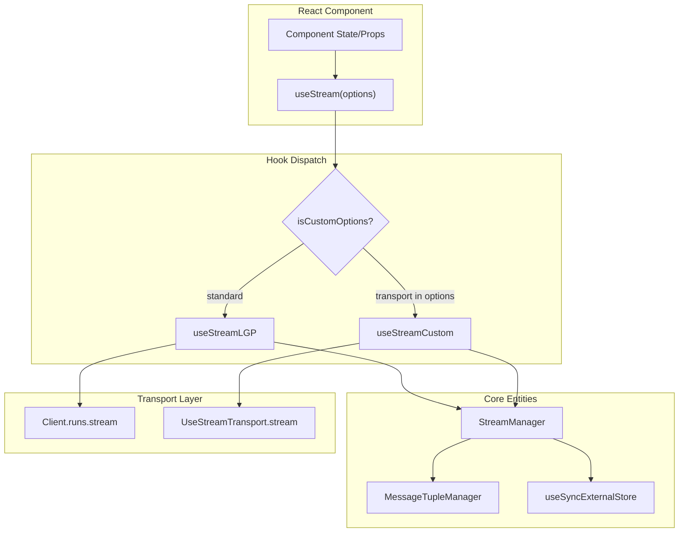
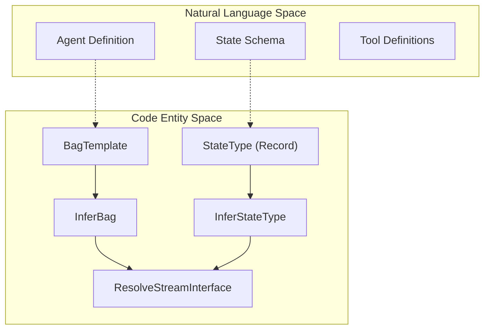
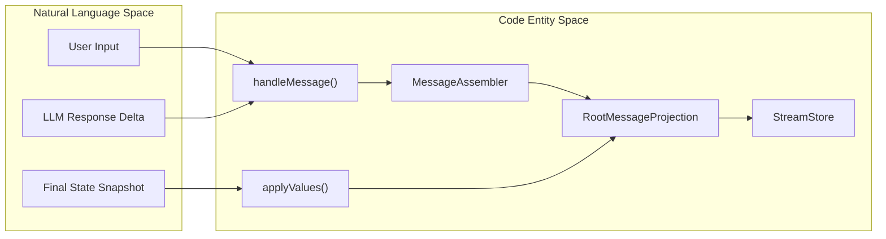

<!-- source: DeepWiki mcp.deepwiki.com · repo langchain-ai/langgraphjs · page 6.2 React Integration · fetched 2026-10-26 -->

# React Integration

<details>
<summary>Relevant source files</summary>

The following files were used as context for generating this wiki page:

- [libs/langgraph-api/src/experimental/embed.mts](libs/langgraph-api/src/experimental/embed.mts)
- [libs/langgraph-api/src/state.mts](libs/langgraph-api/src/state.mts)
- [libs/langgraph-api/src/utils/runnableConfig.mts](libs/langgraph-api/src/utils/runnableConfig.mts)
- [libs/sdk-angular/src/use-stream.ts](libs/sdk-angular/src/use-stream.ts)
- [libs/sdk-react/src/use-stream.ts](libs/sdk-react/src/use-stream.ts)
- [libs/sdk-svelte/src/use-stream.svelte.ts](libs/sdk-svelte/src/use-stream.svelte.ts)
- [libs/sdk-vue/docs/interrupts.md](libs/sdk-vue/docs/interrupts.md)
- [libs/sdk-vue/src/use-stream.ts](libs/sdk-vue/src/use-stream.ts)
- [libs/sdk/src/react-ui/client.tsx](libs/sdk/src/react-ui/client.tsx)
- [libs/sdk/src/react/index.ts](libs/sdk/src/react/index.ts)
- [libs/sdk/src/react/stream.custom.tsx](libs/sdk/src/react/stream.custom.tsx)
- [libs/sdk/src/react/stream.lgp.test.tsx](libs/sdk/src/react/stream.lgp.test.tsx)
- [libs/sdk/src/react/stream.lgp.tsx](libs/sdk/src/react/stream.lgp.tsx)
- [libs/sdk/src/react/stream.tsx](libs/sdk/src/react/stream.tsx)
- [libs/sdk/src/react/thread.tsx](libs/sdk/src/react/thread.tsx)
- [libs/sdk/src/react/types.tsx](libs/sdk/src/react/types.tsx)
- [libs/sdk/src/stream/controller.test.ts](libs/sdk/src/stream/controller.test.ts)
- [libs/sdk/src/stream/controller.ts](libs/sdk/src/stream/controller.ts)
- [libs/sdk/src/stream/root-message-projection.test.ts](libs/sdk/src/stream/root-message-projection.test.ts)
- [libs/sdk/src/stream/root-message-projection.ts](libs/sdk/src/stream/root-message-projection.ts)
- [libs/sdk/src/stream/submit-coordinator.test.ts](libs/sdk/src/stream/submit-coordinator.test.ts)
- [libs/sdk/src/stream/submit-coordinator.ts](libs/sdk/src/stream/submit-coordinator.ts)
- [libs/sdk/src/ui/manager.test.ts](libs/sdk/src/ui/manager.test.ts)
- [libs/sdk/src/ui/manager.ts](libs/sdk/src/ui/manager.ts)
- [libs/sdk/src/ui/subagents.ts](libs/sdk/src/ui/subagents.ts)
- [libs/sdk/src/ui/types.ts](libs/sdk/src/ui/types.ts)
- [libs/sdk/src/ui/utils.test.ts](libs/sdk/src/ui/utils.test.ts)
- [libs/sdk/src/ui/utils.ts](libs/sdk/src/ui/utils.ts)

</details>


This document covers the React integration layer for LangGraph streaming, including the `useStream` hook, stream management, message assembly, and branching capabilities. For information about the underlying Client SDK API, see [Client API Reference](#6.1). For details on stream implementation internals, see [Streaming Implementation Details](#6.2.2).

## Overview

The React integration provides a `useStream` hook that manages bidirectional streaming with LangGraph applications, handling state management, message assembly, reconnection, and branching logic. The integration supports two modes: standard mode using the LangGraph Platform client, and custom transport mode for alternative backends.

**Key Components:**
- `useStream` - Primary React hook for streaming ([libs/sdk/src/react/stream.tsx:26-55]())
- `StreamManager` - Event processing and state management ([libs/sdk/src/ui/manager.ts:183-230]())
- `MessageTupleManager` - Message chunk assembly ([libs/sdk/src/ui/messages.ts:56-118]())
- `StreamController` - Framework-agnostic v2 stream controller ([libs/sdk/src/stream/controller.ts:5-22]())

## Hook Architecture

### useStream Entry Point

The `useStream` hook provides two overloaded signatures that dispatch to different implementations based on whether a custom transport is provided.

Title: useStream Hook Dispatch Logic

Sources: [libs/sdk/src/react/stream.tsx:44-55](), [libs/sdk/src/ui/manager.ts:213-230]()

**Hook Dispatch Logic**

The hook determines which implementation to use based on the presence of a `transport` property in the options object ([libs/sdk/src/react/stream.tsx:15-24]()):

```typescript
function isCustomOptions(options): options is UseStreamCustomOptions {
  return "transport" in options;
}
```

The `useState` ensures the implementation doesn't change during re-renders ([libs/sdk/src/react/stream.tsx:45-46]()):

```typescript
const [isCustom] = useState(isCustomOptions(options));
```

### Type Inference System

The hook provides automatic type inference for agent configurations, state types, and tool calls.

Title: React State and Bag Type Resolution

Sources: [libs/sdk/src/react/stream.tsx:26-41](), [libs/sdk/src/ui/types.ts:21-84]()

**Type Inference Helpers**

The `useStream` signatures leverage `ResolveStreamOptions` and `InferBag` to extract the correct types from the provided generic or configuration ([libs/sdk/src/react/stream.tsx:26-31]()).

## Transport Modes

### Standard Mode (LangGraph Platform)

Standard mode uses the LangGraph Platform Client SDK for communication with the API server.

**Client Initialization**

The hook creates or uses a provided `Client` instance ([libs/sdk/src/react/stream.lgp.tsx:191-207]()):

```typescript
const client = useMemo(
  () =>
    options.client ??
    new Client({
      apiUrl: options.apiUrl,
      apiKey: options.apiKey,
      callerOptions: options.callerOptions,
      defaultHeaders: options.defaultHeaders,
    }),
  [/* dependencies */]
);
```

**Reconnection Support**

Standard mode supports automatic reconnection using `sessionStorage` or a custom storage function to track active runs ([libs/sdk/src/react/stream.lgp.tsx:182-189]()):

```typescript
const runMetadataStorage = useMemo(() => {
  if (typeof window === "undefined") return null;
  const storage = reconnectOnMountRef.current;
  if (storage === true) return window.sessionStorage;
  if (typeof storage === "function") return storage();
  return null;
}, []);
```

### Custom Transport Mode

Custom transport mode allows integration with alternative backends via the `UseStreamTransport` interface ([libs/sdk/src/react/types.tsx:16-17]()). The built-in `FetchStreamTransport` provides a standard HTTP/SSE implementation ([libs/sdk/src/react/index.ts:2]()).

## Stream Manager and Store

### StreamManager

The `StreamManager` class orchestrates event processing, state updates, and React synchronization. It maintains an internal queue to serialize updates ([libs/sdk/src/ui/manager.ts:201-203]()).

**Event Dispatch**

Events are dispatched to appropriate handlers based on event type ([libs/sdk/src/ui/manager.ts:47-60]()):

| Event Type | Handler Interface | Purpose |
|------------|---------|---------|
| `updates` | `onUpdateEvent` | Node-level state updates |
| `custom` | `onCustomEvent` | User-defined custom events |
| `metadata` | `onMetadataEvent` | Run and thread metadata |
| `checkpoints` | `onCheckpointEvent` | Persistence checkpoints |
| `tools` | `onToolEvent` | Tool execution progress |

Sources: [libs/sdk/src/ui/manager.ts:69-114]()

### StreamStore and Controller

For experimental v2 streaming, the `StreamController` acts as a framework-agnostic orchestrator ([libs/sdk/src/stream/controller.ts:5-15]()). It uses a `StreamStore` to expose observable surfaces:
- `rootStore`: Values, messages, tool calls, and interrupts ([libs/sdk/src/stream/controller.ts:8]()).
- `subagentStore`: Discovery map of subagents ([libs/sdk/src/stream/controller.ts:9]()).
- `subgraphStore`: Discovery map of subgraphs ([libs/sdk/src/stream/controller.ts:10]()).

## Message Management

### MessageTupleManager

The `MessageTupleManager` handles message chunk assembly and metadata tracking. It is used by `StreamManager` to build a coherent message history from streamed deltas ([libs/sdk/src/ui/manager.ts:189](), [libs/sdk/src/ui/messages.ts:56-118]()).

### RootMessageProjection

The `RootMessageProjection` manages the merge between the `messages` (streamed deltas) and `values` (authoritative snapshots) channels for the root namespace ([libs/sdk/src/stream/root-message-projection.ts:91-95]()).

Title: Message Projection Architecture

Sources: [libs/sdk/src/stream/root-message-projection.ts:7-12](), [libs/sdk/src/stream/root-message-projection.ts:63-69]()

## Branching and History

### Thread History

The `useThreadHistory` hook manages fetching and caching thread state history ([libs/sdk/src/react/stream.lgp.tsx:79-88]()). It supports limiting the history depth or fetching the current state only ([libs/sdk/src/react/stream.lgp.tsx:63-77]()).

### Submit Coordination

The `SubmitCoordinator` owns the run-submission lifecycle, enforcing multitask strategies (like `enqueue`) and racing dispatch against terminal lifecycle events ([libs/sdk/src/stream/submit-coordinator.ts:7-11]()).

| Strategy | Behavior |
|----------|----------|
| `enqueue` | Records the submission into `queueStore` if a run is in flight ([libs/sdk/src/stream/submit-coordinator.ts:45-47]()). |
| `reject` | Rejects the submission if the thread is busy. |
| `interrupt` | Aborts the current run to start a new one. |

Sources: [libs/sdk/src/stream/submit-coordinator.ts:138-148]()

## For Details, See:
- [useStream Hook](#6.2.1) — Detailed API reference for the hook, including `submit`, `stop`, and `joinStream` methods.
- [Streaming Implementation Details](#6.2.2) — Technical deep dive into `StreamController`, `ChannelRegistry`, and message assembly logic.

---

