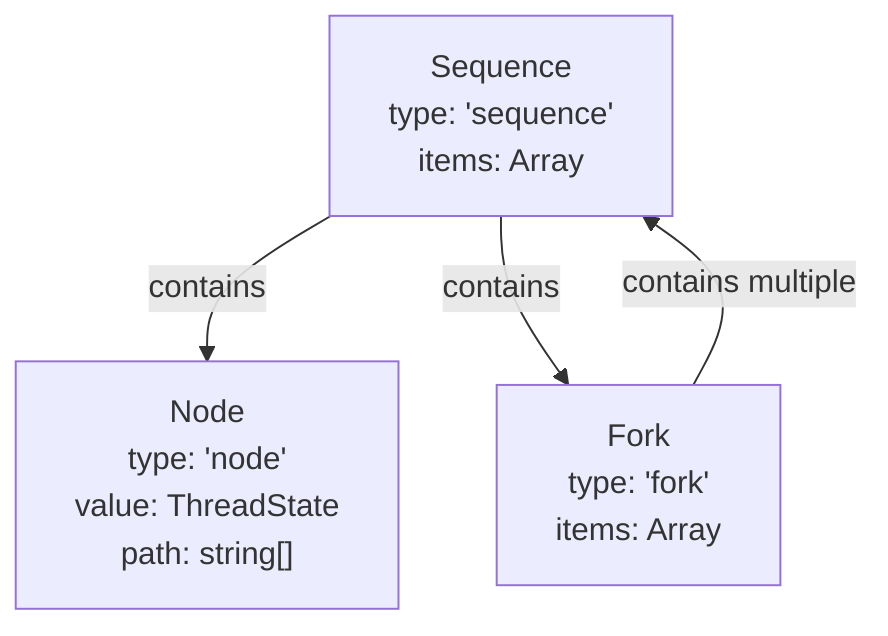
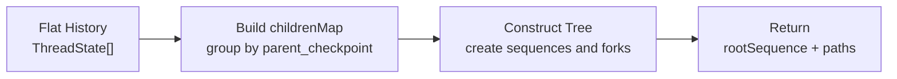
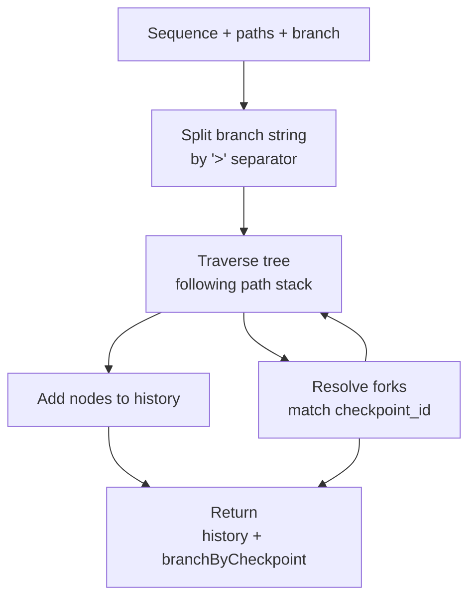
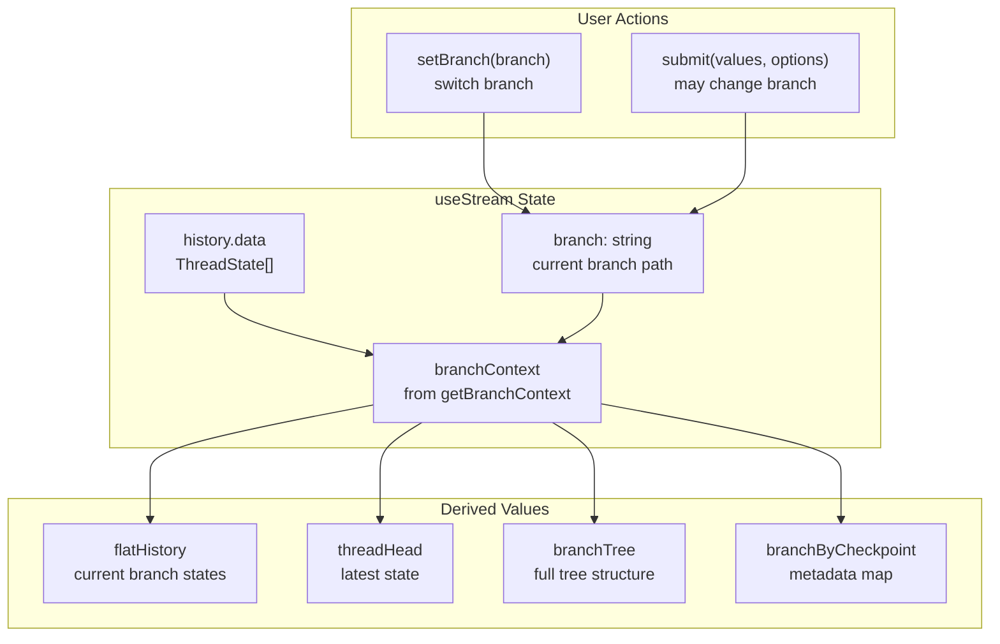
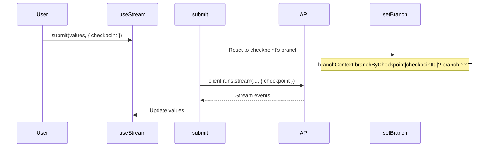

<!-- source: DeepWiki mcp.deepwiki.com · repo langchain-ai/langgraphjs · page 6.3 Branching and State History · fetched 2026-10-26 -->

# Branching and State History

<details>
<summary>Relevant source files</summary>

The following files were used as context for generating this wiki page:

- [libs/langgraph-api/src/experimental/embed.mts](libs/langgraph-api/src/experimental/embed.mts)
- [libs/langgraph-api/src/state.mts](libs/langgraph-api/src/state.mts)
- [libs/langgraph-api/src/utils/runnableConfig.mts](libs/langgraph-api/src/utils/runnableConfig.mts)
- [libs/sdk-react/src/tests/createDeepAgent.test-d.ts](libs/sdk-react/src/tests/createDeepAgent.test-d.ts)
- [libs/sdk-react/src/tests/stream.test-d.ts](libs/sdk-react/src/tests/stream.test-d.ts)
- [libs/sdk/src/react-ui/client.tsx](libs/sdk/src/react-ui/client.tsx)
- [libs/sdk/src/react/index.ts](libs/sdk/src/react/index.ts)
- [libs/sdk/src/react/stream.custom.tsx](libs/sdk/src/react/stream.custom.tsx)
- [libs/sdk/src/react/stream.lgp.test.tsx](libs/sdk/src/react/stream.lgp.test.tsx)
- [libs/sdk/src/react/stream.lgp.tsx](libs/sdk/src/react/stream.lgp.tsx)
- [libs/sdk/src/react/stream.tsx](libs/sdk/src/react/stream.tsx)
- [libs/sdk/src/react/thread.tsx](libs/sdk/src/react/thread.tsx)
- [libs/sdk/src/react/types.tsx](libs/sdk/src/react/types.tsx)
- [libs/sdk/src/ui/branching.test.ts](libs/sdk/src/ui/branching.test.ts)
- [libs/sdk/src/ui/branching.ts](libs/sdk/src/ui/branching.ts)
- [libs/sdk/src/ui/class-messages.ts](libs/sdk/src/ui/class-messages.ts)
- [libs/sdk/src/ui/errors.ts](libs/sdk/src/ui/errors.ts)
- [libs/sdk/src/ui/manager.test.ts](libs/sdk/src/ui/manager.test.ts)
- [libs/sdk/src/ui/manager.ts](libs/sdk/src/ui/manager.ts)
- [libs/sdk/src/ui/messages.test.ts](libs/sdk/src/ui/messages.test.ts)
- [libs/sdk/src/ui/messages.ts](libs/sdk/src/ui/messages.ts)
- [libs/sdk/src/ui/stream/index.ts](libs/sdk/src/ui/stream/index.ts)
- [libs/sdk/src/ui/subagents.ts](libs/sdk/src/ui/subagents.ts)
- [libs/sdk/src/ui/types.ts](libs/sdk/src/ui/types.ts)
- [libs/sdk/src/ui/utils.test.ts](libs/sdk/src/ui/utils.test.ts)
- [libs/sdk/src/ui/utils.ts](libs/sdk/src/ui/utils.ts)

</details>


This page documents the branching and state history system in the LangGraph SDK, which enables time-travel debugging, checkpoint branching, and navigation through execution history. The branching system allows applications to view past thread states, create alternative execution paths from any checkpoint, and visualize the tree of all branches.

For information about the checkpointing system that persists thread state, see [Checkpoint System Architecture](#3.1). For information about the React hooks that expose branching functionality, see [useStream Hook](#6.2.1).

## Overview

The branching system converts linear thread history into a navigable tree structure where each fork represents a point where multiple execution paths diverged. This occurs when runs are submitted from past checkpoints, creating alternative timelines. The system provides three key capabilities:

| Capability | Description | Primary Function |
|------------|-------------|------------------|
| Tree Construction | Converts flat history into hierarchical structure | `getBranchSequence` |
| Branch Navigation | Flattens specific branch path for viewing | `getBranchView` |
| Context Resolution | Combines tree and view for current state | `getBranchContext` |

The branching system is primarily used through the `useStream` hook in React applications, which manages branch state and provides methods to navigate between branches.

**Sources:** [libs/sdk/src/ui/branching.ts:1-229](), [libs/sdk/src/react/stream.lgp.tsx:286-344]()

## Thread State and Checkpoint Identity

Each point in a thread's execution history is represented by a `ThreadState` object containing the state values, checkpoint metadata, and parent relationships:

```typescript
interface ThreadState<StateType> {
  values: StateType;
  checkpoint: {
    thread_id: string;
    checkpoint_id: string;
    checkpoint_ns: string;
  };
  parent_checkpoint: {
    checkpoint_id: string;
    // ...
  } | null;
  next: string[];
  tasks: Task[];
  metadata: Record<string, unknown>;
  created_at: string;
}
```

The `checkpoint_id` uniquely identifies each state snapshot, while `parent_checkpoint` creates the parent-child relationships that form the branch tree. When a run is submitted from a past checkpoint, it creates a new branch diverging from that point.

**Sources:** [libs/sdk/src/ui/branching.ts:1-8](), [libs/sdk/src/react/stream.lgp.tsx:48-62](), [libs/sdk/src/ui/types.ts:5-11]()

## Branch Tree Data Structure

The branching system uses three recursive types to represent the tree structure:

### Node, Fork, and Sequence Types



| Type | Purpose | Structure |
|------|---------|-----------|
| `Node` | Represents single thread state | Contains `ThreadState` and path from root |
| `Fork` | Represents branching point | Contains array of alternative sequences |
| `Sequence` | Ordered list of states | Contains nodes and nested forks |

The `path` array on each node contains the checkpoint IDs traversed from the root to reach that node, enabling navigation to specific branches.

**Sources:** [libs/sdk/src/ui/branching.ts:4-32]()

## Core Branching Functions

### getBranchSequence: Flat to Tree Conversion

The `getBranchSequence` function converts a flat array of `ThreadState` objects into a hierarchical tree structure by analyzing parent-child relationships:



**Algorithm:**
1. Groups states by `parent_checkpoint.checkpoint_id` into `childrenMap`.
2. Handles orphaned nodes (partial history) by finding the branch with latest checkpoint.
3. Breadth-first traversal creates sequences, inserting forks when multiple children exist.
4. Returns `rootSequence` tree and `paths` array of all branch paths.

**Key Implementation Details:**
- Empty history or single state returns simple sequence [libs/sdk/src/ui/branching.ts:40-49]().
- Fork detection: when `childrenMap[id].length > 1` [libs/sdk/src/ui/branching.ts:120-124]().
- Path tracking: appends checkpoint IDs when traversing forks [libs/sdk/src/ui/branching.ts:136-138]().

**Sources:** [libs/sdk/src/ui/branching.ts:34-147]()

### getBranchView: Tree to Flat Conversion

The `getBranchView` function traverses a specific branch path through the tree, flattening it back into a linear history:



**Algorithm:**
1. Parses branch string by splitting on `PATH_SEP` (">").
2. Builds `pathMap` organizing branches by parent checkpoint.
3. Queue-based traversal through tree:
   - Nodes: added to `history`, branch metadata recorded.
   - Forks: resolved by matching `forkStack` checkpoint IDs with child sequences.
4. Returns flat `history` and `branchByCheckpoint` mapping for UI.

**Key Data Structures:**
- `branchByCheckpoint[checkpointId]`: Contains `branch` path and `branchOptions` for UI [libs/sdk/src/ui/branching.ts:168-190]().
- `forkStack`: Stack of checkpoint IDs to follow through forks [libs/sdk/src/ui/branching.ts:173]().

**Sources:** [libs/sdk/src/ui/branching.ts:153-209]()

### getBranchContext: Combined Interface

The `getBranchContext` function combines both operations to provide a complete branching context:

```typescript
function getBranchContext<StateType>(
  branch: string,
  history: ThreadState<StateType>[] | undefined
) {
  const { rootSequence: branchTree, paths } = getBranchSequence(history ?? []);
  const { history: flatHistory, branchByCheckpoint } = getBranchView(
    branchTree,
    paths,
    branch
  );

  return {
    branchTree,      // Full tree structure
    flatHistory,     // Flattened current branch
    branchByCheckpoint, // Metadata mapping
    threadHead: flatHistory.at(-1)  // Latest state
  };
}
```

This is the primary interface used by the `useStream` hook to maintain branching state.

**Sources:** [libs/sdk/src/ui/branching.ts:211-228]()

## React Integration with useStream

### Branch State Management

The `useStream` hook integrates branching through several mechanisms:



**Key Implementation:**
- Branch context computed on every render [libs/sdk/src/react/stream.lgp.tsx:288]().
- History values derived from `branchContext.threadHead?.values` [libs/sdk/src/react/stream.lgp.tsx:290-293]().
- Automatic branch reset when submitting to a specific checkpoint [libs/sdk/src/react/stream.lgp.tsx:365-370]().
- `useThreadHistory` manages fetching state history from the `Client` [libs/sdk/src/react/stream.lgp.tsx:79-170]().

**Sources:** [libs/sdk/src/react/stream.lgp.tsx:79-170](), [libs/sdk/src/react/stream.lgp.tsx:287-293](), [libs/sdk/src/react/stream.lgp.tsx:628-651]()

### Message Metadata with Branch Information

The hook enriches message metadata with branching information for UI display:

```typescript
const messageMetadata = (() => {
  const alreadyShown = new Set<string>();
  return getMessages(historyValues).map((message, idx) => {
    const messageId = message.id ?? idx;
    
    // Find first checkpoint where message appeared
    const firstSeenState = findLast(history.data ?? [], (state) =>
      getMessages(state.values)
        .map((m, idx) => m.id ?? idx)
        .includes(messageId)
    );
    
    const checkpointId = firstSeenState?.checkpoint?.checkpoint_id;
    let branch = checkpointId != null
      ? branchContext.branchByCheckpoint[checkpointId]
      : undefined;
    
    // Deduplicate branch options in UI
    if (branch && alreadyShown.has(branch.branchOptions?.flat(2).join(","))) {
      branch = undefined;
    }
    
    return {
      messageId,
      firstSeenState,
      branch: branch?.branch,
      branchOptions: branch?.branchOptions,
    };
  });
})();
```

This metadata enables UI components to display when messages first appeared and what branches exist at each point.

**Sources:** [libs/sdk/src/react/stream.lgp.tsx:308-344]()

### Branch Submission Workflow

When submitting with a specific checkpoint, the branch state is automatically managed:



**Implementation:**
1. Extract checkpoint ID from submit options [libs/sdk/src/react/stream.lgp.tsx:365]().
2. Look up branch path from `branchByCheckpoint` [libs/sdk/src/react/stream.lgp.tsx:368]().
3. Call `setBranch` to update current branch [libs/sdk/src/react/stream.lgp.tsx:366-370]().
4. Include checkpoint in API request for server-side validation [libs/sdk/src/react/stream.lgp.tsx:434-447]().

**Sources:** [libs/sdk/src/react/stream.lgp.tsx:365-447]()

## Public API Surface

### TypeScript Types

The `UseStream` interface exposes branching functionality:

| Property | Type | Description |
|----------|------|-------------|
| `branch` | `string` | Current branch path (checkpoint IDs joined by ">") |
| `setBranch` | `(branch: string) => void` | Navigate to different branch |
| `history` | `ThreadState<StateType>[]` | Flattened states for current branch |
| `experimental_branchTree` | `Sequence<StateType>` | Full tree structure for visualization |
| `getMessagesMetadata` | `(message, index?) => MessageMetadata \| undefined` | Get branch info for message |

**Requirements:**
- `fetchStateHistory` option must be enabled to access `history` and `experimental_branchTree` [libs/sdk/src/react/stream.lgp.tsx:632-636](), [libs/sdk/src/react/stream.lgp.tsx:643-650]().

**Sources:** [libs/sdk/src/react/types.tsx:45-218]()

### MessageMetadata Interface

```typescript
interface MessageMetadata<StateType> {
  messageId: string;
  firstSeenState?: ThreadState<StateType>;
  branch?: string;
  branchOptions?: string[];
  streamMetadata?: {
    langgraph_checkpoint_ns: string;
    langgraph_node: string;
    langgraph_path: [string, number][];
    langgraph_step: number;
    langgraph_triggers: string[];
  };
}
```

This metadata combines:
- Historical information: when message first appeared (`firstSeenState`).
- Branch context: current branch path and available alternatives.
- Streaming metadata: node execution details (from `MessageTupleManager`).

**Sources:** [libs/sdk/src/react/types.tsx:180-191](), [libs/sdk/src/react/stream.lgp.tsx:308-344]()

## Usage Patterns

### Basic Branch Navigation

```typescript
const stream = useStream<MyState>({
  assistantId: "my-assistant",
  threadId: "my-thread",
  fetchStateHistory: true,  // Required for branching
});

// Access current branch
const currentBranch = stream.branch;

// Navigate to different branch
const handleBranchChange = (newBranch: string) => {
  stream.setBranch(newBranch);
};

// Access flattened history for current branch
const states = stream.history;
```

### Submitting to Past Checkpoint

```typescript
// Get a past state from history
const pastState = stream.history[2];

// Submit from that checkpoint to create new branch
await stream.submit(
  { messages: [{ type: "human", content: "Alternative input" }] },
  { checkpoint: pastState.checkpoint }
);

// Branch automatically updates to new path
console.log(stream.branch); // e.g., "checkpoint-id-1>checkpoint-id-2"
```

### Displaying Branch Options in UI

```typescript
stream.messages.map((message) => {
  const metadata = stream.getMessagesMetadata(message);
  
  if (metadata?.branchOptions && metadata.branchOptions.length > 1) {
    return (
      <div>
        <Message content={message.content} />
        <BranchSelector
          currentBranch={metadata.branch}
          options={metadata.branchOptions}
          onSelect={(branch) => stream.setBranch(branch)}
        />
      </div>
    );
  }
  
  return <Message content={message.content} />;
});
```

**Sources:** [libs/sdk/src/react/stream.lgp.tsx:608-720]()

## Implementation Details

### Partial History Handling

When fetching a limited history (e.g., last 10 states), the system may encounter "orphaned" nodes—states whose parent checkpoint is not in the fetched history. The algorithm handles this by:

1. Identifying orphaned nodes: parent IDs not in `nodeIds` set [libs/sdk/src/ui/branching.ts:70-98]().
2. Following children to find the branch with the latest checkpoint.
3. Treating that branch as the root with `childrenMap.$` [libs/sdk/src/ui/branching.ts:100]().

This ensures partial history displays correctly without requiring the full thread history.

### Path Separator Convention

Branch paths are string representations of checkpoint ID sequences:
- Separator: `">"` (defined as `PATH_SEP`) [libs/sdk/src/ui/branching.ts:149]().
- Root ID: `"$"` [libs/sdk/src/ui/branching.ts:150]().
- Example: `"checkpoint-1>checkpoint-2>checkpoint-3"`

This format is used both internally for navigation and externally in the API.

**Sources:** [libs/sdk/src/ui/branching.ts:149-150]()

### Branch Context Memoization

In `useStream`, the branch context is recalculated on every render when branch or history changes. For performance optimization in complex UIs, consider memoizing `getBranchContext` calls, though the function is already optimized for typical history sizes (10-100 states).

**Sources:** [libs/sdk/src/react/stream.lgp.tsx:288]()

## Testing

The test suite in `branching.test.ts` validates:
- Full tree construction with multiple forks [libs/sdk/src/ui/branching.test.ts:338-365]().
- Partial history handling (1-7 states) [libs/sdk/src/ui/branching.test.ts:367-427]().
- Correct path assignment and fork resolution.
- Node ordering and parent-child relationships.

The test uses a fixture with 7 states forming 3 branches, ensuring all branching scenarios are covered.

**Sources:** [libs/sdk/src/ui/branching.test.ts:1-427]()

---

