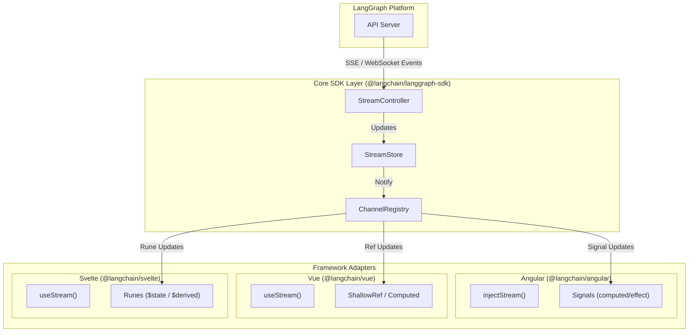
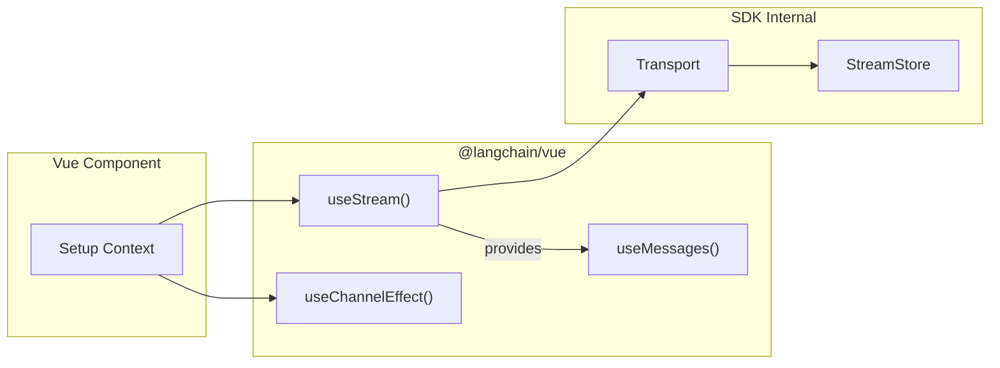

<!-- source: DeepWiki mcp.deepwiki.com · repo langchain-ai/langgraphjs · page 6.4 Framework SDK Integrations · fetched 2026-10-26 -->

# Framework SDK Integrations

Relevant source files

The following files were used as context for generating this wiki page:

- [examples/ai-elements/CHANGELOG.md](examples/ai-elements/CHANGELOG.md)
- [examples/ai-elements/package.json](examples/ai-elements/package.json)
- [examples/assistant-ui-claude/CHANGELOG.md](examples/assistant-ui-claude/CHANGELOG.md)
- [examples/assistant-ui-claude/package.json](examples/assistant-ui-claude/package.json)
- [examples/ui-angular/CHANGELOG.md](examples/ui-angular/CHANGELOG.md)
- [examples/ui-angular/package.json](examples/ui-angular/package.json)
- [libs/sdk-angular/CHANGELOG.md](libs/sdk-angular/CHANGELOG.md)
- [libs/sdk-angular/README.md](libs/sdk-angular/README.md)
- [libs/sdk-angular/docs/selectors.md](libs/sdk-angular/docs/selectors.md)
- [libs/sdk-angular/package.json](libs/sdk-angular/package.json)
- [libs/sdk-angular/src/index.ts](libs/sdk-angular/src/index.ts)
- [libs/sdk-angular/src/selectors.ts](libs/sdk-angular/src/selectors.ts)
- [libs/sdk-angular/src/tests/stream.test.ts](libs/sdk-angular/src/tests/stream.test.ts)
- [libs/sdk-react/CHANGELOG.md](libs/sdk-react/CHANGELOG.md)
- [libs/sdk-react/README.md](libs/sdk-react/README.md)
- [libs/sdk-react/docs/selectors.md](libs/sdk-react/docs/selectors.md)
- [libs/sdk-react/package.json](libs/sdk-react/package.json)
- [libs/sdk-react/src/index.ts](libs/sdk-react/src/index.ts)
- [libs/sdk-react/src/selectors.ts](libs/sdk-react/src/selectors.ts)
- [libs/sdk-react/src/tests/stream.selectors.test.tsx](libs/sdk-react/src/tests/stream.selectors.test.tsx)
- [libs/sdk-svelte/CHANGELOG.md](libs/sdk-svelte/CHANGELOG.md)
- [libs/sdk-svelte/README.md](libs/sdk-svelte/README.md)
- [libs/sdk-svelte/docs/selector-composables.md](libs/sdk-svelte/docs/selector-composables.md)
- [libs/sdk-svelte/package.json](libs/sdk-svelte/package.json)
- [libs/sdk-svelte/src/index.ts](libs/sdk-svelte/src/index.ts)
- [libs/sdk-svelte/src/selectors.svelte.ts](libs/sdk-svelte/src/selectors.svelte.ts)
- [libs/sdk-svelte/src/tests/components/Branching.svelte](libs/sdk-svelte/src/tests/components/Branching.svelte)
- [libs/sdk-svelte/src/tests/components/StreamContextChild.svelte](libs/sdk-svelte/src/tests/components/StreamContextChild.svelte)
- [libs/sdk-svelte/src/tests/components/StreamContextOrphan.svelte](libs/sdk-svelte/src/tests/components/StreamContextOrphan.svelte)
- [libs/sdk-svelte/src/tests/components/StreamContextParent.svelte](libs/sdk-svelte/src/tests/components/StreamContextParent.svelte)
- [libs/sdk-svelte/src/tests/stream.test-d.ts](libs/sdk-svelte/src/tests/stream.test-d.ts)
- [libs/sdk-svelte/src/tests/stream.test.ts](libs/sdk-svelte/src/tests/stream.test.ts)
- [libs/sdk-vue/CHANGELOG.md](libs/sdk-vue/CHANGELOG.md)
- [libs/sdk-vue/README.md](libs/sdk-vue/README.md)
- [libs/sdk-vue/docs/selectors.md](libs/sdk-vue/docs/selectors.md)
- [libs/sdk-vue/package.json](libs/sdk-vue/package.json)
- [libs/sdk-vue/src/index.ts](libs/sdk-vue/src/index.ts)
- [libs/sdk-vue/src/selectors.ts](libs/sdk-vue/src/selectors.ts)
- [libs/sdk-vue/src/tests/stream.test.tsx](libs/sdk-vue/src/tests/stream.test.tsx)
- [libs/sdk/src/headless-tools.ts](libs/sdk/src/headless-tools.ts)
- [libs/sdk/src/index.ts](libs/sdk/src/index.ts)
- [libs/sdk/src/stream/projections/channel.test.ts](libs/sdk/src/stream/projections/channel.test.ts)

The LangGraph.js ecosystem provides framework-specific SDKs for **Angular**, **Vue**, and **Svelte**, complementing the core **React** integration. These packages wrap the framework-agnostic `@langchain/langgraph-sdk` to provide reactive primitives, stream management, and state selectors that feel native to each framework's mental model.

## Core Packages and Reactivity Models

Each framework SDK implements a `useStream` equivalent (or framework-specific alternative) that manages a `StreamController` and `StreamStore` internally [libs/sdk-vue/CHANGELOG.md:64-64]().

| Framework | Package | Primary Primitive | Reactivity System |
| :--- | :--- | :--- | :--- |
| **Angular** | `@langchain/angular` | `injectStream` | Angular Signals |
| **Vue** | `@langchain/vue` | `useStream` | Composition API (Refs/ShallowRefs) |
| **Svelte** | `@langchain/svelte` | `useStream` | Svelte 5 Runes ($state) |
| **React** | `@langchain/react` | `useStream` | React Hooks / State |

### Data Flow Architecture

The following diagram illustrates how framework-specific wrappers interact with the underlying SDK logic to bridge the gap between the LangGraph Protocol and UI components.

**Reactivity Bridge: From Protocol to UI State**

Sources: [libs/sdk-angular/package.json:1-51](), [libs/sdk-vue/package.json:1-45](), [libs/sdk-svelte/package.json:1-43](), [libs/sdk-vue/CHANGELOG.md:62-64]()

---

## Angular Integration (`@langchain/angular`)

The Angular SDK leverages **Signals** to provide a high-performance, fine-grained reactive experience.

### `injectStream` and `injectChannel`
Instead of traditional Observables, the SDK uses `injectStream` to return a handle where properties like `messages`, `values`, and `status` are provided as `Signal` objects [libs/sdk-angular/CHANGELOG.md:73-82]().

*   **`injectChannel`**: Subscribes to a specific state channel. It enables `resumeOnPause` by default, allowing the subscription to persist across multiple serial runs on the same thread [libs/sdk-angular/CHANGELOG.md:108-114]().
*   **`injectChannelEffect`**: The idiomatic replacement for v1 event callbacks. It executes a side-effect (e.g., logging or analytics) once per raw protocol event without triggering component re-renders [libs/sdk-angular/CHANGELOG.md:62-64]().

### Selectors
Angular selectors use `computed` signals to derive state. For example, `injectMessages` or `injectToolCalls` automatically narrow the stream's type and provide reactive lists of message objects [libs/sdk-angular/CHANGELOG.md:73-82]().

Sources: [libs/sdk-angular/src/index.ts:1-5](), [libs/sdk-angular/CHANGELOG.md:62-64](), [libs/sdk-angular/CHANGELOG.md:73-82]()

---

## Vue Integration (`@langchain/vue`)

The Vue SDK is built for the **Composition API** and utilizes `ShallowRef` for performance-sensitive streaming data.

### `useStream` Composable
The `useStream` composable manages the lifecycle of a LangGraph run. It returns a reactive object where:
*   `messages` is a `ShallowRef<Message[]>` to prevent deep reactivity overhead on large chat histories [libs/sdk-vue/CHANGELOG.md:73-82]().
*   `status` is a `Ref<StreamStatus>`.

### Side Effects
*   **`useChannelEffect`**: Similar to the Angular counterpart, this allows developers to hook into the event stream for logging without affecting the UI's render cycle [libs/sdk-vue/CHANGELOG.md:62-64]().

**Code Entity Mapping: Vue SDK**

Sources: [libs/sdk-vue/package.json:1-45](), [libs/sdk-vue/CHANGELOG.md:62-64](), [libs/sdk-vue/CHANGELOG.md:73-82]()

---

## Svelte Integration (`@langchain/svelte`)

The Svelte SDK is optimized for **Svelte 5** and uses **Runes** (`$state`, `$derived`) for state management.

### `useStream` Rune
The `useStream` function in Svelte returns an object with `$state` properties. This allows for direct usage in Svelte templates with minimal boilerplate.
*   **Reconciliation**: Like other SDKs, it performs client-side ID minting for `submit()` calls to provide immediate "optimistic" UI updates before the server responds [libs/sdk-vue/CHANGELOG.md:122-127]().
*   **Selectors**: Svelte selectors like `useMessages` use `$derived` to filter and transform the stream state efficiently.

Sources: [libs/sdk-svelte/package.json:1-43](), [libs/sdk-svelte/src/index.ts:1-5](), [libs/sdk-svelte/src/selectors.svelte.ts:1-10]()

---

## Optimistic Updates and HITL

All framework SDKs support **Optimistic UI** patterns for Human-in-the-Loop (HITL) workflows:

1.  **Synchronous Commits**: User-initiated writes (`submit`, `respond`) commit to the local store synchronously in the same task tick to avoid "flicker" when UI state transitions [libs/sdk-vue/CHANGELOG.md:33-39]().
2.  **Command Mapping**: The `respond(decision, { update, goto })` method maps directly to LangGraph's `Command` primitive. This allows a state update (e.g., clearing an interrupt card) and a graph resume to happen in the **same superstep** [libs/sdk-vue/CHANGELOG.md:14-23]().
3.  **ID Reconciliation**: The SDK mints stable IDs for optimistic messages. When the server streams back the actual message, the SDK reconciles them in place to prevent duplicate entries [libs/sdk-vue/CHANGELOG.md:25-31]().

Sources: [libs/sdk-vue/CHANGELOG.md:14-39](), [libs/sdk-angular/CHANGELOG.md:14-39]()

---

## Migration from v1

The transition from v1 to the current framework SDKs involves several key changes:

| Feature | v1 (Legacy) | v2 (Current) |
| :--- | :--- | :--- |
| **Event Callbacks** | `onLangChainEvent`, `onCustomEvent` | `useChannelEffect` / `injectChannelEffect` [libs/sdk-vue/CHANGELOG.md:62-64]() |
| **State Access** | Direct property access on handle | Framework-native selectors (`useMessages`, `useChannel`) [libs/sdk-vue/CHANGELOG.md:108-114]() |
| **HITL Resuming** | Separate `updateState` calls | `respond()` with inline `update` and `goto` [libs/sdk-vue/CHANGELOG.md:14-23]() |
| **Reactivity** | Manual state syncing | Automatic via Signals/Refs/Runes [libs/sdk-vue/CHANGELOG.md:73-82]() |

### Type Safety
The `AnyStream` type has been updated to be a true supertype across all frameworks. This ensures that generic selector hooks (like `useMessages`) can accept a fully-typed stream handle without requiring manual type casting (e.g., `as AnyStream`) [libs/sdk-vue/CHANGELOG.md:73-82]().

Sources: [libs/sdk-vue/CHANGELOG.md:14-82](), [libs/sdk-angular/CHANGELOG.md:14-82]()

---

