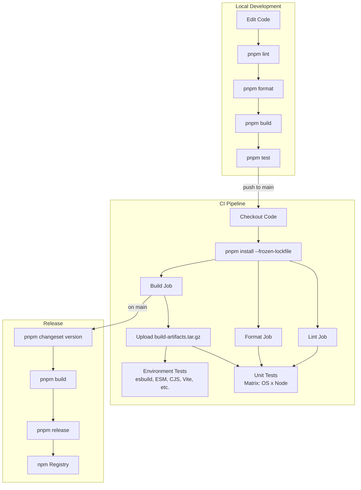
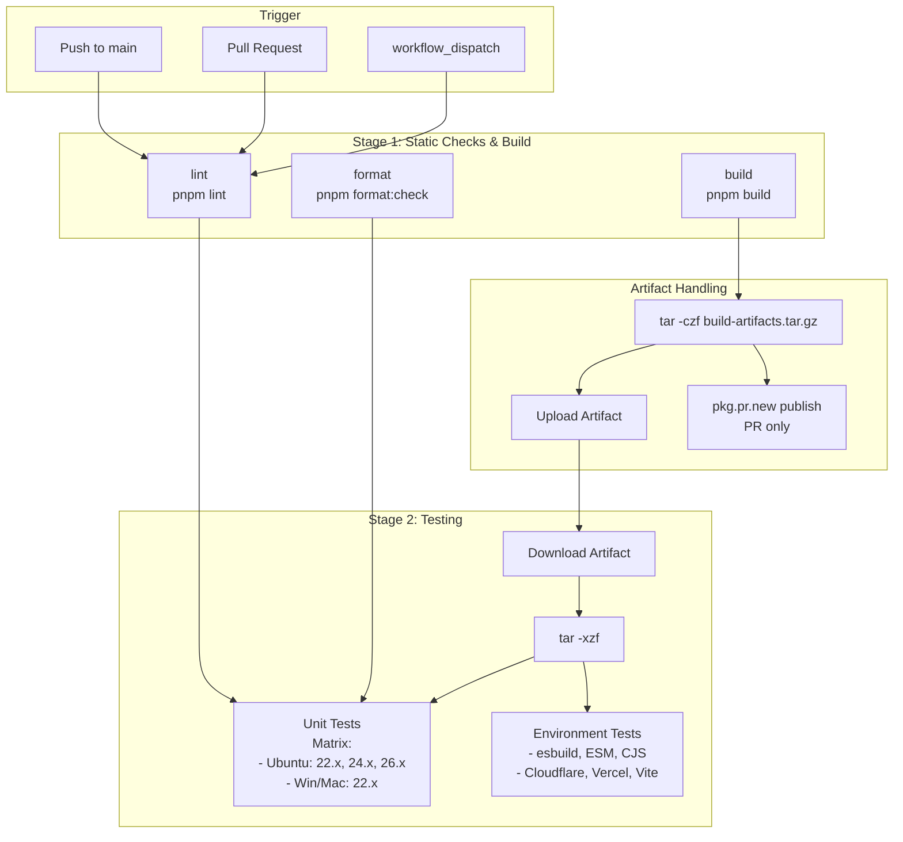

<!-- source: DeepWiki mcp.deepwiki.com · repo langchain-ai/langgraphjs · page 7 Development Infrastructure · fetched 2026-10-26 -->

# Development Infrastructure

<details>
<summary>Relevant source files</summary>

The following files were used as context for generating this wiki page:

- [.github/dependabot.yml](.github/dependabot.yml)
- [.github/workflows/ci.yml](.github/workflows/ci.yml)
- [.github/workflows/deploy_docs.yml](.github/workflows/deploy_docs.yml)
- [.github/workflows/release.yml](.github/workflows/release.yml)
- [.github/workflows/test-browser.yml](.github/workflows/test-browser.yml)
- [.github/workflows/test-exports.yml](.github/workflows/test-exports.yml)
- [.gitignore](.gitignore)
- [LICENSE](LICENSE)
- [README.md](README.md)
- [deno.json](deno.json)
- [examples/ui-react-transport/package.json](examples/ui-react-transport/package.json)
- [examples/ui-svelte/package.json](examples/ui-svelte/package.json)
- [examples/ui-vue/package.json](examples/ui-vue/package.json)
- [libs/checkpoint-validation/README.md](libs/checkpoint-validation/README.md)
- [libs/checkpoint-validation/bin/cli.js](libs/checkpoint-validation/bin/cli.js)
- [libs/langgraph/README.md](libs/langgraph/README.md)
- [package.json](package.json)
- [pnpm-lock.yaml](pnpm-lock.yaml)
- [turbo.json](turbo.json)

</details>


This document describes the development environment, build system, testing infrastructure, and CI/CD pipeline for the LangGraph.js monorepo. It covers the tooling and workflows used to develop, test, build, and release LangGraph.js packages.

**Scope**: This page focuses on development tooling and processes. For information about package organization and dependencies, see [Monorepo Structure](#7.1). For build configuration details, see [Build System](#7.2). For testing strategies and CI/CD pipelines, see [Testing and CI/CD](#7.3). For documentation generation, see [Documentation System](#7.4).

## Overview

The LangGraph.js repository is a **pnpm workspace** monorepo managed with **Turbo** for incremental builds and task orchestration. The infrastructure supports:

- **Package Management**: pnpm 10.27.0 with workspace protocol [package.json:3]()
- **Build System**: Turbo with caching [package.json:47](), tsdown for TypeScript compilation
- **Testing**: Docker Compose for integration tests [package.json:18-20](), multi-environment export validation [.github/workflows/test-exports.yml:1-20]()
- **CI/CD**: GitHub Actions with matrix testing across Node.js versions and operating systems [.github/workflows/ci.yml:110-123]()
- **Release Management**: Changesets for automated versioning and publishing [.github/workflows/release.yml:48-59]()
- **Documentation**: MkDocs Material for docs, TypeDoc for API reference [.github/workflows/deploy_docs.yml:28-42]()

Sources: [package.json:1-49](), [pnpm-lock.yaml:1-60](), [.github/workflows/ci.yml:1-30]()

## Development Workflow



**Development Workflow Stages**

The development workflow consists of three main stages:

1. **Local Development**: Developers edit code and run lint, format, build, and test commands locally [package.json:11-24]()
2. **CI Pipeline**: Automated checks run on every push, with parallel static checks followed by test execution [.github/workflows/ci.yml:4-24]()
3. **Release**: Changesets automate versioning and publishing to npm [.github/workflows/release.yml:48-55]()

Sources: [.github/workflows/ci.yml:1-168](), [.github/workflows/release.yml:1-59](), [package.json:11-25]()

## Package Manager and Node.js Requirements

### Node.js Version Support

The repository requires **Node.js 18 or higher** [package.json:5]() and officially tests against Node.js 22.x, 24.x, and 26.x on Ubuntu, Windows, and macOS [.github/workflows/ci.yml:113-123]().

Sources: [package.json:4-6](), [.github/workflows/ci.yml:26](), [.github/workflows/ci.yml:131-135]()

### pnpm Configuration

The monorepo uses **pnpm 10.27.0** [package.json:3]() with workspace protocol for internal package dependencies. The `pnpm` field in package.json configures:

| Configuration | Purpose |
|--------------|---------|
| `overrides` | Force specific versions across the entire workspace (e.g., `zod: ^4.3.5`, `@langchain/langgraph-sdk: workspace:*`) [package.json:51-84]() |
| `onlyBuiltDependencies` | Limit which native dependencies can be built (better-sqlite3, esbuild, etc.) [package.json:85-95]() |

Example override configuration from `package.json`:
```json
"overrides": {
  "@langchain/core": "^1.2.1",
  "@langchain/langgraph-sdk": "workspace:*",
  "zod": "^4.3.5",
  "better-sqlite3": "^12.10.0"
}
```

Sources: [package.json:50-96](), [pnpm-lock.yaml:1-40]()

## Build and Task Orchestration

The repository uses **Turbo** to manage task dependencies and caching. The `turbo.json` defines the task graph for the monorepo.

| Task | Command | Purpose |
|------|---------|---------|
| `build` | `turbo run build:internal` | Incremental build of all packages [package.json:12]() |
| `lint` | `oxlint` | Fast static analysis using `oxlint` [package.json:14]() |
| `format` | `oxfmt` | Code formatting using `oxfmt` [package.json:22]() |
| `test` | `turbo run test` | Unit testing across packages [package.json:17]() |

**Key Features**:
- **Incremental Builds**: Turbo caches build outputs and only rebuilds changed packages.
- **Fast Tooling**: Migration to `oxlint` and `oxfmt` for significantly faster static analysis compared to ESLint/Prettier [package.json:41-42]().

Sources: [package.json:11-25](), [pnpm-lock.yaml:93-95]()

## CI/CD Pipeline Architecture



**CI Pipeline Stages**

The CI pipeline follows a two-stage approach with concurrency control:

1. **Stage 1**: Static checks (`lint`, `format`) and `build` run in parallel [.github/workflows/ci.yml:32-91]().
2. **Stage 2**: Tests (`Unit Tests`, `Browser Tests`, `Environment Tests`) only run after all Stage 1 jobs pass [.github/workflows/ci.yml:110-168]().

**Concurrency Control**: 
```yaml
concurrency:
  group: ${{ github.workflow }}-${{ github.ref }}
  cancel-in-progress: true
```
This ensures only the latest commit in a PR runs CI, canceling outdated runs [.github/workflows/ci.yml:21-23]().

Sources: [.github/workflows/ci.yml:1-168]()

## Build Artifact Management

The CI pipeline uses a compressed tarball to share build outputs between jobs:

1. **Build Job**: Creates `build-artifacts.tar.gz` containing `libs/*/dist` and `.turbo` cache directories [.github/workflows/ci.yml:92-94]().
2. **Upload**: GitHub Actions artifact storage with 1-day retention [.github/workflows/ci.yml:100-105]().
3. **Test Jobs**: Download and extract artifacts before running tests to avoid redundant builds [.github/workflows/ci.yml:138-144]().

Sources: [.github/workflows/ci.yml:92-106](), [.github/workflows/ci.yml:138-145]()

## Testing Infrastructure

### Test Categories

| Test Type | Command | Purpose |
|-----------|---------|---------|
| Unit Tests | `pnpm test` | Fast feedback on core logic across Node versions [.github/workflows/ci.yml:145-150]() |
| Integration Tests | `pnpm test:int` | Test with real databases using `docker compose` [package.json:18-20]() |
| Export Tests | `pnpm test:exports:docker` | Validate package exports (ESM, CJS, esbuild, etc.) in Docker [package.json:21]() |
| Browser Tests | `browser-tests` job | Tests for framework SDKs (React, Angular, etc.) [.github/workflows/ci.yml:152-158]() |

Sources: [package.json:17-21](), [.github/workflows/ci.yml:110-168](), [.github/workflows/test-exports.yml:1-93]()

### Environment Test Matrix

The export tests validate package compatibility across different JavaScript environments using Docker Compose:

- **Bundlers**: esbuild, Vite, tsc [.github/workflows/test-exports.yml:24-93]()
- **Module Systems**: Native ESM, CommonJS (CJS) [.github/workflows/test-exports.yml:34-53]()
- **Edge Runtimes**: Cloudflare Workers, Vercel Edge [.github/workflows/test-exports.yml:54-73]()

Sources: [.github/workflows/test-exports.yml:1-93]()

## Release Automation

The release process is managed by **Changesets**, which handles versioning and changelog generation.

1. **Versioning**: `pnpm changeset version` updates package versions and changelogs [.github/workflows/release.yml:53]().
2. **Publishing**: `pnpm release` (which runs `pnpm changeset publish`) publishes packages to npm [.github/workflows/release.yml:52]().
3. **Provenance**: Releases are published with npm provenance for security [.github/workflows/release.yml:58]().

Sources: [.github/workflows/release.yml:1-59](), [package.json:13](), [package.json:24]()

## Documentation Infrastructure

The documentation system uses **MkDocs** and **Python** for site generation:

1. **Environment**: Uses `uv` for fast Python dependency management [.github/workflows/deploy_docs.yml:35-37]().
2. **Build Process**: Builds the site using `make build-docs` inside the `docs` directory [.github/workflows/deploy_docs.yml:61-62]().
3. **Deployment**: Automatically deploys to GitHub Pages from the `main` branch [.github/workflows/deploy_docs.yml:74-78]().

Sources: [.github/workflows/deploy_docs.yml:1-78]()

---

