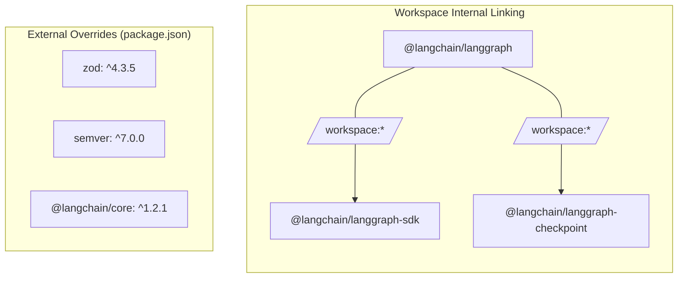

<!-- source: DeepWiki mcp.deepwiki.com · repo langchain-ai/langgraphjs · page 7.1 Monorepo Structure · fetched 2026-10-26 -->

# Monorepo Structure

Relevant source files

The following files were used as context for generating this wiki page:

- [.gitignore](.gitignore)
- [README.md](README.md)
- [deno.json](deno.json)
- [examples/ui-react-transport/package.json](examples/ui-react-transport/package.json)
- [examples/ui-svelte/package.json](examples/ui-svelte/package.json)
- [examples/ui-vue/package.json](examples/ui-vue/package.json)
- [libs/checkpoint-mongodb/tsconfig.json](libs/checkpoint-mongodb/tsconfig.json)
- [libs/checkpoint-postgres/tsconfig.json](libs/checkpoint-postgres/tsconfig.json)
- [libs/checkpoint-sqlite/tsconfig.json](libs/checkpoint-sqlite/tsconfig.json)
- [libs/checkpoint-validation/README.md](libs/checkpoint-validation/README.md)
- [libs/checkpoint-validation/bin/cli.js](libs/checkpoint-validation/bin/cli.js)
- [libs/checkpoint-validation/tsconfig.json](libs/checkpoint-validation/tsconfig.json)
- [libs/checkpoint/tsconfig.json](libs/checkpoint/tsconfig.json)
- [libs/langgraph-supervisor/tsconfig.json](libs/langgraph-supervisor/tsconfig.json)
- [libs/langgraph/README.md](libs/langgraph/README.md)
- [libs/langgraph/tsconfig.json](libs/langgraph/tsconfig.json)
- [package.json](package.json)
- [pnpm-lock.yaml](pnpm-lock.yaml)

This document describes the organization of the LangGraph.js monorepo, including its directory layout, package structure, dependency relationships, and workspace configuration. This repository uses `pnpm` workspaces with Turbo for build orchestration and Changesets for release management.

For information about the build system and tooling, see [Build System](#7.2). For CI/CD and testing infrastructure, see [Testing and CI/CD](#7.3).

## Overview

The LangGraph.js codebase is organized as a monorepo containing 20+ packages across four major categories: core framework libraries, checkpoint persistence implementations, platform tools (API/CLI/UI), and client SDK. The repository uses `pnpm@10.27.0` as its package manager with workspace protocol for internal dependencies, enabling efficient dependency management and parallel builds across packages [package.json:1-3]().

**Sources:** [package.json:1-62](), [pnpm-lock.yaml:1-15]()

## Directory Structure

The monorepo follows a hierarchical directory structure with clear separation between publishable packages, examples, internal tooling, and documentation.

```mermaid
graph TB
    root["langgraphjs/ (root)"]
    libs["libs/ (publishable packages)"]
    examples["examples/ (example apps)"]
    internal["internal/ (build tools)"]
    docs["docs/ (documentation)"]
    
    root --> libs
    root --> examples
    root --> internal
    root --> docs
    
    libs --> core_pkgs["Core Framework"]
    libs --> ckpt_pkgs["Checkpoint Packages"]
    libs --> platform_pkgs["Platform Packages"]
    libs --> agent_pkgs["Specialized Agents"]
    libs --> util_pkgs["Utilities"]
    
    core_pkgs --> langgraph_core["langgraph-core/"]
    core_pkgs --> langgraph["langgraph/"]
    core_pkgs --> checkpoint["checkpoint/"]
    core_pkgs --> sdk["sdk/"]
    
    ckpt_pkgs --> ckpt_sqlite["checkpoint-sqlite/"]
    ckpt_pkgs --> ckpt_postgres["checkpoint-postgres/"]
    ckpt_pkgs --> ckpt_mongo["checkpoint-mongodb/"]
    ckpt_pkgs --> ckpt_redis["checkpoint-redis/"]
    ckpt_pkgs --> ckpt_val["checkpoint-validation/"]
    
    platform_pkgs --> api["langgraph-api/"]
    platform_pkgs --> cli["langgraph-cli/"]
    platform_pkgs --> ui["langgraph-ui/"]
    
    agent_pkgs --> supervisor["langgraph-supervisor/"]
    agent_pkgs --> swarm["langgraph-swarm/"]
    agent_pkgs --> cua["langgraph-cua/"]
    
    util_pkgs --> create["create-langgraph/"]
    util_pkgs --> sdk_val["sdk-validation/"]
    
    examples --> ex_agent["agent_executor/"]
    examples --> ex_chat["chat_agent_executor_with_function_calling/"]
    examples --> ex_multi["multi_agent/"]
    examples --> ex_plan["plan-and-execute/"]
    examples --> ex_rag["rag/"]
    examples --> ex_ui["ui-react/"]
    examples --> ex_more["... (10+ more)"]
    
    internal --> bench["bench/"]
    internal --> build["build/"]
```

**Sources:** [pnpm-lock.yaml:41-210]()

## Package Organization

### Core Framework Packages

The core framework consists of foundational packages that provide the execution engine, state management, and base interfaces. Note that `@langchain/langgraph` acts as the primary entry point for users [libs/langgraph/README.md:25]().

| Package | Published Name | Purpose | Configuration |
|---------|---------------|---------|------------------|
| `libs/langgraph-core/` | `@langchain/langgraph-core` | Low-level Pregel runtime and Graph primitives | [libs/langgraph/tsconfig.json:1-25]() |
| `libs/langgraph/` | `@langchain/langgraph` | Main user-facing library for StateGraph and agents | [libs/langgraph/README.md:22-26]() |
| `libs/checkpoint/` | `@langchain/langgraph-checkpoint` | Base persistence interfaces | [libs/checkpoint/tsconfig.json:1-10]() |
| `libs/sdk/` | `@langchain/langgraph-sdk` | Client SDK for interacting with LangGraph API | [pnpm-lock.yaml:53-54]() |

**Sources:** [libs/langgraph/README.md:22-26](), [libs/langgraph/tsconfig.json:1-25](), [pnpm-lock.yaml:53-54]()

### Checkpoint Persistence Packages

Each checkpoint implementation provides a concrete storage backend. The `checkpoint-validation` package provides a standardized test suite for ensuring implementation compliance [libs/checkpoint-validation/README.md:1-15]().

| Package | Published Name | Storage Backend | Primary Dependency |
|---------|---------------|-----------------|------------------------|
| `libs/checkpoint-sqlite/` | `@langchain/langgraph-checkpoint-sqlite` | SQLite | `better-sqlite3` [package.json:83]() |
| `libs/checkpoint-postgres/` | `@langchain/langgraph-checkpoint-postgres` | PostgreSQL | `pg` |
| `libs/checkpoint-mongodb/` | `@langchain/langgraph-checkpoint-mongodb` | MongoDB | `mongodb` |
| `libs/checkpoint-validation/` | `@langchain/langgraph-checkpoint-validation` | Test Harness | `CheckpointerTestInitializer` [libs/checkpoint-validation/README.md:10]() |

**Sources:** [libs/checkpoint-validation/README.md:1-15](), [package.json:83](), [libs/checkpoint-sqlite/tsconfig.json:1-10]()

### Specialized Agent Packages

Pre-built agent pattern implementations that extend the core framework.

| Package | Published Name | Pattern |
|---------|---------------|---------|
| `libs/langgraph-supervisor/` | `@langchain/langgraph-supervisor` | Supervisor-worker orchestration |
| `libs/langgraph-swarm/` | `@langchain/langgraph-swarm` | Autonomous agent coordination |

**Sources:** [libs/langgraph-supervisor/tsconfig.json:1-24](), [pnpm-lock.yaml:1885-2020]()

## Workspace Configuration

### pnpm Workspace Protocol and Overrides

The monorepo uses pnpm's workspace protocol (`workspace:*`) to ensure that internal packages always link to the local source rather than published versions. Global overrides in the root `package.json` enforce version consistency across all sub-packages [package.json:50-84]().

**Key Overrides:**
- `@langchain/core`: Forced to `^1.2.1` across the repo [package.json:52]().
- `zod`: Standardized to `^4.3.5` [package.json:57]().
- `better-sqlite3`: Standardized to `^12.10.0` [package.json:83]().

**Sources:** [package.json:50-84](), [pnpm-lock.yaml:7-15]()

### Build Dependencies Configuration

Certain packages with native bindings or heavy build requirements are restricted to build-only using `pnpm.onlyBuiltDependencies` to prevent unexpected execution of install scripts [package.json:85-96]().

**Restricted Dependencies:**
- `@swc/core` [package.json:86]()
- `better-sqlite3` [package.json:87]()
- `esbuild` [package.json:89]()

**Sources:** [package.json:85-96]()

## Examples Directory

The `examples/` directory contains standalone applications demonstrating different integration patterns. These examples often demonstrate multi-framework support (React, Svelte, Vue).

| Directory | Framework | Entry Point / Script |
|-----------|-----------|----------------------|
| `examples/ui-react-transport/` | React | `vite` / `tsx src/app.ts` [examples/ui-react-transport/package.json:7-8]() |
| `examples/ui-svelte/` | Svelte | `langgraphjs dev` [examples/ui-svelte/package.json:8]() |
| `examples/ui-vue/` | Vue | `langgraphjs dev` [examples/ui-vue/package.json:8]() |

**Sources:** [examples/ui-react-transport/package.json:1-33](), [examples/ui-svelte/package.json:1-28](), [examples/ui-vue/package.json:1-30]()

## Root-Level Scripts

The root `package.json` defines monorepo-wide scripts that delegate tasks to `turbo` for optimized execution [package.json:11-25]().

| Script | Command | Purpose |
|--------|---------|---------|
| `build` | `turbo run build:internal` | Parallel build of all packages |
| `test:int` | `pnpm test:int:deps && turbo run test:int` | Integration tests with Docker dependencies |
| `test:int:deps` | `docker compose -f int-test-deps-docker-compose.yml up -d` | Spin up Postgres/Mongo/Redis for testing |
| `release` | `pnpm changeset publish` | Release management via Changesets |

**Sources:** [package.json:11-25]()

## Cross-Environment Support

### Deno Compatibility

The `deno.json` file provides explicit import mappings to ensure that LangGraph.js can be used in Deno environments by mapping npm specifiers to specific versions [deno.json:1-23]().

**Key Mappings:**
- `@langchain/langgraph`: `npm:/@langchain/langgraph@0.1.1` [deno.json:9]()
- `@langchain/core/`: `npm:/@langchain/core@latest/` [deno.json:8]()

**Sources:** [deno.json:1-23]()

---

