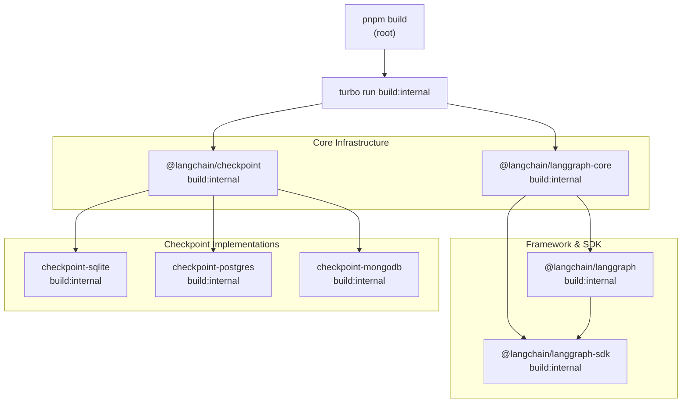
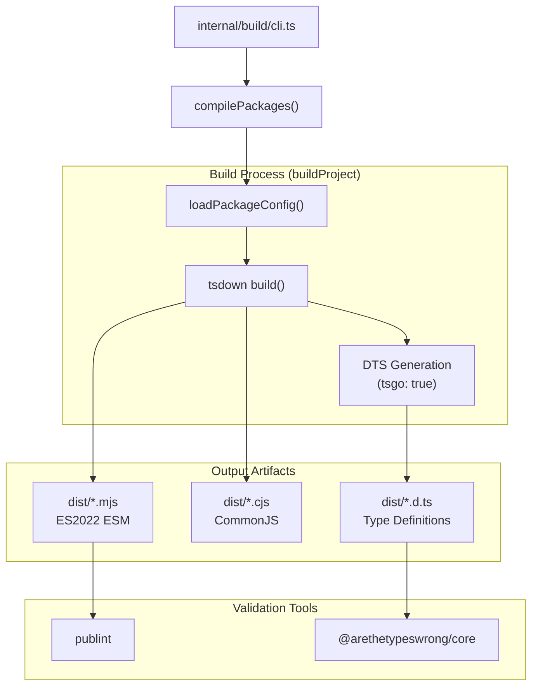
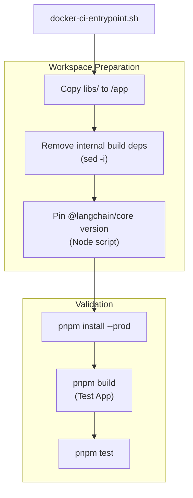

<!-- source: DeepWiki mcp.deepwiki.com · repo langchain-ai/langgraphjs · page 7.2 Build System · fetched 2026-10-26 -->

# Build System

Relevant source files

The following files were used as context for generating this wiki page:

- [.github/dependabot.yml](.github/dependabot.yml)
- [.github/workflows/ci.yml](.github/workflows/ci.yml)
- [.github/workflows/deploy_docs.yml](.github/workflows/deploy_docs.yml)
- [.github/workflows/release.yml](.github/workflows/release.yml)
- [.github/workflows/test-browser.yml](.github/workflows/test-browser.yml)
- [.github/workflows/test-exports.yml](.github/workflows/test-exports.yml)
- [LICENSE](LICENSE)
- [internal/build/index.ts](internal/build/index.ts)
- [internal/build/package.json](internal/build/package.json)
- [internal/environment_tests/scripts/docker-ci-entrypoint.sh](internal/environment_tests/scripts/docker-ci-entrypoint.sh)
- [libs/checkpoint-mongodb/turbo.json](libs/checkpoint-mongodb/turbo.json)
- [libs/checkpoint-postgres/turbo.json](libs/checkpoint-postgres/turbo.json)
- [libs/checkpoint-sqlite/turbo.json](libs/checkpoint-sqlite/turbo.json)
- [libs/checkpoint-validation/turbo.json](libs/checkpoint-validation/turbo.json)
- [libs/checkpoint/turbo.json](libs/checkpoint/turbo.json)
- [libs/create-langgraph/turbo.json](libs/create-langgraph/turbo.json)
- [libs/langgraph-api/turbo.json](libs/langgraph-api/turbo.json)
- [libs/langgraph-cli/turbo.json](libs/langgraph-cli/turbo.json)
- [libs/langgraph-cua/turbo.json](libs/langgraph-cua/turbo.json)
- [libs/langgraph-supervisor/turbo.json](libs/langgraph-supervisor/turbo.json)
- [libs/langgraph-swarm/turbo.json](libs/langgraph-swarm/turbo.json)
- [libs/sdk-react/src/tests/stream.suspense.test.tsx](libs/sdk-react/src/tests/stream.suspense.test.tsx)
- [libs/sdk/src/utils/async_caller.test.ts](libs/sdk/src/utils/async_caller.test.ts)
- [libs/sdk/src/utils/async_caller.ts](libs/sdk/src/utils/async_caller.ts)
- [libs/sdk/tsdown.config.ts](libs/sdk/tsdown.config.ts)
- [turbo.json](turbo.json)

This page documents the build system for the LangGraph.js monorepo, covering build orchestration with Turbo, compilation tooling via `tsdown`, artifact generation, and dual module format (ESM/CJS) support.

## Build Orchestration with Turbo

The LangGraph.js build system uses **Turbo** to orchestrate tasks across the monorepo. Turbo provides incremental builds, dependency-aware task execution, and caching to optimize performance.

The orchestration is configured in [turbo.json:1-34]().

### Task Configuration

Turbo defines build-related tasks with specific dependency relationships:

| Task | Dependencies | Outputs | Cache |
|------|--------------|---------|-------|
| `build` | `^build` | `dist/**` | Yes |
| `build:internal` | `^build:internal` | `dist/**` | Yes |
| `test` | `^build:internal`, `build:internal` | None | No |
| `clean` | `^clean` | None | Yes |

The `^` prefix indicates dependencies on upstream packages in the workspace. For example, `build:internal` depends on the `build:internal` task of all packages listed as dependencies in a package's `package.json` [turbo.json:9-12]().

### Build Task Dependency Graph

**Sources:** [turbo.json:4-12](), [.github/workflows/ci.yml:90]()

## Compilation with tsdown

The monorepo uses `tsdown` (a fast TypeScript bundler built on top of Rolldown/esbuild) for compiling source code. The configuration is centralized in the internal build package.

### Internal Build Package (`@langchain/build`)

The `internal/build` package encapsulates the build logic and is used by other workspace packages as a devDependency [internal/build/package.json:1-36]().

Key components:
- **`compilePackages`**: The main entry point that finds workspace packages and initiates the build [internal/build/index.ts:22-34]().
- **`buildProject`**: Configures `tsdown` with defaults for the monorepo, including sourcemaps, platform targets, and module formats [internal/build/index.ts:36-145]().

### Build Tooling Architecture

**Sources:** [internal/build/index.ts:36-145](), [internal/build/package.json:12-21]()

## Dual Module Format (ESM/CJS)

LangGraph.js ships as a dual-module package to support both modern ESM environments and legacy CommonJS runtimes.

### Format Detection
The build system automatically determines whether to emit CJS based on the `exports` field in the package's `package.json`. If a `require` condition is present, it generates both formats; otherwise, it defaults to ESM-only [internal/build/index.ts:47-50]().

### Bundling ESM Dependencies
To support CJS consumers on older Node.js versions, the build system can bundle pure-ESM dependencies (like `p-retry` or `p-queue`) into the output. This is configured via `noExternal` in a package's `tsdown.config.ts` [libs/sdk/src/utils/async_caller.ts:5-12](), [internal/build/index.ts:52-59]().

### tsdown Configuration Overrides
Packages can provide a `tsdown.config.ts` file to override default build settings. The build system searches for these files and merges them with the base configuration [internal/build/index.ts:147-171]().

**Sources:** [internal/build/index.ts:47-60](), [libs/sdk/src/utils/async_caller.ts:13-17]()

## Build Artifact Generation and CI

In CI environments, build artifacts are generated once and shared across different test jobs to ensure consistency and reduce execution time.

### CI Artifact Flow
1. **Build Stage**: The `build` job runs `pnpm build` [ .github/workflows/ci.yml:90]().
2. **Archiving**: It creates a tarball containing all `dist/` and `.turbo/` directories [ .github/workflows/ci.yml:93]().
3. **Distribution**: The `build-artifacts.tar.gz` is uploaded [ .github/workflows/ci.yml:100-105]().
4. **Consumption**: Downstream jobs (unit tests, browser tests, environment tests) download and extract the archive before running [ .github/workflows/ci.yml:138-144]().

### Environment and Export Tests
A dedicated suite of "Environment Tests" verifies the integrity of the generated artifacts across various runtimes using Docker [ .github/workflows/test-exports.yml:1-93]().

| Test Target | Purpose |
|-------------|---------|
| `exports-esm` | Verifies ESM imports in Node.js [ .github/workflows/test-exports.yml:34-42]() |
| `exports-cjs` | Verifies CJS requires in Node.js [ .github/workflows/test-exports.yml:44-52]() |
| `exports-cf` | Validates compatibility with Cloudflare Workers [ .github/workflows/test-exports.yml:54-62]() |
| `exports-vite` | Ensures the build works with Vite bundlers [ .github/workflows/test-exports.yml:74-82]() |
| `exports-tsc` | Checks type definition compatibility [ .github/workflows/test-exports.yml:84-92]() |

### Docker Entrypoint Logic
The environment tests use a specialized script (`docker-ci-entrypoint.sh`) to prepare a minimal workspace, remove unnecessary devDependencies, and pin `@langchain/core` versions to match the build [internal/environment_tests/scripts/docker-ci-entrypoint.sh:1-112]().

**Sources:** [.github/workflows/ci.yml:72-106](), [.github/workflows/test-exports.yml:24-93](), [internal/environment_tests/scripts/docker-ci-entrypoint.sh:66-112]()

---

