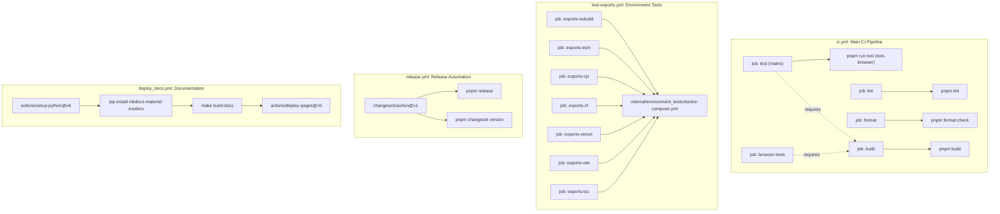
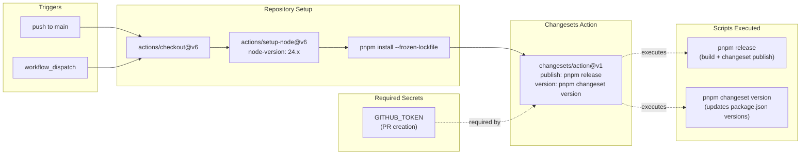
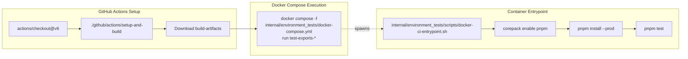
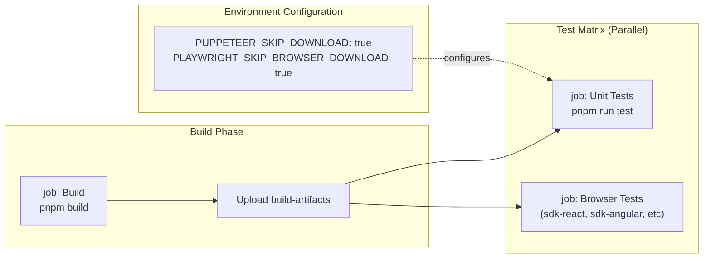

<!-- source: DeepWiki mcp.deepwiki.com · repo langchain-ai/langgraphjs · page 7.3 Testing and CI/CD · fetched 2026-10-26 -->

# Testing and CI/CD

Relevant source files

The following files were used as context for generating this wiki page:

- [.github/dependabot.yml](.github/dependabot.yml)
- [.github/workflows/ci.yml](.github/workflows/ci.yml)
- [.github/workflows/deploy_docs.yml](.github/workflows/deploy_docs.yml)
- [.github/workflows/release.yml](.github/workflows/release.yml)
- [.github/workflows/test-browser.yml](.github/workflows/test-browser.yml)
- [.github/workflows/test-exports.yml](.github/workflows/test-exports.yml)
- [LICENSE](LICENSE)
- [internal/build/index.ts](internal/build/index.ts)
- [internal/build/package.json](internal/build/package.json)
- [internal/environment_tests/scripts/docker-ci-entrypoint.sh](internal/environment_tests/scripts/docker-ci-entrypoint.sh)
- [internal/environment_tests/test-exports-vercel/eslint.config.mjs](internal/environment_tests/test-exports-vercel/eslint.config.mjs)
- [internal/environment_tests/test-exports-vercel/package.json](internal/environment_tests/test-exports-vercel/package.json)
- [libs/sdk-react/src/tests/stream.suspense.test.tsx](libs/sdk-react/src/tests/stream.suspense.test.tsx)
- [libs/sdk/src/utils/async_caller.test.ts](libs/sdk/src/utils/async_caller.test.ts)
- [libs/sdk/src/utils/async_caller.ts](libs/sdk/src/utils/async_caller.ts)
- [libs/sdk/tsdown.config.ts](libs/sdk/tsdown.config.ts)
- [turbo.json](turbo.json)

This page documents the testing and CI/CD infrastructure for LangGraph.js. The system is designed to ensure code quality, environment compatibility, and reliable releases across the monorepo. The infrastructure is based on GitHub Actions workflows, Docker-based environment validation, and Changesets for versioning and publishing.

## CI/CD Pipeline Overview

LangGraph.js uses four primary GitHub Actions workflows to automate the development lifecycle:

- `ci.yml`: Main CI pipeline for build, lint, format, and test validation.
- `test-exports.yml`: Environment and compatibility testing across multiple build tools and runtimes.
- `release.yml`: Automated release management and NPM publishing using Changesets.
- `deploy_docs.yml`: Documentation build and deployment to GitHub Pages.

### CI/CD Workflow Architecture

**Sources:**  
[.github/workflows/ci.yml:29-158]()  
[.github/workflows/test-exports.yml:23-93]()  
[.github/workflows/release.yml:18-59]()  
[.github/workflows/deploy_docs.yml:19-78]()

## Release Management and Changesets

LangGraph.js uses Changesets for automated versioning and publishing of packages in the monorepo. The release process is triggered by pushes to the `main` branch.

### Release Workflow and Code Entities

- The workflow is defined in [.github/workflows/release.yml:1-59]().
- The `changesets/action@v1` step manages versioning, changelog generation, and NPM publishing [ .github/workflows/release.yml:49-59]().
- The `pnpm release` command is used for publishing, while `pnpm changeset version` handles version bumps [.github/workflows/release.yml:52-53]().
- `NPM_CONFIG_PROVENANCE` is enabled to provide build transparency for published packages [.github/workflows/release.yml:58]().

### Release Workflow Execution

The release workflow executes automatically on pushes to `main`. The `changesets/action@v1` GitHub Action orchestrates the entire release process:

**Release Pipeline Flow**

**Sources:**  
[.github/workflows/release.yml:18-59]()

## Environment Compatibility and Integration Testing

The `test-exports.yml` workflow validates that LangGraph.js packages are compatible with a variety of JavaScript build tools, module formats, and deployment targets. Each job runs in a Docker container for isolation and reproducibility.

### Test Environment Matrix

| Job Name         | Build Tool / Target         | Purpose                        |
|------------------|----------------------------|--------------------------------|
| `exports-esbuild`| esbuild                    | Bundle compatibility           |
| `exports-esm`    | TypeScript/ESM             | ES Module support              |
| `exports-cjs`    | TypeScript/CJS             | CommonJS compatibility         |
| `exports-cf`     | Cloudflare Workers         | Edge runtime compatibility     |
| `exports-vercel` | Vercel Edge Functions      | Edge runtime compatibility     |
| `exports-vite`   | Vite                       | Frontend build tool            |
| `exports-tsc`    | tsc                        | TypeScript compilation         |

All jobs use the Docker Compose file at `internal/environment_tests/docker-compose.yml` to define their environment [.github/workflows/test-exports.yml:32-92]().

### Environment Test Execution Pipeline

The `docker-ci-entrypoint.sh` script prepares the environment within the container, handling pnpm setup and workspace package cleanup to ensure tests run against built artifacts rather than source code [internal/environment_tests/scripts/docker-ci-entrypoint.sh:1-112]().

**Environment Test Job Flow**

**Sources:**  
[.github/workflows/test-exports.yml:23-93]()  
[internal/environment_tests/scripts/docker-ci-entrypoint.sh:1-112]()

## Documentation Build and Deployment

Documentation is built and deployed using the `deploy_docs.yml` workflow. The process uses MkDocs for static site generation and GitHub Pages for hosting.

- Python dependencies are installed using `uv` and `pip` [.github/workflows/deploy_docs.yml:34-42]().
- Node.js dependencies are installed with `pnpm install --frozen-lockfile` [.github/workflows/deploy_docs.yml:55]().
- The documentation build includes both TypeScript API docs and manual content via `make build-docs` [.github/workflows/deploy_docs.yml:62]().

**Sources:**  
[.github/workflows/deploy_docs.yml:19-78]()

## Testing Infrastructure

The main CI workflow implements a comprehensive test matrix covering multiple Node.js versions and operating systems.

### Test Matrix Configuration

The test job uses a strategy matrix to ensure cross-platform compatibility [.github/workflows/ci.yml:113-123]():

| Matrix Dimension | Values |
|------------------|--------|
| `os` | `ubuntu-latest`, `windows-latest`, `macos-latest` |
| `node-version` | `22.x`, `24.x`, `26.x` |

### CI Job Pipeline

**Main CI Test Flow**

### Specialized Browser Tests

Browser-based SDK tests (React, Angular, Vue, Svelte) are isolated into a dedicated workflow `test-browser.yml` to avoid Chrome connection timeouts in the main runner [.github/workflows/ci.yml:148-150](). This workflow uses `dorny/paths-filter` to only run tests for packages that have changed [.github/workflows/test-browser.yml:27-55]().

**Sources:**  
[.github/workflows/ci.yml:110-158]()  
[.github/workflows/test-browser.yml:1-119]()

## Build System Integration

The internal build package `@langchain/build` uses `tsdown` for artifact generation. It supports dual-module output (ESM/CJS) and performs automated build checks including:

- `attw`: Check for module resolution issues via `@arethetypeswrong/core` [internal/build/index.ts:101-104]().
- `publint`: Validates `package.json` for NPM publishing standards [internal/build/index.ts:110-116]().
- `unbundle`: Configured to true to maintain clean internal package structures [internal/build/index.ts:129]().

### Build and Test Commands

| Command | File Context | Purpose |
|---------|--------------|---------|
| `pnpm build` | `turbo.json:5` | Runs build across all workspace packages with dependency tracking. |
| `pnpm test` | `turbo.json:13` | Runs unit tests; depends on `build:internal`. |
| `pnpm test:int` | `turbo.json:20` | Runs integration tests. |

**Sources:**  
[turbo.json:1-34]()  
[internal/build/index.ts:1-171]()

## Concurrency and Resource Management

The CI system implements intelligent concurrency management to optimize resource usage while maintaining test reliability. Workflows use cancellation policies that terminate outdated runs when new commits are pushed to the same branch or pull request.

The main CI workflow uses the concurrency group `${{ github.workflow }}-${{ github.ref }}` [.github/workflows/ci.yml:21-23]().

**Sources:**  
[.github/workflows/ci.yml:21-23]()  
[.github/workflows/test-exports.yml:17-19]()  
[.github/workflows/test-browser.yml:17-19]()

---

