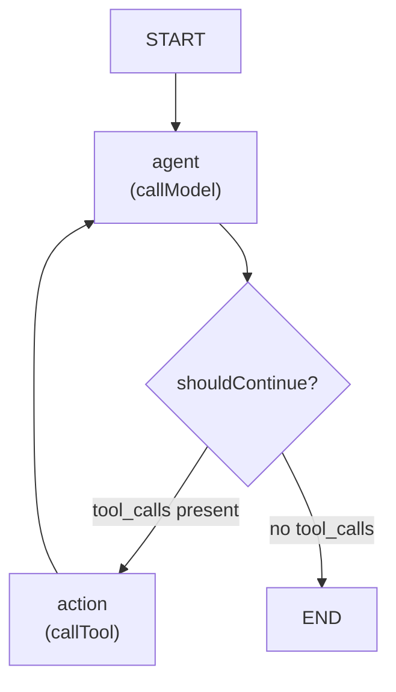
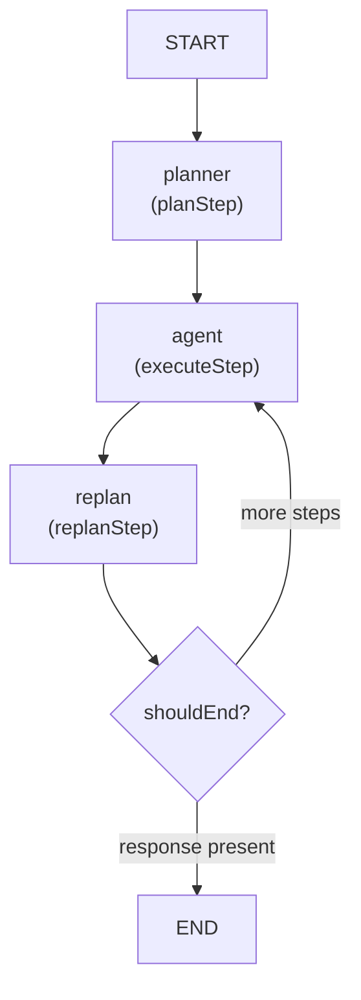
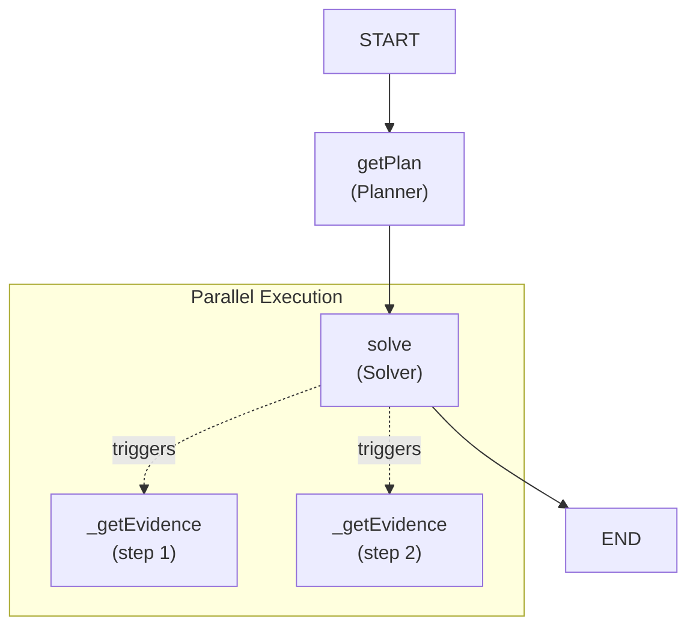
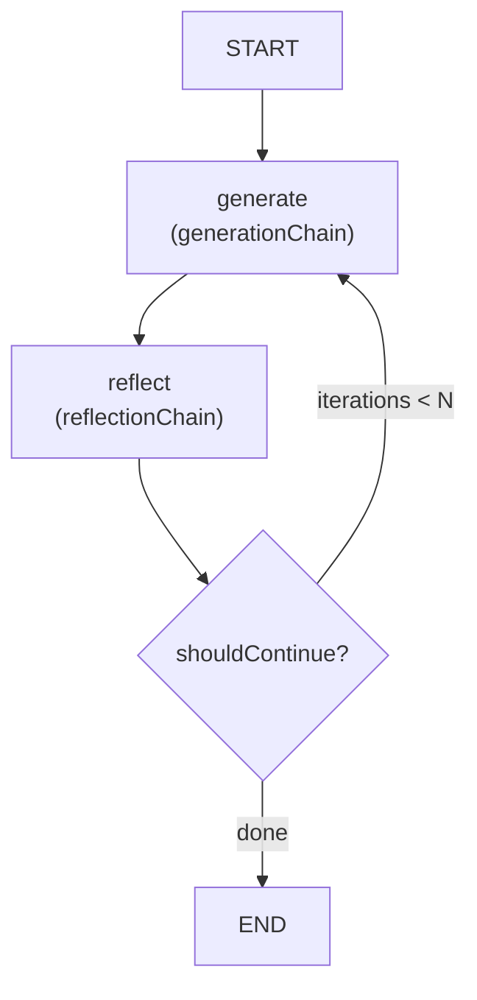
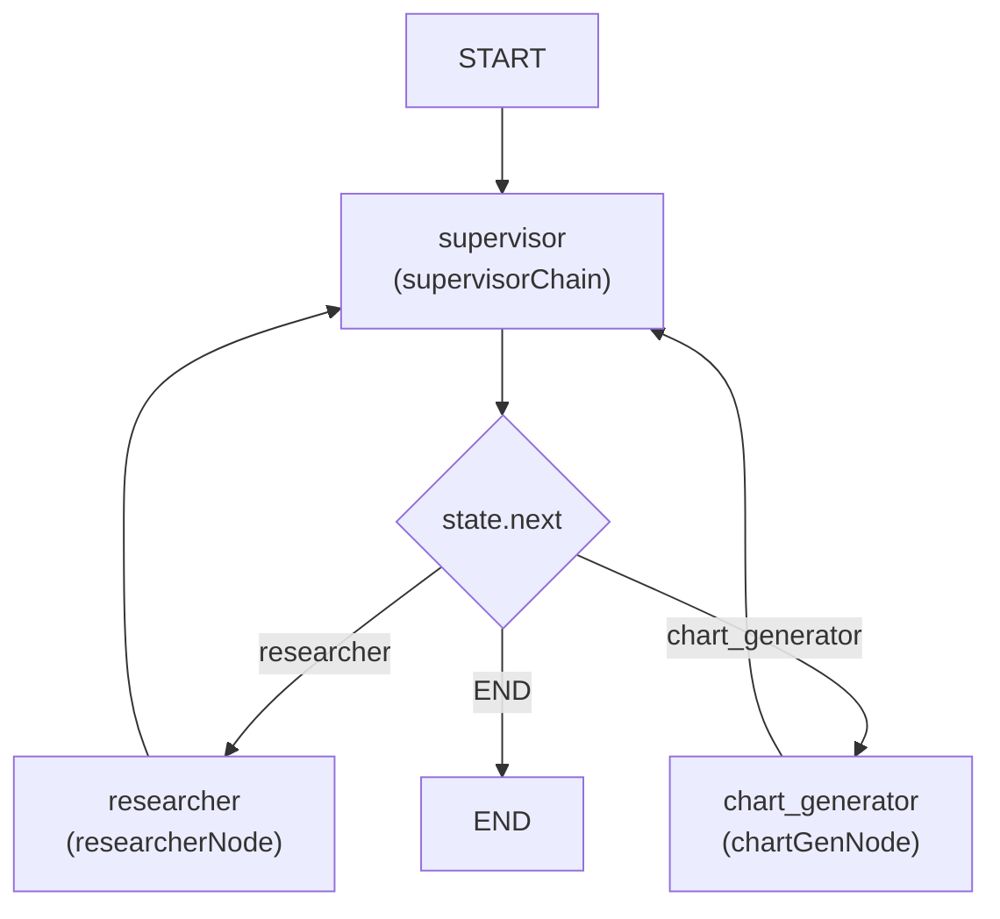
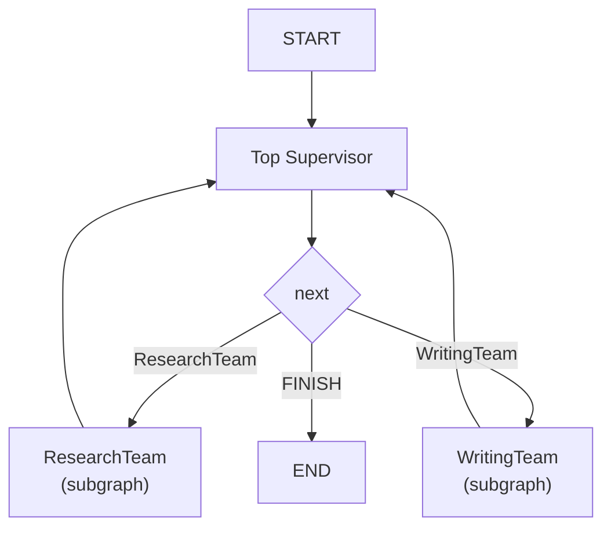

<!-- source: DeepWiki mcp.deepwiki.com · repo langchain-ai/langgraphjs · page 8 Examples and Patterns · fetched 2026-10-26 -->

# Examples and Patterns

<details>
<summary>Relevant source files</summary>

The following files were used as context for generating this wiki page:

- [examples/agent_executor/base.ipynb](examples/agent_executor/base.ipynb)
- [examples/chat_agent_executor_with_function_calling/base.ipynb](examples/chat_agent_executor_with_function_calling/base.ipynb)
- [examples/chatbot-simulation-evaluation/package.json](examples/chatbot-simulation-evaluation/package.json)
- [examples/chatbots/package.json](examples/chatbots/package.json)
- [examples/how-tos/branching.ipynb](examples/how-tos/branching.ipynb)
- [examples/how-tos/configuration.ipynb](examples/how-tos/configuration.ipynb)
- [examples/how-tos/dynamically-returning-directly.ipynb](examples/how-tos/dynamically-returning-directly.ipynb)
- [examples/how-tos/force-calling-a-tool-first.ipynb](examples/how-tos/force-calling-a-tool-first.ipynb)
- [examples/how-tos/managing-agent-steps.ipynb](examples/how-tos/managing-agent-steps.ipynb)
- [examples/how-tos/package.json](examples/how-tos/package.json)
- [examples/how-tos/persistence.ipynb](examples/how-tos/persistence.ipynb)
- [examples/how-tos/respond-in-format.ipynb](examples/how-tos/respond-in-format.ipynb)
- [examples/how-tos/stream-tokens.ipynb](examples/how-tos/stream-tokens.ipynb)
- [examples/how-tos/subgraph.ipynb](examples/how-tos/subgraph.ipynb)
- [examples/how-tos/time-travel.ipynb](examples/how-tos/time-travel.ipynb)
- [examples/multi_agent/agent_supervisor.ipynb](examples/multi_agent/agent_supervisor.ipynb)
- [examples/multi_agent/hierarchical_agent_teams.ipynb](examples/multi_agent/hierarchical_agent_teams.ipynb)
- [examples/multi_agent/multi_agent_collaboration.ipynb](examples/multi_agent/multi_agent_collaboration.ipynb)
- [examples/multi_agent/package.json](examples/multi_agent/package.json)
- [examples/plan-and-execute/package.json](examples/plan-and-execute/package.json)
- [examples/plan-and-execute/plan-and-execute.ipynb](examples/plan-and-execute/plan-and-execute.ipynb)
- [examples/quickstart/package.json](examples/quickstart/package.json)
- [examples/rag/langgraph_agentic_rag.ipynb](examples/rag/langgraph_agentic_rag.ipynb)
- [examples/rag/langgraph_crag.ipynb](examples/rag/langgraph_crag.ipynb)
- [examples/rag/langgraph_crag_mistral.ipynb](examples/rag/langgraph_crag_mistral.ipynb)
- [examples/rag/langgraph_self_rag.ipynb](examples/rag/langgraph_self_rag.ipynb)
- [examples/rag/package.json](examples/rag/package.json)
- [examples/reflection/img/reflection.png](examples/reflection/img/reflection.png)
- [examples/reflection/package.json](examples/reflection/package.json)
- [examples/reflection/reflection.ipynb](examples/reflection/reflection.ipynb)
- [examples/rewoo/package.json](examples/rewoo/package.json)
- [examples/rewoo/rewoo.ipynb](examples/rewoo/rewoo.ipynb)

</details>


This document provides an overview of common agent orchestration patterns implemented in LangGraphJS. These patterns demonstrate practical approaches to building stateful single-agent and multi-agent systems, each optimized for different use cases and complexity levels.

For information about the core graph building primitives used in these patterns, see [StateGraph and Graph Building](#2.1). For details on how to use persistence, streaming, and human-in-the-loop features, see [Core How-To Examples](#8.1).

---

## Single-Agent Patterns

Single-agent patterns focus on how a single LLM-powered agent can solve tasks through different reasoning and execution strategies.

### Basic Agent Executor (ReAct Pattern)

The most fundamental agent pattern implements the ReAct (Reasoning and Acting) approach where an agent iteratively reasons about the next action, executes tools, and observes results until the task is complete.

**Architecture:**



**Implementation Components:**

The ReAct agent uses a simple two-node graph defined using `StateGraph`:
- **`callModel` node**: Invokes the LLM (bound with tools via `.bindTools()`) to decide the next action [examples/agent_executor/base.ipynb:174-180]().
- **`executeTools` node**: Uses `ToolNode` to execute selected tools and return results [examples/agent_executor/base.ipynb:100-110]().
- **`shouldContinue` function**: Conditional routing logic that checks for `tool_calls` in the last `AIMessage` [examples/agent_executor/base.ipynb:162-172]().

**State Definition:**

The state is defined using `Annotation.Root` with a message accumulation reducer [examples/agent_executor/base.ipynb:79-83]():

```typescript
const AgentState = Annotation.Root({
  messages: Annotation<BaseMessage[]>({
    reducer: (x, y) => x.concat(y),
  })
})
```

Sources: [examples/agent_executor/base.ipynb:79-180]()

---

### Plan-and-Execute Pattern

The plan-and-execute pattern separates planning from execution. It generates a multi-step plan upfront and then executes steps sequentially, revisiting the plan as needed. This reduces token consumption compared to ReAct by avoiding redundant LLM calls during long-running tasks.

**Architecture:**



**Implementation Details:**

The pattern uses three specialized nodes:
1. **Planner**: Generates the initial plan [examples/plan-and-execute/plan-and-execute.ipynb:108-124]().
2. **Executor**: Executes individual plan steps using a prebuilt agent [examples/plan-and-execute/plan-and-execute.ipynb:171-178]().
3. **Replanner**: Updates the plan based on results or generates a final response.

**State Structure:**

```typescript
const PlanExecuteState = Annotation.Root({
  input: Annotation<string>,
  plan: Annotation<string[]>,
  pastSteps: Annotation<[string, string][]>,
  response: Annotation<string>
})
```

Sources: [examples/plan-and-execute/plan-and-execute.ipynb:108-178]()

---

### ReWOO Pattern (Reasoning Without Observation)

ReWOO (Reasoning Without Observation) generates a complete execution plan with variable substitution in a single pass, eliminating the need to wait for tool results before planning subsequent steps.

**Architecture:**



Sources: [examples/rewoo/rewoo.ipynb:1-50]()

---

### Reflection Pattern

The reflection pattern adds a critique-and-revise loop where a second LLM evaluation step provides feedback on the agent's output to improve quality.

**Architecture:**



Sources: [examples/reflection/reflection.ipynb:1-93]()

---

## Multi-Agent Patterns

Multi-agent patterns coordinate multiple specialized agents to solve complex tasks through division of labor and hierarchical organization.

### Agent Supervisor Pattern

A central LLM-based supervisor coordinates work distribution among worker agents, making dynamic routing decisions based on the current state and task requirements.

**Architecture:**



**Implementation Components:**
- **Supervisor**: A chain that decides which member to call next using tool-calling or structured output [examples/multi_agent/agent_supervisor.ipynb:89-99]().
- **Workers**: Specialized nodes (e.g., `researcher`, `chart_generator`) that perform tasks and return results to the supervisor.

**State Management:**

```typescript
const AgentState = Annotation.Root({
  messages: Annotation<BaseMessage[]>({
    reducer: (x, y) => x.concat(y),
    default: () => [],
  }),
  next: Annotation<string>({
    reducer: (x, y) => y ?? x ?? END,
    default: () => END,
  }),
});
```

Sources: [examples/multi_agent/agent_supervisor.ipynb:84-100]()

---

### Hierarchical Agent Teams

This pattern extends the supervisor concept by nesting teams. A top-level supervisor manages "teams" (which are themselves subgraphs), allowing for complex organizational structures.

**Architecture:**



Sources: [examples/multi_agent/hierarchical_agent_teams.ipynb:8-37]()

---

## Retrieval Patterns (RAG)

LangGraphJS provides advanced patterns for Retrieval Augmented Generation (RAG), including agentic retrieval and self-correction.

- **Agentic RAG**: An agent that can decide when to retrieve information using a retriever tool [examples/rag/langgraph_agentic_rag.ipynb:131-145]().
- **Corrective RAG (CRAG)**: Incorporates self-reflection to evaluate the quality of retrieved documents and potentially trigger web searches if retrieval is insufficient [examples/rag/langgraph_crag.ipynb:7-23]().
- **Self-RAG**: A pattern where the agent evaluates its own generations for hallucinations and relevance [examples/rag/langgraph_self_rag.ipynb:1-10]().

Sources: [examples/rag/langgraph_agentic_rag.ipynb:131-145](), [examples/rag/langgraph_crag.ipynb:7-23]()

---

## Detailed Examples

For deep dives into specific implementations, refer to the following child pages:

- [Core How-To Examples](#8.1) — Detailed notebooks on persistence [examples/how-tos/persistence.ipynb](), time-travel [examples/how-tos/time-travel.ipynb](), subgraphs [examples/how-tos/subgraph.ipynb](), and token streaming [examples/how-tos/stream-tokens.ipynb]().
- [Multi-Agent and Advanced Examples](#8.2) — Implementation details for supervisor [examples/multi_agent/agent_supervisor.ipynb](), hierarchical teams [examples/multi_agent/hierarchical_agent_teams.ipynb](), and advanced RAG patterns [examples/rag/langgraph_crag.ipynb]().
- [UI and Streaming Examples](#8.3) — Documentation for the streaming protocol, React/Angular/Vue integrations, and multimodal UI examples.

Sources: [examples/how-tos/persistence.ipynb:8-24](), [examples/how-tos/time-travel.ipynb:8-35](), [examples/how-tos/subgraph.ipynb:1-10](), [examples/how-tos/stream-tokens.ipynb:8-37]()

---

